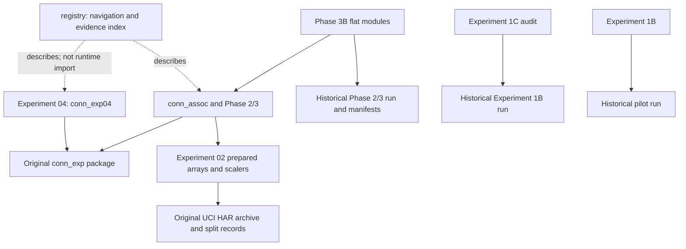

# Phase 3 dependency map

Verified 2026-11-22 against local workspace E:/CoNN; repository remote nu-ink/frank_h_torralva-conn, branch initial-repository, HEAD d06568ac87bf370eba627858a12997d88cf30208.

Evidence labels: **V** = verified source/file fact; **S** = static-analysis inference, with limits; **P** = architectural proposal; **U** = unresolved. No project module was imported, no checkpoint loaded, and no training, evaluation, research test, package installation or runtime framework creation was performed. Byte identity and AST similarity are not behavioral-equivalence claims.

Reports: [inventory](PHASE3_SOURCE_INVENTORY.md) | [dependencies](PHASE3_DEPENDENCY_MAP.md) | [compatibility](PHASE3_BEHAVIORAL_COMPATIBILITY.md) | [proposal](PHASE3_PROPOSED_ARCHITECTURE.md) | [risks](PHASE3_RISK_ASSESSMENT.md). Navigation foundation: [registry guide](../../registry/README.md).

## Method and scope

**V:** AST imports were extracted from all 708 project-owned Python files. The source inventory gives every occurrence and hash. This report catalogs statements once per distinct byte content (130 representatives). There are 5796 import statements across all copies. Imports inside functions and conditionals are included; a statement is not a runtime call graph. Relative-import levels and imported members are retained.

**S:** Candidate paths below are static possibilities. Resolution uses adjacent/snapshot package layout where present, then known working packages and Phase 3B flat modules. It does not execute package initialization, sys.path insertion, import hooks or branch conditions. A candidate file does not prove that Python selected it. External-or-unresolved includes third-party imports and possible names the heuristic cannot resolve; it is not a missing-package diagnosis. Installed libraries are excluded from architectural conclusions.

## Verified package and artifact relationships

The registry records 24 important edges and six data/provenance records in [registry/dependencies.yaml](../../registry/dependencies.yaml). Stored evidence hashes and excerpts were checked again. This diagram shows consumers pointing to dependencies; it is not a function execution graph.

| Consumer | Dependency | Mechanism | Evidence |
| --- | --- | --- | --- |
| [conn_experiment_01/src/conn_exp/experiment1b.py](../../conn_experiment_01/src/conn_exp/experiment1b.py) | [conn_experiment_01/results/runs/20261017T235839Z_pilot](../../conn_experiment_01/results/runs/20261017T235839Z_pilot) | historical_run_input: Fixed pilot path for preservation and configuration provenance. | [source statement](../../conn_experiment_01/src/conn_exp/experiment1b.py#L36) |
| [conn_experiment_01/src/conn_exp/experiment1c_audit.py](../../conn_experiment_01/src/conn_exp/experiment1c_audit.py) | [conn_experiment_01/results/runs/20261018T001947Z_experiment1b_v1](../../conn_experiment_01/results/runs/20261018T001947Z_experiment1b_v1) | historical_run_input: Audit reads saved Experiment 1B artifacts. | [source statement](../../conn_experiment_01/src/conn_exp/experiment1c_audit.py#L20) |
| [conn_experiment_01/src/conn_exp/experiment1c.py](../../conn_experiment_01/src/conn_exp/experiment1c.py) | [conn_experiment_01/src/conn_exp/experiment1b.py](../../conn_experiment_01/src/conn_exp/experiment1b.py) | python_import: Imports repository paths, sealing and manifest helpers. | [source statement](../../conn_experiment_01/src/conn_exp/experiment1c.py#L21) |
| [conn_experiment_01/src/conn_exp/experiment2.py](../../conn_experiment_01/src/conn_exp/experiment2.py) | [conn_experiment_01/src/conn_exp/experiment1b.py](../../conn_experiment_01/src/conn_exp/experiment1b.py) | python_import: HAR orchestration shares historical experiment helpers. | [source statement](../../conn_experiment_01/src/conn_exp/experiment2.py#L19) |
| [conn_experiment_01/src/conn_exp/experiment2.py](../../conn_experiment_01/src/conn_exp/experiment2.py) | [conn_experiment_01/src/conn_exp/har_core.py](../../conn_experiment_01/src/conn_exp/har_core.py) | python_import: HAR model/training and pairing primitives. | [source statement](../../conn_experiment_01/src/conn_exp/experiment2.py#L21) |
| [conn_experiment_01/src/conn_exp/har_data.py](../../conn_experiment_01/src/conn_exp/har_data.py) | [conn_experiment_01/data/raw/uci_har_original.zip](../../conn_experiment_01/data/raw/uci_har_original.zip) | raw_dataset_input: Raw UCI HAR archive path; no new download performed. | [source statement](../../conn_experiment_01/src/conn_exp/har_data.py#L184) |
| [CoNN_Associative_Relationships/src/conn_assoc/paths.py](../../CoNN_Associative_Relationships/src/conn_assoc/paths.py) | [conn_experiment_01](../../conn_experiment_01) | sibling_path: Resolves the original sibling project; moving directories changes this dependency. | [source statement](../../CoNN_Associative_Relationships/src/conn_assoc/paths.py#L14) |
| [CoNN_Associative_Relationships/src/conn_assoc/paths.py](../../CoNN_Associative_Relationships/src/conn_assoc/paths.py) | [conn_experiment_01/results/runs/20261019T004346Z_experiment2_har_v1](../../conn_experiment_01/results/runs/20261019T004346Z_experiment2_har_v1) | fixed_historical_run_path: Exact historical Experiment 02 identifier is embedded in the path helper. | [source statement](../../CoNN_Associative_Relationships/src/conn_assoc/paths.py#L18) |
| [CoNN_Associative_Relationships/src/conn_assoc/data.py](../../CoNN_Associative_Relationships/src/conn_assoc/data.py) | [conn_experiment_01/results/runs/20261019T004346Z_experiment2_har_v1/prepared](../../conn_experiment_01/results/runs/20261019T004346Z_experiment2_har_v1/prepared) | prepared_dataset_input: Reads the original engineered/temporal arrays and associated scalers. | [source statement](../../CoNN_Associative_Relationships/src/conn_assoc/data.py#L78) |
| [CoNN_Associative_Relationships/src/conn_assoc/data.py](../../CoNN_Associative_Relationships/src/conn_assoc/data.py) | [conn_experiment_01/data/raw/uci_har_original.zip](../../conn_experiment_01/data/raw/uci_har_original.zip) | raw_dataset_input: Accesses and verifies the archive through the original path helper. | [source statement](../../CoNN_Associative_Relationships/src/conn_assoc/data.py#L36) |
| [CoNN_Associative_Relationships/src/conn_assoc/phase23_core.py](../../CoNN_Associative_Relationships/src/conn_assoc/phase23_core.py) | [conn_experiment_01/src/conn_exp/har_core.py](../../conn_experiment_01/src/conn_exp/har_core.py) | python_import: Imports HARMLP, initial_state and paired_batches after original source-path insertion. | [source statement](../../CoNN_Associative_Relationships/src/conn_assoc/phase23_core.py#L25) |
| [CoNN_Associative_Relationships/src/conn_assoc/phase23_core.py](../../CoNN_Associative_Relationships/src/conn_assoc/phase23_core.py) | [conn_experiment_01/src/conn_exp/gates.py](../../conn_experiment_01/src/conn_exp/gates.py) | python_import: Imports historical mask generation. | [source statement](../../CoNN_Associative_Relationships/src/conn_assoc/phase23_core.py#L26) |
| [CoNN_Associative_Relationships/src/conn_assoc/phase3_context.py](../../CoNN_Associative_Relationships/src/conn_assoc/phase3_context.py) | [conn_experiment_01/src/conn_exp/har_core.py](../../conn_experiment_01/src/conn_exp/har_core.py) | python_import: Context model depends on the original HAR implementation. | [source statement](../../CoNN_Associative_Relationships/src/conn_assoc/phase3_context.py#L10) |
| [CoNN_Associative_Relationships/src/conn_assoc/phase23.py](../../CoNN_Associative_Relationships/src/conn_assoc/phase23.py) | [CoNN_Associative_Relationships/config/phase23_active_run.txt](../../CoNN_Associative_Relationships/config/phase23_active_run.txt) | configuration_reference: Reads a mutable active-run pointer; it is not a universal scientific authority. | [source statement](../../CoNN_Associative_Relationships/src/conn_assoc/phase23.py#L23) |
| [CoNN_Associative_Relationships/config/phase23_active_run.txt](../../CoNN_Associative_Relationships/config/phase23_active_run.txt) | [CoNN_Associative_Relationships/results/runs/20261019T030442340025Z_phase23_v1](../../CoNN_Associative_Relationships/results/runs/20261019T030442340025Z_phase23_v1) | active_run_pointer: Pointer currently names this run using an absolute Windows path. | [source statement](../../CoNN_Associative_Relationships/config/phase23_active_run.txt#L1) |
| [CoNN_Associative_Relationships/phase3b_context_diagnostics/src/models.py](../../CoNN_Associative_Relationships/phase3b_context_diagnostics/src/models.py) | [CoNN_Associative_Relationships/src/conn_assoc/phase3_context.py](../../CoNN_Associative_Relationships/src/conn_assoc/phase3_context.py) | python_import: Imports ContextFactor and mask_input from the parent implementation. | [source statement](../../CoNN_Associative_Relationships/phase3b_context_diagnostics/src/models.py#L11) |
| [CoNN_Associative_Relationships/phase3b_context_diagnostics/src/models.py](../../CoNN_Associative_Relationships/phase3b_context_diagnostics/src/models.py) | [CoNN_Associative_Relationships/src/conn_assoc/phase23_core.py](../../CoNN_Associative_Relationships/src/conn_assoc/phase23_core.py) | python_import: Imports gates, runtime setup, initialization and HARMLP. | [source statement](../../CoNN_Associative_Relationships/phase3b_context_diagnostics/src/models.py#L12) |
| [CoNN_Associative_Relationships/phase3b_context_diagnostics/src/preflight.py](../../CoNN_Associative_Relationships/phase3b_context_diagnostics/src/preflight.py) | [CoNN_Associative_Relationships/results/runs/20261019T030442340025Z_phase23_v1](../../CoNN_Associative_Relationships/results/runs/20261019T030442340025Z_phase23_v1) | historical_integrity_input: Verifies prior manifests and job artifacts rather than constituting a new independent study. | [source statement](../../CoNN_Associative_Relationships/phase3b_context_diagnostics/src/preflight.py#L16) |
| [CoNN_Associative_Relationships/phase3b_context_diagnostics/src/preflight.py](../../CoNN_Associative_Relationships/phase3b_context_diagnostics/src/preflight.py) | [CoNN_Associative_Relationships/src/conn_assoc/data.py](../../CoNN_Associative_Relationships/src/conn_assoc/data.py) | python_import: Uses original raw/prepared-data verification. | [source statement](../../CoNN_Associative_Relationships/phase3b_context_diagnostics/src/preflight.py#L13) |
| [experiments/experiment_04/src/conn_exp04/__init__.py](../../experiments/experiment_04/src/conn_exp04/__init__.py) | [conn_experiment_01/src](../../conn_experiment_01/src) | source_path_insertion: Root is inferred with parents[4]; existing conn_exp is imported without installation. | [source statement](../../experiments/experiment_04/src/conn_exp04/__init__.py#L7) |
| [experiments/experiment_04/src/conn_exp04/core.py](../../experiments/experiment_04/src/conn_exp04/core.py) | [conn_experiment_01/src/conn_exp/gates.py](../../conn_experiment_01/src/conn_exp/gates.py) | python_import: Reuses original gates primitives; historical semantics must be retained. | [source statement](../../experiments/experiment_04/src/conn_exp04/core.py#L12) |
| [experiments/experiment_04/src/conn_exp04/core.py](../../experiments/experiment_04/src/conn_exp04/core.py) | [conn_experiment_01/src/conn_exp/geometry.py](../../conn_experiment_01/src/conn_exp/geometry.py) | python_import: Reuses original geometry primitives; historical semantics must be retained. | [source statement](../../experiments/experiment_04/src/conn_exp04/core.py#L13) |
| [experiments/experiment_04/src/conn_exp04/core.py](../../experiments/experiment_04/src/conn_exp04/core.py) | [conn_experiment_01/src/conn_exp/models.py](../../conn_experiment_01/src/conn_exp/models.py) | python_import: Reuses original models primitives; historical semantics must be retained. | [source statement](../../experiments/experiment_04/src/conn_exp04/core.py#L14) |
| [experiments/experiment_04/src/conn_exp04/core.py](../../experiments/experiment_04/src/conn_exp04/core.py) | [conn_experiment_01/src/conn_exp/schedules.py](../../conn_experiment_01/src/conn_exp/schedules.py) | python_import: Reuses original schedules primitives; historical semantics must be retained. | [source statement](../../experiments/experiment_04/src/conn_exp04/core.py#L15) |

## Hidden coupling and portability findings

- **D01 — Filesystem layout is part of import behavior [V/S].** conn_assoc imports sibling conn_exp; Phase 3B inserts parent source; Experiment 04 infers the workspace with parents[4]. Installing one package does not isolate this closure. Evidence: [CoNN_Associative_Relationships/src/conn_assoc/phase23_core.py](../../CoNN_Associative_Relationships/src/conn_assoc/phase23_core.py#L24).
- **D02 — Scientific helpers depend on an orchestrator [V/S].** har_data imports path/sealing/hash helpers from experiment1b, which imports runner; runner imports plots. A future pure data layer should remove this indirect orchestration/reporting import chain. Evidence: [conn_experiment_01/src/conn_exp/har_data.py](../../conn_experiment_01/src/conn_exp/har_data.py#L14).
- **D03 — Historical run identities are implicit inputs [V/S].** Prepared arrays use the fixed Experiment 02 run. Experiment 1C audits fixed 1B artifacts; Phase 3B audits the fixed Phase 2/3 run. These are scientific inputs, not incidental paths. Evidence: [experiment2_run](../../CoNN_Associative_Relationships/src/conn_assoc/paths.py#L17).
- **D04 — Absolute active-run pointer selects state [V/S].** The CLI reads config/phase23_active_run.txt. The pointer currently names a historical run, but is not a universal protocol/source authority or portable identifier. Evidence: [active_run](../../CoNN_Associative_Relationships/src/conn_assoc/phase23.py#L23).
- **D05 — Flat module names depend on path order [V/S].** Bare common, models, verify, evaluation and reporting imports can collide with modules in a larger process. This is a static risk, not an observed collision. Evidence: [CoNN_Associative_Relationships/phase3b_context_diagnostics/src/training.py](../../CoNN_Associative_Relationships/phase3b_context_diagnostics/src/training.py#L1).
- **D06 — Dynamic reporting repair alters its module [V/S].** Recovery uses spec_from_file_location/exec_module, assigns module.ROOT and creates separately manifested sources with string substitutions. Preserve the repair lineage rather than fold it into an unversioned verifier. Evidence: [load](../../CoNN_Associative_Relationships/phase3b_context_diagnostics/scripts/recover_reporting_v2.py#L20).
- **D07 — Library imports change process configuration [V/S].** This environment variable is set at import. Recovery scripts also configure environment/stdout at top level. Future runtime services should own such effects explicitly. Evidence: [CoNN_Associative_Relationships/src/conn_assoc/phase23_core.py](../../CoNN_Associative_Relationships/src/conn_assoc/phase23_core.py#L14).
- **D08 — Snapshots are not self-contained launch roots [V/S].** Copied paths.py locates a sibling relative to its snapshot directory. Copied Phase 3B models.py derives PROJECT from the copied ROOT. Preserved bytes do not establish runnable isolation. Evidence: [experiment2_root](../../CoNN_Associative_Relationships/src/conn_assoc/paths.py#L13).
- **D09 — Dependency declarations lag imports [V/S].** Associative metadata declares torch/numpy/PyYAML but source imports conn_exp, pandas and matplotlib. Experiment 04 adds SciPy and psutil and lacks its own project metadata. Existing environments can mask gaps. Evidence: [CoNN_Associative_Relationships/pyproject.toml](../../CoNN_Associative_Relationships/pyproject.toml).
- **D10 — Verification can execute or write [V/S].** This verifier loads checkpoints and writes manifests. Phase 3B execute invokes pytest and a benchmark; preflight contains optimizer checks. None was run for this assessment. Evidence: [main](../../experiments/experiment_04/scripts/verify_artifacts.py#L14).

### Derived snapshot-path examples

**S, derived without launching copies:** In [CoNN_Associative_Relationships/results/runs/20261019T030442340025Z_phase23_v1/source/delivery/src/conn_assoc/paths.py](../../CoNN_Associative_Relationships/results/runs/20261019T030442340025Z_phase23_v1/source/delivery/src/conn_assoc/paths.py), the delivery copy would seek the sibling at CoNN_Associative_Relationships/results/runs/20261019T030442340025Z_phase23_v1/source/conn_experiment_01. In [CoNN_Associative_Relationships/phase3b_context_diagnostics/results/20261020_phase3b_v3_run01/source/src/models.py](../../CoNN_Associative_Relationships/phase3b_context_diagnostics/results/20261020_phase3b_v3_run01/source/src/models.py), PROJECT/src would be CoNN_Associative_Relationships/phase3b_context_diagnostics/results/20261020_phase3b_v3_run01/src. Neither inferred directory exists. External path injection could alter imports, so this is a layout finding, not a runtime failure result.

## Path manipulation, fixed run references and dynamic imports

Distinct source contents are listed once. Identical historical occurrences are mapped by the inventory hashes. Snippets are shortened for readability. References inside generated strings are candidates requiring source context, not proof of execution.

| Representative source | Line | Source excerpt |
| --- | ---: | --- |
| [AUDIT_20261020/Supporting_Evidence/independent_recalculation.py](../../AUDIT_20261020/Supporting_Evidence/independent_recalculation.py#L18) | 18 | OUT = ROOT / "AUDIT_20261020" / "Supporting_Evidence" |
| [AUDIT_20261020/Supporting_Evidence/independent_recalculation.py](../../AUDIT_20261020/Supporting_Evidence/independent_recalculation.py#L214) | 214 | skip_parts = {".venv", ".venv_cuda23", ".pip-cache23", ".pytest_cache", "__pycache__", "site-packages", "AUDIT_20261020"} |
| [AUDIT_20261020/Supporting_Evidence/independent_recalculation.py](../../AUDIT_20261020/Supporting_Evidence/independent_recalculation.py#L256) | 256 | pilot = read_csv(ROOT / "conn_experiment_01/results/runs/20261017T235839Z_pilot/scores.csv") |
| [AUDIT_20261020/Supporting_Evidence/independent_recalculation.py](../../AUDIT_20261020/Supporting_Evidence/independent_recalculation.py#L257) | 257 | rep_1b = read_csv(ROOT / "conn_experiment_01/results/runs/20261018T001947Z_experiment1b_v1/replication/scores.csv") |
| [AUDIT_20261020/Supporting_Evidence/independent_recalculation.py](../../AUDIT_20261020/Supporting_Evidence/independent_recalculation.py#L258) | 258 | rep_1c = read_csv(ROOT / "conn_experiment_01/results/runs/20261018T024146Z_experiment1c_v1/replication/scores.csv") |
| [AUDIT_20261020/Supporting_Evidence/independent_recalculation.py](../../AUDIT_20261020/Supporting_Evidence/independent_recalculation.py#L259) | 259 | rep_2 = read_csv(ROOT / "conn_experiment_01/results/runs/20261019T004346Z_experiment2_har_v1/replication/scores.csv") |
| [AUDIT_20261020/Supporting_Evidence/independent_recalculation.py](../../AUDIT_20261020/Supporting_Evidence/independent_recalculation.py#L260) | 260 | tune_2 = read_csv(ROOT / "conn_experiment_01/results/runs/20261019T004346Z_experiment2_har_v1/tuning/scores.csv") |
| [AUDIT_20261020/Supporting_Evidence/independent_recalculation.py](../../AUDIT_20261020/Supporting_Evidence/independent_recalculation.py#L261) | 261 | phase_seeds = read_csv(ROOT / "CoNN_Associative_Relationships/results/runs/20261019T030442340025Z_phase23_v1/analysis/selected_seed_scores.csv") |
| [AUDIT_20261020/Supporting_Evidence/independent_recalculation.py](../../AUDIT_20261020/Supporting_Evidence/independent_recalculation.py#L262) | 262 | phase_seed_deltas = read_csv(ROOT / "CoNN_Associative_Relationships/results/runs/20261019T030442340025Z_phase23_v1/analysis/individual_seed_differences.csv") |
| [AUDIT_20261020/Supporting_Evidence/independent_recalculation.py](../../AUDIT_20261020/Supporting_Evidence/independent_recalculation.py#L263) | 263 | p3_subjects = read_csv(ROOT / "CoNN_Associative_Relationships/phase3b_context_diagnostics/results/20261020_phase3b_v3_run01/analysis/subject_differences.csv") |
| [AUDIT_20261020/Supporting_Evidence/independent_recalculation.py](../../AUDIT_20261020/Supporting_Evidence/independent_recalculation.py#L264) | 264 | p3_seeds = read_csv(ROOT / "CoNN_Associative_Relationships/phase3b_context_diagnostics/results/20261020_phase3b_v3_run01/analysis/seed_differences.csv") |
| [AUDIT_20261020/Supporting_Evidence/independent_recalculation.py](../../AUDIT_20261020/Supporting_Evidence/independent_recalculation.py#L362) | 362 | ROOT / "CoNN_Associative_Relationships/phase3b_context_diagnostics/results/20261020_phase3b_v3_run01/reports/PHASE3B_FINAL_REPORT.md", |
| [AUDIT_20261020/Supporting_Evidence/independent_recalculation.py](../../AUDIT_20261020/Supporting_Evidence/independent_recalculation.py#L363) | 363 | ROOT / "CoNN_Associative_Relationships/phase3b_context_diagnostics/results/20261020_phase3b_v3_run01/research_report.md", |
| [CoNN_Associative_Relationships/phase3b_context_diagnostics/protocol_reviews/20261020_reference_reconciliation/verify_review.py](../../CoNN_Associative_Relationships/phase3b_context_diagnostics/protocol_reviews/20261020_reference_reconciliation/verify_review.py#L9) | 9 | RUN = ROOT / 'results/20261020_phase3b_v3_run01' |
| [CoNN_Associative_Relationships/phase3b_context_diagnostics/protocol_versions/phase3b_v3_1_20261020/verify_and_seal.py](../../CoNN_Associative_Relationships/phase3b_context_diagnostics/protocol_versions/phase3b_v3_1_20261020/verify_and_seal.py#L9) | 9 | REVIEW = ROOT / 'protocol_reviews/20261020_reference_reconciliation' |
| [CoNN_Associative_Relationships/phase3b_context_diagnostics/protocol_versions/phase3b_v3_1_20261020/verify_and_seal.py](../../CoNN_Associative_Relationships/phase3b_context_diagnostics/protocol_versions/phase3b_v3_1_20261020/verify_and_seal.py#L10) | 10 | RUN = ROOT / 'results/20261020_phase3b_v3_run01' |
| [CoNN_Associative_Relationships/phase3b_context_diagnostics/results/20261020_phase3b_v3_run01/execution_extensions/final_qa_recovery_v1/final_qa.py](../../CoNN_Associative_Relationships/phase3b_context_diagnostics/results/20261020_phase3b_v3_run01/execution_extensions/final_qa_recovery_v1/final_qa.py#L6) | 6 | ROOT=Path('E:\\CoNN\\CoNN_Associative_Relationships\\phase3b_context_diagnostics') |
| [CoNN_Associative_Relationships/phase3b_context_diagnostics/results/20261020_phase3b_v3_run01/execution_extensions/final_qa_recovery_v1/final_qa.py](../../CoNN_Associative_Relationships/phase3b_context_diagnostics/results/20261020_phase3b_v3_run01/execution_extensions/final_qa_recovery_v1/final_qa.py#L7) | 7 | sys.path.insert(0,str(ROOT/'src')) |
| [CoNN_Associative_Relationships/phase3b_context_diagnostics/results/20261020_phase3b_v3_run01/execution_extensions/final_qa_recovery_v1/final_qa.py](../../CoNN_Associative_Relationships/phase3b_context_diagnostics/results/20261020_phase3b_v3_run01/execution_extensions/final_qa_recovery_v1/final_qa.py#L16) | 16 | run=ROOT/'results/20261020_phase3b_v3_run01' |
| [CoNN_Associative_Relationships/phase3b_context_diagnostics/results/20261020_phase3b_v3_run01/execution_extensions/final_qa_recovery_v1/final_qa.py](../../CoNN_Associative_Relationships/phase3b_context_diagnostics/results/20261020_phase3b_v3_run01/execution_extensions/final_qa_recovery_v1/final_qa.py#L92) | 92 | run=ROOT/'results/20261020_phase3b_v3_run01' |
| [CoNN_Associative_Relationships/phase3b_context_diagnostics/results/20261020_phase3b_v3_run01/execution_extensions/recovery_analysis_v1/code/forward_rank_sensitivity.py](../../CoNN_Associative_Relationships/phase3b_context_diagnostics/results/20261020_phase3b_v3_run01/execution_extensions/recovery_analysis_v1/code/forward_rank_sensitivity.py#L6) | 6 | ROOT=Path('E:\\CoNN\\CoNN_Associative_Relationships\\phase3b_context_diagnostics') |
| [CoNN_Associative_Relationships/phase3b_context_diagnostics/results/20261020_phase3b_v3_run01/execution_extensions/recovery_analysis_v1/code/forward_rank_sensitivity.py](../../CoNN_Associative_Relationships/phase3b_context_diagnostics/results/20261020_phase3b_v3_run01/execution_extensions/recovery_analysis_v1/code/forward_rank_sensitivity.py#L7) | 7 | sys.path.insert(0,str(ROOT/'src')) |
| [CoNN_Associative_Relationships/phase3b_context_diagnostics/results/20261020_phase3b_v3_run01/execution_extensions/recovery_analysis_v1/code/forward_rank_sensitivity.py](../../CoNN_Associative_Relationships/phase3b_context_diagnostics/results/20261020_phase3b_v3_run01/execution_extensions/recovery_analysis_v1/code/forward_rank_sensitivity.py#L16) | 16 | run=ROOT/'results/20261020_phase3b_v3_run01' |
| [CoNN_Associative_Relationships/phase3b_context_diagnostics/results/20261020_phase3b_v3_run01/execution_extensions/recovery_analysis_v1/code/forward_rank_sensitivity.py](../../CoNN_Associative_Relationships/phase3b_context_diagnostics/results/20261020_phase3b_v3_run01/execution_extensions/recovery_analysis_v1/code/forward_rank_sensitivity.py#L72) | 72 | run=ROOT/'results/20261020_phase3b_v3_run01' |
| [CoNN_Associative_Relationships/phase3b_context_diagnostics/results/20261020_phase3b_v3_run01/execution_extensions/recovery_analysis_v1/code/measured_summary.py](../../CoNN_Associative_Relationships/phase3b_context_diagnostics/results/20261020_phase3b_v3_run01/execution_extensions/recovery_analysis_v1/code/measured_summary.py#L6) | 6 | ROOT=Path('E:\\CoNN\\CoNN_Associative_Relationships\\phase3b_context_diagnostics') |
| [CoNN_Associative_Relationships/phase3b_context_diagnostics/results/20261020_phase3b_v3_run01/execution_extensions/recovery_analysis_v1/code/measured_summary.py](../../CoNN_Associative_Relationships/phase3b_context_diagnostics/results/20261020_phase3b_v3_run01/execution_extensions/recovery_analysis_v1/code/measured_summary.py#L7) | 7 | sys.path.insert(0,str(ROOT/'src')) |
| [CoNN_Associative_Relationships/phase3b_context_diagnostics/results/20261020_phase3b_v3_run01/execution_extensions/recovery_analysis_v1/code/measured_summary.py](../../CoNN_Associative_Relationships/phase3b_context_diagnostics/results/20261020_phase3b_v3_run01/execution_extensions/recovery_analysis_v1/code/measured_summary.py#L48) | 48 | run=ROOT/'results/20261020_phase3b_v3_run01' |
| [CoNN_Associative_Relationships/phase3b_context_diagnostics/results/20261020_phase3b_v3_run01/execution_extensions/recovery_analysis_v1/code/measured_summary.py](../../CoNN_Associative_Relationships/phase3b_context_diagnostics/results/20261020_phase3b_v3_run01/execution_extensions/recovery_analysis_v1/code/measured_summary.py#L213) | 213 | text+='From E:\\CoNN, set PYTHONDONTWRITEBYTECODE=1and use `CoNN_Associative_Relationships\\.venv_cuda23\\Scripts\\python.exe CoNN_Associative_Relationships\\phase3b_context_diagnostics\\scripts\\run.py verify`to rescore saved predictions i |
| [CoNN_Associative_Relationships/phase3b_context_diagnostics/results/20261020_phase3b_v3_run01/execution_extensions/recovery_analysis_v1/code/reporting_json_native.py](../../CoNN_Associative_Relationships/phase3b_context_diagnostics/results/20261020_phase3b_v3_run01/execution_extensions/recovery_analysis_v1/code/reporting_json_native.py#L206) | 206 | text+='Commands (from E:\\CoNN, PYTHONDONTWRITEBYTECODE=1): use the isolated `.venv_cuda23\\Scripts\\python.exe` with `phase3b_context_diagnostics\\scripts\\run.py preflight`, `execute` (also resume), `verify`, `report`. Read README.md for  |
| [CoNN_Associative_Relationships/phase3b_context_diagnostics/results/20261020_phase3b_v3_run01/execution_extensions/recovery_analysis_v2/code/forward_rank_sensitivity.py](../../CoNN_Associative_Relationships/phase3b_context_diagnostics/results/20261020_phase3b_v3_run01/execution_extensions/recovery_analysis_v2/code/forward_rank_sensitivity.py#L6) | 6 | ROOT=Path('E:\\CoNN\\CoNN_Associative_Relationships\\phase3b_context_diagnostics') |
| [CoNN_Associative_Relationships/phase3b_context_diagnostics/results/20261020_phase3b_v3_run01/execution_extensions/recovery_analysis_v2/code/forward_rank_sensitivity.py](../../CoNN_Associative_Relationships/phase3b_context_diagnostics/results/20261020_phase3b_v3_run01/execution_extensions/recovery_analysis_v2/code/forward_rank_sensitivity.py#L7) | 7 | sys.path.insert(0,str(ROOT/'src')) |
| [CoNN_Associative_Relationships/phase3b_context_diagnostics/results/20261020_phase3b_v3_run01/execution_extensions/recovery_analysis_v2/code/forward_rank_sensitivity.py](../../CoNN_Associative_Relationships/phase3b_context_diagnostics/results/20261020_phase3b_v3_run01/execution_extensions/recovery_analysis_v2/code/forward_rank_sensitivity.py#L16) | 16 | run=ROOT/'results/20261020_phase3b_v3_run01' |
| [CoNN_Associative_Relationships/phase3b_context_diagnostics/results/20261020_phase3b_v3_run01/execution_extensions/recovery_analysis_v2/code/forward_rank_sensitivity.py](../../CoNN_Associative_Relationships/phase3b_context_diagnostics/results/20261020_phase3b_v3_run01/execution_extensions/recovery_analysis_v2/code/forward_rank_sensitivity.py#L72) | 72 | run=ROOT/'results/20261020_phase3b_v3_run01' |
| [CoNN_Associative_Relationships/phase3b_context_diagnostics/results/20261020_phase3b_v3_run01/execution_extensions/recovery_analysis_v2/code/measured_summary.py](../../CoNN_Associative_Relationships/phase3b_context_diagnostics/results/20261020_phase3b_v3_run01/execution_extensions/recovery_analysis_v2/code/measured_summary.py#L6) | 6 | ROOT=Path('E:\\CoNN\\CoNN_Associative_Relationships\\phase3b_context_diagnostics') |
| [CoNN_Associative_Relationships/phase3b_context_diagnostics/results/20261020_phase3b_v3_run01/execution_extensions/recovery_analysis_v2/code/measured_summary.py](../../CoNN_Associative_Relationships/phase3b_context_diagnostics/results/20261020_phase3b_v3_run01/execution_extensions/recovery_analysis_v2/code/measured_summary.py#L7) | 7 | sys.path.insert(0,str(ROOT/'src')) |
| [CoNN_Associative_Relationships/phase3b_context_diagnostics/results/20261020_phase3b_v3_run01/execution_extensions/recovery_analysis_v2/code/measured_summary.py](../../CoNN_Associative_Relationships/phase3b_context_diagnostics/results/20261020_phase3b_v3_run01/execution_extensions/recovery_analysis_v2/code/measured_summary.py#L48) | 48 | run=ROOT/'results/20261020_phase3b_v3_run01' |
| [CoNN_Associative_Relationships/phase3b_context_diagnostics/results/20261020_phase3b_v3_run01/execution_extensions/recovery_analysis_v2/code/measured_summary.py](../../CoNN_Associative_Relationships/phase3b_context_diagnostics/results/20261020_phase3b_v3_run01/execution_extensions/recovery_analysis_v2/code/measured_summary.py#L213) | 213 | text+='From E:\\CoNN, set PYTHONDONTWRITEBYTECODE=1and use `CoNN_Associative_Relationships\\.venv_cuda23\\Scripts\\python.exe CoNN_Associative_Relationships\\phase3b_context_diagnostics\\scripts\\run.py verify`to rescore saved predictions i |
| [CoNN_Associative_Relationships/phase3b_context_diagnostics/scripts/consolidate_protocol_v3_1.py](../../CoNN_Associative_Relationships/phase3b_context_diagnostics/scripts/consolidate_protocol_v3_1.py#L8) | 8 | REVIEW = ROOT / 'protocol_reviews/20261020_reference_reconciliation' |
| [CoNN_Associative_Relationships/phase3b_context_diagnostics/scripts/consolidate_protocol_v3_1.py](../../CoNN_Associative_Relationships/phase3b_context_diagnostics/scripts/consolidate_protocol_v3_1.py#L9) | 9 | DEST = ROOT / 'protocol_versions/phase3b_v3_1_20261020' |
| [CoNN_Associative_Relationships/phase3b_context_diagnostics/scripts/consolidate_protocol_v3_1.py](../../CoNN_Associative_Relationships/phase3b_context_diagnostics/scripts/consolidate_protocol_v3_1.py#L10) | 10 | RUN = ROOT / 'results/20261020_phase3b_v3_run01' |
| [CoNN_Associative_Relationships/phase3b_context_diagnostics/scripts/delivery_review.py](../../CoNN_Associative_Relationships/phase3b_context_diagnostics/scripts/delivery_review.py#L7) | 7 | ROOT=Path(__file__).resolve().parents[1] |
| [CoNN_Associative_Relationships/phase3b_context_diagnostics/scripts/delivery_review.py](../../CoNN_Associative_Relationships/phase3b_context_diagnostics/scripts/delivery_review.py#L8) | 8 | sys.path.insert(0,str(ROOT/'src')) |
| [CoNN_Associative_Relationships/phase3b_context_diagnostics/scripts/delivery_review.py](../../CoNN_Associative_Relationships/phase3b_context_diagnostics/scripts/delivery_review.py#L28) | 28 | run=ROOT/'results/20261020_phase3b_v3_run01';ext=run/'execution_extensions/delivery_review_v1' |
| [CoNN_Associative_Relationships/phase3b_context_diagnostics/scripts/delivery_review.py](../../CoNN_Associative_Relationships/phase3b_context_diagnostics/scripts/delivery_review.py#L89) | 89 | run=ROOT/'results/20261020_phase3b_v3_run01' |
| [CoNN_Associative_Relationships/phase3b_context_diagnostics/scripts/delivery_review_v2.py](../../CoNN_Associative_Relationships/phase3b_context_diagnostics/scripts/delivery_review_v2.py#L7) | 7 | ROOT=Path(__file__).resolve().parents[1] |
| [CoNN_Associative_Relationships/phase3b_context_diagnostics/scripts/delivery_review_v2.py](../../CoNN_Associative_Relationships/phase3b_context_diagnostics/scripts/delivery_review_v2.py#L8) | 8 | sys.path.insert(0,str(ROOT/'src')) |
| [CoNN_Associative_Relationships/phase3b_context_diagnostics/scripts/delivery_review_v2.py](../../CoNN_Associative_Relationships/phase3b_context_diagnostics/scripts/delivery_review_v2.py#L28) | 28 | run=ROOT/'results/20261020_phase3b_v3_run01';ext=run/'execution_extensions/delivery_review_v2' |
| [CoNN_Associative_Relationships/phase3b_context_diagnostics/scripts/delivery_review_v2.py](../../CoNN_Associative_Relationships/phase3b_context_diagnostics/scripts/delivery_review_v2.py#L89) | 89 | run=ROOT/'results/20261020_phase3b_v3_run01' |
| [CoNN_Associative_Relationships/phase3b_context_diagnostics/scripts/final_qa.py](../../CoNN_Associative_Relationships/phase3b_context_diagnostics/scripts/final_qa.py#L6) | 6 | ROOT=Path(__file__).resolve().parents[1] |
| [CoNN_Associative_Relationships/phase3b_context_diagnostics/scripts/final_qa.py](../../CoNN_Associative_Relationships/phase3b_context_diagnostics/scripts/final_qa.py#L7) | 7 | sys.path.insert(0,str(ROOT/'src')) |
| [CoNN_Associative_Relationships/phase3b_context_diagnostics/scripts/final_qa.py](../../CoNN_Associative_Relationships/phase3b_context_diagnostics/scripts/final_qa.py#L16) | 16 | run=ROOT/'results/20261020_phase3b_v3_run01' |
| [CoNN_Associative_Relationships/phase3b_context_diagnostics/scripts/final_qa.py](../../CoNN_Associative_Relationships/phase3b_context_diagnostics/scripts/final_qa.py#L92) | 92 | run=ROOT/'results/20261020_phase3b_v3_run01' |
| [CoNN_Associative_Relationships/phase3b_context_diagnostics/scripts/finalize_analysis.py](../../CoNN_Associative_Relationships/phase3b_context_diagnostics/scripts/finalize_analysis.py#L12) | 12 | ROOT=Path(__file__).resolve().parents[1] |
| [CoNN_Associative_Relationships/phase3b_context_diagnostics/scripts/finalize_analysis.py](../../CoNN_Associative_Relationships/phase3b_context_diagnostics/scripts/finalize_analysis.py#L13) | 13 | sys.path.insert(0,str(ROOT/'src')) |
| [CoNN_Associative_Relationships/phase3b_context_diagnostics/scripts/finalize_analysis.py](../../CoNN_Associative_Relationships/phase3b_context_diagnostics/scripts/finalize_analysis.py#L30) | 30 | run=ROOT/'results/20261020_phase3b_v3_run01' |
| [CoNN_Associative_Relationships/phase3b_context_diagnostics/scripts/finalize_when_ready.py](../../CoNN_Associative_Relationships/phase3b_context_diagnostics/scripts/finalize_when_ready.py#L9) | 9 | ROOT=Path(__file__).resolve().parents[1] |
| [CoNN_Associative_Relationships/phase3b_context_diagnostics/scripts/finalize_when_ready.py](../../CoNN_Associative_Relationships/phase3b_context_diagnostics/scripts/finalize_when_ready.py#L10) | 10 | sys.path.insert(0,str(ROOT/'src')) |
| [CoNN_Associative_Relationships/phase3b_context_diagnostics/scripts/finalize_when_ready.py](../../CoNN_Associative_Relationships/phase3b_context_diagnostics/scripts/finalize_when_ready.py#L14) | 14 | run=ROOT/'results/20261020_phase3b_v3_run01' |
| [CoNN_Associative_Relationships/phase3b_context_diagnostics/scripts/finalize_when_ready.py](../../CoNN_Associative_Relationships/phase3b_context_diagnostics/scripts/finalize_when_ready.py#L41) | 41 | run=ROOT/'results/20261020_phase3b_v3_run01' |
| [CoNN_Associative_Relationships/phase3b_context_diagnostics/scripts/forward_rank_sensitivity.py](../../CoNN_Associative_Relationships/phase3b_context_diagnostics/scripts/forward_rank_sensitivity.py#L6) | 6 | ROOT=Path(__file__).resolve().parents[1] |
| [CoNN_Associative_Relationships/phase3b_context_diagnostics/scripts/forward_rank_sensitivity.py](../../CoNN_Associative_Relationships/phase3b_context_diagnostics/scripts/forward_rank_sensitivity.py#L7) | 7 | sys.path.insert(0,str(ROOT/'src')) |
| [CoNN_Associative_Relationships/phase3b_context_diagnostics/scripts/forward_rank_sensitivity.py](../../CoNN_Associative_Relationships/phase3b_context_diagnostics/scripts/forward_rank_sensitivity.py#L16) | 16 | run=ROOT/'results/20261020_phase3b_v3_run01' |
| [CoNN_Associative_Relationships/phase3b_context_diagnostics/scripts/forward_rank_sensitivity.py](../../CoNN_Associative_Relationships/phase3b_context_diagnostics/scripts/forward_rank_sensitivity.py#L72) | 72 | run=ROOT/'results/20261020_phase3b_v3_run01' |
| [CoNN_Associative_Relationships/phase3b_context_diagnostics/scripts/measured_summary.py](../../CoNN_Associative_Relationships/phase3b_context_diagnostics/scripts/measured_summary.py#L6) | 6 | ROOT=Path(__file__).resolve().parents[1] |
| [CoNN_Associative_Relationships/phase3b_context_diagnostics/scripts/measured_summary.py](../../CoNN_Associative_Relationships/phase3b_context_diagnostics/scripts/measured_summary.py#L7) | 7 | sys.path.insert(0,str(ROOT/'src')) |
| [CoNN_Associative_Relationships/phase3b_context_diagnostics/scripts/measured_summary.py](../../CoNN_Associative_Relationships/phase3b_context_diagnostics/scripts/measured_summary.py#L48) | 48 | run=ROOT/'results/20261020_phase3b_v3_run01' |
| [CoNN_Associative_Relationships/phase3b_context_diagnostics/scripts/measured_summary.py](../../CoNN_Associative_Relationships/phase3b_context_diagnostics/scripts/measured_summary.py#L213) | 213 | text+='From E:\\CoNN, set PYTHONDONTWRITEBYTECODE=1and use `CoNN_Associative_Relationships\\.venv_cuda23\\Scripts\\python.exe CoNN_Associative_Relationships\\phase3b_context_diagnostics\\scripts\\run.py verify`to rescore saved predictions i |
| [CoNN_Associative_Relationships/phase3b_context_diagnostics/scripts/parallel_tail.py](../../CoNN_Associative_Relationships/phase3b_context_diagnostics/scripts/parallel_tail.py#L9) | 9 | os.environ.setdefault('CUBLAS_WORKSPACE_CONFIG',':4096:8') |
| [CoNN_Associative_Relationships/phase3b_context_diagnostics/scripts/parallel_tail.py](../../CoNN_Associative_Relationships/phase3b_context_diagnostics/scripts/parallel_tail.py#L12) | 12 | ROOT=Path(__file__).resolve().parents[1] |
| [CoNN_Associative_Relationships/phase3b_context_diagnostics/scripts/parallel_tail.py](../../CoNN_Associative_Relationships/phase3b_context_diagnostics/scripts/parallel_tail.py#L13) | 13 | sys.path.insert(0,str(ROOT/'src')) |
| [CoNN_Associative_Relationships/phase3b_context_diagnostics/scripts/parallel_tail.py](../../CoNN_Associative_Relationships/phase3b_context_diagnostics/scripts/parallel_tail.py#L25) | 25 | run=ROOT/'results/20261020_phase3b_v3_run01' |
| [CoNN_Associative_Relationships/phase3b_context_diagnostics/scripts/recover_reporting.py](../../CoNN_Associative_Relationships/phase3b_context_diagnostics/scripts/recover_reporting.py#L10) | 10 | ROOT=Path(__file__).resolve().parents[1] |
| [CoNN_Associative_Relationships/phase3b_context_diagnostics/scripts/recover_reporting.py](../../CoNN_Associative_Relationships/phase3b_context_diagnostics/scripts/recover_reporting.py#L11) | 11 | sys.path.insert(0,str(ROOT/'src')) |
| [CoNN_Associative_Relationships/phase3b_context_diagnostics/scripts/recover_reporting.py](../../CoNN_Associative_Relationships/phase3b_context_diagnostics/scripts/recover_reporting.py#L19) | 19 | spec=importlib.util.spec_from_file_location(name,path);module=importlib.util.module_from_spec(spec);spec.loader.exec_module(module) |
| [CoNN_Associative_Relationships/phase3b_context_diagnostics/scripts/recover_reporting.py](../../CoNN_Associative_Relationships/phase3b_context_diagnostics/scripts/recover_reporting.py#L24) | 24 | run=ROOT/'results/20261020_phase3b_v3_run01';repair=run/'execution_extensions/recovery_analysis_v1' |
| [CoNN_Associative_Relationships/phase3b_context_diagnostics/scripts/recover_reporting.py](../../CoNN_Associative_Relationships/phase3b_context_diagnostics/scripts/recover_reporting.py#L50) | 50 | source=source.replace('ROOT=Path(__file__).resolve().parents[1]',f'ROOT=Path({str(ROOT)!r})') |
| [CoNN_Associative_Relationships/phase3b_context_diagnostics/scripts/recover_reporting.py](../../CoNN_Associative_Relationships/phase3b_context_diagnostics/scripts/recover_reporting.py#L100) | 100 | run=ROOT/'results/20261020_phase3b_v3_run01' |
| [CoNN_Associative_Relationships/phase3b_context_diagnostics/scripts/recover_reporting_v2.py](../../CoNN_Associative_Relationships/phase3b_context_diagnostics/scripts/recover_reporting_v2.py#L12) | 12 | ROOT=Path(__file__).resolve().parents[1] |
| [CoNN_Associative_Relationships/phase3b_context_diagnostics/scripts/recover_reporting_v2.py](../../CoNN_Associative_Relationships/phase3b_context_diagnostics/scripts/recover_reporting_v2.py#L13) | 13 | sys.path.insert(0,str(ROOT/'src')) |
| [CoNN_Associative_Relationships/phase3b_context_diagnostics/scripts/recover_reporting_v2.py](../../CoNN_Associative_Relationships/phase3b_context_diagnostics/scripts/recover_reporting_v2.py#L21) | 21 | spec=importlib.util.spec_from_file_location(name,path);module=importlib.util.module_from_spec(spec);spec.loader.exec_module(module) |
| [CoNN_Associative_Relationships/phase3b_context_diagnostics/scripts/recover_reporting_v2.py](../../CoNN_Associative_Relationships/phase3b_context_diagnostics/scripts/recover_reporting_v2.py#L26) | 26 | run=ROOT/'results/20261020_phase3b_v3_run01';repair=run/'execution_extensions/recovery_analysis_v2' |
| [CoNN_Associative_Relationships/phase3b_context_diagnostics/scripts/recover_reporting_v2.py](../../CoNN_Associative_Relationships/phase3b_context_diagnostics/scripts/recover_reporting_v2.py#L52) | 52 | source=source.replace('ROOT=Path(__file__).resolve().parents[1]',f'ROOT=Path({str(ROOT)!r})') |
| [CoNN_Associative_Relationships/phase3b_context_diagnostics/scripts/recover_reporting_v2.py](../../CoNN_Associative_Relationships/phase3b_context_diagnostics/scripts/recover_reporting_v2.py#L103) | 103 | run=ROOT/'results/20261020_phase3b_v3_run01' |
| [CoNN_Associative_Relationships/phase3b_context_diagnostics/scripts/run.py](../../CoNN_Associative_Relationships/phase3b_context_diagnostics/scripts/run.py#L4) | 4 | os.environ.setdefault('CUBLAS_WORKSPACE_CONFIG',':4096:8') |
| [CoNN_Associative_Relationships/phase3b_context_diagnostics/scripts/run.py](../../CoNN_Associative_Relationships/phase3b_context_diagnostics/scripts/run.py#L7) | 7 | ROOT=Path(__file__).resolve().parents[1] |
| [CoNN_Associative_Relationships/phase3b_context_diagnostics/scripts/run.py](../../CoNN_Associative_Relationships/phase3b_context_diagnostics/scripts/run.py#L8) | 8 | sys.path.insert(0,str(ROOT/'src')) |
| [CoNN_Associative_Relationships/phase3b_context_diagnostics/scripts/run.py](../../CoNN_Associative_Relationships/phase3b_context_diagnostics/scripts/run.py#L13) | 13 | p=argparse.ArgumentParser();p.add_argument('stage',choices=['preflight','execute','verify','report']);p.add_argument('--run',default='20261020_phase3b_v3_run01') |
| [CoNN_Associative_Relationships/phase3b_context_diagnostics/src/models.py](../../CoNN_Associative_Relationships/phase3b_context_diagnostics/src/models.py#L8) | 8 | ROOT = Path(__file__).resolve().parents[1] |
| [CoNN_Associative_Relationships/phase3b_context_diagnostics/src/models.py](../../CoNN_Associative_Relationships/phase3b_context_diagnostics/src/models.py#L10) | 10 | sys.path.insert(0, str(PROJECT / 'src')) |
| [CoNN_Associative_Relationships/phase3b_context_diagnostics/src/preflight.py](../../CoNN_Associative_Relationships/phase3b_context_diagnostics/src/preflight.py#L16) | 16 | OLD=PROJECT/'results/runs/20261019T030442340025Z_phase23_v1' |
| [CoNN_Associative_Relationships/phase3b_context_diagnostics/src/reporting.py](../../CoNN_Associative_Relationships/phase3b_context_diagnostics/src/reporting.py#L206) | 206 | text+='Commands (from E:\\CoNN, PYTHONDONTWRITEBYTECODE=1): use the isolated `.venv_cuda23\\Scripts\\python.exe` with `phase3b_context_diagnostics\\scripts\\run.py preflight`, `execute` (also resume), `verify`, `report`. Read README.md for  |
| [CoNN_Associative_Relationships/phase3b_context_diagnostics/src/training.py](../../CoNN_Associative_Relationships/phase3b_context_diagnostics/src/training.py#L199) | 199 | 'base_initial_fingerprint':base_initial,'batch_sha256':__import__('hashlib').sha256(batches.tobytes()).hexdigest(), |
| [CoNN_Associative_Relationships/phase3b_context_diagnostics/src/training.py](../../CoNN_Associative_Relationships/phase3b_context_diagnostics/src/training.py#L200) | 200 | 'mask_sha256':__import__('hashlib').sha256(masks.tobytes()).hexdigest(), |
| [CoNN_Associative_Relationships/phase3b_context_diagnostics/tests/test_phase3b.py](../../CoNN_Associative_Relationships/phase3b_context_diagnostics/tests/test_phase3b.py#L3) | 3 | sys.path.insert(0,str(Path(__file__).resolve().parents[1]/'src')) |
| [CoNN_Associative_Relationships/results/runs/20261019T024525616341Z_audit_recovery_v1/original_snapshot/scripts/audit_recovery.py](../../CoNN_Associative_Relationships/results/runs/20261019T024525616341Z_audit_recovery_v1/original_snapshot/scripts/audit_recovery.py#L21) | 21 | ROOT = Path(__file__).resolve().parents[1] |
| [CoNN_Associative_Relationships/results/runs/20261019T024525616341Z_audit_recovery_v1/original_snapshot/scripts/audit_recovery.py](../../CoNN_Associative_Relationships/results/runs/20261019T024525616341Z_audit_recovery_v1/original_snapshot/scripts/audit_recovery.py#L22) | 22 | sys.path.insert(0, str(ROOT / "src")) |
| [CoNN_Associative_Relationships/results/runs/20261019T024525616341Z_audit_recovery_v1/original_snapshot/scripts/audit_recovery.py](../../CoNN_Associative_Relationships/results/runs/20261019T024525616341Z_audit_recovery_v1/original_snapshot/scripts/audit_recovery.py#L24) | 24 | OLD_RUN = OLD / "results/runs/20261019T004346Z_experiment2_har_v1" |
| [CoNN_Associative_Relationships/results/runs/20261019T024525616341Z_audit_recovery_v1/original_snapshot/scripts/inspect.py](../../CoNN_Associative_Relationships/results/runs/20261019T024525616341Z_audit_recovery_v1/original_snapshot/scripts/inspect.py#L8) | 8 | sys.path.insert(0, str(Path(__file__).resolve().parents[1] / "src")) |
| [CoNN_Associative_Relationships/results/runs/20261019T024619338011Z_audit_recovery_v1/original_snapshot/scripts/audit_recovery.py](../../CoNN_Associative_Relationships/results/runs/20261019T024619338011Z_audit_recovery_v1/original_snapshot/scripts/audit_recovery.py#L21) | 21 | ROOT = Path(__file__).resolve().parents[1] |
| [CoNN_Associative_Relationships/results/runs/20261019T024619338011Z_audit_recovery_v1/original_snapshot/scripts/audit_recovery.py](../../CoNN_Associative_Relationships/results/runs/20261019T024619338011Z_audit_recovery_v1/original_snapshot/scripts/audit_recovery.py#L23) | 23 | sys.path.insert(0, str(ROOT / "src")) |
| [CoNN_Associative_Relationships/results/runs/20261019T024619338011Z_audit_recovery_v1/original_snapshot/scripts/audit_recovery.py](../../CoNN_Associative_Relationships/results/runs/20261019T024619338011Z_audit_recovery_v1/original_snapshot/scripts/audit_recovery.py#L25) | 25 | OLD_RUN = OLD / "results/runs/20261019T004346Z_experiment2_har_v1" |
| [CoNN_Associative_Relationships/results/runs/20261019T030442340025Z_phase23_v1/source/analysis_ready/scripts/phase23_finalize.py](../../CoNN_Associative_Relationships/results/runs/20261019T030442340025Z_phase23_v1/source/analysis_ready/scripts/phase23_finalize.py#L8) | 8 | ROOT=Path(__file__).resolve().parents[1] |
| [CoNN_Associative_Relationships/results/runs/20261019T030442340025Z_phase23_v1/source/analysis_ready/scripts/phase23_report.py](../../CoNN_Associative_Relationships/results/runs/20261019T030442340025Z_phase23_v1/source/analysis_ready/scripts/phase23_report.py#L7) | 7 | ROOT=Path(__file__).resolve().parents[1] |
| [CoNN_Associative_Relationships/results/runs/20261019T030442340025Z_phase23_v1/source/analysis_ready/scripts/phase23_report.py](../../CoNN_Associative_Relationships/results/runs/20261019T030442340025Z_phase23_v1/source/analysis_ready/scripts/phase23_report.py#L41) | 41 | rpath='../results/runs/'+run.name |
| [CoNN_Associative_Relationships/results/runs/20261019T030442340025Z_phase23_v1/source/analysis_ready/scripts/phase23_report.py](../../CoNN_Associative_Relationships/results/runs/20261019T030442340025Z_phase23_v1/source/analysis_ready/scripts/phase23_report.py#L109) | 109 | Verified CPU: {machine['cpu']}; {machine['logical_cpu_count']} logical CPUs; {machine['total_ram_bytes']/2**30:.3f} GiB RAM. Original executable: `E:\\CoNN\\conn_experiment_01\\.venv\\Scripts\\python.exe`, Python 3.11.1 / PyTorch 2.14.1+cpu |
| [CoNN_Associative_Relationships/results/runs/20261019T030442340025Z_phase23_v1/source/analysis_ready/scripts/phase23_report.py](../../CoNN_Associative_Relationships/results/runs/20261019T030442340025Z_phase23_v1/source/analysis_ready/scripts/phase23_report.py#L259) | 259 | Set-Location E:\\CoNN\\CoNN_Associative_Relationships |
| [CoNN_Associative_Relationships/results/runs/20261019T030442340025Z_phase23_v1/source/phase2_pretraining/src/conn_assoc/phase23_core.py](../../CoNN_Associative_Relationships/results/runs/20261019T030442340025Z_phase23_v1/source/phase2_pretraining/src/conn_assoc/phase23_core.py#L22) | 22 | sys.path.insert(0, str(experiment2_root() / 'src')) |
| [CoNN_Associative_Relationships/results/runs/20261019T030442340025Z_phase23_v1/source/phase2_ready/src/conn_assoc/phase23_core.py](../../CoNN_Associative_Relationships/results/runs/20261019T030442340025Z_phase23_v1/source/phase2_ready/src/conn_assoc/phase23_core.py#L14) | 14 | os.environ.setdefault('CUBLAS_WORKSPACE_CONFIG', ':4096:8') |
| [CoNN_Associative_Relationships/results/runs/20261019T030442340025Z_phase23_v1/source/phase2_ready/src/conn_assoc/phase23_core.py](../../CoNN_Associative_Relationships/results/runs/20261019T030442340025Z_phase23_v1/source/phase2_ready/src/conn_assoc/phase23_core.py#L24) | 24 | sys.path.insert(0, str(experiment2_root() / 'src')) |
| [CoNN_Associative_Relationships/results/runs/20261019T030442340025Z_phase23_v1/source/phase3_ready/src/conn_assoc/phase23_core.py](../../CoNN_Associative_Relationships/results/runs/20261019T030442340025Z_phase23_v1/source/phase3_ready/src/conn_assoc/phase23_core.py#L14) | 14 | os.environ.setdefault('CUBLAS_WORKSPACE_CONFIG', ':4096:8') |
| [CoNN_Associative_Relationships/results/runs/20261019T030442340025Z_phase23_v1/source/phase3_ready/src/conn_assoc/phase23_core.py](../../CoNN_Associative_Relationships/results/runs/20261019T030442340025Z_phase23_v1/source/phase3_ready/src/conn_assoc/phase23_core.py#L24) | 24 | sys.path.insert(0, str(experiment2_root() / 'src')) |
| [CoNN_Associative_Relationships/results/runs/20261019T030442340025Z_phase23_v1/source/recovery_io_retry/scripts/phase23_report.py](../../CoNN_Associative_Relationships/results/runs/20261019T030442340025Z_phase23_v1/source/recovery_io_retry/scripts/phase23_report.py#L7) | 7 | ROOT=Path(__file__).resolve().parents[1] |
| [CoNN_Associative_Relationships/results/runs/20261019T030442340025Z_phase23_v1/source/recovery_io_retry/scripts/phase23_report.py](../../CoNN_Associative_Relationships/results/runs/20261019T030442340025Z_phase23_v1/source/recovery_io_retry/scripts/phase23_report.py#L38) | 38 | rpath='../results/runs/'+run.name |
| [CoNN_Associative_Relationships/results/runs/20261019T030442340025Z_phase23_v1/source/recovery_io_retry/scripts/phase23_report.py](../../CoNN_Associative_Relationships/results/runs/20261019T030442340025Z_phase23_v1/source/recovery_io_retry/scripts/phase23_report.py#L99) | 99 | Verified CPU: {machine['cpu']}; {machine['logical_cpu_count']} logical CPUs; {machine['total_ram_bytes']/2**30:.3f} GiB RAM. Original executable: `E:\\CoNN\\conn_experiment_01\\.venv\\Scripts\\python.exe`, Python 3.11.1 / PyTorch 2.14.1+cpu |
| [CoNN_Associative_Relationships/results/runs/20261019T030442340025Z_phase23_v1/source/recovery_io_retry/scripts/phase23_report.py](../../CoNN_Associative_Relationships/results/runs/20261019T030442340025Z_phase23_v1/source/recovery_io_retry/scripts/phase23_report.py#L225) | 225 | Set-Location E:\\CoNN\\CoNN_Associative_Relationships |
| [CoNN_Associative_Relationships/scripts/audit_recovery.py](../../CoNN_Associative_Relationships/scripts/audit_recovery.py#L21) | 21 | ROOT = Path(__file__).resolve().parents[1] |
| [CoNN_Associative_Relationships/scripts/audit_recovery.py](../../CoNN_Associative_Relationships/scripts/audit_recovery.py#L23) | 23 | sys.path.insert(0, str(ROOT / "src")) |
| [CoNN_Associative_Relationships/scripts/audit_recovery.py](../../CoNN_Associative_Relationships/scripts/audit_recovery.py#L25) | 25 | OLD_RUN = OLD / "results/runs/20261019T004346Z_experiment2_har_v1" |
| [CoNN_Associative_Relationships/scripts/inspect.py](../../CoNN_Associative_Relationships/scripts/inspect.py#L8) | 8 | # A direct script launch puts scripts/ first on sys.path. This file must not |
| [CoNN_Associative_Relationships/scripts/inspect.py](../../CoNN_Associative_Relationships/scripts/inspect.py#L12) | 12 | sys.path.insert(0, str(script_dir.parent / "src")) |
| [CoNN_Associative_Relationships/scripts/phase23_finalize.py](../../CoNN_Associative_Relationships/scripts/phase23_finalize.py#L8) | 8 | ROOT=Path(__file__).resolve().parents[1] |
| [CoNN_Associative_Relationships/scripts/phase23_preflight.py](../../CoNN_Associative_Relationships/scripts/phase23_preflight.py#L11) | 11 | ROOT = Path(__file__).resolve().parents[1] |
| [CoNN_Associative_Relationships/scripts/phase23_preflight.py](../../CoNN_Associative_Relationships/scripts/phase23_preflight.py#L13) | 13 | sys.path.insert(0,str(ROOT/'src')) |
| [CoNN_Associative_Relationships/scripts/phase23_preflight.py](../../CoNN_Associative_Relationships/scripts/phase23_preflight.py#L28) | 28 | old=ROOT/'results/runs/20261019T024656620209Z_audit_recovery_v1/experiment2.after.json' |
| [CoNN_Associative_Relationships/scripts/phase23_report.py](../../CoNN_Associative_Relationships/scripts/phase23_report.py#L7) | 7 | ROOT=Path(__file__).resolve().parents[1] |
| [CoNN_Associative_Relationships/scripts/phase23_report.py](../../CoNN_Associative_Relationships/scripts/phase23_report.py#L41) | 41 | rpath='../results/runs/'+run.name |
| [CoNN_Associative_Relationships/scripts/phase23_report.py](../../CoNN_Associative_Relationships/scripts/phase23_report.py#L110) | 110 | Verified CPU: {machine['cpu']}; {machine['logical_cpu_count']} logical CPUs; {machine['total_ram_bytes']/2**30:.3f} GiB RAM. Original executable: `E:\\CoNN\\conn_experiment_01\\.venv\\Scripts\\python.exe`, Python 3.11.1 / PyTorch 2.14.1+cpu |
| [CoNN_Associative_Relationships/scripts/phase23_report.py](../../CoNN_Associative_Relationships/scripts/phase23_report.py#L262) | 262 | Set-Location E:\\CoNN\\CoNN_Associative_Relationships |
| [CoNN_Associative_Relationships/scripts/phase23_visual_review.py](../../CoNN_Associative_Relationships/scripts/phase23_visual_review.py#L7) | 7 | ROOT=Path(__file__).resolve().parents[1] |
| [CoNN_Associative_Relationships/scripts/run_phase23.py](../../CoNN_Associative_Relationships/scripts/run_phase23.py#L1) | 1 | """CLI without editable installation; keeps legacy scripts/inspect.py off sys.path.""" |
| [CoNN_Associative_Relationships/scripts/run_phase23.py](../../CoNN_Associative_Relationships/scripts/run_phase23.py#L6) | 6 | ROOT=Path(__file__).resolve().parents[1] |
| [CoNN_Associative_Relationships/scripts/run_phase23.py](../../CoNN_Associative_Relationships/scripts/run_phase23.py#L10) | 10 | os.environ.setdefault('CUBLAS_WORKSPACE_CONFIG',':4096:8') |
| [CoNN_Associative_Relationships/src/conn_assoc/paths.py](../../CoNN_Associative_Relationships/src/conn_assoc/paths.py#L7) | 7 | EXPERIMENT_ROOT = Path(__file__).resolve().parents[2] |
| [CoNN_Associative_Relationships/src/conn_assoc/paths.py](../../CoNN_Associative_Relationships/src/conn_assoc/paths.py#L18) | 18 | return experiment2_root() / "results" / "runs" / "20261019T004346Z_experiment2_har_v1" |
| [CoNN_Associative_Relationships/src/conn_assoc/phase23_core.py](../../CoNN_Associative_Relationships/src/conn_assoc/phase23_core.py#L14) | 14 | os.environ.setdefault('CUBLAS_WORKSPACE_CONFIG', ':4096:8') |
| [CoNN_Associative_Relationships/src/conn_assoc/phase23_core.py](../../CoNN_Associative_Relationships/src/conn_assoc/phase23_core.py#L24) | 24 | sys.path.insert(0, str(experiment2_root() / 'src')) |
| [CoNN_Associative_Relationships/src/conn_assoc/phase3_context.py](../../CoNN_Associative_Relationships/src/conn_assoc/phase3_context.py#L9) | 9 | sys.path.insert(0,str(experiment2_root()/'src')) |
| [CoNN_Associative_Relationships/tests/test_entrypoint.py](../../CoNN_Associative_Relationships/tests/test_entrypoint.py#L7) | 7 | ROOT = Path(__file__).resolve().parents[1] |
| [ORGANIZED_EXPERIMENTS/_organize.py](../../ORGANIZED_EXPERIMENTS/_organize.py#L18) | 18 | "AUDIT_20261020", |
| [ORGANIZED_EXPERIMENTS/_organize.py](../../ORGANIZED_EXPERIMENTS/_organize.py#L147) | 147 | snap1b = exp1 / "results/runs/20261018T001947Z_experiment1b_v1/source" |
| [ORGANIZED_EXPERIMENTS/_organize.py](../../ORGANIZED_EXPERIMENTS/_organize.py#L148) | 148 | snap1c = exp1 / "results/runs/20261018T024146Z_experiment1c_v1/source" |
| [ORGANIZED_EXPERIMENTS/_organize.py](../../ORGANIZED_EXPERIMENTS/_organize.py#L149) | 149 | snap2 = exp1 / "results/runs/20261019T004346Z_experiment2_har_v1/source" |
| [ORGANIZED_EXPERIMENTS/_organize.py](../../ORGANIZED_EXPERIMENTS/_organize.py#L150) | 150 | phase_run = assoc / "results/runs/20261019T030442340025Z_phase23_v1" |
| [ORGANIZED_EXPERIMENTS/_organize.py](../../ORGANIZED_EXPERIMENTS/_organize.py#L152) | 152 | run3b = assoc / "phase3b_context_diagnostics/results/20261020_phase3b_v3_run01" |
| [ORGANIZED_EXPERIMENTS/_organize.py](../../ORGANIZED_EXPERIMENTS/_organize.py#L168) | 168 | ("20261017T235744Z_smoke", "smoke"), |
| [ORGANIZED_EXPERIMENTS/_organize.py](../../ORGANIZED_EXPERIMENTS/_organize.py#L169) | 169 | ("20261017T235839Z_pilot", "pilot"), |
| [ORGANIZED_EXPERIMENTS/_organize.py](../../ORGANIZED_EXPERIMENTS/_organize.py#L189) | 189 | run = exp1 / "results/runs/20261018T001947Z_experiment1b_v1" |
| [ORGANIZED_EXPERIMENTS/_organize.py](../../ORGANIZED_EXPERIMENTS/_organize.py#L212) | 212 | run = exp1 / "results/runs/20261018T024146Z_experiment1c_v1" |
| [ORGANIZED_EXPERIMENTS/_organize.py](../../ORGANIZED_EXPERIMENTS/_organize.py#L233) | 233 | run = exp1 / "results/runs/20261019T004346Z_experiment2_har_v1" |
| [ORGANIZED_EXPERIMENTS/_organize.py](../../ORGANIZED_EXPERIMENTS/_organize.py#L447) | 447 | "Experiment 3D exists only as a proposal inside `AUDIT_20261020`, which was excluded from this organization.", |
| [ORGANIZED_EXPERIMENTS/_organize.py](../../ORGANIZED_EXPERIMENTS/_organize.py#L555) | 555 | Date: 2026-10-20. Destination: `E:\\CoNN\\ORGANIZED_EXPERIMENTS`. Original files were read and copied. None were edited, moved, or deleted by this script. |
| [ORGANIZED_EXPERIMENTS/_organize.py](../../ORGANIZED_EXPERIMENTS/_organize.py#L587) | 587 | Runtime reproduction was not attempted. Every organized Python tree still imports packages and data through the original paths. Treat `E:\\CoNN` as the runnable source of truth. |
| [ORGANIZED_EXPERIMENTS/_organize.py](../../ORGANIZED_EXPERIMENTS/_organize.py#L609) | 609 | The complete path list is `EXCLUDED_FILES.csv` ({excluded_count} rows). Discovery skipped `AUDIT_20261020`, `ORGANIZED_EXPERIMENTS`, virtual environments, pip caches, pytest caches, and `__pycache__`. Those skipped directories are not rows  |
| [ORGANIZED_EXPERIMENTS/_organize.py](../../ORGANIZED_EXPERIMENTS/_organize.py#L635) | 635 | Discovery excluded `AUDIT_20261020`, `ORGANIZED_EXPERIMENTS`, virtual environments, caches, and Git storage. There is no Git repository. |
| [ORGANIZED_EXPERIMENTS/_organize.py](../../ORGANIZED_EXPERIMENTS/_organize.py#L639) | 639 | &#124; `EXPERIMENT_01` &#124; Smoke run `20261017T235744Z_smoke` and five-seed pilot `20261017T235839Z_pilot` &#124; Compare task-aligned local-to-global Gaussian gating with magnitude-matched controls on a synthetic AND task. Primary contrast: final test |
| [ORGANIZED_EXPERIMENTS/_organize.py](../../ORGANIZED_EXPERIMENTS/_organize.py#L640) | 640 | &#124; `EXPERIMENT_01B` &#124; Run `20261018T001947Z_experiment1b_v1` &#124; Repeat that contrast after a validation-only learning-rate and duration grid, on seeds 100–119. &#124; COMPLETE &#124; |
| [ORGANIZED_EXPERIMENTS/_organize.py](../../ORGANIZED_EXPERIMENTS/_organize.py#L641) | 641 | &#124; `EXPERIMENT_01C` &#124; Run `20261018T024146Z_experiment1c_v1` &#124; Compare locality and dense release. Primary contrast: AND partial-width P minus full-release D, seeds 200–219. &#124; COMPLETE &#124; |
| [ORGANIZED_EXPERIMENTS/_organize.py](../../ORGANIZED_EXPERIMENTS/_organize.py#L642) | 642 | &#124; `EXPERIMENT_02` &#124; Run `20261019T004346Z_experiment2_har_v1` &#124; Test the scheduled gate on UCI HAR. Primary contrast: engineered-feature D minus B macro-F1, seeds 300–319. &#124; COMPLETE &#124; |
| [ORGANIZED_EXPERIMENTS/_organize.py](../../ORGANIZED_EXPERIMENTS/_organize.py#L644) | 644 | &#124; `EXPERIMENT_03_PHASE23` &#124; Run `20261019T030442340025Z_phase23_v1` &#124; Development grid for temporal HAR Phase 2 conditions and Phase 3 context conditions. One amendment, one run, six source stages. &#124; COMPLETE &#124; |
| [ORGANIZED_EXPERIMENTS/_organize.py](../../ORGANIZED_EXPERIMENTS/_organize.py#L645) | 645 | &#124; `EXPERIMENT_03B` &#124; Run `20261020_phase3b_v3_run01` &#124; Diagnostic study of context-factor symmetry, saturation, and precision. Primary contrast: Gaussian C4 minus Gaussian masked. &#124; COMPLETE &#124; |
| [ORGANIZED_EXPERIMENTS/_organize.py](../../ORGANIZED_EXPERIMENTS/_organize.py#L663) | 663 | Experiment 01. Smoke run `20261017T235744Z_smoke` and five-seed pilot `20261017T235839Z_pilot`. |
| [ORGANIZED_EXPERIMENTS/_organize.py](../../ORGANIZED_EXPERIMENTS/_organize.py#L721) | 721 | - Code snapshot: `conn_experiment_01/results/runs/20261018T001947Z_experiment1b_v1/source` |
| [ORGANIZED_EXPERIMENTS/_organize.py](../../ORGANIZED_EXPERIMENTS/_organize.py#L722) | 722 | - Runs: `conn_experiment_01/results/runs/20261017T235744Z_smoke` and `20261017T235839Z_pilot` |
| [ORGANIZED_EXPERIMENTS/_organize.py](../../ORGANIZED_EXPERIMENTS/_organize.py#L738) | 738 | Experiment 1B. Run `20261018T001947Z_experiment1b_v1`. |
| [ORGANIZED_EXPERIMENTS/_organize.py](../../ORGANIZED_EXPERIMENTS/_organize.py#L772) | 772 | `python -m conn_exp.experiment1b_report results/runs/20261018T001947Z_experiment1b_v1` |
| [ORGANIZED_EXPERIMENTS/_organize.py](../../ORGANIZED_EXPERIMENTS/_organize.py#L792) | 792 | `conn_experiment_01/results/runs/20261018T001947Z_experiment1b_v1` |
| [ORGANIZED_EXPERIMENTS/_organize.py](../../ORGANIZED_EXPERIMENTS/_organize.py#L807) | 807 | Experiment 1C. Run `20261018T024146Z_experiment1c_v1`. |
| [ORGANIZED_EXPERIMENTS/_organize.py](../../ORGANIZED_EXPERIMENTS/_organize.py#L839) | 839 | `python -m conn_exp.experiment1c --run-dir results/runs/<timestamp>_experiment1c_v1 --workers 6` |
| [ORGANIZED_EXPERIMENTS/_organize.py](../../ORGANIZED_EXPERIMENTS/_organize.py#L841) | 841 | `python -m conn_exp.experiment1c_report results/runs/20261018T024146Z_experiment1c_v1` |
| [ORGANIZED_EXPERIMENTS/_organize.py](../../ORGANIZED_EXPERIMENTS/_organize.py#L861) | 861 | `conn_experiment_01/results/runs/20261018T024146Z_experiment1c_v1` |
| [ORGANIZED_EXPERIMENTS/_organize.py](../../ORGANIZED_EXPERIMENTS/_organize.py#L876) | 876 | Experiment 2. Run `20261019T004346Z_experiment2_har_v1`. |
| [ORGANIZED_EXPERIMENTS/_organize.py](../../ORGANIZED_EXPERIMENTS/_organize.py#L906) | 906 | `python -m conn_exp.experiment2 --run-dir results/runs/<timestamp>_experiment2_har_v1 --workers 6` |
| [ORGANIZED_EXPERIMENTS/_organize.py](../../ORGANIZED_EXPERIMENTS/_organize.py#L908) | 908 | `python -m conn_exp.experiment2_report results/runs/20261019T004346Z_experiment2_har_v1` |
| [ORGANIZED_EXPERIMENTS/_organize.py](../../ORGANIZED_EXPERIMENTS/_organize.py#L928) | 928 | Run: `conn_experiment_01/results/runs/20261019T004346Z_experiment2_har_v1` |
| [ORGANIZED_EXPERIMENTS/_organize.py](../../ORGANIZED_EXPERIMENTS/_organize.py#L999) | 999 | Prior snapshot: `CoNN_Associative_Relationships/results/runs/20261019T030442340025Z_phase23_v1/prior_snapshot` |
| [ORGANIZED_EXPERIMENTS/_organize.py](../../ORGANIZED_EXPERIMENTS/_organize.py#L1016) | 1016 | One development study. Run `20261019T030442340025Z_phase23_v1`. Authorization text in the amendment: implement Phases 2 and 3. This directory is not named Experiment 3A in the source. |
| [ORGANIZED_EXPERIMENTS/_organize.py](../../ORGANIZED_EXPERIMENTS/_organize.py#L1076) | 1076 | `CoNN_Associative_Relationships/results/runs/20261019T030442340025Z_phase23_v1` |
| [ORGANIZED_EXPERIMENTS/_organize.py](../../ORGANIZED_EXPERIMENTS/_organize.py#L1091) | 1091 | Phase 3B v3. Run `20261020_phase3b_v3_run01`. The root review file uses the name Experiment 3B. There is no executed Experiment 3A or 3C beside it. |
| [ORGANIZED_EXPERIMENTS/_organize.py](../../ORGANIZED_EXPERIMENTS/_organize.py#L1145) | 1145 | Run: `.../results/20261020_phase3b_v3_run01` |
| [conn_experiment_01/results/runs/20261018T001947Z_experiment1b_v1/source/src/conn_exp/experiment1b_report.py](../../conn_experiment_01/results/runs/20261018T001947Z_experiment1b_v1/source/src/conn_exp/experiment1b_report.py#L217) | 217 | "The five-seed pilot at 20261017T235839Z_pilot remains exploratory. Its measured +0.021875 difference motivated this follow-up and is not pooled with replication. Pilot files and exact configuration are preserved; before/after SHA-256 manif |
| [conn_experiment_01/results/runs/20261018T001947Z_experiment1b_v1/verify_outputs.py](../../conn_experiment_01/results/runs/20261018T001947Z_experiment1b_v1/verify_outputs.py#L14) | 14 | REPO = ROOT.parents[2] |
| [conn_experiment_01/results/runs/20261018T001947Z_experiment1b_v1/verify_outputs.py](../../conn_experiment_01/results/runs/20261018T001947Z_experiment1b_v1/verify_outputs.py#L34) | 34 | pilot = manifest(REPO / 'results/runs/20261017T235839Z_pilot') |
| [conn_experiment_01/results/runs/20261018T024146Z_experiment1c_v1/verify_outputs.py](../../conn_experiment_01/results/runs/20261018T024146Z_experiment1c_v1/verify_outputs.py#L12) | 12 | REPO = ROOT.parents[2] |
| [conn_experiment_01/results/runs/20261019T004346Z_experiment2_har_v1/verify_outputs.py](../../conn_experiment_01/results/runs/20261019T004346Z_experiment2_har_v1/verify_outputs.py#L14) | 14 | REPO=ROOT.parents[2] |
| [conn_experiment_01/src/conn_exp/experiment1b.py](../../conn_experiment_01/src/conn_exp/experiment1b.py#L35) | 35 | REPO = Path(__file__).resolve().parents[2] |
| [conn_experiment_01/src/conn_exp/experiment1b.py](../../conn_experiment_01/src/conn_exp/experiment1b.py#L36) | 36 | PILOT = REPO / "results/runs/20261017T235839Z_pilot" |
| [conn_experiment_01/src/conn_exp/experiment1b_report.py](../../conn_experiment_01/src/conn_exp/experiment1b_report.py#L217) | 217 | "The five-seed pilot at 20261017T235839Z_pilot remains exploratory. Its measured +0.021875 difference motivated this follow-up and is not pooled with replication. Pilot files and exact configuration are preserved; before/after SHA-256 manif |
| [conn_experiment_01/src/conn_exp/experiment1c_audit.py](../../conn_experiment_01/src/conn_exp/experiment1c_audit.py#L20) | 20 | PRIOR = REPO / 'results/runs/20261018T001947Z_experiment1b_v1' |
| [conn_experiment_01/src/conn_exp/runner.py](../../conn_experiment_01/src/conn_exp/runner.py#L255) | 255 | "  python -m conn_exp.runner --regenerate --run-dir results/runs/<run_id>\n" |
| [conn_experiment_01/tests/helpers.py](../../conn_experiment_01/tests/helpers.py#L7) | 7 | REPO = Path(__file__).resolve().parents[1] |
| [conn_experiment_01/tests/test_reproducibility.py](../../conn_experiment_01/tests/test_reproducibility.py#L104) | 104 | env = dict(**__import__("os").environ) |
| [docs/architecture_review/experiment_visualizations/tools/build_package.py](../../docs/architecture_review/experiment_visualizations/tools/build_package.py#L10) | 10 | OUT = Path(__file__).resolve().parents[1] |
| [docs/architecture_review/experiment_visualizations/tools/build_package.py](../../docs/architecture_review/experiment_visualizations/tools/build_package.py#L11) | 11 | ROOT = OUT.parents[2] |
| [docs/architecture_review/experiment_visualizations/tools/build_package.py](../../docs/architecture_review/experiment_visualizations/tools/build_package.py#L16) | 16 | RUNS = 'conn_experiment_01/results/runs/' |
| [docs/architecture_review/experiment_visualizations/tools/build_package.py](../../docs/architecture_review/experiment_visualizations/tools/build_package.py#L17) | 17 | R01 = RUNS+'20261017T235839Z_pilot/' |
| [docs/architecture_review/experiment_visualizations/tools/build_package.py](../../docs/architecture_review/experiment_visualizations/tools/build_package.py#L18) | 18 | R1B = RUNS+'20261018T001947Z_experiment1b_v1/' |
| [docs/architecture_review/experiment_visualizations/tools/build_package.py](../../docs/architecture_review/experiment_visualizations/tools/build_package.py#L19) | 19 | R1C = RUNS+'20261018T024146Z_experiment1c_v1/' |
| [docs/architecture_review/experiment_visualizations/tools/build_package.py](../../docs/architecture_review/experiment_visualizations/tools/build_package.py#L20) | 20 | R02 = RUNS+'20261019T004346Z_experiment2_har_v1/' |
| [docs/architecture_review/experiment_visualizations/tools/build_package.py](../../docs/architecture_review/experiment_visualizations/tools/build_package.py#L21) | 21 | R23 = 'CoNN_Associative_Relationships/results/runs/20261019T030442340025Z_phase23_v1/' |
| [docs/architecture_review/experiment_visualizations/tools/build_package.py](../../docs/architecture_review/experiment_visualizations/tools/build_package.py#L22) | 22 | R3B = BROOT+'results/20261020_phase3b_v3_run01/' |
| [docs/architecture_review/experiment_visualizations/tools/build_package.py](../../docs/architecture_review/experiment_visualizations/tools/build_package.py#L1170) | 1170 | runs=[('01',RUNS+'20261017T235744Z_smoke','Smoke: one seed, 30 updates, all seven controls. Engineering check.'), |
| [docs/architecture_review/experiment_visualizations/tools/build_package.py](../../docs/architecture_review/experiment_visualizations/tools/build_package.py#L1182) | 1182 | text+='- `CoNN_Associative_Relationships/results/runs/*audit_recovery*` records Phase 0/1 recovery attempts. The three directories and launcher log do not define three training studies.\n' |
| [docs/architecture_review/experiment_visualizations/tools/build_package.py](../../docs/architecture_review/experiment_visualizations/tools/build_package.py#L1186) | 1186 | text+='- `AUDIT_20261020/Supporting_Evidence/independent_recalculation.py` is a retrospective statistical check, not a fit. Its code is in the source manifest.\n' |
| [docs/architecture_review/experiment_visualizations/tools/check_package.py](../../docs/architecture_review/experiment_visualizations/tools/check_package.py#L11) | 11 | OUT=Path(__file__).resolve().parents[1] |
| [docs/architecture_review/experiment_visualizations/tools/check_package.py](../../docs/architecture_review/experiment_visualizations/tools/check_package.py#L12) | 12 | ROOT=OUT.parents[2] |
| [docs/architecture_review/experiment_visualizations/tools/check_package.py](../../docs/architecture_review/experiment_visualizations/tools/check_package.py#L44) | 44 | ('20261017T235839Z_pilot','final_test_accuracy','B_prime','D','summary.json'), |
| [docs/architecture_review/experiment_visualizations/tools/check_package.py](../../docs/architecture_review/experiment_visualizations/tools/check_package.py#L45) | 45 | ('20261018T001947Z_experiment1b_v1','test_accuracy','B_prime','D','replication/summary.json'), |
| [docs/architecture_review/experiment_visualizations/tools/check_package.py](../../docs/architecture_review/experiment_visualizations/tools/check_package.py#L46) | 46 | ('20261018T024146Z_experiment1c_v1','test_accuracy','D_aligned_q0','P_aligned_q0','replication/primary_summary.json')]: |
| [docs/architecture_review/experiment_visualizations/tools/check_package.py](../../docs/architecture_review/experiment_visualizations/tools/check_package.py#L60) | 60 | har=readcsv(runs/'20261019T004346Z_experiment2_har_v1/replication/scores.csv') |
| [docs/architecture_review/experiment_visualizations/tools/check_package.py](../../docs/architecture_review/experiment_visualizations/tools/check_package.py#L62) | 62 | r23=ROOT/'CoNN_Associative_Relationships/results/runs/20261019T030442340025Z_phase23_v1' |
| [docs/architecture_review/experiment_visualizations/tools/check_package.py](../../docs/architecture_review/experiment_visualizations/tools/check_package.py#L63) | 63 | r3b=ROOT/'CoNN_Associative_Relationships/phase3b_context_diagnostics/results/20261020_phase3b_v3_run01' |
| [docs/architecture_review/experiment_visualizations/tools/discover.py](../../docs/architecture_review/experiment_visualizations/tools/discover.py#L10) | 10 | ROOT = Path(__file__).resolve().parents[4] |
| [docs/architecture_review/experiment_visualizations/tools/discover.py](../../docs/architecture_review/experiment_visualizations/tools/discover.py#L11) | 11 | OUT = Path(__file__).resolve().parents[1] |
| [experiments/experiment_04/scripts/build_diagrams.py](../../experiments/experiment_04/scripts/build_diagrams.py#L5) | 5 | ROOT=Path(__file__).resolve().parents[3] |
| [experiments/experiment_04/scripts/prepare.py](../../experiments/experiment_04/scripts/prepare.py#L7) | 7 | sys.path.insert(0,str(Path(__file__).resolve().parents[1]/'src')) |
| [experiments/experiment_04/scripts/prepare.py](../../experiments/experiment_04/scripts/prepare.py#L20) | 20 | for folder in ('conn_experiment_01','CoNN_Associative_Relationships','CoNN_Cursor_Experiment_01','AUDIT_20261020','ORGANIZED_EXPERIMENTS','docs'): |
| [experiments/experiment_04/scripts/report.py](../../experiments/experiment_04/scripts/report.py#L13) | 13 | ROOT=Path(__file__).resolve().parents[3] |
| [experiments/experiment_04/scripts/report.py](../../experiments/experiment_04/scripts/report.py#L372) | 372 | Use the existing environment, from `E:\\CoNN`. No packages were installed. |
| [experiments/experiment_04/scripts/report.py](../../experiments/experiment_04/scripts/report.py#L383) | 383 | $env:PYTHONPATH='E:\\CoNN\\experiments\\experiment_04\\src' |
| [experiments/experiment_04/scripts/validate_diagrams.py](../../experiments/experiment_04/scripts/validate_diagrams.py#L12) | 12 | ROOT=Path(__file__).resolve().parents[3] |
| [experiments/experiment_04/scripts/verify_artifacts.py](../../experiments/experiment_04/scripts/verify_artifacts.py#L9) | 9 | sys.path.insert(0,str(Path(__file__).resolve().parents[1]/'src')) |
| [experiments/experiment_04/src/conn_exp04/__init__.py](../../experiments/experiment_04/src/conn_exp04/__init__.py#L5) | 5 | ROOT = Path(__file__).resolve().parents[4] |
| [experiments/experiment_04/src/conn_exp04/__init__.py](../../experiments/experiment_04/src/conn_exp04/__init__.py#L7) | 7 | sys.path.insert(0, str(ROOT / 'conn_experiment_01' / 'src')) |
| [experiments/experiment_04/tests/conftest.py](../../experiments/experiment_04/tests/conftest.py#L3) | 3 | sys.path.insert(0, str(Path(__file__).resolve().parents[1] / 'src')) |

## AST import catalog for every distinct source content

Each representative has a full SHA-256 in the inventory. Separate statement lines remain separate. Candidate links do not resolve class/member exports or certify module loading.

| Representative consumer and line | Import statement | Classification | Project path candidates |
| --- | --- | --- | --- |
| [AUDIT_20261020/Supporting_Evidence/independent_recalculation.py](../../AUDIT_20261020/Supporting_Evidence/independent_recalculation.py#L6) | from __future__ import annotations | stdlib | (none inferred) |
| [AUDIT_20261020/Supporting_Evidence/independent_recalculation.py](../../AUDIT_20261020/Supporting_Evidence/independent_recalculation.py#L8) | import csv | stdlib | (none inferred) |
| [AUDIT_20261020/Supporting_Evidence/independent_recalculation.py](../../AUDIT_20261020/Supporting_Evidence/independent_recalculation.py#L9) | import hashlib | stdlib | (none inferred) |
| [AUDIT_20261020/Supporting_Evidence/independent_recalculation.py](../../AUDIT_20261020/Supporting_Evidence/independent_recalculation.py#L10) | import json | stdlib | (none inferred) |
| [AUDIT_20261020/Supporting_Evidence/independent_recalculation.py](../../AUDIT_20261020/Supporting_Evidence/independent_recalculation.py#L11) | import math | stdlib | (none inferred) |
| [AUDIT_20261020/Supporting_Evidence/independent_recalculation.py](../../AUDIT_20261020/Supporting_Evidence/independent_recalculation.py#L12) | from collections import defaultdict | stdlib | (none inferred) |
| [AUDIT_20261020/Supporting_Evidence/independent_recalculation.py](../../AUDIT_20261020/Supporting_Evidence/independent_recalculation.py#L13) | from pathlib import Path | stdlib | (none inferred) |
| [AUDIT_20261020/Supporting_Evidence/independent_recalculation.py](../../AUDIT_20261020/Supporting_Evidence/independent_recalculation.py#L15) | import numpy | external_or_unresolved | (none inferred) |
| [CoNN_Associative_Relationships/phase3b_context_diagnostics/protocol_reviews/20261020_reference_reconciliation/verify_review.py](../../CoNN_Associative_Relationships/phase3b_context_diagnostics/protocol_reviews/20261020_reference_reconciliation/verify_review.py#L2) | import hashlib | stdlib | (none inferred) |
| [CoNN_Associative_Relationships/phase3b_context_diagnostics/protocol_reviews/20261020_reference_reconciliation/verify_review.py](../../CoNN_Associative_Relationships/phase3b_context_diagnostics/protocol_reviews/20261020_reference_reconciliation/verify_review.py#L3) | import json | stdlib | (none inferred) |
| [CoNN_Associative_Relationships/phase3b_context_diagnostics/protocol_reviews/20261020_reference_reconciliation/verify_review.py](../../CoNN_Associative_Relationships/phase3b_context_diagnostics/protocol_reviews/20261020_reference_reconciliation/verify_review.py#L4) | from datetime import datetime,timezone | stdlib | (none inferred) |
| [CoNN_Associative_Relationships/phase3b_context_diagnostics/protocol_reviews/20261020_reference_reconciliation/verify_review.py](../../CoNN_Associative_Relationships/phase3b_context_diagnostics/protocol_reviews/20261020_reference_reconciliation/verify_review.py#L5) | from pathlib import Path | stdlib | (none inferred) |
| [CoNN_Associative_Relationships/phase3b_context_diagnostics/protocol_versions/phase3b_v3_1_20261020/verify_and_seal.py](../../CoNN_Associative_Relationships/phase3b_context_diagnostics/protocol_versions/phase3b_v3_1_20261020/verify_and_seal.py#L2) | import hashlib | stdlib | (none inferred) |
| [CoNN_Associative_Relationships/phase3b_context_diagnostics/protocol_versions/phase3b_v3_1_20261020/verify_and_seal.py](../../CoNN_Associative_Relationships/phase3b_context_diagnostics/protocol_versions/phase3b_v3_1_20261020/verify_and_seal.py#L3) | import json | stdlib | (none inferred) |
| [CoNN_Associative_Relationships/phase3b_context_diagnostics/protocol_versions/phase3b_v3_1_20261020/verify_and_seal.py](../../CoNN_Associative_Relationships/phase3b_context_diagnostics/protocol_versions/phase3b_v3_1_20261020/verify_and_seal.py#L4) | from datetime import datetime,timezone | stdlib | (none inferred) |
| [CoNN_Associative_Relationships/phase3b_context_diagnostics/protocol_versions/phase3b_v3_1_20261020/verify_and_seal.py](../../CoNN_Associative_Relationships/phase3b_context_diagnostics/protocol_versions/phase3b_v3_1_20261020/verify_and_seal.py#L5) | from pathlib import Path | stdlib | (none inferred) |
| [CoNN_Associative_Relationships/phase3b_context_diagnostics/results/20261020_phase3b_v3_run01/execution_extensions/final_qa_recovery_v1/final_qa.py](../../CoNN_Associative_Relationships/phase3b_context_diagnostics/results/20261020_phase3b_v3_run01/execution_extensions/final_qa_recovery_v1/final_qa.py#L2) | import os | stdlib | (none inferred) |
| [CoNN_Associative_Relationships/phase3b_context_diagnostics/results/20261020_phase3b_v3_run01/execution_extensions/final_qa_recovery_v1/final_qa.py](../../CoNN_Associative_Relationships/phase3b_context_diagnostics/results/20261020_phase3b_v3_run01/execution_extensions/final_qa_recovery_v1/final_qa.py#L4) | from pathlib import Path | stdlib | (none inferred) |
| [CoNN_Associative_Relationships/phase3b_context_diagnostics/results/20261020_phase3b_v3_run01/execution_extensions/final_qa_recovery_v1/final_qa.py](../../CoNN_Associative_Relationships/phase3b_context_diagnostics/results/20261020_phase3b_v3_run01/execution_extensions/final_qa_recovery_v1/final_qa.py#L5) | import sys | stdlib | (none inferred) |
| [CoNN_Associative_Relationships/phase3b_context_diagnostics/results/20261020_phase3b_v3_run01/execution_extensions/final_qa_recovery_v1/final_qa.py](../../CoNN_Associative_Relationships/phase3b_context_diagnostics/results/20261020_phase3b_v3_run01/execution_extensions/final_qa_recovery_v1/final_qa.py#L8) | import shutil | stdlib | (none inferred) |
| [CoNN_Associative_Relationships/phase3b_context_diagnostics/results/20261020_phase3b_v3_run01/execution_extensions/final_qa_recovery_v1/final_qa.py](../../CoNN_Associative_Relationships/phase3b_context_diagnostics/results/20261020_phase3b_v3_run01/execution_extensions/final_qa_recovery_v1/final_qa.py#L9) | import time | stdlib | (none inferred) |
| [CoNN_Associative_Relationships/phase3b_context_diagnostics/results/20261020_phase3b_v3_run01/execution_extensions/final_qa_recovery_v1/final_qa.py](../../CoNN_Associative_Relationships/phase3b_context_diagnostics/results/20261020_phase3b_v3_run01/execution_extensions/final_qa_recovery_v1/final_qa.py#L10) | import numpy | external_or_unresolved | (none inferred) |
| [CoNN_Associative_Relationships/phase3b_context_diagnostics/results/20261020_phase3b_v3_run01/execution_extensions/final_qa_recovery_v1/final_qa.py](../../CoNN_Associative_Relationships/phase3b_context_diagnostics/results/20261020_phase3b_v3_run01/execution_extensions/final_qa_recovery_v1/final_qa.py#L11) | import torch | external_or_unresolved | (none inferred) |
| [CoNN_Associative_Relationships/phase3b_context_diagnostics/results/20261020_phase3b_v3_run01/execution_extensions/final_qa_recovery_v1/final_qa.py](../../CoNN_Associative_Relationships/phase3b_context_diagnostics/results/20261020_phase3b_v3_run01/execution_extensions/final_qa_recovery_v1/final_qa.py#L12) | from common import read,write,sha,csv_read | bare_module_candidate_path_order_sensitive | [CoNN_Associative_Relationships/phase3b_context_diagnostics/src/common.py](../../CoNN_Associative_Relationships/phase3b_context_diagnostics/src/common.py) |
| [CoNN_Associative_Relationships/phase3b_context_diagnostics/results/20261020_phase3b_v3_run01/execution_extensions/final_qa_recovery_v1/final_qa.py](../../CoNN_Associative_Relationships/phase3b_context_diagnostics/results/20261020_phase3b_v3_run01/execution_extensions/final_qa_recovery_v1/final_qa.py#L13) | from models import configure | bare_module_candidate_path_order_sensitive | [CoNN_Associative_Relationships/phase3b_context_diagnostics/src/models.py](../../CoNN_Associative_Relationships/phase3b_context_diagnostics/src/models.py) |
| [CoNN_Associative_Relationships/phase3b_context_diagnostics/results/20261020_phase3b_v3_run01/execution_extensions/final_qa_recovery_v1/final_qa.py](../../CoNN_Associative_Relationships/phase3b_context_diagnostics/results/20261020_phase3b_v3_run01/execution_extensions/final_qa_recovery_v1/final_qa.py#L59) | import matplotlib | external_or_unresolved | (none inferred) |
| [CoNN_Associative_Relationships/phase3b_context_diagnostics/results/20261020_phase3b_v3_run01/execution_extensions/final_qa_recovery_v1/final_qa.py](../../CoNN_Associative_Relationships/phase3b_context_diagnostics/results/20261020_phase3b_v3_run01/execution_extensions/final_qa_recovery_v1/final_qa.py#L61) | import matplotlib.pyplot | external_or_unresolved | (none inferred) |
| [CoNN_Associative_Relationships/phase3b_context_diagnostics/results/20261020_phase3b_v3_run01/execution_extensions/final_qa_recovery_v1/final_qa.py](../../CoNN_Associative_Relationships/phase3b_context_diagnostics/results/20261020_phase3b_v3_run01/execution_extensions/final_qa_recovery_v1/final_qa.py#L91) | import traceback | stdlib | (none inferred) |
| [CoNN_Associative_Relationships/phase3b_context_diagnostics/results/20261020_phase3b_v3_run01/execution_extensions/recovery_analysis_v1/code/forward_rank_sensitivity.py](../../CoNN_Associative_Relationships/phase3b_context_diagnostics/results/20261020_phase3b_v3_run01/execution_extensions/recovery_analysis_v1/code/forward_rank_sensitivity.py#L2) | import os | stdlib | (none inferred) |
| [CoNN_Associative_Relationships/phase3b_context_diagnostics/results/20261020_phase3b_v3_run01/execution_extensions/recovery_analysis_v1/code/forward_rank_sensitivity.py](../../CoNN_Associative_Relationships/phase3b_context_diagnostics/results/20261020_phase3b_v3_run01/execution_extensions/recovery_analysis_v1/code/forward_rank_sensitivity.py#L4) | from pathlib import Path | stdlib | (none inferred) |
| [CoNN_Associative_Relationships/phase3b_context_diagnostics/results/20261020_phase3b_v3_run01/execution_extensions/recovery_analysis_v1/code/forward_rank_sensitivity.py](../../CoNN_Associative_Relationships/phase3b_context_diagnostics/results/20261020_phase3b_v3_run01/execution_extensions/recovery_analysis_v1/code/forward_rank_sensitivity.py#L5) | import sys | stdlib | (none inferred) |
| [CoNN_Associative_Relationships/phase3b_context_diagnostics/results/20261020_phase3b_v3_run01/execution_extensions/recovery_analysis_v1/code/forward_rank_sensitivity.py](../../CoNN_Associative_Relationships/phase3b_context_diagnostics/results/20261020_phase3b_v3_run01/execution_extensions/recovery_analysis_v1/code/forward_rank_sensitivity.py#L8) | import shutil | stdlib | (none inferred) |
| [CoNN_Associative_Relationships/phase3b_context_diagnostics/results/20261020_phase3b_v3_run01/execution_extensions/recovery_analysis_v1/code/forward_rank_sensitivity.py](../../CoNN_Associative_Relationships/phase3b_context_diagnostics/results/20261020_phase3b_v3_run01/execution_extensions/recovery_analysis_v1/code/forward_rank_sensitivity.py#L9) | import time | stdlib | (none inferred) |
| [CoNN_Associative_Relationships/phase3b_context_diagnostics/results/20261020_phase3b_v3_run01/execution_extensions/recovery_analysis_v1/code/forward_rank_sensitivity.py](../../CoNN_Associative_Relationships/phase3b_context_diagnostics/results/20261020_phase3b_v3_run01/execution_extensions/recovery_analysis_v1/code/forward_rank_sensitivity.py#L10) | import numpy | external_or_unresolved | (none inferred) |
| [CoNN_Associative_Relationships/phase3b_context_diagnostics/results/20261020_phase3b_v3_run01/execution_extensions/recovery_analysis_v1/code/forward_rank_sensitivity.py](../../CoNN_Associative_Relationships/phase3b_context_diagnostics/results/20261020_phase3b_v3_run01/execution_extensions/recovery_analysis_v1/code/forward_rank_sensitivity.py#L11) | import torch | external_or_unresolved | (none inferred) |
| [CoNN_Associative_Relationships/phase3b_context_diagnostics/results/20261020_phase3b_v3_run01/execution_extensions/recovery_analysis_v1/code/forward_rank_sensitivity.py](../../CoNN_Associative_Relationships/phase3b_context_diagnostics/results/20261020_phase3b_v3_run01/execution_extensions/recovery_analysis_v1/code/forward_rank_sensitivity.py#L12) | from common import read,write,sha,csv_write,csv_read | bare_module_candidate_path_order_sensitive | [CoNN_Associative_Relationships/phase3b_context_diagnostics/src/common.py](../../CoNN_Associative_Relationships/phase3b_context_diagnostics/src/common.py) |
| [CoNN_Associative_Relationships/phase3b_context_diagnostics/results/20261020_phase3b_v3_run01/execution_extensions/recovery_analysis_v1/code/forward_rank_sensitivity.py](../../CoNN_Associative_Relationships/phase3b_context_diagnostics/results/20261020_phase3b_v3_run01/execution_extensions/recovery_analysis_v1/code/forward_rank_sensitivity.py#L13) | from models import Model,configure,factor_reference | bare_module_candidate_path_order_sensitive | [CoNN_Associative_Relationships/phase3b_context_diagnostics/src/models.py](../../CoNN_Associative_Relationships/phase3b_context_diagnostics/src/models.py) |
| [CoNN_Associative_Relationships/phase3b_context_diagnostics/results/20261020_phase3b_v3_run01/execution_extensions/recovery_analysis_v1/code/forward_rank_sensitivity.py](../../CoNN_Associative_Relationships/phase3b_context_diagnostics/results/20261020_phase3b_v3_run01/execution_extensions/recovery_analysis_v1/code/forward_rank_sensitivity.py#L71) | import traceback | stdlib | (none inferred) |
| [CoNN_Associative_Relationships/phase3b_context_diagnostics/results/20261020_phase3b_v3_run01/execution_extensions/recovery_analysis_v1/code/measured_summary.py](../../CoNN_Associative_Relationships/phase3b_context_diagnostics/results/20261020_phase3b_v3_run01/execution_extensions/recovery_analysis_v1/code/measured_summary.py#L2) | import os | stdlib | (none inferred) |
| [CoNN_Associative_Relationships/phase3b_context_diagnostics/results/20261020_phase3b_v3_run01/execution_extensions/recovery_analysis_v1/code/measured_summary.py](../../CoNN_Associative_Relationships/phase3b_context_diagnostics/results/20261020_phase3b_v3_run01/execution_extensions/recovery_analysis_v1/code/measured_summary.py#L4) | from pathlib import Path | stdlib | (none inferred) |
| [CoNN_Associative_Relationships/phase3b_context_diagnostics/results/20261020_phase3b_v3_run01/execution_extensions/recovery_analysis_v1/code/measured_summary.py](../../CoNN_Associative_Relationships/phase3b_context_diagnostics/results/20261020_phase3b_v3_run01/execution_extensions/recovery_analysis_v1/code/measured_summary.py#L5) | import sys | stdlib | (none inferred) |
| [CoNN_Associative_Relationships/phase3b_context_diagnostics/results/20261020_phase3b_v3_run01/execution_extensions/recovery_analysis_v1/code/measured_summary.py](../../CoNN_Associative_Relationships/phase3b_context_diagnostics/results/20261020_phase3b_v3_run01/execution_extensions/recovery_analysis_v1/code/measured_summary.py#L8) | import collections | stdlib | (none inferred) |
| [CoNN_Associative_Relationships/phase3b_context_diagnostics/results/20261020_phase3b_v3_run01/execution_extensions/recovery_analysis_v1/code/measured_summary.py](../../CoNN_Associative_Relationships/phase3b_context_diagnostics/results/20261020_phase3b_v3_run01/execution_extensions/recovery_analysis_v1/code/measured_summary.py#L9) | import json | stdlib | (none inferred) |
| [CoNN_Associative_Relationships/phase3b_context_diagnostics/results/20261020_phase3b_v3_run01/execution_extensions/recovery_analysis_v1/code/measured_summary.py](../../CoNN_Associative_Relationships/phase3b_context_diagnostics/results/20261020_phase3b_v3_run01/execution_extensions/recovery_analysis_v1/code/measured_summary.py#L10) | import shutil | stdlib | (none inferred) |
| [CoNN_Associative_Relationships/phase3b_context_diagnostics/results/20261020_phase3b_v3_run01/execution_extensions/recovery_analysis_v1/code/measured_summary.py](../../CoNN_Associative_Relationships/phase3b_context_diagnostics/results/20261020_phase3b_v3_run01/execution_extensions/recovery_analysis_v1/code/measured_summary.py#L11) | import re | stdlib | (none inferred) |
| [CoNN_Associative_Relationships/phase3b_context_diagnostics/results/20261020_phase3b_v3_run01/execution_extensions/recovery_analysis_v1/code/measured_summary.py](../../CoNN_Associative_Relationships/phase3b_context_diagnostics/results/20261020_phase3b_v3_run01/execution_extensions/recovery_analysis_v1/code/measured_summary.py#L12) | import numpy | external_or_unresolved | (none inferred) |
| [CoNN_Associative_Relationships/phase3b_context_diagnostics/results/20261020_phase3b_v3_run01/execution_extensions/recovery_analysis_v1/code/measured_summary.py](../../CoNN_Associative_Relationships/phase3b_context_diagnostics/results/20261020_phase3b_v3_run01/execution_extensions/recovery_analysis_v1/code/measured_summary.py#L13) | import torch | external_or_unresolved | (none inferred) |
| [CoNN_Associative_Relationships/phase3b_context_diagnostics/results/20261020_phase3b_v3_run01/execution_extensions/recovery_analysis_v1/code/measured_summary.py](../../CoNN_Associative_Relationships/phase3b_context_diagnostics/results/20261020_phase3b_v3_run01/execution_extensions/recovery_analysis_v1/code/measured_summary.py#L14) | from common import read,write,sha,csv_read,csv_write | bare_module_candidate_path_order_sensitive | [CoNN_Associative_Relationships/phase3b_context_diagnostics/src/common.py](../../CoNN_Associative_Relationships/phase3b_context_diagnostics/src/common.py) |
| [CoNN_Associative_Relationships/phase3b_context_diagnostics/results/20261020_phase3b_v3_run01/execution_extensions/recovery_analysis_v1/code/reporting_json_native.py](../../CoNN_Associative_Relationships/phase3b_context_diagnostics/results/20261020_phase3b_v3_run01/execution_extensions/recovery_analysis_v1/code/reporting_json_native.py#L2) | from pathlib import Path | stdlib | (none inferred) |
| [CoNN_Associative_Relationships/phase3b_context_diagnostics/results/20261020_phase3b_v3_run01/execution_extensions/recovery_analysis_v1/code/reporting_json_native.py](../../CoNN_Associative_Relationships/phase3b_context_diagnostics/results/20261020_phase3b_v3_run01/execution_extensions/recovery_analysis_v1/code/reporting_json_native.py#L3) | import math | stdlib | (none inferred) |
| [CoNN_Associative_Relationships/phase3b_context_diagnostics/results/20261020_phase3b_v3_run01/execution_extensions/recovery_analysis_v1/code/reporting_json_native.py](../../CoNN_Associative_Relationships/phase3b_context_diagnostics/results/20261020_phase3b_v3_run01/execution_extensions/recovery_analysis_v1/code/reporting_json_native.py#L4) | import numpy | external_or_unresolved | (none inferred) |
| [CoNN_Associative_Relationships/phase3b_context_diagnostics/results/20261020_phase3b_v3_run01/execution_extensions/recovery_analysis_v1/code/reporting_json_native.py](../../CoNN_Associative_Relationships/phase3b_context_diagnostics/results/20261020_phase3b_v3_run01/execution_extensions/recovery_analysis_v1/code/reporting_json_native.py#L5) | from common import read,write,csv_write,csv_read,sha | bare_module_candidate_path_order_sensitive | [CoNN_Associative_Relationships/phase3b_context_diagnostics/src/common.py](../../CoNN_Associative_Relationships/phase3b_context_diagnostics/src/common.py) |
| [CoNN_Associative_Relationships/phase3b_context_diagnostics/results/20261020_phase3b_v3_run01/execution_extensions/recovery_analysis_v1/code/reporting_json_native.py](../../CoNN_Associative_Relationships/phase3b_context_diagnostics/results/20261020_phase3b_v3_run01/execution_extensions/recovery_analysis_v1/code/reporting_json_native.py#L6) | from models import ROOT,CONDITIONS | bare_module_candidate_path_order_sensitive | [CoNN_Associative_Relationships/phase3b_context_diagnostics/src/models.py](../../CoNN_Associative_Relationships/phase3b_context_diagnostics/src/models.py) |
| [CoNN_Associative_Relationships/phase3b_context_diagnostics/results/20261020_phase3b_v3_run01/execution_extensions/recovery_analysis_v1/code/reporting_json_native.py](../../CoNN_Associative_Relationships/phase3b_context_diagnostics/results/20261020_phase3b_v3_run01/execution_extensions/recovery_analysis_v1/code/reporting_json_native.py#L15) | import matplotlib | external_or_unresolved | (none inferred) |
| [CoNN_Associative_Relationships/phase3b_context_diagnostics/results/20261020_phase3b_v3_run01/execution_extensions/recovery_analysis_v1/code/reporting_json_native.py](../../CoNN_Associative_Relationships/phase3b_context_diagnostics/results/20261020_phase3b_v3_run01/execution_extensions/recovery_analysis_v1/code/reporting_json_native.py#L17) | import matplotlib.pyplot | external_or_unresolved | (none inferred) |
| [CoNN_Associative_Relationships/phase3b_context_diagnostics/results/20261020_phase3b_v3_run01/execution_extensions/recovery_analysis_v1/code/reporting_json_native.py](../../CoNN_Associative_Relationships/phase3b_context_diagnostics/results/20261020_phase3b_v3_run01/execution_extensions/recovery_analysis_v1/code/reporting_json_native.py#L18) | from verify import verify_run | bare_module_candidate_path_order_sensitive | [CoNN_Associative_Relationships/phase3b_context_diagnostics/src/verify.py](../../CoNN_Associative_Relationships/phase3b_context_diagnostics/src/verify.py) |
| [CoNN_Associative_Relationships/phase3b_context_diagnostics/results/20261020_phase3b_v3_run01/execution_extensions/recovery_analysis_v2/code/forward_rank_sensitivity.py](../../CoNN_Associative_Relationships/phase3b_context_diagnostics/results/20261020_phase3b_v3_run01/execution_extensions/recovery_analysis_v2/code/forward_rank_sensitivity.py#L2) | import os | stdlib | (none inferred) |
| [CoNN_Associative_Relationships/phase3b_context_diagnostics/results/20261020_phase3b_v3_run01/execution_extensions/recovery_analysis_v2/code/forward_rank_sensitivity.py](../../CoNN_Associative_Relationships/phase3b_context_diagnostics/results/20261020_phase3b_v3_run01/execution_extensions/recovery_analysis_v2/code/forward_rank_sensitivity.py#L4) | from pathlib import Path | stdlib | (none inferred) |
| [CoNN_Associative_Relationships/phase3b_context_diagnostics/results/20261020_phase3b_v3_run01/execution_extensions/recovery_analysis_v2/code/forward_rank_sensitivity.py](../../CoNN_Associative_Relationships/phase3b_context_diagnostics/results/20261020_phase3b_v3_run01/execution_extensions/recovery_analysis_v2/code/forward_rank_sensitivity.py#L5) | import sys | stdlib | (none inferred) |
| [CoNN_Associative_Relationships/phase3b_context_diagnostics/results/20261020_phase3b_v3_run01/execution_extensions/recovery_analysis_v2/code/forward_rank_sensitivity.py](../../CoNN_Associative_Relationships/phase3b_context_diagnostics/results/20261020_phase3b_v3_run01/execution_extensions/recovery_analysis_v2/code/forward_rank_sensitivity.py#L8) | import shutil | stdlib | (none inferred) |
| [CoNN_Associative_Relationships/phase3b_context_diagnostics/results/20261020_phase3b_v3_run01/execution_extensions/recovery_analysis_v2/code/forward_rank_sensitivity.py](../../CoNN_Associative_Relationships/phase3b_context_diagnostics/results/20261020_phase3b_v3_run01/execution_extensions/recovery_analysis_v2/code/forward_rank_sensitivity.py#L9) | import time | stdlib | (none inferred) |
| [CoNN_Associative_Relationships/phase3b_context_diagnostics/results/20261020_phase3b_v3_run01/execution_extensions/recovery_analysis_v2/code/forward_rank_sensitivity.py](../../CoNN_Associative_Relationships/phase3b_context_diagnostics/results/20261020_phase3b_v3_run01/execution_extensions/recovery_analysis_v2/code/forward_rank_sensitivity.py#L10) | import numpy | external_or_unresolved | (none inferred) |
| [CoNN_Associative_Relationships/phase3b_context_diagnostics/results/20261020_phase3b_v3_run01/execution_extensions/recovery_analysis_v2/code/forward_rank_sensitivity.py](../../CoNN_Associative_Relationships/phase3b_context_diagnostics/results/20261020_phase3b_v3_run01/execution_extensions/recovery_analysis_v2/code/forward_rank_sensitivity.py#L11) | import torch | external_or_unresolved | (none inferred) |
| [CoNN_Associative_Relationships/phase3b_context_diagnostics/results/20261020_phase3b_v3_run01/execution_extensions/recovery_analysis_v2/code/forward_rank_sensitivity.py](../../CoNN_Associative_Relationships/phase3b_context_diagnostics/results/20261020_phase3b_v3_run01/execution_extensions/recovery_analysis_v2/code/forward_rank_sensitivity.py#L12) | from common import read,write,sha,csv_write,csv_read | bare_module_candidate_path_order_sensitive | [CoNN_Associative_Relationships/phase3b_context_diagnostics/src/common.py](../../CoNN_Associative_Relationships/phase3b_context_diagnostics/src/common.py) |
| [CoNN_Associative_Relationships/phase3b_context_diagnostics/results/20261020_phase3b_v3_run01/execution_extensions/recovery_analysis_v2/code/forward_rank_sensitivity.py](../../CoNN_Associative_Relationships/phase3b_context_diagnostics/results/20261020_phase3b_v3_run01/execution_extensions/recovery_analysis_v2/code/forward_rank_sensitivity.py#L13) | from models import Model,configure,factor_reference | bare_module_candidate_path_order_sensitive | [CoNN_Associative_Relationships/phase3b_context_diagnostics/src/models.py](../../CoNN_Associative_Relationships/phase3b_context_diagnostics/src/models.py) |
| [CoNN_Associative_Relationships/phase3b_context_diagnostics/results/20261020_phase3b_v3_run01/execution_extensions/recovery_analysis_v2/code/forward_rank_sensitivity.py](../../CoNN_Associative_Relationships/phase3b_context_diagnostics/results/20261020_phase3b_v3_run01/execution_extensions/recovery_analysis_v2/code/forward_rank_sensitivity.py#L71) | import traceback | stdlib | (none inferred) |
| [CoNN_Associative_Relationships/phase3b_context_diagnostics/results/20261020_phase3b_v3_run01/execution_extensions/recovery_analysis_v2/code/measured_summary.py](../../CoNN_Associative_Relationships/phase3b_context_diagnostics/results/20261020_phase3b_v3_run01/execution_extensions/recovery_analysis_v2/code/measured_summary.py#L2) | import os | stdlib | (none inferred) |
| [CoNN_Associative_Relationships/phase3b_context_diagnostics/results/20261020_phase3b_v3_run01/execution_extensions/recovery_analysis_v2/code/measured_summary.py](../../CoNN_Associative_Relationships/phase3b_context_diagnostics/results/20261020_phase3b_v3_run01/execution_extensions/recovery_analysis_v2/code/measured_summary.py#L4) | from pathlib import Path | stdlib | (none inferred) |
| [CoNN_Associative_Relationships/phase3b_context_diagnostics/results/20261020_phase3b_v3_run01/execution_extensions/recovery_analysis_v2/code/measured_summary.py](../../CoNN_Associative_Relationships/phase3b_context_diagnostics/results/20261020_phase3b_v3_run01/execution_extensions/recovery_analysis_v2/code/measured_summary.py#L5) | import sys | stdlib | (none inferred) |
| [CoNN_Associative_Relationships/phase3b_context_diagnostics/results/20261020_phase3b_v3_run01/execution_extensions/recovery_analysis_v2/code/measured_summary.py](../../CoNN_Associative_Relationships/phase3b_context_diagnostics/results/20261020_phase3b_v3_run01/execution_extensions/recovery_analysis_v2/code/measured_summary.py#L8) | import collections | stdlib | (none inferred) |
| [CoNN_Associative_Relationships/phase3b_context_diagnostics/results/20261020_phase3b_v3_run01/execution_extensions/recovery_analysis_v2/code/measured_summary.py](../../CoNN_Associative_Relationships/phase3b_context_diagnostics/results/20261020_phase3b_v3_run01/execution_extensions/recovery_analysis_v2/code/measured_summary.py#L9) | import json | stdlib | (none inferred) |
| [CoNN_Associative_Relationships/phase3b_context_diagnostics/results/20261020_phase3b_v3_run01/execution_extensions/recovery_analysis_v2/code/measured_summary.py](../../CoNN_Associative_Relationships/phase3b_context_diagnostics/results/20261020_phase3b_v3_run01/execution_extensions/recovery_analysis_v2/code/measured_summary.py#L10) | import shutil | stdlib | (none inferred) |
| [CoNN_Associative_Relationships/phase3b_context_diagnostics/results/20261020_phase3b_v3_run01/execution_extensions/recovery_analysis_v2/code/measured_summary.py](../../CoNN_Associative_Relationships/phase3b_context_diagnostics/results/20261020_phase3b_v3_run01/execution_extensions/recovery_analysis_v2/code/measured_summary.py#L11) | import re | stdlib | (none inferred) |
| [CoNN_Associative_Relationships/phase3b_context_diagnostics/results/20261020_phase3b_v3_run01/execution_extensions/recovery_analysis_v2/code/measured_summary.py](../../CoNN_Associative_Relationships/phase3b_context_diagnostics/results/20261020_phase3b_v3_run01/execution_extensions/recovery_analysis_v2/code/measured_summary.py#L12) | import numpy | external_or_unresolved | (none inferred) |
| [CoNN_Associative_Relationships/phase3b_context_diagnostics/results/20261020_phase3b_v3_run01/execution_extensions/recovery_analysis_v2/code/measured_summary.py](../../CoNN_Associative_Relationships/phase3b_context_diagnostics/results/20261020_phase3b_v3_run01/execution_extensions/recovery_analysis_v2/code/measured_summary.py#L13) | import torch | external_or_unresolved | (none inferred) |
| [CoNN_Associative_Relationships/phase3b_context_diagnostics/results/20261020_phase3b_v3_run01/execution_extensions/recovery_analysis_v2/code/measured_summary.py](../../CoNN_Associative_Relationships/phase3b_context_diagnostics/results/20261020_phase3b_v3_run01/execution_extensions/recovery_analysis_v2/code/measured_summary.py#L14) | from common import read,write,sha,csv_read,csv_write | bare_module_candidate_path_order_sensitive | [CoNN_Associative_Relationships/phase3b_context_diagnostics/src/common.py](../../CoNN_Associative_Relationships/phase3b_context_diagnostics/src/common.py) |
| [CoNN_Associative_Relationships/phase3b_context_diagnostics/scripts/consolidate_protocol_v3_1.py](../../CoNN_Associative_Relationships/phase3b_context_diagnostics/scripts/consolidate_protocol_v3_1.py#L2) | import hashlib | stdlib | (none inferred) |
| [CoNN_Associative_Relationships/phase3b_context_diagnostics/scripts/consolidate_protocol_v3_1.py](../../CoNN_Associative_Relationships/phase3b_context_diagnostics/scripts/consolidate_protocol_v3_1.py#L3) | import json | stdlib | (none inferred) |
| [CoNN_Associative_Relationships/phase3b_context_diagnostics/scripts/consolidate_protocol_v3_1.py](../../CoNN_Associative_Relationships/phase3b_context_diagnostics/scripts/consolidate_protocol_v3_1.py#L4) | from datetime import datetime,timezone | stdlib | (none inferred) |
| [CoNN_Associative_Relationships/phase3b_context_diagnostics/scripts/consolidate_protocol_v3_1.py](../../CoNN_Associative_Relationships/phase3b_context_diagnostics/scripts/consolidate_protocol_v3_1.py#L5) | from pathlib import Path | stdlib | (none inferred) |
| [CoNN_Associative_Relationships/phase3b_context_diagnostics/scripts/delivery_review.py](../../CoNN_Associative_Relationships/phase3b_context_diagnostics/scripts/delivery_review.py#L2) | import os | stdlib | (none inferred) |
| [CoNN_Associative_Relationships/phase3b_context_diagnostics/scripts/delivery_review.py](../../CoNN_Associative_Relationships/phase3b_context_diagnostics/scripts/delivery_review.py#L4) | from pathlib import Path | stdlib | (none inferred) |
| [CoNN_Associative_Relationships/phase3b_context_diagnostics/scripts/delivery_review.py](../../CoNN_Associative_Relationships/phase3b_context_diagnostics/scripts/delivery_review.py#L5) | import sys | stdlib | (none inferred) |
| [CoNN_Associative_Relationships/phase3b_context_diagnostics/scripts/delivery_review.py](../../CoNN_Associative_Relationships/phase3b_context_diagnostics/scripts/delivery_review.py#L9) | import re | stdlib | (none inferred) |
| [CoNN_Associative_Relationships/phase3b_context_diagnostics/scripts/delivery_review.py](../../CoNN_Associative_Relationships/phase3b_context_diagnostics/scripts/delivery_review.py#L10) | import shutil | stdlib | (none inferred) |
| [CoNN_Associative_Relationships/phase3b_context_diagnostics/scripts/delivery_review.py](../../CoNN_Associative_Relationships/phase3b_context_diagnostics/scripts/delivery_review.py#L11) | import time | stdlib | (none inferred) |
| [CoNN_Associative_Relationships/phase3b_context_diagnostics/scripts/delivery_review.py](../../CoNN_Associative_Relationships/phase3b_context_diagnostics/scripts/delivery_review.py#L12) | import numpy | external_or_unresolved | (none inferred) |
| [CoNN_Associative_Relationships/phase3b_context_diagnostics/scripts/delivery_review.py](../../CoNN_Associative_Relationships/phase3b_context_diagnostics/scripts/delivery_review.py#L13) | from common import read,write,sha | bare_module_candidate_path_order_sensitive | [CoNN_Associative_Relationships/phase3b_context_diagnostics/src/common.py](../../CoNN_Associative_Relationships/phase3b_context_diagnostics/src/common.py) |
| [CoNN_Associative_Relationships/phase3b_context_diagnostics/scripts/delivery_review.py](../../CoNN_Associative_Relationships/phase3b_context_diagnostics/scripts/delivery_review.py#L50) | import matplotlib | external_or_unresolved | (none inferred) |
| [CoNN_Associative_Relationships/phase3b_context_diagnostics/scripts/delivery_review.py](../../CoNN_Associative_Relationships/phase3b_context_diagnostics/scripts/delivery_review.py#L52) | import matplotlib.pyplot | external_or_unresolved | (none inferred) |
| [CoNN_Associative_Relationships/phase3b_context_diagnostics/scripts/delivery_review.py](../../CoNN_Associative_Relationships/phase3b_context_diagnostics/scripts/delivery_review.py#L88) | import traceback | stdlib | (none inferred) |
| [CoNN_Associative_Relationships/phase3b_context_diagnostics/scripts/delivery_review_v2.py](../../CoNN_Associative_Relationships/phase3b_context_diagnostics/scripts/delivery_review_v2.py#L2) | import os | stdlib | (none inferred) |
| [CoNN_Associative_Relationships/phase3b_context_diagnostics/scripts/delivery_review_v2.py](../../CoNN_Associative_Relationships/phase3b_context_diagnostics/scripts/delivery_review_v2.py#L4) | from pathlib import Path | stdlib | (none inferred) |
| [CoNN_Associative_Relationships/phase3b_context_diagnostics/scripts/delivery_review_v2.py](../../CoNN_Associative_Relationships/phase3b_context_diagnostics/scripts/delivery_review_v2.py#L5) | import sys | stdlib | (none inferred) |
| [CoNN_Associative_Relationships/phase3b_context_diagnostics/scripts/delivery_review_v2.py](../../CoNN_Associative_Relationships/phase3b_context_diagnostics/scripts/delivery_review_v2.py#L9) | import re | stdlib | (none inferred) |
| [CoNN_Associative_Relationships/phase3b_context_diagnostics/scripts/delivery_review_v2.py](../../CoNN_Associative_Relationships/phase3b_context_diagnostics/scripts/delivery_review_v2.py#L10) | import shutil | stdlib | (none inferred) |
| [CoNN_Associative_Relationships/phase3b_context_diagnostics/scripts/delivery_review_v2.py](../../CoNN_Associative_Relationships/phase3b_context_diagnostics/scripts/delivery_review_v2.py#L11) | import time | stdlib | (none inferred) |
| [CoNN_Associative_Relationships/phase3b_context_diagnostics/scripts/delivery_review_v2.py](../../CoNN_Associative_Relationships/phase3b_context_diagnostics/scripts/delivery_review_v2.py#L12) | import numpy | external_or_unresolved | (none inferred) |
| [CoNN_Associative_Relationships/phase3b_context_diagnostics/scripts/delivery_review_v2.py](../../CoNN_Associative_Relationships/phase3b_context_diagnostics/scripts/delivery_review_v2.py#L13) | from common import read,write,sha | bare_module_candidate_path_order_sensitive | [CoNN_Associative_Relationships/phase3b_context_diagnostics/src/common.py](../../CoNN_Associative_Relationships/phase3b_context_diagnostics/src/common.py) |
| [CoNN_Associative_Relationships/phase3b_context_diagnostics/scripts/delivery_review_v2.py](../../CoNN_Associative_Relationships/phase3b_context_diagnostics/scripts/delivery_review_v2.py#L50) | import matplotlib | external_or_unresolved | (none inferred) |
| [CoNN_Associative_Relationships/phase3b_context_diagnostics/scripts/delivery_review_v2.py](../../CoNN_Associative_Relationships/phase3b_context_diagnostics/scripts/delivery_review_v2.py#L52) | import matplotlib.pyplot | external_or_unresolved | (none inferred) |
| [CoNN_Associative_Relationships/phase3b_context_diagnostics/scripts/delivery_review_v2.py](../../CoNN_Associative_Relationships/phase3b_context_diagnostics/scripts/delivery_review_v2.py#L88) | import traceback | stdlib | (none inferred) |
| [CoNN_Associative_Relationships/phase3b_context_diagnostics/scripts/final_qa.py](../../CoNN_Associative_Relationships/phase3b_context_diagnostics/scripts/final_qa.py#L2) | import os | stdlib | (none inferred) |
| [CoNN_Associative_Relationships/phase3b_context_diagnostics/scripts/final_qa.py](../../CoNN_Associative_Relationships/phase3b_context_diagnostics/scripts/final_qa.py#L4) | from pathlib import Path | stdlib | (none inferred) |
| [CoNN_Associative_Relationships/phase3b_context_diagnostics/scripts/final_qa.py](../../CoNN_Associative_Relationships/phase3b_context_diagnostics/scripts/final_qa.py#L5) | import sys | stdlib | (none inferred) |
| [CoNN_Associative_Relationships/phase3b_context_diagnostics/scripts/final_qa.py](../../CoNN_Associative_Relationships/phase3b_context_diagnostics/scripts/final_qa.py#L8) | import shutil | stdlib | (none inferred) |
| [CoNN_Associative_Relationships/phase3b_context_diagnostics/scripts/final_qa.py](../../CoNN_Associative_Relationships/phase3b_context_diagnostics/scripts/final_qa.py#L9) | import time | stdlib | (none inferred) |
| [CoNN_Associative_Relationships/phase3b_context_diagnostics/scripts/final_qa.py](../../CoNN_Associative_Relationships/phase3b_context_diagnostics/scripts/final_qa.py#L10) | import numpy | external_or_unresolved | (none inferred) |
| [CoNN_Associative_Relationships/phase3b_context_diagnostics/scripts/final_qa.py](../../CoNN_Associative_Relationships/phase3b_context_diagnostics/scripts/final_qa.py#L11) | import torch | external_or_unresolved | (none inferred) |
| [CoNN_Associative_Relationships/phase3b_context_diagnostics/scripts/final_qa.py](../../CoNN_Associative_Relationships/phase3b_context_diagnostics/scripts/final_qa.py#L12) | from common import read,write,sha,csv_read | bare_module_candidate_path_order_sensitive | [CoNN_Associative_Relationships/phase3b_context_diagnostics/src/common.py](../../CoNN_Associative_Relationships/phase3b_context_diagnostics/src/common.py) |
| [CoNN_Associative_Relationships/phase3b_context_diagnostics/scripts/final_qa.py](../../CoNN_Associative_Relationships/phase3b_context_diagnostics/scripts/final_qa.py#L13) | from models import configure | bare_module_candidate_path_order_sensitive | [CoNN_Associative_Relationships/phase3b_context_diagnostics/src/models.py](../../CoNN_Associative_Relationships/phase3b_context_diagnostics/src/models.py) |
| [CoNN_Associative_Relationships/phase3b_context_diagnostics/scripts/final_qa.py](../../CoNN_Associative_Relationships/phase3b_context_diagnostics/scripts/final_qa.py#L59) | import matplotlib | external_or_unresolved | (none inferred) |
| [CoNN_Associative_Relationships/phase3b_context_diagnostics/scripts/final_qa.py](../../CoNN_Associative_Relationships/phase3b_context_diagnostics/scripts/final_qa.py#L61) | import matplotlib.pyplot | external_or_unresolved | (none inferred) |
| [CoNN_Associative_Relationships/phase3b_context_diagnostics/scripts/final_qa.py](../../CoNN_Associative_Relationships/phase3b_context_diagnostics/scripts/final_qa.py#L91) | import traceback | stdlib | (none inferred) |
| [CoNN_Associative_Relationships/phase3b_context_diagnostics/scripts/finalize_analysis.py](../../CoNN_Associative_Relationships/phase3b_context_diagnostics/scripts/finalize_analysis.py#L8) | import os | stdlib | (none inferred) |
| [CoNN_Associative_Relationships/phase3b_context_diagnostics/scripts/finalize_analysis.py](../../CoNN_Associative_Relationships/phase3b_context_diagnostics/scripts/finalize_analysis.py#L10) | from pathlib import Path | stdlib | (none inferred) |
| [CoNN_Associative_Relationships/phase3b_context_diagnostics/scripts/finalize_analysis.py](../../CoNN_Associative_Relationships/phase3b_context_diagnostics/scripts/finalize_analysis.py#L11) | import sys | stdlib | (none inferred) |
| [CoNN_Associative_Relationships/phase3b_context_diagnostics/scripts/finalize_analysis.py](../../CoNN_Associative_Relationships/phase3b_context_diagnostics/scripts/finalize_analysis.py#L14) | import itertools | stdlib | (none inferred) |
| [CoNN_Associative_Relationships/phase3b_context_diagnostics/scripts/finalize_analysis.py](../../CoNN_Associative_Relationships/phase3b_context_diagnostics/scripts/finalize_analysis.py#L15) | import json | stdlib | (none inferred) |
| [CoNN_Associative_Relationships/phase3b_context_diagnostics/scripts/finalize_analysis.py](../../CoNN_Associative_Relationships/phase3b_context_diagnostics/scripts/finalize_analysis.py#L16) | import shutil | stdlib | (none inferred) |
| [CoNN_Associative_Relationships/phase3b_context_diagnostics/scripts/finalize_analysis.py](../../CoNN_Associative_Relationships/phase3b_context_diagnostics/scripts/finalize_analysis.py#L17) | import numpy | external_or_unresolved | (none inferred) |
| [CoNN_Associative_Relationships/phase3b_context_diagnostics/scripts/finalize_analysis.py](../../CoNN_Associative_Relationships/phase3b_context_diagnostics/scripts/finalize_analysis.py#L18) | import torch | external_or_unresolved | (none inferred) |
| [CoNN_Associative_Relationships/phase3b_context_diagnostics/scripts/finalize_analysis.py](../../CoNN_Associative_Relationships/phase3b_context_diagnostics/scripts/finalize_analysis.py#L19) | from torch.nn import functional | external_or_unresolved | (none inferred) |
| [CoNN_Associative_Relationships/phase3b_context_diagnostics/scripts/finalize_analysis.py](../../CoNN_Associative_Relationships/phase3b_context_diagnostics/scripts/finalize_analysis.py#L20) | from common import read,write,sha,csv_write,csv_read | bare_module_candidate_path_order_sensitive | [CoNN_Associative_Relationships/phase3b_context_diagnostics/src/common.py](../../CoNN_Associative_Relationships/phase3b_context_diagnostics/src/common.py) |
| [CoNN_Associative_Relationships/phase3b_context_diagnostics/scripts/finalize_analysis.py](../../CoNN_Associative_Relationships/phase3b_context_diagnostics/scripts/finalize_analysis.py#L21) | from models import Model,gates_for,configure,support | bare_module_candidate_path_order_sensitive | [CoNN_Associative_Relationships/phase3b_context_diagnostics/src/models.py](../../CoNN_Associative_Relationships/phase3b_context_diagnostics/src/models.py) |
| [CoNN_Associative_Relationships/phase3b_context_diagnostics/scripts/finalize_analysis.py](../../CoNN_Associative_Relationships/phase3b_context_diagnostics/scripts/finalize_analysis.py#L22) | from conn_assoc.phase23_core import fold_arrays | package_candidate_not_runtime_resolution | [CoNN_Associative_Relationships/src/conn_assoc/phase23_core.py](../../CoNN_Associative_Relationships/src/conn_assoc/phase23_core.py) |
| [CoNN_Associative_Relationships/phase3b_context_diagnostics/scripts/finalize_analysis.py](../../CoNN_Associative_Relationships/phase3b_context_diagnostics/scripts/finalize_analysis.py#L23) | from conn_assoc.phase3_context import mask_input | package_candidate_not_runtime_resolution | [CoNN_Associative_Relationships/src/conn_assoc/phase3_context.py](../../CoNN_Associative_Relationships/src/conn_assoc/phase3_context.py) |
| [CoNN_Associative_Relationships/phase3b_context_diagnostics/scripts/finalize_analysis.py](../../CoNN_Associative_Relationships/phase3b_context_diagnostics/scripts/finalize_analysis.py#L24) | from verify import independent_scores | bare_module_candidate_path_order_sensitive | [CoNN_Associative_Relationships/phase3b_context_diagnostics/src/verify.py](../../CoNN_Associative_Relationships/phase3b_context_diagnostics/src/verify.py) |
| [CoNN_Associative_Relationships/phase3b_context_diagnostics/scripts/finalize_analysis.py](../../CoNN_Associative_Relationships/phase3b_context_diagnostics/scripts/finalize_analysis.py#L27) | import matplotlib | external_or_unresolved | (none inferred) |
| [CoNN_Associative_Relationships/phase3b_context_diagnostics/scripts/finalize_analysis.py](../../CoNN_Associative_Relationships/phase3b_context_diagnostics/scripts/finalize_analysis.py#L29) | import matplotlib.pyplot | external_or_unresolved | (none inferred) |
| [CoNN_Associative_Relationships/phase3b_context_diagnostics/scripts/finalize_analysis.py](../../CoNN_Associative_Relationships/phase3b_context_diagnostics/scripts/finalize_analysis.py#L40) | import platform | stdlib | (none inferred) |
| [CoNN_Associative_Relationships/phase3b_context_diagnostics/scripts/finalize_analysis.py](../../CoNN_Associative_Relationships/phase3b_context_diagnostics/scripts/finalize_analysis.py#L40) | import subprocess | stdlib | (none inferred) |
| [CoNN_Associative_Relationships/phase3b_context_diagnostics/scripts/finalize_analysis.py](../../CoNN_Associative_Relationships/phase3b_context_diagnostics/scripts/finalize_analysis.py#L92) | from preflight import OLD | bare_module_candidate_path_order_sensitive | [CoNN_Associative_Relationships/phase3b_context_diagnostics/src/preflight.py](../../CoNN_Associative_Relationships/phase3b_context_diagnostics/src/preflight.py) |
| [CoNN_Associative_Relationships/phase3b_context_diagnostics/scripts/finalize_analysis.py](../../CoNN_Associative_Relationships/phase3b_context_diagnostics/scripts/finalize_analysis.py#L176) | from preflight import audit | bare_module_candidate_path_order_sensitive | [CoNN_Associative_Relationships/phase3b_context_diagnostics/src/preflight.py](../../CoNN_Associative_Relationships/phase3b_context_diagnostics/src/preflight.py) |
| [CoNN_Associative_Relationships/phase3b_context_diagnostics/scripts/finalize_when_ready.py](../../CoNN_Associative_Relationships/phase3b_context_diagnostics/scripts/finalize_when_ready.py#L2) | import os | stdlib | (none inferred) |
| [CoNN_Associative_Relationships/phase3b_context_diagnostics/scripts/finalize_when_ready.py](../../CoNN_Associative_Relationships/phase3b_context_diagnostics/scripts/finalize_when_ready.py#L4) | from pathlib import Path | stdlib | (none inferred) |
| [CoNN_Associative_Relationships/phase3b_context_diagnostics/scripts/finalize_when_ready.py](../../CoNN_Associative_Relationships/phase3b_context_diagnostics/scripts/finalize_when_ready.py#L5) | import shutil | stdlib | (none inferred) |
| [CoNN_Associative_Relationships/phase3b_context_diagnostics/scripts/finalize_when_ready.py](../../CoNN_Associative_Relationships/phase3b_context_diagnostics/scripts/finalize_when_ready.py#L6) | import subprocess | stdlib | (none inferred) |
| [CoNN_Associative_Relationships/phase3b_context_diagnostics/scripts/finalize_when_ready.py](../../CoNN_Associative_Relationships/phase3b_context_diagnostics/scripts/finalize_when_ready.py#L7) | import sys | stdlib | (none inferred) |
| [CoNN_Associative_Relationships/phase3b_context_diagnostics/scripts/finalize_when_ready.py](../../CoNN_Associative_Relationships/phase3b_context_diagnostics/scripts/finalize_when_ready.py#L8) | import time | stdlib | (none inferred) |
| [CoNN_Associative_Relationships/phase3b_context_diagnostics/scripts/finalize_when_ready.py](../../CoNN_Associative_Relationships/phase3b_context_diagnostics/scripts/finalize_when_ready.py#L11) | from common import read,write,sha | bare_module_candidate_path_order_sensitive | [CoNN_Associative_Relationships/phase3b_context_diagnostics/src/common.py](../../CoNN_Associative_Relationships/phase3b_context_diagnostics/src/common.py) |
| [CoNN_Associative_Relationships/phase3b_context_diagnostics/scripts/finalize_when_ready.py](../../CoNN_Associative_Relationships/phase3b_context_diagnostics/scripts/finalize_when_ready.py#L40) | import traceback | stdlib | (none inferred) |
| [CoNN_Associative_Relationships/phase3b_context_diagnostics/scripts/forward_rank_sensitivity.py](../../CoNN_Associative_Relationships/phase3b_context_diagnostics/scripts/forward_rank_sensitivity.py#L2) | import os | stdlib | (none inferred) |
| [CoNN_Associative_Relationships/phase3b_context_diagnostics/scripts/forward_rank_sensitivity.py](../../CoNN_Associative_Relationships/phase3b_context_diagnostics/scripts/forward_rank_sensitivity.py#L4) | from pathlib import Path | stdlib | (none inferred) |
| [CoNN_Associative_Relationships/phase3b_context_diagnostics/scripts/forward_rank_sensitivity.py](../../CoNN_Associative_Relationships/phase3b_context_diagnostics/scripts/forward_rank_sensitivity.py#L5) | import sys | stdlib | (none inferred) |
| [CoNN_Associative_Relationships/phase3b_context_diagnostics/scripts/forward_rank_sensitivity.py](../../CoNN_Associative_Relationships/phase3b_context_diagnostics/scripts/forward_rank_sensitivity.py#L8) | import shutil | stdlib | (none inferred) |
| [CoNN_Associative_Relationships/phase3b_context_diagnostics/scripts/forward_rank_sensitivity.py](../../CoNN_Associative_Relationships/phase3b_context_diagnostics/scripts/forward_rank_sensitivity.py#L9) | import time | stdlib | (none inferred) |
| [CoNN_Associative_Relationships/phase3b_context_diagnostics/scripts/forward_rank_sensitivity.py](../../CoNN_Associative_Relationships/phase3b_context_diagnostics/scripts/forward_rank_sensitivity.py#L10) | import numpy | external_or_unresolved | (none inferred) |
| [CoNN_Associative_Relationships/phase3b_context_diagnostics/scripts/forward_rank_sensitivity.py](../../CoNN_Associative_Relationships/phase3b_context_diagnostics/scripts/forward_rank_sensitivity.py#L11) | import torch | external_or_unresolved | (none inferred) |
| [CoNN_Associative_Relationships/phase3b_context_diagnostics/scripts/forward_rank_sensitivity.py](../../CoNN_Associative_Relationships/phase3b_context_diagnostics/scripts/forward_rank_sensitivity.py#L12) | from common import read,write,sha,csv_write,csv_read | bare_module_candidate_path_order_sensitive | [CoNN_Associative_Relationships/phase3b_context_diagnostics/src/common.py](../../CoNN_Associative_Relationships/phase3b_context_diagnostics/src/common.py) |
| [CoNN_Associative_Relationships/phase3b_context_diagnostics/scripts/forward_rank_sensitivity.py](../../CoNN_Associative_Relationships/phase3b_context_diagnostics/scripts/forward_rank_sensitivity.py#L13) | from models import Model,configure,factor_reference | bare_module_candidate_path_order_sensitive | [CoNN_Associative_Relationships/phase3b_context_diagnostics/src/models.py](../../CoNN_Associative_Relationships/phase3b_context_diagnostics/src/models.py) |
| [CoNN_Associative_Relationships/phase3b_context_diagnostics/scripts/forward_rank_sensitivity.py](../../CoNN_Associative_Relationships/phase3b_context_diagnostics/scripts/forward_rank_sensitivity.py#L71) | import traceback | stdlib | (none inferred) |
| [CoNN_Associative_Relationships/phase3b_context_diagnostics/scripts/measured_summary.py](../../CoNN_Associative_Relationships/phase3b_context_diagnostics/scripts/measured_summary.py#L2) | import os | stdlib | (none inferred) |
| [CoNN_Associative_Relationships/phase3b_context_diagnostics/scripts/measured_summary.py](../../CoNN_Associative_Relationships/phase3b_context_diagnostics/scripts/measured_summary.py#L4) | from pathlib import Path | stdlib | (none inferred) |
| [CoNN_Associative_Relationships/phase3b_context_diagnostics/scripts/measured_summary.py](../../CoNN_Associative_Relationships/phase3b_context_diagnostics/scripts/measured_summary.py#L5) | import sys | stdlib | (none inferred) |
| [CoNN_Associative_Relationships/phase3b_context_diagnostics/scripts/measured_summary.py](../../CoNN_Associative_Relationships/phase3b_context_diagnostics/scripts/measured_summary.py#L8) | import collections | stdlib | (none inferred) |
| [CoNN_Associative_Relationships/phase3b_context_diagnostics/scripts/measured_summary.py](../../CoNN_Associative_Relationships/phase3b_context_diagnostics/scripts/measured_summary.py#L9) | import json | stdlib | (none inferred) |
| [CoNN_Associative_Relationships/phase3b_context_diagnostics/scripts/measured_summary.py](../../CoNN_Associative_Relationships/phase3b_context_diagnostics/scripts/measured_summary.py#L10) | import shutil | stdlib | (none inferred) |
| [CoNN_Associative_Relationships/phase3b_context_diagnostics/scripts/measured_summary.py](../../CoNN_Associative_Relationships/phase3b_context_diagnostics/scripts/measured_summary.py#L11) | import re | stdlib | (none inferred) |
| [CoNN_Associative_Relationships/phase3b_context_diagnostics/scripts/measured_summary.py](../../CoNN_Associative_Relationships/phase3b_context_diagnostics/scripts/measured_summary.py#L12) | import numpy | external_or_unresolved | (none inferred) |
| [CoNN_Associative_Relationships/phase3b_context_diagnostics/scripts/measured_summary.py](../../CoNN_Associative_Relationships/phase3b_context_diagnostics/scripts/measured_summary.py#L13) | import torch | external_or_unresolved | (none inferred) |
| [CoNN_Associative_Relationships/phase3b_context_diagnostics/scripts/measured_summary.py](../../CoNN_Associative_Relationships/phase3b_context_diagnostics/scripts/measured_summary.py#L14) | from common import read,write,sha,csv_read,csv_write | bare_module_candidate_path_order_sensitive | [CoNN_Associative_Relationships/phase3b_context_diagnostics/src/common.py](../../CoNN_Associative_Relationships/phase3b_context_diagnostics/src/common.py) |
| [CoNN_Associative_Relationships/phase3b_context_diagnostics/scripts/parallel_tail.py](../../CoNN_Associative_Relationships/phase3b_context_diagnostics/scripts/parallel_tail.py#L7) | import os | stdlib | (none inferred) |
| [CoNN_Associative_Relationships/phase3b_context_diagnostics/scripts/parallel_tail.py](../../CoNN_Associative_Relationships/phase3b_context_diagnostics/scripts/parallel_tail.py#L10) | from pathlib import Path | stdlib | (none inferred) |
| [CoNN_Associative_Relationships/phase3b_context_diagnostics/scripts/parallel_tail.py](../../CoNN_Associative_Relationships/phase3b_context_diagnostics/scripts/parallel_tail.py#L11) | import sys | stdlib | (none inferred) |
| [CoNN_Associative_Relationships/phase3b_context_diagnostics/scripts/parallel_tail.py](../../CoNN_Associative_Relationships/phase3b_context_diagnostics/scripts/parallel_tail.py#L14) | import concurrent.futures | stdlib | (none inferred) |
| [CoNN_Associative_Relationships/phase3b_context_diagnostics/scripts/parallel_tail.py](../../CoNN_Associative_Relationships/phase3b_context_diagnostics/scripts/parallel_tail.py#L15) | import time | stdlib | (none inferred) |
| [CoNN_Associative_Relationships/phase3b_context_diagnostics/scripts/parallel_tail.py](../../CoNN_Associative_Relationships/phase3b_context_diagnostics/scripts/parallel_tail.py#L16) | from common import read,write,sha | bare_module_candidate_path_order_sensitive | [CoNN_Associative_Relationships/phase3b_context_diagnostics/src/common.py](../../CoNN_Associative_Relationships/phase3b_context_diagnostics/src/common.py) |
| [CoNN_Associative_Relationships/phase3b_context_diagnostics/scripts/parallel_tail.py](../../CoNN_Associative_Relationships/phase3b_context_diagnostics/scripts/parallel_tail.py#L17) | from models import CONDITIONS | bare_module_candidate_path_order_sensitive | [CoNN_Associative_Relationships/phase3b_context_diagnostics/src/models.py](../../CoNN_Associative_Relationships/phase3b_context_diagnostics/src/models.py) |
| [CoNN_Associative_Relationships/phase3b_context_diagnostics/scripts/parallel_tail.py](../../CoNN_Associative_Relationships/phase3b_context_diagnostics/scripts/parallel_tail.py#L20) | from training import train_job | bare_module_candidate_path_order_sensitive | [CoNN_Associative_Relationships/phase3b_context_diagnostics/src/training.py](../../CoNN_Associative_Relationships/phase3b_context_diagnostics/src/training.py) |
| [CoNN_Associative_Relationships/phase3b_context_diagnostics/scripts/parallel_tail.py](../../CoNN_Associative_Relationships/phase3b_context_diagnostics/scripts/parallel_tail.py#L31) | import shutil | stdlib | (none inferred) |
| [CoNN_Associative_Relationships/phase3b_context_diagnostics/scripts/parallel_tail.py](../../CoNN_Associative_Relationships/phase3b_context_diagnostics/scripts/parallel_tail.py#L60) | import traceback | stdlib | (none inferred) |
| [CoNN_Associative_Relationships/phase3b_context_diagnostics/scripts/recover_reporting.py](../../CoNN_Associative_Relationships/phase3b_context_diagnostics/scripts/recover_reporting.py#L6) | import os | stdlib | (none inferred) |
| [CoNN_Associative_Relationships/phase3b_context_diagnostics/scripts/recover_reporting.py](../../CoNN_Associative_Relationships/phase3b_context_diagnostics/scripts/recover_reporting.py#L8) | from pathlib import Path | stdlib | (none inferred) |
| [CoNN_Associative_Relationships/phase3b_context_diagnostics/scripts/recover_reporting.py](../../CoNN_Associative_Relationships/phase3b_context_diagnostics/scripts/recover_reporting.py#L9) | import sys | stdlib | (none inferred) |
| [CoNN_Associative_Relationships/phase3b_context_diagnostics/scripts/recover_reporting.py](../../CoNN_Associative_Relationships/phase3b_context_diagnostics/scripts/recover_reporting.py#L12) | import importlib.util | stdlib | (none inferred) |
| [CoNN_Associative_Relationships/phase3b_context_diagnostics/scripts/recover_reporting.py](../../CoNN_Associative_Relationships/phase3b_context_diagnostics/scripts/recover_reporting.py#L13) | import json | stdlib | (none inferred) |
| [CoNN_Associative_Relationships/phase3b_context_diagnostics/scripts/recover_reporting.py](../../CoNN_Associative_Relationships/phase3b_context_diagnostics/scripts/recover_reporting.py#L14) | import shutil | stdlib | (none inferred) |
| [CoNN_Associative_Relationships/phase3b_context_diagnostics/scripts/recover_reporting.py](../../CoNN_Associative_Relationships/phase3b_context_diagnostics/scripts/recover_reporting.py#L15) | import numpy | external_or_unresolved | (none inferred) |
| [CoNN_Associative_Relationships/phase3b_context_diagnostics/scripts/recover_reporting.py](../../CoNN_Associative_Relationships/phase3b_context_diagnostics/scripts/recover_reporting.py#L16) | from common import read,write,sha | bare_module_candidate_path_order_sensitive | [CoNN_Associative_Relationships/phase3b_context_diagnostics/src/common.py](../../CoNN_Associative_Relationships/phase3b_context_diagnostics/src/common.py) |
| [CoNN_Associative_Relationships/phase3b_context_diagnostics/scripts/recover_reporting.py](../../CoNN_Associative_Relationships/phase3b_context_diagnostics/scripts/recover_reporting.py#L99) | import traceback | stdlib | (none inferred) |
| [CoNN_Associative_Relationships/phase3b_context_diagnostics/scripts/recover_reporting_v2.py](../../CoNN_Associative_Relationships/phase3b_context_diagnostics/scripts/recover_reporting_v2.py#L6) | import os | stdlib | (none inferred) |
| [CoNN_Associative_Relationships/phase3b_context_diagnostics/scripts/recover_reporting_v2.py](../../CoNN_Associative_Relationships/phase3b_context_diagnostics/scripts/recover_reporting_v2.py#L8) | from pathlib import Path | stdlib | (none inferred) |
| [CoNN_Associative_Relationships/phase3b_context_diagnostics/scripts/recover_reporting_v2.py](../../CoNN_Associative_Relationships/phase3b_context_diagnostics/scripts/recover_reporting_v2.py#L9) | import sys | stdlib | (none inferred) |
| [CoNN_Associative_Relationships/phase3b_context_diagnostics/scripts/recover_reporting_v2.py](../../CoNN_Associative_Relationships/phase3b_context_diagnostics/scripts/recover_reporting_v2.py#L14) | import importlib.util | stdlib | (none inferred) |
| [CoNN_Associative_Relationships/phase3b_context_diagnostics/scripts/recover_reporting_v2.py](../../CoNN_Associative_Relationships/phase3b_context_diagnostics/scripts/recover_reporting_v2.py#L15) | import json | stdlib | (none inferred) |
| [CoNN_Associative_Relationships/phase3b_context_diagnostics/scripts/recover_reporting_v2.py](../../CoNN_Associative_Relationships/phase3b_context_diagnostics/scripts/recover_reporting_v2.py#L16) | import shutil | stdlib | (none inferred) |
| [CoNN_Associative_Relationships/phase3b_context_diagnostics/scripts/recover_reporting_v2.py](../../CoNN_Associative_Relationships/phase3b_context_diagnostics/scripts/recover_reporting_v2.py#L17) | import numpy | external_or_unresolved | (none inferred) |
| [CoNN_Associative_Relationships/phase3b_context_diagnostics/scripts/recover_reporting_v2.py](../../CoNN_Associative_Relationships/phase3b_context_diagnostics/scripts/recover_reporting_v2.py#L18) | from common import read,write,sha | bare_module_candidate_path_order_sensitive | [CoNN_Associative_Relationships/phase3b_context_diagnostics/src/common.py](../../CoNN_Associative_Relationships/phase3b_context_diagnostics/src/common.py) |
| [CoNN_Associative_Relationships/phase3b_context_diagnostics/scripts/recover_reporting_v2.py](../../CoNN_Associative_Relationships/phase3b_context_diagnostics/scripts/recover_reporting_v2.py#L102) | import traceback | stdlib | (none inferred) |
| [CoNN_Associative_Relationships/phase3b_context_diagnostics/scripts/run.py](../../CoNN_Associative_Relationships/phase3b_context_diagnostics/scripts/run.py#L2) | import os | stdlib | (none inferred) |
| [CoNN_Associative_Relationships/phase3b_context_diagnostics/scripts/run.py](../../CoNN_Associative_Relationships/phase3b_context_diagnostics/scripts/run.py#L5) | from pathlib import Path | stdlib | (none inferred) |
| [CoNN_Associative_Relationships/phase3b_context_diagnostics/scripts/run.py](../../CoNN_Associative_Relationships/phase3b_context_diagnostics/scripts/run.py#L6) | import sys | stdlib | (none inferred) |
| [CoNN_Associative_Relationships/phase3b_context_diagnostics/scripts/run.py](../../CoNN_Associative_Relationships/phase3b_context_diagnostics/scripts/run.py#L9) | import argparse | stdlib | (none inferred) |
| [CoNN_Associative_Relationships/phase3b_context_diagnostics/scripts/run.py](../../CoNN_Associative_Relationships/phase3b_context_diagnostics/scripts/run.py#L10) | from common import write,read | bare_module_candidate_path_order_sensitive | [CoNN_Associative_Relationships/phase3b_context_diagnostics/src/common.py](../../CoNN_Associative_Relationships/phase3b_context_diagnostics/src/common.py) |
| [CoNN_Associative_Relationships/phase3b_context_diagnostics/scripts/run.py](../../CoNN_Associative_Relationships/phase3b_context_diagnostics/scripts/run.py#L16) | from preflight import run_preflight | bare_module_candidate_path_order_sensitive | [CoNN_Associative_Relationships/phase3b_context_diagnostics/src/preflight.py](../../CoNN_Associative_Relationships/phase3b_context_diagnostics/src/preflight.py) |
| [CoNN_Associative_Relationships/phase3b_context_diagnostics/scripts/run.py](../../CoNN_Associative_Relationships/phase3b_context_diagnostics/scripts/run.py#L19) | from training import execute | bare_module_candidate_path_order_sensitive | [CoNN_Associative_Relationships/phase3b_context_diagnostics/src/training.py](../../CoNN_Associative_Relationships/phase3b_context_diagnostics/src/training.py) |
| [CoNN_Associative_Relationships/phase3b_context_diagnostics/scripts/run.py](../../CoNN_Associative_Relationships/phase3b_context_diagnostics/scripts/run.py#L22) | from verify import verify_run | bare_module_candidate_path_order_sensitive | [CoNN_Associative_Relationships/phase3b_context_diagnostics/src/verify.py](../../CoNN_Associative_Relationships/phase3b_context_diagnostics/src/verify.py) |
| [CoNN_Associative_Relationships/phase3b_context_diagnostics/scripts/run.py](../../CoNN_Associative_Relationships/phase3b_context_diagnostics/scripts/run.py#L25) | from reporting import report | bare_module_candidate_path_order_sensitive | [CoNN_Associative_Relationships/phase3b_context_diagnostics/src/reporting.py](../../CoNN_Associative_Relationships/phase3b_context_diagnostics/src/reporting.py) |
| [CoNN_Associative_Relationships/phase3b_context_diagnostics/scripts/run.py](../../CoNN_Associative_Relationships/phase3b_context_diagnostics/scripts/run.py#L31) | import traceback | stdlib | (none inferred) |
| [CoNN_Associative_Relationships/phase3b_context_diagnostics/scripts/run.py](../../CoNN_Associative_Relationships/phase3b_context_diagnostics/scripts/run.py#L33) | import time | stdlib | (none inferred) |
| [CoNN_Associative_Relationships/phase3b_context_diagnostics/src/common.py](../../CoNN_Associative_Relationships/phase3b_context_diagnostics/src/common.py#L1) | import csv | stdlib | (none inferred) |
| [CoNN_Associative_Relationships/phase3b_context_diagnostics/src/common.py](../../CoNN_Associative_Relationships/phase3b_context_diagnostics/src/common.py#L2) | import hashlib | stdlib | (none inferred) |
| [CoNN_Associative_Relationships/phase3b_context_diagnostics/src/common.py](../../CoNN_Associative_Relationships/phase3b_context_diagnostics/src/common.py#L3) | import json | stdlib | (none inferred) |
| [CoNN_Associative_Relationships/phase3b_context_diagnostics/src/common.py](../../CoNN_Associative_Relationships/phase3b_context_diagnostics/src/common.py#L4) | import os | stdlib | (none inferred) |
| [CoNN_Associative_Relationships/phase3b_context_diagnostics/src/common.py](../../CoNN_Associative_Relationships/phase3b_context_diagnostics/src/common.py#L5) | from pathlib import Path | stdlib | (none inferred) |
| [CoNN_Associative_Relationships/phase3b_context_diagnostics/src/common.py](../../CoNN_Associative_Relationships/phase3b_context_diagnostics/src/common.py#L6) | import time | stdlib | (none inferred) |
| [CoNN_Associative_Relationships/phase3b_context_diagnostics/src/diagnostics.py](../../CoNN_Associative_Relationships/phase3b_context_diagnostics/src/diagnostics.py#L1) | import itertools | stdlib | (none inferred) |
| [CoNN_Associative_Relationships/phase3b_context_diagnostics/src/diagnostics.py](../../CoNN_Associative_Relationships/phase3b_context_diagnostics/src/diagnostics.py#L2) | import math | stdlib | (none inferred) |
| [CoNN_Associative_Relationships/phase3b_context_diagnostics/src/diagnostics.py](../../CoNN_Associative_Relationships/phase3b_context_diagnostics/src/diagnostics.py#L3) | import numpy | external_or_unresolved | (none inferred) |
| [CoNN_Associative_Relationships/phase3b_context_diagnostics/src/diagnostics.py](../../CoNN_Associative_Relationships/phase3b_context_diagnostics/src/diagnostics.py#L4) | import torch | external_or_unresolved | (none inferred) |
| [CoNN_Associative_Relationships/phase3b_context_diagnostics/src/diagnostics.py](../../CoNN_Associative_Relationships/phase3b_context_diagnostics/src/diagnostics.py#L5) | from torch.nn import functional | external_or_unresolved | (none inferred) |
| [CoNN_Associative_Relationships/phase3b_context_diagnostics/src/diagnostics.py](../../CoNN_Associative_Relationships/phase3b_context_diagnostics/src/diagnostics.py#L6) | from models import support,factor_reference | bare_module_candidate_path_order_sensitive | [CoNN_Associative_Relationships/phase3b_context_diagnostics/src/models.py](../../CoNN_Associative_Relationships/phase3b_context_diagnostics/src/models.py) |
| [CoNN_Associative_Relationships/phase3b_context_diagnostics/src/evaluation.py](../../CoNN_Associative_Relationships/phase3b_context_diagnostics/src/evaluation.py#L2) | import numpy | external_or_unresolved | (none inferred) |
| [CoNN_Associative_Relationships/phase3b_context_diagnostics/src/evaluation.py](../../CoNN_Associative_Relationships/phase3b_context_diagnostics/src/evaluation.py#L3) | import torch | external_or_unresolved | (none inferred) |
| [CoNN_Associative_Relationships/phase3b_context_diagnostics/src/evaluation.py](../../CoNN_Associative_Relationships/phase3b_context_diagnostics/src/evaluation.py#L4) | from torch.nn import functional | external_or_unresolved | (none inferred) |
| [CoNN_Associative_Relationships/phase3b_context_diagnostics/src/models.py](../../CoNN_Associative_Relationships/phase3b_context_diagnostics/src/models.py#L2) | from pathlib import Path | stdlib | (none inferred) |
| [CoNN_Associative_Relationships/phase3b_context_diagnostics/src/models.py](../../CoNN_Associative_Relationships/phase3b_context_diagnostics/src/models.py#L3) | import sys | stdlib | (none inferred) |
| [CoNN_Associative_Relationships/phase3b_context_diagnostics/src/models.py](../../CoNN_Associative_Relationships/phase3b_context_diagnostics/src/models.py#L4) | import torch | external_or_unresolved | (none inferred) |
| [CoNN_Associative_Relationships/phase3b_context_diagnostics/src/models.py](../../CoNN_Associative_Relationships/phase3b_context_diagnostics/src/models.py#L5) | from torch import nn | external_or_unresolved | (none inferred) |
| [CoNN_Associative_Relationships/phase3b_context_diagnostics/src/models.py](../../CoNN_Associative_Relationships/phase3b_context_diagnostics/src/models.py#L6) | from torch.nn import functional | external_or_unresolved | (none inferred) |
| [CoNN_Associative_Relationships/phase3b_context_diagnostics/src/models.py](../../CoNN_Associative_Relationships/phase3b_context_diagnostics/src/models.py#L11) | from conn_assoc.phase3_context import ContextFactor,mask_input | package_candidate_not_runtime_resolution | [CoNN_Associative_Relationships/src/conn_assoc/phase3_context.py](../../CoNN_Associative_Relationships/src/conn_assoc/phase3_context.py) |
| [CoNN_Associative_Relationships/phase3b_context_diagnostics/src/models.py](../../CoNN_Associative_Relationships/phase3b_context_diagnostics/src/models.py#L12) | from conn_assoc.phase23_core import Gates,configure,initial_state,HARMLP | package_candidate_not_runtime_resolution | [CoNN_Associative_Relationships/src/conn_assoc/phase23_core.py](../../CoNN_Associative_Relationships/src/conn_assoc/phase23_core.py) |
| [CoNN_Associative_Relationships/phase3b_context_diagnostics/src/preflight.py](../../CoNN_Associative_Relationships/phase3b_context_diagnostics/src/preflight.py#L1) | import json | stdlib | (none inferred) |
| [CoNN_Associative_Relationships/phase3b_context_diagnostics/src/preflight.py](../../CoNN_Associative_Relationships/phase3b_context_diagnostics/src/preflight.py#L2) | import math | stdlib | (none inferred) |
| [CoNN_Associative_Relationships/phase3b_context_diagnostics/src/preflight.py](../../CoNN_Associative_Relationships/phase3b_context_diagnostics/src/preflight.py#L3) | import platform | stdlib | (none inferred) |
| [CoNN_Associative_Relationships/phase3b_context_diagnostics/src/preflight.py](../../CoNN_Associative_Relationships/phase3b_context_diagnostics/src/preflight.py#L4) | import shutil | stdlib | (none inferred) |
| [CoNN_Associative_Relationships/phase3b_context_diagnostics/src/preflight.py](../../CoNN_Associative_Relationships/phase3b_context_diagnostics/src/preflight.py#L5) | import time | stdlib | (none inferred) |
| [CoNN_Associative_Relationships/phase3b_context_diagnostics/src/preflight.py](../../CoNN_Associative_Relationships/phase3b_context_diagnostics/src/preflight.py#L6) | from pathlib import Path | stdlib | (none inferred) |
| [CoNN_Associative_Relationships/phase3b_context_diagnostics/src/preflight.py](../../CoNN_Associative_Relationships/phase3b_context_diagnostics/src/preflight.py#L7) | import numpy | external_or_unresolved | (none inferred) |
| [CoNN_Associative_Relationships/phase3b_context_diagnostics/src/preflight.py](../../CoNN_Associative_Relationships/phase3b_context_diagnostics/src/preflight.py#L8) | import torch | external_or_unresolved | (none inferred) |
| [CoNN_Associative_Relationships/phase3b_context_diagnostics/src/preflight.py](../../CoNN_Associative_Relationships/phase3b_context_diagnostics/src/preflight.py#L9) | from torch.nn import functional | external_or_unresolved | (none inferred) |
| [CoNN_Associative_Relationships/phase3b_context_diagnostics/src/preflight.py](../../CoNN_Associative_Relationships/phase3b_context_diagnostics/src/preflight.py#L10) | from common import read,write,sha,csv_write | bare_module_candidate_path_order_sensitive | [CoNN_Associative_Relationships/phase3b_context_diagnostics/src/common.py](../../CoNN_Associative_Relationships/phase3b_context_diagnostics/src/common.py) |
| [CoNN_Associative_Relationships/phase3b_context_diagnostics/src/preflight.py](../../CoNN_Associative_Relationships/phase3b_context_diagnostics/src/preflight.py#L11) | from models import ROOT,PROJECT,Model,gates_for,configure,support,parameter_groups,factor_reference,PERMUTATIONS | bare_module_candidate_path_order_sensitive | [CoNN_Associative_Relationships/phase3b_context_diagnostics/src/models.py](../../CoNN_Associative_Relationships/phase3b_context_diagnostics/src/models.py) |
| [CoNN_Associative_Relationships/phase3b_context_diagnostics/src/preflight.py](../../CoNN_Associative_Relationships/phase3b_context_diagnostics/src/preflight.py#L12) | from conn_assoc.phase23_core import fold_arrays,paired_batches,context_plan | package_candidate_not_runtime_resolution | [CoNN_Associative_Relationships/src/conn_assoc/phase23_core.py](../../CoNN_Associative_Relationships/src/conn_assoc/phase23_core.py) |
| [CoNN_Associative_Relationships/phase3b_context_diagnostics/src/preflight.py](../../CoNN_Associative_Relationships/phase3b_context_diagnostics/src/preflight.py#L13) | from conn_assoc.data import verify_archive,verify_prepared_manifest | package_candidate_not_runtime_resolution | [CoNN_Associative_Relationships/src/conn_assoc/data.py](../../CoNN_Associative_Relationships/src/conn_assoc/data.py) |
| [CoNN_Associative_Relationships/phase3b_context_diagnostics/src/preflight.py](../../CoNN_Associative_Relationships/phase3b_context_diagnostics/src/preflight.py#L14) | from verify import independent_scores | bare_module_candidate_path_order_sensitive | [CoNN_Associative_Relationships/phase3b_context_diagnostics/src/verify.py](../../CoNN_Associative_Relationships/phase3b_context_diagnostics/src/verify.py) |
| [CoNN_Associative_Relationships/phase3b_context_diagnostics/src/preflight.py](../../CoNN_Associative_Relationships/phase3b_context_diagnostics/src/preflight.py#L147) | from conn_assoc.phase23_core import make_model,forward | package_candidate_not_runtime_resolution | [CoNN_Associative_Relationships/src/conn_assoc/phase23_core.py](../../CoNN_Associative_Relationships/src/conn_assoc/phase23_core.py) |
| [CoNN_Associative_Relationships/phase3b_context_diagnostics/src/preflight.py](../../CoNN_Associative_Relationships/phase3b_context_diagnostics/src/preflight.py#L148) | from conn_exp.gates import gaussian_gate | package_candidate_not_runtime_resolution | [conn_experiment_01/src/conn_exp/gates.py](../../conn_experiment_01/src/conn_exp/gates.py) |
| [CoNN_Associative_Relationships/phase3b_context_diagnostics/src/preflight.py](../../CoNN_Associative_Relationships/phase3b_context_diagnostics/src/preflight.py#L150) | import math | stdlib | (none inferred) |
| [CoNN_Associative_Relationships/phase3b_context_diagnostics/src/reporting.py](../../CoNN_Associative_Relationships/phase3b_context_diagnostics/src/reporting.py#L2) | from pathlib import Path | stdlib | (none inferred) |
| [CoNN_Associative_Relationships/phase3b_context_diagnostics/src/reporting.py](../../CoNN_Associative_Relationships/phase3b_context_diagnostics/src/reporting.py#L3) | import math | stdlib | (none inferred) |
| [CoNN_Associative_Relationships/phase3b_context_diagnostics/src/reporting.py](../../CoNN_Associative_Relationships/phase3b_context_diagnostics/src/reporting.py#L4) | import numpy | external_or_unresolved | (none inferred) |
| [CoNN_Associative_Relationships/phase3b_context_diagnostics/src/reporting.py](../../CoNN_Associative_Relationships/phase3b_context_diagnostics/src/reporting.py#L5) | from common import read,write,csv_write,csv_read,sha | bare_module_candidate_path_order_sensitive | [CoNN_Associative_Relationships/phase3b_context_diagnostics/src/common.py](../../CoNN_Associative_Relationships/phase3b_context_diagnostics/src/common.py) |
| [CoNN_Associative_Relationships/phase3b_context_diagnostics/src/reporting.py](../../CoNN_Associative_Relationships/phase3b_context_diagnostics/src/reporting.py#L6) | from models import ROOT,CONDITIONS | bare_module_candidate_path_order_sensitive | [CoNN_Associative_Relationships/phase3b_context_diagnostics/src/models.py](../../CoNN_Associative_Relationships/phase3b_context_diagnostics/src/models.py) |
| [CoNN_Associative_Relationships/phase3b_context_diagnostics/src/reporting.py](../../CoNN_Associative_Relationships/phase3b_context_diagnostics/src/reporting.py#L15) | import matplotlib | external_or_unresolved | (none inferred) |
| [CoNN_Associative_Relationships/phase3b_context_diagnostics/src/reporting.py](../../CoNN_Associative_Relationships/phase3b_context_diagnostics/src/reporting.py#L17) | import matplotlib.pyplot | external_or_unresolved | (none inferred) |
| [CoNN_Associative_Relationships/phase3b_context_diagnostics/src/reporting.py](../../CoNN_Associative_Relationships/phase3b_context_diagnostics/src/reporting.py#L18) | from verify import verify_run | bare_module_candidate_path_order_sensitive | [CoNN_Associative_Relationships/phase3b_context_diagnostics/src/verify.py](../../CoNN_Associative_Relationships/phase3b_context_diagnostics/src/verify.py) |
| [CoNN_Associative_Relationships/phase3b_context_diagnostics/src/training.py](../../CoNN_Associative_Relationships/phase3b_context_diagnostics/src/training.py#L1) | import copy | stdlib | (none inferred) |
| [CoNN_Associative_Relationships/phase3b_context_diagnostics/src/training.py](../../CoNN_Associative_Relationships/phase3b_context_diagnostics/src/training.py#L2) | import json | stdlib | (none inferred) |
| [CoNN_Associative_Relationships/phase3b_context_diagnostics/src/training.py](../../CoNN_Associative_Relationships/phase3b_context_diagnostics/src/training.py#L3) | import math | stdlib | (none inferred) |
| [CoNN_Associative_Relationships/phase3b_context_diagnostics/src/training.py](../../CoNN_Associative_Relationships/phase3b_context_diagnostics/src/training.py#L4) | import os | stdlib | (none inferred) |
| [CoNN_Associative_Relationships/phase3b_context_diagnostics/src/training.py](../../CoNN_Associative_Relationships/phase3b_context_diagnostics/src/training.py#L5) | from pathlib import Path | stdlib | (none inferred) |
| [CoNN_Associative_Relationships/phase3b_context_diagnostics/src/training.py](../../CoNN_Associative_Relationships/phase3b_context_diagnostics/src/training.py#L6) | import shutil | stdlib | (none inferred) |
| [CoNN_Associative_Relationships/phase3b_context_diagnostics/src/training.py](../../CoNN_Associative_Relationships/phase3b_context_diagnostics/src/training.py#L7) | import time | stdlib | (none inferred) |
| [CoNN_Associative_Relationships/phase3b_context_diagnostics/src/training.py](../../CoNN_Associative_Relationships/phase3b_context_diagnostics/src/training.py#L8) | import numpy | external_or_unresolved | (none inferred) |
| [CoNN_Associative_Relationships/phase3b_context_diagnostics/src/training.py](../../CoNN_Associative_Relationships/phase3b_context_diagnostics/src/training.py#L9) | import torch | external_or_unresolved | (none inferred) |
| [CoNN_Associative_Relationships/phase3b_context_diagnostics/src/training.py](../../CoNN_Associative_Relationships/phase3b_context_diagnostics/src/training.py#L10) | from torch.nn import functional | external_or_unresolved | (none inferred) |
| [CoNN_Associative_Relationships/phase3b_context_diagnostics/src/training.py](../../CoNN_Associative_Relationships/phase3b_context_diagnostics/src/training.py#L11) | import yaml | external_or_unresolved | (none inferred) |
| [CoNN_Associative_Relationships/phase3b_context_diagnostics/src/training.py](../../CoNN_Associative_Relationships/phase3b_context_diagnostics/src/training.py#L12) | from common import sha,write,read,replace,csv_write | bare_module_candidate_path_order_sensitive | [CoNN_Associative_Relationships/phase3b_context_diagnostics/src/common.py](../../CoNN_Associative_Relationships/phase3b_context_diagnostics/src/common.py) |
| [CoNN_Associative_Relationships/phase3b_context_diagnostics/src/training.py](../../CoNN_Associative_Relationships/phase3b_context_diagnostics/src/training.py#L13) | from models import ROOT,PROJECT,CONDITIONS,PERMUTATIONS,Model,gates_for,configure,parameter_groups | bare_module_candidate_path_order_sensitive | [CoNN_Associative_Relationships/phase3b_context_diagnostics/src/models.py](../../CoNN_Associative_Relationships/phase3b_context_diagnostics/src/models.py) |
| [CoNN_Associative_Relationships/phase3b_context_diagnostics/src/training.py](../../CoNN_Associative_Relationships/phase3b_context_diagnostics/src/training.py#L14) | from conn_assoc.phase23_core import fold_arrays,paired_batches,context_plan,fingerprint | package_candidate_not_runtime_resolution | [CoNN_Associative_Relationships/src/conn_assoc/phase23_core.py](../../CoNN_Associative_Relationships/src/conn_assoc/phase23_core.py) |
| [CoNN_Associative_Relationships/phase3b_context_diagnostics/src/training.py](../../CoNN_Associative_Relationships/phase3b_context_diagnostics/src/training.py#L15) | from diagnostics import snapshot,changes,final_diagnostics | bare_module_candidate_path_order_sensitive | [CoNN_Associative_Relationships/phase3b_context_diagnostics/src/diagnostics.py](../../CoNN_Associative_Relationships/phase3b_context_diagnostics/src/diagnostics.py) |
| [CoNN_Associative_Relationships/phase3b_context_diagnostics/src/training.py](../../CoNN_Associative_Relationships/phase3b_context_diagnostics/src/training.py#L16) | from evaluation import evaluate | bare_module_candidate_path_order_sensitive | [CoNN_Associative_Relationships/phase3b_context_diagnostics/src/evaluation.py](../../CoNN_Associative_Relationships/phase3b_context_diagnostics/src/evaluation.py) |
| [CoNN_Associative_Relationships/phase3b_context_diagnostics/src/training.py](../../CoNN_Associative_Relationships/phase3b_context_diagnostics/src/training.py#L220) | import subprocess | stdlib | (none inferred) |
| [CoNN_Associative_Relationships/phase3b_context_diagnostics/src/training.py](../../CoNN_Associative_Relationships/phase3b_context_diagnostics/src/training.py#L220) | import sys | stdlib | (none inferred) |
| [CoNN_Associative_Relationships/phase3b_context_diagnostics/src/training.py](../../CoNN_Associative_Relationships/phase3b_context_diagnostics/src/training.py#L229) | from verify import verify_run | bare_module_candidate_path_order_sensitive | [CoNN_Associative_Relationships/phase3b_context_diagnostics/src/verify.py](../../CoNN_Associative_Relationships/phase3b_context_diagnostics/src/verify.py) |
| [CoNN_Associative_Relationships/phase3b_context_diagnostics/src/training.py](../../CoNN_Associative_Relationships/phase3b_context_diagnostics/src/training.py#L262) | from reporting import report | bare_module_candidate_path_order_sensitive | [CoNN_Associative_Relationships/phase3b_context_diagnostics/src/reporting.py](../../CoNN_Associative_Relationships/phase3b_context_diagnostics/src/reporting.py) |
| [CoNN_Associative_Relationships/phase3b_context_diagnostics/src/verify.py](../../CoNN_Associative_Relationships/phase3b_context_diagnostics/src/verify.py#L2) | import numpy | external_or_unresolved | (none inferred) |
| [CoNN_Associative_Relationships/phase3b_context_diagnostics/src/verify.py](../../CoNN_Associative_Relationships/phase3b_context_diagnostics/src/verify.py#L3) | from pathlib import Path | stdlib | (none inferred) |
| [CoNN_Associative_Relationships/phase3b_context_diagnostics/src/verify.py](../../CoNN_Associative_Relationships/phase3b_context_diagnostics/src/verify.py#L4) | from common import read,sha,write,csv_write | bare_module_candidate_path_order_sensitive | [CoNN_Associative_Relationships/phase3b_context_diagnostics/src/common.py](../../CoNN_Associative_Relationships/phase3b_context_diagnostics/src/common.py) |
| [CoNN_Associative_Relationships/phase3b_context_diagnostics/src/verify.py](../../CoNN_Associative_Relationships/phase3b_context_diagnostics/src/verify.py#L21) | import torch | external_or_unresolved | (none inferred) |
| [CoNN_Associative_Relationships/phase3b_context_diagnostics/tests/test_phase3b.py](../../CoNN_Associative_Relationships/phase3b_context_diagnostics/tests/test_phase3b.py#L1) | from pathlib import Path | stdlib | (none inferred) |
| [CoNN_Associative_Relationships/phase3b_context_diagnostics/tests/test_phase3b.py](../../CoNN_Associative_Relationships/phase3b_context_diagnostics/tests/test_phase3b.py#L2) | import sys | stdlib | (none inferred) |
| [CoNN_Associative_Relationships/phase3b_context_diagnostics/tests/test_phase3b.py](../../CoNN_Associative_Relationships/phase3b_context_diagnostics/tests/test_phase3b.py#L4) | import numpy | external_or_unresolved | (none inferred) |
| [CoNN_Associative_Relationships/phase3b_context_diagnostics/tests/test_phase3b.py](../../CoNN_Associative_Relationships/phase3b_context_diagnostics/tests/test_phase3b.py#L5) | import torch | external_or_unresolved | (none inferred) |
| [CoNN_Associative_Relationships/phase3b_context_diagnostics/tests/test_phase3b.py](../../CoNN_Associative_Relationships/phase3b_context_diagnostics/tests/test_phase3b.py#L6) | import pytest | external_or_unresolved | (none inferred) |
| [CoNN_Associative_Relationships/phase3b_context_diagnostics/tests/test_phase3b.py](../../CoNN_Associative_Relationships/phase3b_context_diagnostics/tests/test_phase3b.py#L7) | from models import Model,gates_for,support,PERMUTATIONS,configure,parameter_groups | bare_module_candidate_path_order_sensitive | [CoNN_Associative_Relationships/phase3b_context_diagnostics/src/models.py](../../CoNN_Associative_Relationships/phase3b_context_diagnostics/src/models.py) |
| [CoNN_Associative_Relationships/phase3b_context_diagnostics/tests/test_phase3b.py](../../CoNN_Associative_Relationships/phase3b_context_diagnostics/tests/test_phase3b.py#L8) | from diagnostics import snapshot,changes | bare_module_candidate_path_order_sensitive | [CoNN_Associative_Relationships/phase3b_context_diagnostics/src/diagnostics.py](../../CoNN_Associative_Relationships/phase3b_context_diagnostics/src/diagnostics.py) |
| [CoNN_Associative_Relationships/phase3b_context_diagnostics/tests/test_phase3b.py](../../CoNN_Associative_Relationships/phase3b_context_diagnostics/tests/test_phase3b.py#L9) | from preflight import mathematical_tests | bare_module_candidate_path_order_sensitive | [CoNN_Associative_Relationships/phase3b_context_diagnostics/src/preflight.py](../../CoNN_Associative_Relationships/phase3b_context_diagnostics/src/preflight.py) |
| [CoNN_Associative_Relationships/phase3b_context_diagnostics/tests/test_phase3b.py](../../CoNN_Associative_Relationships/phase3b_context_diagnostics/tests/test_phase3b.py#L10) | from conn_assoc.phase23_core import context_plan,paired_batches | package_candidate_not_runtime_resolution | [CoNN_Associative_Relationships/src/conn_assoc/phase23_core.py](../../CoNN_Associative_Relationships/src/conn_assoc/phase23_core.py) |
| [CoNN_Associative_Relationships/phase3b_context_diagnostics/tests/test_phase3b.py](../../CoNN_Associative_Relationships/phase3b_context_diagnostics/tests/test_phase3b.py#L11) | from conn_assoc.phase3_context import mask_input,ContextHARMLP | package_candidate_not_runtime_resolution | [CoNN_Associative_Relationships/src/conn_assoc/phase3_context.py](../../CoNN_Associative_Relationships/src/conn_assoc/phase3_context.py) |
| [CoNN_Associative_Relationships/phase3b_context_diagnostics/tests/test_phase3b.py](../../CoNN_Associative_Relationships/phase3b_context_diagnostics/tests/test_phase3b.py#L12) | from verify import independent_scores | bare_module_candidate_path_order_sensitive | [CoNN_Associative_Relationships/phase3b_context_diagnostics/src/verify.py](../../CoNN_Associative_Relationships/phase3b_context_diagnostics/src/verify.py) |
| [CoNN_Associative_Relationships/phase3b_context_diagnostics/tests/test_phase3b.py](../../CoNN_Associative_Relationships/phase3b_context_diagnostics/tests/test_phase3b.py#L13) | from evaluation import metric | bare_module_candidate_path_order_sensitive | [CoNN_Associative_Relationships/phase3b_context_diagnostics/src/evaluation.py](../../CoNN_Associative_Relationships/phase3b_context_diagnostics/src/evaluation.py) |
| [CoNN_Associative_Relationships/results/runs/20261019T024525616341Z_audit_recovery_v1/original_snapshot/scripts/audit_recovery.py](../../CoNN_Associative_Relationships/results/runs/20261019T024525616341Z_audit_recovery_v1/original_snapshot/scripts/audit_recovery.py#L5) | from __future__ import annotations | stdlib | (none inferred) |
| [CoNN_Associative_Relationships/results/runs/20261019T024525616341Z_audit_recovery_v1/original_snapshot/scripts/audit_recovery.py](../../CoNN_Associative_Relationships/results/runs/20261019T024525616341Z_audit_recovery_v1/original_snapshot/scripts/audit_recovery.py#L7) | import ast | stdlib | (none inferred) |
| [CoNN_Associative_Relationships/results/runs/20261019T024525616341Z_audit_recovery_v1/original_snapshot/scripts/audit_recovery.py](../../CoNN_Associative_Relationships/results/runs/20261019T024525616341Z_audit_recovery_v1/original_snapshot/scripts/audit_recovery.py#L8) | import csv | stdlib | (none inferred) |
| [CoNN_Associative_Relationships/results/runs/20261019T024525616341Z_audit_recovery_v1/original_snapshot/scripts/audit_recovery.py](../../CoNN_Associative_Relationships/results/runs/20261019T024525616341Z_audit_recovery_v1/original_snapshot/scripts/audit_recovery.py#L9) | import hashlib | stdlib | (none inferred) |
| [CoNN_Associative_Relationships/results/runs/20261019T024525616341Z_audit_recovery_v1/original_snapshot/scripts/audit_recovery.py](../../CoNN_Associative_Relationships/results/runs/20261019T024525616341Z_audit_recovery_v1/original_snapshot/scripts/audit_recovery.py#L10) | import importlib.metadata | stdlib | (none inferred) |
| [CoNN_Associative_Relationships/results/runs/20261019T024525616341Z_audit_recovery_v1/original_snapshot/scripts/audit_recovery.py](../../CoNN_Associative_Relationships/results/runs/20261019T024525616341Z_audit_recovery_v1/original_snapshot/scripts/audit_recovery.py#L11) | import json | stdlib | (none inferred) |
| [CoNN_Associative_Relationships/results/runs/20261019T024525616341Z_audit_recovery_v1/original_snapshot/scripts/audit_recovery.py](../../CoNN_Associative_Relationships/results/runs/20261019T024525616341Z_audit_recovery_v1/original_snapshot/scripts/audit_recovery.py#L12) | import os | stdlib | (none inferred) |
| [CoNN_Associative_Relationships/results/runs/20261019T024525616341Z_audit_recovery_v1/original_snapshot/scripts/audit_recovery.py](../../CoNN_Associative_Relationships/results/runs/20261019T024525616341Z_audit_recovery_v1/original_snapshot/scripts/audit_recovery.py#L13) | from pathlib import Path | stdlib | (none inferred) |
| [CoNN_Associative_Relationships/results/runs/20261019T024525616341Z_audit_recovery_v1/original_snapshot/scripts/audit_recovery.py](../../CoNN_Associative_Relationships/results/runs/20261019T024525616341Z_audit_recovery_v1/original_snapshot/scripts/audit_recovery.py#L14) | import platform | stdlib | (none inferred) |
| [CoNN_Associative_Relationships/results/runs/20261019T024525616341Z_audit_recovery_v1/original_snapshot/scripts/audit_recovery.py](../../CoNN_Associative_Relationships/results/runs/20261019T024525616341Z_audit_recovery_v1/original_snapshot/scripts/audit_recovery.py#L15) | import shutil | stdlib | (none inferred) |
| [CoNN_Associative_Relationships/results/runs/20261019T024525616341Z_audit_recovery_v1/original_snapshot/scripts/audit_recovery.py](../../CoNN_Associative_Relationships/results/runs/20261019T024525616341Z_audit_recovery_v1/original_snapshot/scripts/audit_recovery.py#L16) | import subprocess | stdlib | (none inferred) |
| [CoNN_Associative_Relationships/results/runs/20261019T024525616341Z_audit_recovery_v1/original_snapshot/scripts/audit_recovery.py](../../CoNN_Associative_Relationships/results/runs/20261019T024525616341Z_audit_recovery_v1/original_snapshot/scripts/audit_recovery.py#L17) | import sys | stdlib | (none inferred) |
| [CoNN_Associative_Relationships/results/runs/20261019T024525616341Z_audit_recovery_v1/original_snapshot/scripts/audit_recovery.py](../../CoNN_Associative_Relationships/results/runs/20261019T024525616341Z_audit_recovery_v1/original_snapshot/scripts/audit_recovery.py#L18) | import time | stdlib | (none inferred) |
| [CoNN_Associative_Relationships/results/runs/20261019T024525616341Z_audit_recovery_v1/original_snapshot/scripts/audit_recovery.py](../../CoNN_Associative_Relationships/results/runs/20261019T024525616341Z_audit_recovery_v1/original_snapshot/scripts/audit_recovery.py#L19) | from datetime import datetime,timezone | stdlib | (none inferred) |
| [CoNN_Associative_Relationships/results/runs/20261019T024525616341Z_audit_recovery_v1/original_snapshot/scripts/audit_recovery.py](../../CoNN_Associative_Relationships/results/runs/20261019T024525616341Z_audit_recovery_v1/original_snapshot/scripts/audit_recovery.py#L90) | import torch | external_or_unresolved | (none inferred) |
| [CoNN_Associative_Relationships/results/runs/20261019T024525616341Z_audit_recovery_v1/original_snapshot/scripts/audit_recovery.py](../../CoNN_Associative_Relationships/results/runs/20261019T024525616341Z_audit_recovery_v1/original_snapshot/scripts/audit_recovery.py#L91) | import numpy | external_or_unresolved | (none inferred) |
| [CoNN_Associative_Relationships/results/runs/20261019T024525616341Z_audit_recovery_v1/original_snapshot/scripts/audit_recovery.py](../../CoNN_Associative_Relationships/results/runs/20261019T024525616341Z_audit_recovery_v1/original_snapshot/scripts/audit_recovery.py#L92) | from conn_assoc import data,gate,geometry,inspect,protocol | package_candidate_not_runtime_resolution | [CoNN_Associative_Relationships/src/conn_assoc/__init__.py](../../CoNN_Associative_Relationships/src/conn_assoc/__init__.py) |
| [CoNN_Associative_Relationships/results/runs/20261019T024525616341Z_audit_recovery_v1/original_snapshot/scripts/audit_recovery.py](../../CoNN_Associative_Relationships/results/runs/20261019T024525616341Z_audit_recovery_v1/original_snapshot/scripts/audit_recovery.py#L93) | from conn_exp.gates import gaussian_gate | package_candidate_not_runtime_resolution | [conn_experiment_01/src/conn_exp/gates.py](../../conn_experiment_01/src/conn_exp/gates.py) |
| [CoNN_Associative_Relationships/results/runs/20261019T024525616341Z_audit_recovery_v1/original_snapshot/scripts/audit_recovery.py](../../CoNN_Associative_Relationships/results/runs/20261019T024525616341Z_audit_recovery_v1/original_snapshot/scripts/audit_recovery.py#L138) | from matplotlib import pyplot | external_or_unresolved | (none inferred) |
| [CoNN_Associative_Relationships/results/runs/20261019T024525616341Z_audit_recovery_v1/original_snapshot/scripts/inspect.py](../../CoNN_Associative_Relationships/results/runs/20261019T024525616341Z_audit_recovery_v1/original_snapshot/scripts/inspect.py#L3) | from __future__ import annotations | stdlib | (none inferred) |
| [CoNN_Associative_Relationships/results/runs/20261019T024525616341Z_audit_recovery_v1/original_snapshot/scripts/inspect.py](../../CoNN_Associative_Relationships/results/runs/20261019T024525616341Z_audit_recovery_v1/original_snapshot/scripts/inspect.py#L5) | import sys | stdlib | (none inferred) |
| [CoNN_Associative_Relationships/results/runs/20261019T024525616341Z_audit_recovery_v1/original_snapshot/scripts/inspect.py](../../CoNN_Associative_Relationships/results/runs/20261019T024525616341Z_audit_recovery_v1/original_snapshot/scripts/inspect.py#L6) | from pathlib import Path | stdlib | (none inferred) |
| [CoNN_Associative_Relationships/results/runs/20261019T024525616341Z_audit_recovery_v1/original_snapshot/scripts/inspect.py](../../CoNN_Associative_Relationships/results/runs/20261019T024525616341Z_audit_recovery_v1/original_snapshot/scripts/inspect.py#L10) | from conn_assoc.inspect import main | package_candidate_not_runtime_resolution | [CoNN_Associative_Relationships/src/conn_assoc/inspect.py](../../CoNN_Associative_Relationships/src/conn_assoc/inspect.py) |
| [CoNN_Associative_Relationships/results/runs/20261019T024525616341Z_audit_recovery_v1/original_snapshot/src/conn_assoc/inspect.py](../../CoNN_Associative_Relationships/results/runs/20261019T024525616341Z_audit_recovery_v1/original_snapshot/src/conn_assoc/inspect.py#L3) | from __future__ import annotations | stdlib | (none inferred) |
| [CoNN_Associative_Relationships/results/runs/20261019T024525616341Z_audit_recovery_v1/original_snapshot/src/conn_assoc/inspect.py](../../CoNN_Associative_Relationships/results/runs/20261019T024525616341Z_audit_recovery_v1/original_snapshot/src/conn_assoc/inspect.py#L5) | import json | stdlib | (none inferred) |
| [CoNN_Associative_Relationships/results/runs/20261019T024525616341Z_audit_recovery_v1/original_snapshot/src/conn_assoc/inspect.py](../../CoNN_Associative_Relationships/results/runs/20261019T024525616341Z_audit_recovery_v1/original_snapshot/src/conn_assoc/inspect.py#L6) | from datetime import datetime,timezone | stdlib | (none inferred) |
| [CoNN_Associative_Relationships/results/runs/20261019T024525616341Z_audit_recovery_v1/original_snapshot/src/conn_assoc/inspect.py](../../CoNN_Associative_Relationships/results/runs/20261019T024525616341Z_audit_recovery_v1/original_snapshot/src/conn_assoc/inspect.py#L8) | import numpy | external_or_unresolved | (none inferred) |
| [CoNN_Associative_Relationships/results/runs/20261019T024525616341Z_audit_recovery_v1/original_snapshot/src/conn_assoc/inspect.py](../../CoNN_Associative_Relationships/results/runs/20261019T024525616341Z_audit_recovery_v1/original_snapshot/src/conn_assoc/inspect.py#L10) | from conn_assoc.data import assert_no_subject_leakage,inertial_windows,overlap_exclusion_available,scaler,inverse_vendor,stitch_official_train,transform_vendor,vendor_matrix,verify_archive,verify_prepared_manifest | package_candidate_not_runtime_resolution | [CoNN_Associative_Relationships/results/runs/20261019T024525616341Z_audit_recovery_v1/original_snapshot/src/conn_assoc/data.py](../../CoNN_Associative_Relationships/results/runs/20261019T024525616341Z_audit_recovery_v1/original_snapshot/src/conn_assoc/data.py) [CoNN_Associative_Relationships/src/conn_assoc/data.py](../../CoNN_Associative_Relationships/src/conn_assoc/data.py) |
| [CoNN_Associative_Relationships/results/runs/20261019T024525616341Z_audit_recovery_v1/original_snapshot/src/conn_assoc/inspect.py](../../CoNN_Associative_Relationships/results/runs/20261019T024525616341Z_audit_recovery_v1/original_snapshot/src/conn_assoc/inspect.py#L22) | from conn_assoc.paths import EXPERIMENT_ROOT,archive_path,experiment2_run | package_candidate_not_runtime_resolution | [CoNN_Associative_Relationships/results/runs/20261019T024525616341Z_audit_recovery_v1/original_snapshot/src/conn_assoc/paths.py](../../CoNN_Associative_Relationships/results/runs/20261019T024525616341Z_audit_recovery_v1/original_snapshot/src/conn_assoc/paths.py) [CoNN_Associative_Relationships/src/conn_assoc/paths.py](../../CoNN_Associative_Relationships/src/conn_assoc/paths.py) |
| [CoNN_Associative_Relationships/results/runs/20261019T024525616341Z_audit_recovery_v1/original_snapshot/src/conn_assoc/inspect.py](../../CoNN_Associative_Relationships/results/runs/20261019T024525616341Z_audit_recovery_v1/original_snapshot/src/conn_assoc/inspect.py#L23) | from conn_assoc.protocol import frozen_constants,protocol_sha256 | package_candidate_not_runtime_resolution | [CoNN_Associative_Relationships/results/runs/20261019T024525616341Z_audit_recovery_v1/original_snapshot/src/conn_assoc/protocol.py](../../CoNN_Associative_Relationships/results/runs/20261019T024525616341Z_audit_recovery_v1/original_snapshot/src/conn_assoc/protocol.py) [CoNN_Associative_Relationships/src/conn_assoc/protocol.py](../../CoNN_Associative_Relationships/src/conn_assoc/protocol.py) |
| [CoNN_Associative_Relationships/results/runs/20261019T024619338011Z_audit_recovery_v1/original_snapshot/scripts/audit_recovery.py](../../CoNN_Associative_Relationships/results/runs/20261019T024619338011Z_audit_recovery_v1/original_snapshot/scripts/audit_recovery.py#L5) | from __future__ import annotations | stdlib | (none inferred) |
| [CoNN_Associative_Relationships/results/runs/20261019T024619338011Z_audit_recovery_v1/original_snapshot/scripts/audit_recovery.py](../../CoNN_Associative_Relationships/results/runs/20261019T024619338011Z_audit_recovery_v1/original_snapshot/scripts/audit_recovery.py#L7) | import ast | stdlib | (none inferred) |
| [CoNN_Associative_Relationships/results/runs/20261019T024619338011Z_audit_recovery_v1/original_snapshot/scripts/audit_recovery.py](../../CoNN_Associative_Relationships/results/runs/20261019T024619338011Z_audit_recovery_v1/original_snapshot/scripts/audit_recovery.py#L8) | import csv | stdlib | (none inferred) |
| [CoNN_Associative_Relationships/results/runs/20261019T024619338011Z_audit_recovery_v1/original_snapshot/scripts/audit_recovery.py](../../CoNN_Associative_Relationships/results/runs/20261019T024619338011Z_audit_recovery_v1/original_snapshot/scripts/audit_recovery.py#L9) | import hashlib | stdlib | (none inferred) |
| [CoNN_Associative_Relationships/results/runs/20261019T024619338011Z_audit_recovery_v1/original_snapshot/scripts/audit_recovery.py](../../CoNN_Associative_Relationships/results/runs/20261019T024619338011Z_audit_recovery_v1/original_snapshot/scripts/audit_recovery.py#L10) | import importlib.metadata | stdlib | (none inferred) |
| [CoNN_Associative_Relationships/results/runs/20261019T024619338011Z_audit_recovery_v1/original_snapshot/scripts/audit_recovery.py](../../CoNN_Associative_Relationships/results/runs/20261019T024619338011Z_audit_recovery_v1/original_snapshot/scripts/audit_recovery.py#L11) | import json | stdlib | (none inferred) |
| [CoNN_Associative_Relationships/results/runs/20261019T024619338011Z_audit_recovery_v1/original_snapshot/scripts/audit_recovery.py](../../CoNN_Associative_Relationships/results/runs/20261019T024619338011Z_audit_recovery_v1/original_snapshot/scripts/audit_recovery.py#L12) | import os | stdlib | (none inferred) |
| [CoNN_Associative_Relationships/results/runs/20261019T024619338011Z_audit_recovery_v1/original_snapshot/scripts/audit_recovery.py](../../CoNN_Associative_Relationships/results/runs/20261019T024619338011Z_audit_recovery_v1/original_snapshot/scripts/audit_recovery.py#L13) | from pathlib import Path | stdlib | (none inferred) |
| [CoNN_Associative_Relationships/results/runs/20261019T024619338011Z_audit_recovery_v1/original_snapshot/scripts/audit_recovery.py](../../CoNN_Associative_Relationships/results/runs/20261019T024619338011Z_audit_recovery_v1/original_snapshot/scripts/audit_recovery.py#L14) | import platform | stdlib | (none inferred) |
| [CoNN_Associative_Relationships/results/runs/20261019T024619338011Z_audit_recovery_v1/original_snapshot/scripts/audit_recovery.py](../../CoNN_Associative_Relationships/results/runs/20261019T024619338011Z_audit_recovery_v1/original_snapshot/scripts/audit_recovery.py#L15) | import shutil | stdlib | (none inferred) |
| [CoNN_Associative_Relationships/results/runs/20261019T024619338011Z_audit_recovery_v1/original_snapshot/scripts/audit_recovery.py](../../CoNN_Associative_Relationships/results/runs/20261019T024619338011Z_audit_recovery_v1/original_snapshot/scripts/audit_recovery.py#L16) | import subprocess | stdlib | (none inferred) |
| [CoNN_Associative_Relationships/results/runs/20261019T024619338011Z_audit_recovery_v1/original_snapshot/scripts/audit_recovery.py](../../CoNN_Associative_Relationships/results/runs/20261019T024619338011Z_audit_recovery_v1/original_snapshot/scripts/audit_recovery.py#L17) | import sys | stdlib | (none inferred) |
| [CoNN_Associative_Relationships/results/runs/20261019T024619338011Z_audit_recovery_v1/original_snapshot/scripts/audit_recovery.py](../../CoNN_Associative_Relationships/results/runs/20261019T024619338011Z_audit_recovery_v1/original_snapshot/scripts/audit_recovery.py#L18) | import time | stdlib | (none inferred) |
| [CoNN_Associative_Relationships/results/runs/20261019T024619338011Z_audit_recovery_v1/original_snapshot/scripts/audit_recovery.py](../../CoNN_Associative_Relationships/results/runs/20261019T024619338011Z_audit_recovery_v1/original_snapshot/scripts/audit_recovery.py#L19) | from datetime import datetime,timezone | stdlib | (none inferred) |
| [CoNN_Associative_Relationships/results/runs/20261019T024619338011Z_audit_recovery_v1/original_snapshot/scripts/audit_recovery.py](../../CoNN_Associative_Relationships/results/runs/20261019T024619338011Z_audit_recovery_v1/original_snapshot/scripts/audit_recovery.py#L91) | import torch | external_or_unresolved | (none inferred) |
| [CoNN_Associative_Relationships/results/runs/20261019T024619338011Z_audit_recovery_v1/original_snapshot/scripts/audit_recovery.py](../../CoNN_Associative_Relationships/results/runs/20261019T024619338011Z_audit_recovery_v1/original_snapshot/scripts/audit_recovery.py#L92) | import numpy | external_or_unresolved | (none inferred) |
| [CoNN_Associative_Relationships/results/runs/20261019T024619338011Z_audit_recovery_v1/original_snapshot/scripts/audit_recovery.py](../../CoNN_Associative_Relationships/results/runs/20261019T024619338011Z_audit_recovery_v1/original_snapshot/scripts/audit_recovery.py#L93) | from conn_assoc import data,gate,geometry,inspect,protocol | package_candidate_not_runtime_resolution | [CoNN_Associative_Relationships/src/conn_assoc/__init__.py](../../CoNN_Associative_Relationships/src/conn_assoc/__init__.py) |
| [CoNN_Associative_Relationships/results/runs/20261019T024619338011Z_audit_recovery_v1/original_snapshot/scripts/audit_recovery.py](../../CoNN_Associative_Relationships/results/runs/20261019T024619338011Z_audit_recovery_v1/original_snapshot/scripts/audit_recovery.py#L94) | from conn_exp.gates import gaussian_gate | package_candidate_not_runtime_resolution | [conn_experiment_01/src/conn_exp/gates.py](../../conn_experiment_01/src/conn_exp/gates.py) |
| [CoNN_Associative_Relationships/results/runs/20261019T024619338011Z_audit_recovery_v1/original_snapshot/scripts/audit_recovery.py](../../CoNN_Associative_Relationships/results/runs/20261019T024619338011Z_audit_recovery_v1/original_snapshot/scripts/audit_recovery.py#L140) | from matplotlib import pyplot | external_or_unresolved | (none inferred) |
| [CoNN_Associative_Relationships/results/runs/20261019T030442340025Z_phase23_v1/recovery_evidence/checkpoint_replace_01/verify_replay.py](../../CoNN_Associative_Relationships/results/runs/20261019T030442340025Z_phase23_v1/recovery_evidence/checkpoint_replace_01/verify_replay.py#L1) | import json | stdlib | (none inferred) |
| [CoNN_Associative_Relationships/results/runs/20261019T030442340025Z_phase23_v1/recovery_evidence/checkpoint_replace_01/verify_replay.py](../../CoNN_Associative_Relationships/results/runs/20261019T030442340025Z_phase23_v1/recovery_evidence/checkpoint_replace_01/verify_replay.py#L2) | from pathlib import Path | stdlib | (none inferred) |
| [CoNN_Associative_Relationships/results/runs/20261019T030442340025Z_phase23_v1/recovery_evidence/checkpoint_replace_01/verify_replay.py](../../CoNN_Associative_Relationships/results/runs/20261019T030442340025Z_phase23_v1/recovery_evidence/checkpoint_replace_01/verify_replay.py#L3) | import torch | external_or_unresolved | (none inferred) |
| [CoNN_Associative_Relationships/results/runs/20261019T030442340025Z_phase23_v1/recovery_evidence/checkpoint_replace_01/verify_replay.py](../../CoNN_Associative_Relationships/results/runs/20261019T030442340025Z_phase23_v1/recovery_evidence/checkpoint_replace_01/verify_replay.py#L4) | from conn_assoc.phase23_core import configure,fold_arrays,make_model,Gates,forward,restore_rng,fingerprint | package_candidate_not_runtime_resolution | [CoNN_Associative_Relationships/src/conn_assoc/phase23_core.py](../../CoNN_Associative_Relationships/src/conn_assoc/phase23_core.py) |
| [CoNN_Associative_Relationships/results/runs/20261019T030442340025Z_phase23_v1/source/analysis_ready/scripts/phase23_finalize.py](../../CoNN_Associative_Relationships/results/runs/20261019T030442340025Z_phase23_v1/source/analysis_ready/scripts/phase23_finalize.py#L2) | from datetime import datetime,timezone | stdlib | (none inferred) |
| [CoNN_Associative_Relationships/results/runs/20261019T030442340025Z_phase23_v1/source/analysis_ready/scripts/phase23_finalize.py](../../CoNN_Associative_Relationships/results/runs/20261019T030442340025Z_phase23_v1/source/analysis_ready/scripts/phase23_finalize.py#L3) | import json | stdlib | (none inferred) |
| [CoNN_Associative_Relationships/results/runs/20261019T030442340025Z_phase23_v1/source/analysis_ready/scripts/phase23_finalize.py](../../CoNN_Associative_Relationships/results/runs/20261019T030442340025Z_phase23_v1/source/analysis_ready/scripts/phase23_finalize.py#L4) | from pathlib import Path | stdlib | (none inferred) |
| [CoNN_Associative_Relationships/results/runs/20261019T030442340025Z_phase23_v1/source/analysis_ready/scripts/phase23_finalize.py](../../CoNN_Associative_Relationships/results/runs/20261019T030442340025Z_phase23_v1/source/analysis_ready/scripts/phase23_finalize.py#L5) | import re | stdlib | (none inferred) |
| [CoNN_Associative_Relationships/results/runs/20261019T030442340025Z_phase23_v1/source/analysis_ready/scripts/phase23_finalize.py](../../CoNN_Associative_Relationships/results/runs/20261019T030442340025Z_phase23_v1/source/analysis_ready/scripts/phase23_finalize.py#L6) | import sys | stdlib | (none inferred) |
| [CoNN_Associative_Relationships/results/runs/20261019T030442340025Z_phase23_v1/source/analysis_ready/scripts/phase23_finalize.py](../../CoNN_Associative_Relationships/results/runs/20261019T030442340025Z_phase23_v1/source/analysis_ready/scripts/phase23_finalize.py#L11) | from PIL import Image | external_or_unresolved | (none inferred) |
| [CoNN_Associative_Relationships/results/runs/20261019T030442340025Z_phase23_v1/source/analysis_ready/scripts/phase23_finalize.py](../../CoNN_Associative_Relationships/results/runs/20261019T030442340025Z_phase23_v1/source/analysis_ready/scripts/phase23_finalize.py#L12) | from conn_assoc.phase23 import snapshot | package_candidate_not_runtime_resolution | [CoNN_Associative_Relationships/src/conn_assoc/phase23.py](../../CoNN_Associative_Relationships/src/conn_assoc/phase23.py) |
| [CoNN_Associative_Relationships/results/runs/20261019T030442340025Z_phase23_v1/source/analysis_ready/scripts/phase23_finalize.py](../../CoNN_Associative_Relationships/results/runs/20261019T030442340025Z_phase23_v1/source/analysis_ready/scripts/phase23_finalize.py#L13) | from conn_assoc.phase23_core import json_write,sha | package_candidate_not_runtime_resolution | [CoNN_Associative_Relationships/src/conn_assoc/phase23_core.py](../../CoNN_Associative_Relationships/src/conn_assoc/phase23_core.py) |
| [CoNN_Associative_Relationships/results/runs/20261019T030442340025Z_phase23_v1/source/analysis_ready/scripts/phase23_report.py](../../CoNN_Associative_Relationships/results/runs/20261019T030442340025Z_phase23_v1/source/analysis_ready/scripts/phase23_report.py#L2) | from pathlib import Path | stdlib | (none inferred) |
| [CoNN_Associative_Relationships/results/runs/20261019T030442340025Z_phase23_v1/source/analysis_ready/scripts/phase23_report.py](../../CoNN_Associative_Relationships/results/runs/20261019T030442340025Z_phase23_v1/source/analysis_ready/scripts/phase23_report.py#L3) | import hashlib | stdlib | (none inferred) |
| [CoNN_Associative_Relationships/results/runs/20261019T030442340025Z_phase23_v1/source/analysis_ready/scripts/phase23_report.py](../../CoNN_Associative_Relationships/results/runs/20261019T030442340025Z_phase23_v1/source/analysis_ready/scripts/phase23_report.py#L4) | import json | stdlib | (none inferred) |
| [CoNN_Associative_Relationships/results/runs/20261019T030442340025Z_phase23_v1/source/analysis_ready/scripts/phase23_report.py](../../CoNN_Associative_Relationships/results/runs/20261019T030442340025Z_phase23_v1/source/analysis_ready/scripts/phase23_report.py#L5) | import sys | stdlib | (none inferred) |
| [CoNN_Associative_Relationships/results/runs/20261019T030442340025Z_phase23_v1/source/analysis_ready/scripts/phase23_report.py](../../CoNN_Associative_Relationships/results/runs/20261019T030442340025Z_phase23_v1/source/analysis_ready/scripts/phase23_report.py#L10) | import numpy | external_or_unresolved | (none inferred) |
| [CoNN_Associative_Relationships/results/runs/20261019T030442340025Z_phase23_v1/source/analysis_ready/scripts/phase23_report.py](../../CoNN_Associative_Relationships/results/runs/20261019T030442340025Z_phase23_v1/source/analysis_ready/scripts/phase23_report.py#L11) | import pandas | external_or_unresolved | (none inferred) |
| [CoNN_Associative_Relationships/results/runs/20261019T030442340025Z_phase23_v1/source/phase2_pretraining/src/conn_assoc/phase23_core.py](../../CoNN_Associative_Relationships/results/runs/20261019T030442340025Z_phase23_v1/source/phase2_pretraining/src/conn_assoc/phase23_core.py#L2) | from __future__ import annotations | stdlib | (none inferred) |
| [CoNN_Associative_Relationships/results/runs/20261019T030442340025Z_phase23_v1/source/phase2_pretraining/src/conn_assoc/phase23_core.py](../../CoNN_Associative_Relationships/results/runs/20261019T030442340025Z_phase23_v1/source/phase2_pretraining/src/conn_assoc/phase23_core.py#L4) | import hashlib | stdlib | (none inferred) |
| [CoNN_Associative_Relationships/results/runs/20261019T030442340025Z_phase23_v1/source/phase2_pretraining/src/conn_assoc/phase23_core.py](../../CoNN_Associative_Relationships/results/runs/20261019T030442340025Z_phase23_v1/source/phase2_pretraining/src/conn_assoc/phase23_core.py#L5) | import json | stdlib | (none inferred) |
| [CoNN_Associative_Relationships/results/runs/20261019T030442340025Z_phase23_v1/source/phase2_pretraining/src/conn_assoc/phase23_core.py](../../CoNN_Associative_Relationships/results/runs/20261019T030442340025Z_phase23_v1/source/phase2_pretraining/src/conn_assoc/phase23_core.py#L6) | import math | stdlib | (none inferred) |
| [CoNN_Associative_Relationships/results/runs/20261019T030442340025Z_phase23_v1/source/phase2_pretraining/src/conn_assoc/phase23_core.py](../../CoNN_Associative_Relationships/results/runs/20261019T030442340025Z_phase23_v1/source/phase2_pretraining/src/conn_assoc/phase23_core.py#L7) | from pathlib import Path | stdlib | (none inferred) |
| [CoNN_Associative_Relationships/results/runs/20261019T030442340025Z_phase23_v1/source/phase2_pretraining/src/conn_assoc/phase23_core.py](../../CoNN_Associative_Relationships/results/runs/20261019T030442340025Z_phase23_v1/source/phase2_pretraining/src/conn_assoc/phase23_core.py#L8) | import random | stdlib | (none inferred) |
| [CoNN_Associative_Relationships/results/runs/20261019T030442340025Z_phase23_v1/source/phase2_pretraining/src/conn_assoc/phase23_core.py](../../CoNN_Associative_Relationships/results/runs/20261019T030442340025Z_phase23_v1/source/phase2_pretraining/src/conn_assoc/phase23_core.py#L9) | import sys | stdlib | (none inferred) |
| [CoNN_Associative_Relationships/results/runs/20261019T030442340025Z_phase23_v1/source/phase2_pretraining/src/conn_assoc/phase23_core.py](../../CoNN_Associative_Relationships/results/runs/20261019T030442340025Z_phase23_v1/source/phase2_pretraining/src/conn_assoc/phase23_core.py#L10) | import time | stdlib | (none inferred) |
| [CoNN_Associative_Relationships/results/runs/20261019T030442340025Z_phase23_v1/source/phase2_pretraining/src/conn_assoc/phase23_core.py](../../CoNN_Associative_Relationships/results/runs/20261019T030442340025Z_phase23_v1/source/phase2_pretraining/src/conn_assoc/phase23_core.py#L12) | import numpy | external_or_unresolved | (none inferred) |
| [CoNN_Associative_Relationships/results/runs/20261019T030442340025Z_phase23_v1/source/phase2_pretraining/src/conn_assoc/phase23_core.py](../../CoNN_Associative_Relationships/results/runs/20261019T030442340025Z_phase23_v1/source/phase2_pretraining/src/conn_assoc/phase23_core.py#L13) | import torch | external_or_unresolved | (none inferred) |
| [CoNN_Associative_Relationships/results/runs/20261019T030442340025Z_phase23_v1/source/phase2_pretraining/src/conn_assoc/phase23_core.py](../../CoNN_Associative_Relationships/results/runs/20261019T030442340025Z_phase23_v1/source/phase2_pretraining/src/conn_assoc/phase23_core.py#L14) | from torch import nn | external_or_unresolved | (none inferred) |
| [CoNN_Associative_Relationships/results/runs/20261019T030442340025Z_phase23_v1/source/phase2_pretraining/src/conn_assoc/phase23_core.py](../../CoNN_Associative_Relationships/results/runs/20261019T030442340025Z_phase23_v1/source/phase2_pretraining/src/conn_assoc/phase23_core.py#L15) | from torch.nn import functional | external_or_unresolved | (none inferred) |
| [CoNN_Associative_Relationships/results/runs/20261019T030442340025Z_phase23_v1/source/phase2_pretraining/src/conn_assoc/phase23_core.py](../../CoNN_Associative_Relationships/results/runs/20261019T030442340025Z_phase23_v1/source/phase2_pretraining/src/conn_assoc/phase23_core.py#L17) | from conn_assoc.data import stitch_official_train | package_candidate_not_runtime_resolution | [CoNN_Associative_Relationships/results/runs/20261019T030442340025Z_phase23_v1/source/phase2_pretraining/src/conn_assoc/data.py](../../CoNN_Associative_Relationships/results/runs/20261019T030442340025Z_phase23_v1/source/phase2_pretraining/src/conn_assoc/data.py) [CoNN_Associative_Relationships/src/conn_assoc/data.py](../../CoNN_Associative_Relationships/src/conn_assoc/data.py) |
| [CoNN_Associative_Relationships/results/runs/20261019T030442340025Z_phase23_v1/source/phase2_pretraining/src/conn_assoc/phase23_core.py](../../CoNN_Associative_Relationships/results/runs/20261019T030442340025Z_phase23_v1/source/phase2_pretraining/src/conn_assoc/phase23_core.py#L18) | from conn_assoc.gate import gaussian_gate | package_candidate_not_runtime_resolution | [CoNN_Associative_Relationships/results/runs/20261019T030442340025Z_phase23_v1/source/phase2_pretraining/src/conn_assoc/gate.py](../../CoNN_Associative_Relationships/results/runs/20261019T030442340025Z_phase23_v1/source/phase2_pretraining/src/conn_assoc/gate.py) [CoNN_Associative_Relationships/src/conn_assoc/gate.py](../../CoNN_Associative_Relationships/src/conn_assoc/gate.py) |
| [CoNN_Associative_Relationships/results/runs/20261019T030442340025Z_phase23_v1/source/phase2_pretraining/src/conn_assoc/phase23_core.py](../../CoNN_Associative_Relationships/results/runs/20261019T030442340025Z_phase23_v1/source/phase2_pretraining/src/conn_assoc/phase23_core.py#L19) | from conn_assoc.geometry import pairwise_abs_distance,temporal_input_coordinates,uniform_coordinates | package_candidate_not_runtime_resolution | [CoNN_Associative_Relationships/results/runs/20261019T030442340025Z_phase23_v1/source/phase2_pretraining/src/conn_assoc/geometry.py](../../CoNN_Associative_Relationships/results/runs/20261019T030442340025Z_phase23_v1/source/phase2_pretraining/src/conn_assoc/geometry.py) [CoNN_Associative_Relationships/src/conn_assoc/geometry.py](../../CoNN_Associative_Relationships/src/conn_assoc/geometry.py) |
| [CoNN_Associative_Relationships/results/runs/20261019T030442340025Z_phase23_v1/source/phase2_pretraining/src/conn_assoc/phase23_core.py](../../CoNN_Associative_Relationships/results/runs/20261019T030442340025Z_phase23_v1/source/phase2_pretraining/src/conn_assoc/phase23_core.py#L20) | from conn_assoc.paths import EXPERIMENT_ROOT,experiment2_root | package_candidate_not_runtime_resolution | [CoNN_Associative_Relationships/results/runs/20261019T030442340025Z_phase23_v1/source/phase2_pretraining/src/conn_assoc/paths.py](../../CoNN_Associative_Relationships/results/runs/20261019T030442340025Z_phase23_v1/source/phase2_pretraining/src/conn_assoc/paths.py) [CoNN_Associative_Relationships/src/conn_assoc/paths.py](../../CoNN_Associative_Relationships/src/conn_assoc/paths.py) |
| [CoNN_Associative_Relationships/results/runs/20261019T030442340025Z_phase23_v1/source/phase2_pretraining/src/conn_assoc/phase23_core.py](../../CoNN_Associative_Relationships/results/runs/20261019T030442340025Z_phase23_v1/source/phase2_pretraining/src/conn_assoc/phase23_core.py#L23) | from conn_exp.har_core import HARMLP,initial_state,paired_batches | package_candidate_not_runtime_resolution | [conn_experiment_01/src/conn_exp/har_core.py](../../conn_experiment_01/src/conn_exp/har_core.py) |
| [CoNN_Associative_Relationships/results/runs/20261019T030442340025Z_phase23_v1/source/phase2_pretraining/src/conn_assoc/phase23_core.py](../../CoNN_Associative_Relationships/results/runs/20261019T030442340025Z_phase23_v1/source/phase2_pretraining/src/conn_assoc/phase23_core.py#L24) | from conn_exp.gates import draw_masks | package_candidate_not_runtime_resolution | [conn_experiment_01/src/conn_exp/gates.py](../../conn_experiment_01/src/conn_exp/gates.py) |
| [CoNN_Associative_Relationships/results/runs/20261019T030442340025Z_phase23_v1/source/phase2_ready/src/conn_assoc/phase23_core.py](../../CoNN_Associative_Relationships/results/runs/20261019T030442340025Z_phase23_v1/source/phase2_ready/src/conn_assoc/phase23_core.py#L2) | from __future__ import annotations | stdlib | (none inferred) |
| [CoNN_Associative_Relationships/results/runs/20261019T030442340025Z_phase23_v1/source/phase2_ready/src/conn_assoc/phase23_core.py](../../CoNN_Associative_Relationships/results/runs/20261019T030442340025Z_phase23_v1/source/phase2_ready/src/conn_assoc/phase23_core.py#L4) | import hashlib | stdlib | (none inferred) |
| [CoNN_Associative_Relationships/results/runs/20261019T030442340025Z_phase23_v1/source/phase2_ready/src/conn_assoc/phase23_core.py](../../CoNN_Associative_Relationships/results/runs/20261019T030442340025Z_phase23_v1/source/phase2_ready/src/conn_assoc/phase23_core.py#L5) | import json | stdlib | (none inferred) |
| [CoNN_Associative_Relationships/results/runs/20261019T030442340025Z_phase23_v1/source/phase2_ready/src/conn_assoc/phase23_core.py](../../CoNN_Associative_Relationships/results/runs/20261019T030442340025Z_phase23_v1/source/phase2_ready/src/conn_assoc/phase23_core.py#L6) | import math | stdlib | (none inferred) |
| [CoNN_Associative_Relationships/results/runs/20261019T030442340025Z_phase23_v1/source/phase2_ready/src/conn_assoc/phase23_core.py](../../CoNN_Associative_Relationships/results/runs/20261019T030442340025Z_phase23_v1/source/phase2_ready/src/conn_assoc/phase23_core.py#L7) | import os | stdlib | (none inferred) |
| [CoNN_Associative_Relationships/results/runs/20261019T030442340025Z_phase23_v1/source/phase2_ready/src/conn_assoc/phase23_core.py](../../CoNN_Associative_Relationships/results/runs/20261019T030442340025Z_phase23_v1/source/phase2_ready/src/conn_assoc/phase23_core.py#L8) | from pathlib import Path | stdlib | (none inferred) |
| [CoNN_Associative_Relationships/results/runs/20261019T030442340025Z_phase23_v1/source/phase2_ready/src/conn_assoc/phase23_core.py](../../CoNN_Associative_Relationships/results/runs/20261019T030442340025Z_phase23_v1/source/phase2_ready/src/conn_assoc/phase23_core.py#L9) | import random | stdlib | (none inferred) |
| [CoNN_Associative_Relationships/results/runs/20261019T030442340025Z_phase23_v1/source/phase2_ready/src/conn_assoc/phase23_core.py](../../CoNN_Associative_Relationships/results/runs/20261019T030442340025Z_phase23_v1/source/phase2_ready/src/conn_assoc/phase23_core.py#L10) | import sys | stdlib | (none inferred) |
| [CoNN_Associative_Relationships/results/runs/20261019T030442340025Z_phase23_v1/source/phase2_ready/src/conn_assoc/phase23_core.py](../../CoNN_Associative_Relationships/results/runs/20261019T030442340025Z_phase23_v1/source/phase2_ready/src/conn_assoc/phase23_core.py#L11) | import time | stdlib | (none inferred) |
| [CoNN_Associative_Relationships/results/runs/20261019T030442340025Z_phase23_v1/source/phase2_ready/src/conn_assoc/phase23_core.py](../../CoNN_Associative_Relationships/results/runs/20261019T030442340025Z_phase23_v1/source/phase2_ready/src/conn_assoc/phase23_core.py#L13) | import numpy | external_or_unresolved | (none inferred) |
| [CoNN_Associative_Relationships/results/runs/20261019T030442340025Z_phase23_v1/source/phase2_ready/src/conn_assoc/phase23_core.py](../../CoNN_Associative_Relationships/results/runs/20261019T030442340025Z_phase23_v1/source/phase2_ready/src/conn_assoc/phase23_core.py#L15) | import torch | external_or_unresolved | (none inferred) |
| [CoNN_Associative_Relationships/results/runs/20261019T030442340025Z_phase23_v1/source/phase2_ready/src/conn_assoc/phase23_core.py](../../CoNN_Associative_Relationships/results/runs/20261019T030442340025Z_phase23_v1/source/phase2_ready/src/conn_assoc/phase23_core.py#L16) | from torch import nn | external_or_unresolved | (none inferred) |
| [CoNN_Associative_Relationships/results/runs/20261019T030442340025Z_phase23_v1/source/phase2_ready/src/conn_assoc/phase23_core.py](../../CoNN_Associative_Relationships/results/runs/20261019T030442340025Z_phase23_v1/source/phase2_ready/src/conn_assoc/phase23_core.py#L17) | from torch.nn import functional | external_or_unresolved | (none inferred) |
| [CoNN_Associative_Relationships/results/runs/20261019T030442340025Z_phase23_v1/source/phase2_ready/src/conn_assoc/phase23_core.py](../../CoNN_Associative_Relationships/results/runs/20261019T030442340025Z_phase23_v1/source/phase2_ready/src/conn_assoc/phase23_core.py#L19) | from conn_assoc.data import stitch_official_train | package_candidate_not_runtime_resolution | [CoNN_Associative_Relationships/results/runs/20261019T030442340025Z_phase23_v1/source/phase2_ready/src/conn_assoc/data.py](../../CoNN_Associative_Relationships/results/runs/20261019T030442340025Z_phase23_v1/source/phase2_ready/src/conn_assoc/data.py) [CoNN_Associative_Relationships/src/conn_assoc/data.py](../../CoNN_Associative_Relationships/src/conn_assoc/data.py) |
| [CoNN_Associative_Relationships/results/runs/20261019T030442340025Z_phase23_v1/source/phase2_ready/src/conn_assoc/phase23_core.py](../../CoNN_Associative_Relationships/results/runs/20261019T030442340025Z_phase23_v1/source/phase2_ready/src/conn_assoc/phase23_core.py#L20) | from conn_assoc.gate import gaussian_gate | package_candidate_not_runtime_resolution | [CoNN_Associative_Relationships/results/runs/20261019T030442340025Z_phase23_v1/source/phase2_ready/src/conn_assoc/gate.py](../../CoNN_Associative_Relationships/results/runs/20261019T030442340025Z_phase23_v1/source/phase2_ready/src/conn_assoc/gate.py) [CoNN_Associative_Relationships/src/conn_assoc/gate.py](../../CoNN_Associative_Relationships/src/conn_assoc/gate.py) |
| [CoNN_Associative_Relationships/results/runs/20261019T030442340025Z_phase23_v1/source/phase2_ready/src/conn_assoc/phase23_core.py](../../CoNN_Associative_Relationships/results/runs/20261019T030442340025Z_phase23_v1/source/phase2_ready/src/conn_assoc/phase23_core.py#L21) | from conn_assoc.geometry import pairwise_abs_distance,temporal_input_coordinates,uniform_coordinates | package_candidate_not_runtime_resolution | [CoNN_Associative_Relationships/results/runs/20261019T030442340025Z_phase23_v1/source/phase2_ready/src/conn_assoc/geometry.py](../../CoNN_Associative_Relationships/results/runs/20261019T030442340025Z_phase23_v1/source/phase2_ready/src/conn_assoc/geometry.py) [CoNN_Associative_Relationships/src/conn_assoc/geometry.py](../../CoNN_Associative_Relationships/src/conn_assoc/geometry.py) |
| [CoNN_Associative_Relationships/results/runs/20261019T030442340025Z_phase23_v1/source/phase2_ready/src/conn_assoc/phase23_core.py](../../CoNN_Associative_Relationships/results/runs/20261019T030442340025Z_phase23_v1/source/phase2_ready/src/conn_assoc/phase23_core.py#L22) | from conn_assoc.paths import EXPERIMENT_ROOT,experiment2_root | package_candidate_not_runtime_resolution | [CoNN_Associative_Relationships/results/runs/20261019T030442340025Z_phase23_v1/source/phase2_ready/src/conn_assoc/paths.py](../../CoNN_Associative_Relationships/results/runs/20261019T030442340025Z_phase23_v1/source/phase2_ready/src/conn_assoc/paths.py) [CoNN_Associative_Relationships/src/conn_assoc/paths.py](../../CoNN_Associative_Relationships/src/conn_assoc/paths.py) |
| [CoNN_Associative_Relationships/results/runs/20261019T030442340025Z_phase23_v1/source/phase2_ready/src/conn_assoc/phase23_core.py](../../CoNN_Associative_Relationships/results/runs/20261019T030442340025Z_phase23_v1/source/phase2_ready/src/conn_assoc/phase23_core.py#L25) | from conn_exp.har_core import HARMLP,initial_state,paired_batches | package_candidate_not_runtime_resolution | [conn_experiment_01/src/conn_exp/har_core.py](../../conn_experiment_01/src/conn_exp/har_core.py) |
| [CoNN_Associative_Relationships/results/runs/20261019T030442340025Z_phase23_v1/source/phase2_ready/src/conn_assoc/phase23_core.py](../../CoNN_Associative_Relationships/results/runs/20261019T030442340025Z_phase23_v1/source/phase2_ready/src/conn_assoc/phase23_core.py#L26) | from conn_exp.gates import draw_masks | package_candidate_not_runtime_resolution | [conn_experiment_01/src/conn_exp/gates.py](../../conn_experiment_01/src/conn_exp/gates.py) |
| [CoNN_Associative_Relationships/results/runs/20261019T030442340025Z_phase23_v1/source/phase2_ready/tests/test_phase2_cuda.py](../../CoNN_Associative_Relationships/results/runs/20261019T030442340025Z_phase23_v1/source/phase2_ready/tests/test_phase2_cuda.py#L2) | import json | stdlib | (none inferred) |
| [CoNN_Associative_Relationships/results/runs/20261019T030442340025Z_phase23_v1/source/phase2_ready/tests/test_phase2_cuda.py](../../CoNN_Associative_Relationships/results/runs/20261019T030442340025Z_phase23_v1/source/phase2_ready/tests/test_phase2_cuda.py#L3) | from pathlib import Path | stdlib | (none inferred) |
| [CoNN_Associative_Relationships/results/runs/20261019T030442340025Z_phase23_v1/source/phase2_ready/tests/test_phase2_cuda.py](../../CoNN_Associative_Relationships/results/runs/20261019T030442340025Z_phase23_v1/source/phase2_ready/tests/test_phase2_cuda.py#L4) | import shutil | stdlib | (none inferred) |
| [CoNN_Associative_Relationships/results/runs/20261019T030442340025Z_phase23_v1/source/phase2_ready/tests/test_phase2_cuda.py](../../CoNN_Associative_Relationships/results/runs/20261019T030442340025Z_phase23_v1/source/phase2_ready/tests/test_phase2_cuda.py#L5) | import uuid | stdlib | (none inferred) |
| [CoNN_Associative_Relationships/results/runs/20261019T030442340025Z_phase23_v1/source/phase2_ready/tests/test_phase2_cuda.py](../../CoNN_Associative_Relationships/results/runs/20261019T030442340025Z_phase23_v1/source/phase2_ready/tests/test_phase2_cuda.py#L7) | import pytest | external_or_unresolved | (none inferred) |
| [CoNN_Associative_Relationships/results/runs/20261019T030442340025Z_phase23_v1/source/phase2_ready/tests/test_phase2_cuda.py](../../CoNN_Associative_Relationships/results/runs/20261019T030442340025Z_phase23_v1/source/phase2_ready/tests/test_phase2_cuda.py#L8) | import torch | external_or_unresolved | (none inferred) |
| [CoNN_Associative_Relationships/results/runs/20261019T030442340025Z_phase23_v1/source/phase2_ready/tests/test_phase2_cuda.py](../../CoNN_Associative_Relationships/results/runs/20261019T030442340025Z_phase23_v1/source/phase2_ready/tests/test_phase2_cuda.py#L10) | from conn_assoc.paths import EXPERIMENT_ROOT | package_candidate_not_runtime_resolution | [CoNN_Associative_Relationships/src/conn_assoc/paths.py](../../CoNN_Associative_Relationships/src/conn_assoc/paths.py) |
| [CoNN_Associative_Relationships/results/runs/20261019T030442340025Z_phase23_v1/source/phase2_ready/tests/test_phase2_cuda.py](../../CoNN_Associative_Relationships/results/runs/20261019T030442340025Z_phase23_v1/source/phase2_ready/tests/test_phase2_cuda.py#L11) | from conn_assoc.phase23_core import Gates,configure,forward,make_model,train_job | package_candidate_not_runtime_resolution | [CoNN_Associative_Relationships/src/conn_assoc/phase23_core.py](../../CoNN_Associative_Relationships/src/conn_assoc/phase23_core.py) |
| [CoNN_Associative_Relationships/results/runs/20261019T030442340025Z_phase23_v1/source/phase3_ready/src/conn_assoc/phase23_analysis.py](../../CoNN_Associative_Relationships/results/runs/20261019T030442340025Z_phase23_v1/source/phase3_ready/src/conn_assoc/phase23_analysis.py#L2) | from __future__ import annotations | stdlib | (none inferred) |
| [CoNN_Associative_Relationships/results/runs/20261019T030442340025Z_phase23_v1/source/phase3_ready/src/conn_assoc/phase23_analysis.py](../../CoNN_Associative_Relationships/results/runs/20261019T030442340025Z_phase23_v1/source/phase3_ready/src/conn_assoc/phase23_analysis.py#L3) | import argparse | stdlib | (none inferred) |
| [CoNN_Associative_Relationships/results/runs/20261019T030442340025Z_phase23_v1/source/phase3_ready/src/conn_assoc/phase23_analysis.py](../../CoNN_Associative_Relationships/results/runs/20261019T030442340025Z_phase23_v1/source/phase3_ready/src/conn_assoc/phase23_analysis.py#L4) | import json | stdlib | (none inferred) |
| [CoNN_Associative_Relationships/results/runs/20261019T030442340025Z_phase23_v1/source/phase3_ready/src/conn_assoc/phase23_analysis.py](../../CoNN_Associative_Relationships/results/runs/20261019T030442340025Z_phase23_v1/source/phase3_ready/src/conn_assoc/phase23_analysis.py#L5) | from pathlib import Path | stdlib | (none inferred) |
| [CoNN_Associative_Relationships/results/runs/20261019T030442340025Z_phase23_v1/source/phase3_ready/src/conn_assoc/phase23_analysis.py](../../CoNN_Associative_Relationships/results/runs/20261019T030442340025Z_phase23_v1/source/phase3_ready/src/conn_assoc/phase23_analysis.py#L7) | import matplotlib | external_or_unresolved | (none inferred) |
| [CoNN_Associative_Relationships/results/runs/20261019T030442340025Z_phase23_v1/source/phase3_ready/src/conn_assoc/phase23_analysis.py](../../CoNN_Associative_Relationships/results/runs/20261019T030442340025Z_phase23_v1/source/phase3_ready/src/conn_assoc/phase23_analysis.py#L9) | from matplotlib import pyplot | external_or_unresolved | (none inferred) |
| [CoNN_Associative_Relationships/results/runs/20261019T030442340025Z_phase23_v1/source/phase3_ready/src/conn_assoc/phase23_analysis.py](../../CoNN_Associative_Relationships/results/runs/20261019T030442340025Z_phase23_v1/source/phase3_ready/src/conn_assoc/phase23_analysis.py#L10) | import numpy | external_or_unresolved | (none inferred) |
| [CoNN_Associative_Relationships/results/runs/20261019T030442340025Z_phase23_v1/source/phase3_ready/src/conn_assoc/phase23_analysis.py](../../CoNN_Associative_Relationships/results/runs/20261019T030442340025Z_phase23_v1/source/phase3_ready/src/conn_assoc/phase23_analysis.py#L11) | import pandas | external_or_unresolved | (none inferred) |
| [CoNN_Associative_Relationships/results/runs/20261019T030442340025Z_phase23_v1/source/phase3_ready/src/conn_assoc/phase23_analysis.py](../../CoNN_Associative_Relationships/results/runs/20261019T030442340025Z_phase23_v1/source/phase3_ready/src/conn_assoc/phase23_analysis.py#L13) | from conn_assoc.phase23_core import json_write,metrics | package_candidate_not_runtime_resolution | [CoNN_Associative_Relationships/results/runs/20261019T030442340025Z_phase23_v1/source/phase3_ready/src/conn_assoc/phase23_core.py](../../CoNN_Associative_Relationships/results/runs/20261019T030442340025Z_phase23_v1/source/phase3_ready/src/conn_assoc/phase23_core.py) [CoNN_Associative_Relationships/src/conn_assoc/phase23_core.py](../../CoNN_Associative_Relationships/src/conn_assoc/phase23_core.py) |
| [CoNN_Associative_Relationships/results/runs/20261019T030442340025Z_phase23_v1/source/phase3_ready/src/conn_assoc/phase23_core.py](../../CoNN_Associative_Relationships/results/runs/20261019T030442340025Z_phase23_v1/source/phase3_ready/src/conn_assoc/phase23_core.py#L2) | from __future__ import annotations | stdlib | (none inferred) |
| [CoNN_Associative_Relationships/results/runs/20261019T030442340025Z_phase23_v1/source/phase3_ready/src/conn_assoc/phase23_core.py](../../CoNN_Associative_Relationships/results/runs/20261019T030442340025Z_phase23_v1/source/phase3_ready/src/conn_assoc/phase23_core.py#L4) | import hashlib | stdlib | (none inferred) |
| [CoNN_Associative_Relationships/results/runs/20261019T030442340025Z_phase23_v1/source/phase3_ready/src/conn_assoc/phase23_core.py](../../CoNN_Associative_Relationships/results/runs/20261019T030442340025Z_phase23_v1/source/phase3_ready/src/conn_assoc/phase23_core.py#L5) | import json | stdlib | (none inferred) |
| [CoNN_Associative_Relationships/results/runs/20261019T030442340025Z_phase23_v1/source/phase3_ready/src/conn_assoc/phase23_core.py](../../CoNN_Associative_Relationships/results/runs/20261019T030442340025Z_phase23_v1/source/phase3_ready/src/conn_assoc/phase23_core.py#L6) | import math | stdlib | (none inferred) |
| [CoNN_Associative_Relationships/results/runs/20261019T030442340025Z_phase23_v1/source/phase3_ready/src/conn_assoc/phase23_core.py](../../CoNN_Associative_Relationships/results/runs/20261019T030442340025Z_phase23_v1/source/phase3_ready/src/conn_assoc/phase23_core.py#L7) | import os | stdlib | (none inferred) |
| [CoNN_Associative_Relationships/results/runs/20261019T030442340025Z_phase23_v1/source/phase3_ready/src/conn_assoc/phase23_core.py](../../CoNN_Associative_Relationships/results/runs/20261019T030442340025Z_phase23_v1/source/phase3_ready/src/conn_assoc/phase23_core.py#L8) | from pathlib import Path | stdlib | (none inferred) |
| [CoNN_Associative_Relationships/results/runs/20261019T030442340025Z_phase23_v1/source/phase3_ready/src/conn_assoc/phase23_core.py](../../CoNN_Associative_Relationships/results/runs/20261019T030442340025Z_phase23_v1/source/phase3_ready/src/conn_assoc/phase23_core.py#L9) | import random | stdlib | (none inferred) |
| [CoNN_Associative_Relationships/results/runs/20261019T030442340025Z_phase23_v1/source/phase3_ready/src/conn_assoc/phase23_core.py](../../CoNN_Associative_Relationships/results/runs/20261019T030442340025Z_phase23_v1/source/phase3_ready/src/conn_assoc/phase23_core.py#L10) | import sys | stdlib | (none inferred) |
| [CoNN_Associative_Relationships/results/runs/20261019T030442340025Z_phase23_v1/source/phase3_ready/src/conn_assoc/phase23_core.py](../../CoNN_Associative_Relationships/results/runs/20261019T030442340025Z_phase23_v1/source/phase3_ready/src/conn_assoc/phase23_core.py#L11) | import time | stdlib | (none inferred) |
| [CoNN_Associative_Relationships/results/runs/20261019T030442340025Z_phase23_v1/source/phase3_ready/src/conn_assoc/phase23_core.py](../../CoNN_Associative_Relationships/results/runs/20261019T030442340025Z_phase23_v1/source/phase3_ready/src/conn_assoc/phase23_core.py#L13) | import numpy | external_or_unresolved | (none inferred) |
| [CoNN_Associative_Relationships/results/runs/20261019T030442340025Z_phase23_v1/source/phase3_ready/src/conn_assoc/phase23_core.py](../../CoNN_Associative_Relationships/results/runs/20261019T030442340025Z_phase23_v1/source/phase3_ready/src/conn_assoc/phase23_core.py#L15) | import torch | external_or_unresolved | (none inferred) |
| [CoNN_Associative_Relationships/results/runs/20261019T030442340025Z_phase23_v1/source/phase3_ready/src/conn_assoc/phase23_core.py](../../CoNN_Associative_Relationships/results/runs/20261019T030442340025Z_phase23_v1/source/phase3_ready/src/conn_assoc/phase23_core.py#L16) | from torch import nn | external_or_unresolved | (none inferred) |
| [CoNN_Associative_Relationships/results/runs/20261019T030442340025Z_phase23_v1/source/phase3_ready/src/conn_assoc/phase23_core.py](../../CoNN_Associative_Relationships/results/runs/20261019T030442340025Z_phase23_v1/source/phase3_ready/src/conn_assoc/phase23_core.py#L17) | from torch.nn import functional | external_or_unresolved | (none inferred) |
| [CoNN_Associative_Relationships/results/runs/20261019T030442340025Z_phase23_v1/source/phase3_ready/src/conn_assoc/phase23_core.py](../../CoNN_Associative_Relationships/results/runs/20261019T030442340025Z_phase23_v1/source/phase3_ready/src/conn_assoc/phase23_core.py#L19) | from conn_assoc.data import stitch_official_train | package_candidate_not_runtime_resolution | [CoNN_Associative_Relationships/results/runs/20261019T030442340025Z_phase23_v1/source/phase3_ready/src/conn_assoc/data.py](../../CoNN_Associative_Relationships/results/runs/20261019T030442340025Z_phase23_v1/source/phase3_ready/src/conn_assoc/data.py) [CoNN_Associative_Relationships/src/conn_assoc/data.py](../../CoNN_Associative_Relationships/src/conn_assoc/data.py) |
| [CoNN_Associative_Relationships/results/runs/20261019T030442340025Z_phase23_v1/source/phase3_ready/src/conn_assoc/phase23_core.py](../../CoNN_Associative_Relationships/results/runs/20261019T030442340025Z_phase23_v1/source/phase3_ready/src/conn_assoc/phase23_core.py#L20) | from conn_assoc.gate import gaussian_gate | package_candidate_not_runtime_resolution | [CoNN_Associative_Relationships/results/runs/20261019T030442340025Z_phase23_v1/source/phase3_ready/src/conn_assoc/gate.py](../../CoNN_Associative_Relationships/results/runs/20261019T030442340025Z_phase23_v1/source/phase3_ready/src/conn_assoc/gate.py) [CoNN_Associative_Relationships/src/conn_assoc/gate.py](../../CoNN_Associative_Relationships/src/conn_assoc/gate.py) |
| [CoNN_Associative_Relationships/results/runs/20261019T030442340025Z_phase23_v1/source/phase3_ready/src/conn_assoc/phase23_core.py](../../CoNN_Associative_Relationships/results/runs/20261019T030442340025Z_phase23_v1/source/phase3_ready/src/conn_assoc/phase23_core.py#L21) | from conn_assoc.geometry import pairwise_abs_distance,temporal_input_coordinates,uniform_coordinates | package_candidate_not_runtime_resolution | [CoNN_Associative_Relationships/results/runs/20261019T030442340025Z_phase23_v1/source/phase3_ready/src/conn_assoc/geometry.py](../../CoNN_Associative_Relationships/results/runs/20261019T030442340025Z_phase23_v1/source/phase3_ready/src/conn_assoc/geometry.py) [CoNN_Associative_Relationships/src/conn_assoc/geometry.py](../../CoNN_Associative_Relationships/src/conn_assoc/geometry.py) |
| [CoNN_Associative_Relationships/results/runs/20261019T030442340025Z_phase23_v1/source/phase3_ready/src/conn_assoc/phase23_core.py](../../CoNN_Associative_Relationships/results/runs/20261019T030442340025Z_phase23_v1/source/phase3_ready/src/conn_assoc/phase23_core.py#L22) | from conn_assoc.paths import EXPERIMENT_ROOT,experiment2_root | package_candidate_not_runtime_resolution | [CoNN_Associative_Relationships/results/runs/20261019T030442340025Z_phase23_v1/source/phase3_ready/src/conn_assoc/paths.py](../../CoNN_Associative_Relationships/results/runs/20261019T030442340025Z_phase23_v1/source/phase3_ready/src/conn_assoc/paths.py) [CoNN_Associative_Relationships/src/conn_assoc/paths.py](../../CoNN_Associative_Relationships/src/conn_assoc/paths.py) |
| [CoNN_Associative_Relationships/results/runs/20261019T030442340025Z_phase23_v1/source/phase3_ready/src/conn_assoc/phase23_core.py](../../CoNN_Associative_Relationships/results/runs/20261019T030442340025Z_phase23_v1/source/phase3_ready/src/conn_assoc/phase23_core.py#L25) | from conn_exp.har_core import HARMLP,initial_state,paired_batches | package_candidate_not_runtime_resolution | [conn_experiment_01/src/conn_exp/har_core.py](../../conn_experiment_01/src/conn_exp/har_core.py) |
| [CoNN_Associative_Relationships/results/runs/20261019T030442340025Z_phase23_v1/source/phase3_ready/src/conn_assoc/phase23_core.py](../../CoNN_Associative_Relationships/results/runs/20261019T030442340025Z_phase23_v1/source/phase3_ready/src/conn_assoc/phase23_core.py#L26) | from conn_exp.gates import draw_masks | package_candidate_not_runtime_resolution | [conn_experiment_01/src/conn_exp/gates.py](../../conn_experiment_01/src/conn_exp/gates.py) |
| [CoNN_Associative_Relationships/results/runs/20261019T030442340025Z_phase23_v1/source/phase3_ready/src/conn_assoc/phase23_core.py](../../CoNN_Associative_Relationships/results/runs/20261019T030442340025Z_phase23_v1/source/phase3_ready/src/conn_assoc/phase23_core.py#L120) | from conn_assoc.phase3_context import ContextHARMLP | package_candidate_not_runtime_resolution | [CoNN_Associative_Relationships/results/runs/20261019T030442340025Z_phase23_v1/source/phase3_ready/src/conn_assoc/phase3_context.py](../../CoNN_Associative_Relationships/results/runs/20261019T030442340025Z_phase23_v1/source/phase3_ready/src/conn_assoc/phase3_context.py) [CoNN_Associative_Relationships/src/conn_assoc/phase3_context.py](../../CoNN_Associative_Relationships/src/conn_assoc/phase3_context.py) |
| [CoNN_Associative_Relationships/results/runs/20261019T030442340025Z_phase23_v1/source/phase3_ready/src/conn_assoc/phase23_core.py](../../CoNN_Associative_Relationships/results/runs/20261019T030442340025Z_phase23_v1/source/phase3_ready/src/conn_assoc/phase23_core.py#L131) | from conn_assoc.phase3_context import mask_input | package_candidate_not_runtime_resolution | [CoNN_Associative_Relationships/results/runs/20261019T030442340025Z_phase23_v1/source/phase3_ready/src/conn_assoc/phase3_context.py](../../CoNN_Associative_Relationships/results/runs/20261019T030442340025Z_phase23_v1/source/phase3_ready/src/conn_assoc/phase3_context.py) [CoNN_Associative_Relationships/src/conn_assoc/phase3_context.py](../../CoNN_Associative_Relationships/src/conn_assoc/phase3_context.py) |
| [CoNN_Associative_Relationships/results/runs/20261019T030442340025Z_phase23_v1/source/recovery_io_retry/scripts/phase23_report.py](../../CoNN_Associative_Relationships/results/runs/20261019T030442340025Z_phase23_v1/source/recovery_io_retry/scripts/phase23_report.py#L2) | from pathlib import Path | stdlib | (none inferred) |
| [CoNN_Associative_Relationships/results/runs/20261019T030442340025Z_phase23_v1/source/recovery_io_retry/scripts/phase23_report.py](../../CoNN_Associative_Relationships/results/runs/20261019T030442340025Z_phase23_v1/source/recovery_io_retry/scripts/phase23_report.py#L3) | import hashlib | stdlib | (none inferred) |
| [CoNN_Associative_Relationships/results/runs/20261019T030442340025Z_phase23_v1/source/recovery_io_retry/scripts/phase23_report.py](../../CoNN_Associative_Relationships/results/runs/20261019T030442340025Z_phase23_v1/source/recovery_io_retry/scripts/phase23_report.py#L4) | import json | stdlib | (none inferred) |
| [CoNN_Associative_Relationships/results/runs/20261019T030442340025Z_phase23_v1/source/recovery_io_retry/scripts/phase23_report.py](../../CoNN_Associative_Relationships/results/runs/20261019T030442340025Z_phase23_v1/source/recovery_io_retry/scripts/phase23_report.py#L5) | import sys | stdlib | (none inferred) |
| [CoNN_Associative_Relationships/results/runs/20261019T030442340025Z_phase23_v1/source/recovery_io_retry/scripts/phase23_report.py](../../CoNN_Associative_Relationships/results/runs/20261019T030442340025Z_phase23_v1/source/recovery_io_retry/scripts/phase23_report.py#L10) | import numpy | external_or_unresolved | (none inferred) |
| [CoNN_Associative_Relationships/results/runs/20261019T030442340025Z_phase23_v1/source/recovery_io_retry/scripts/phase23_report.py](../../CoNN_Associative_Relationships/results/runs/20261019T030442340025Z_phase23_v1/source/recovery_io_retry/scripts/phase23_report.py#L11) | import pandas | external_or_unresolved | (none inferred) |
| [CoNN_Associative_Relationships/results/runs/20261019T030442340025Z_phase23_v1/source/recovery_io_retry/src/conn_assoc/phase23_analysis.py](../../CoNN_Associative_Relationships/results/runs/20261019T030442340025Z_phase23_v1/source/recovery_io_retry/src/conn_assoc/phase23_analysis.py#L2) | from __future__ import annotations | stdlib | (none inferred) |
| [CoNN_Associative_Relationships/results/runs/20261019T030442340025Z_phase23_v1/source/recovery_io_retry/src/conn_assoc/phase23_analysis.py](../../CoNN_Associative_Relationships/results/runs/20261019T030442340025Z_phase23_v1/source/recovery_io_retry/src/conn_assoc/phase23_analysis.py#L3) | import argparse | stdlib | (none inferred) |
| [CoNN_Associative_Relationships/results/runs/20261019T030442340025Z_phase23_v1/source/recovery_io_retry/src/conn_assoc/phase23_analysis.py](../../CoNN_Associative_Relationships/results/runs/20261019T030442340025Z_phase23_v1/source/recovery_io_retry/src/conn_assoc/phase23_analysis.py#L4) | import json | stdlib | (none inferred) |
| [CoNN_Associative_Relationships/results/runs/20261019T030442340025Z_phase23_v1/source/recovery_io_retry/src/conn_assoc/phase23_analysis.py](../../CoNN_Associative_Relationships/results/runs/20261019T030442340025Z_phase23_v1/source/recovery_io_retry/src/conn_assoc/phase23_analysis.py#L5) | from pathlib import Path | stdlib | (none inferred) |
| [CoNN_Associative_Relationships/results/runs/20261019T030442340025Z_phase23_v1/source/recovery_io_retry/src/conn_assoc/phase23_analysis.py](../../CoNN_Associative_Relationships/results/runs/20261019T030442340025Z_phase23_v1/source/recovery_io_retry/src/conn_assoc/phase23_analysis.py#L7) | import matplotlib | external_or_unresolved | (none inferred) |
| [CoNN_Associative_Relationships/results/runs/20261019T030442340025Z_phase23_v1/source/recovery_io_retry/src/conn_assoc/phase23_analysis.py](../../CoNN_Associative_Relationships/results/runs/20261019T030442340025Z_phase23_v1/source/recovery_io_retry/src/conn_assoc/phase23_analysis.py#L9) | from matplotlib import pyplot | external_or_unresolved | (none inferred) |
| [CoNN_Associative_Relationships/results/runs/20261019T030442340025Z_phase23_v1/source/recovery_io_retry/src/conn_assoc/phase23_analysis.py](../../CoNN_Associative_Relationships/results/runs/20261019T030442340025Z_phase23_v1/source/recovery_io_retry/src/conn_assoc/phase23_analysis.py#L10) | import numpy | external_or_unresolved | (none inferred) |
| [CoNN_Associative_Relationships/results/runs/20261019T030442340025Z_phase23_v1/source/recovery_io_retry/src/conn_assoc/phase23_analysis.py](../../CoNN_Associative_Relationships/results/runs/20261019T030442340025Z_phase23_v1/source/recovery_io_retry/src/conn_assoc/phase23_analysis.py#L11) | import pandas | external_or_unresolved | (none inferred) |
| [CoNN_Associative_Relationships/results/runs/20261019T030442340025Z_phase23_v1/source/recovery_io_retry/src/conn_assoc/phase23_analysis.py](../../CoNN_Associative_Relationships/results/runs/20261019T030442340025Z_phase23_v1/source/recovery_io_retry/src/conn_assoc/phase23_analysis.py#L13) | from conn_assoc.phase23_core import json_write,metrics | package_candidate_not_runtime_resolution | [CoNN_Associative_Relationships/results/runs/20261019T030442340025Z_phase23_v1/source/recovery_io_retry/src/conn_assoc/phase23_core.py](../../CoNN_Associative_Relationships/results/runs/20261019T030442340025Z_phase23_v1/source/recovery_io_retry/src/conn_assoc/phase23_core.py) [CoNN_Associative_Relationships/src/conn_assoc/phase23_core.py](../../CoNN_Associative_Relationships/src/conn_assoc/phase23_core.py) |
| [CoNN_Associative_Relationships/results/runs/20261019T030442340025Z_phase23_v1/source/recovery_io_retry/src/conn_assoc/phase23_diagnostics.py](../../CoNN_Associative_Relationships/results/runs/20261019T030442340025Z_phase23_v1/source/recovery_io_retry/src/conn_assoc/phase23_diagnostics.py#L2) | from __future__ import annotations | stdlib | (none inferred) |
| [CoNN_Associative_Relationships/results/runs/20261019T030442340025Z_phase23_v1/source/recovery_io_retry/src/conn_assoc/phase23_diagnostics.py](../../CoNN_Associative_Relationships/results/runs/20261019T030442340025Z_phase23_v1/source/recovery_io_retry/src/conn_assoc/phase23_diagnostics.py#L3) | import argparse | stdlib | (none inferred) |
| [CoNN_Associative_Relationships/results/runs/20261019T030442340025Z_phase23_v1/source/recovery_io_retry/src/conn_assoc/phase23_diagnostics.py](../../CoNN_Associative_Relationships/results/runs/20261019T030442340025Z_phase23_v1/source/recovery_io_retry/src/conn_assoc/phase23_diagnostics.py#L4) | import json | stdlib | (none inferred) |
| [CoNN_Associative_Relationships/results/runs/20261019T030442340025Z_phase23_v1/source/recovery_io_retry/src/conn_assoc/phase23_diagnostics.py](../../CoNN_Associative_Relationships/results/runs/20261019T030442340025Z_phase23_v1/source/recovery_io_retry/src/conn_assoc/phase23_diagnostics.py#L5) | from pathlib import Path | stdlib | (none inferred) |
| [CoNN_Associative_Relationships/results/runs/20261019T030442340025Z_phase23_v1/source/recovery_io_retry/src/conn_assoc/phase23_diagnostics.py](../../CoNN_Associative_Relationships/results/runs/20261019T030442340025Z_phase23_v1/source/recovery_io_retry/src/conn_assoc/phase23_diagnostics.py#L7) | import matplotlib | external_or_unresolved | (none inferred) |
| [CoNN_Associative_Relationships/results/runs/20261019T030442340025Z_phase23_v1/source/recovery_io_retry/src/conn_assoc/phase23_diagnostics.py](../../CoNN_Associative_Relationships/results/runs/20261019T030442340025Z_phase23_v1/source/recovery_io_retry/src/conn_assoc/phase23_diagnostics.py#L9) | from matplotlib import pyplot | external_or_unresolved | (none inferred) |
| [CoNN_Associative_Relationships/results/runs/20261019T030442340025Z_phase23_v1/source/recovery_io_retry/src/conn_assoc/phase23_diagnostics.py](../../CoNN_Associative_Relationships/results/runs/20261019T030442340025Z_phase23_v1/source/recovery_io_retry/src/conn_assoc/phase23_diagnostics.py#L10) | import numpy | external_or_unresolved | (none inferred) |
| [CoNN_Associative_Relationships/results/runs/20261019T030442340025Z_phase23_v1/source/recovery_io_retry/src/conn_assoc/phase23_diagnostics.py](../../CoNN_Associative_Relationships/results/runs/20261019T030442340025Z_phase23_v1/source/recovery_io_retry/src/conn_assoc/phase23_diagnostics.py#L11) | import pandas | external_or_unresolved | (none inferred) |
| [CoNN_Associative_Relationships/results/runs/20261019T030442340025Z_phase23_v1/source/recovery_io_retry/src/conn_assoc/phase23_diagnostics.py](../../CoNN_Associative_Relationships/results/runs/20261019T030442340025Z_phase23_v1/source/recovery_io_retry/src/conn_assoc/phase23_diagnostics.py#L12) | import torch | external_or_unresolved | (none inferred) |
| [CoNN_Associative_Relationships/results/runs/20261019T030442340025Z_phase23_v1/source/recovery_io_retry/src/conn_assoc/phase23_diagnostics.py](../../CoNN_Associative_Relationships/results/runs/20261019T030442340025Z_phase23_v1/source/recovery_io_retry/src/conn_assoc/phase23_diagnostics.py#L14) | from conn_assoc.phase23_core import Gates,configure,evaluate,fingerprint,fold_arrays,json_write,make_model | package_candidate_not_runtime_resolution | [CoNN_Associative_Relationships/results/runs/20261019T030442340025Z_phase23_v1/source/recovery_io_retry/src/conn_assoc/phase23_core.py](../../CoNN_Associative_Relationships/results/runs/20261019T030442340025Z_phase23_v1/source/recovery_io_retry/src/conn_assoc/phase23_core.py) [CoNN_Associative_Relationships/src/conn_assoc/phase23_core.py](../../CoNN_Associative_Relationships/src/conn_assoc/phase23_core.py) |
| [CoNN_Associative_Relationships/scripts/audit_recovery.py](../../CoNN_Associative_Relationships/scripts/audit_recovery.py#L5) | from __future__ import annotations | stdlib | (none inferred) |
| [CoNN_Associative_Relationships/scripts/audit_recovery.py](../../CoNN_Associative_Relationships/scripts/audit_recovery.py#L7) | import ast | stdlib | (none inferred) |
| [CoNN_Associative_Relationships/scripts/audit_recovery.py](../../CoNN_Associative_Relationships/scripts/audit_recovery.py#L8) | import csv | stdlib | (none inferred) |
| [CoNN_Associative_Relationships/scripts/audit_recovery.py](../../CoNN_Associative_Relationships/scripts/audit_recovery.py#L9) | import hashlib | stdlib | (none inferred) |
| [CoNN_Associative_Relationships/scripts/audit_recovery.py](../../CoNN_Associative_Relationships/scripts/audit_recovery.py#L10) | import importlib.metadata | stdlib | (none inferred) |
| [CoNN_Associative_Relationships/scripts/audit_recovery.py](../../CoNN_Associative_Relationships/scripts/audit_recovery.py#L11) | import json | stdlib | (none inferred) |
| [CoNN_Associative_Relationships/scripts/audit_recovery.py](../../CoNN_Associative_Relationships/scripts/audit_recovery.py#L12) | import os | stdlib | (none inferred) |
| [CoNN_Associative_Relationships/scripts/audit_recovery.py](../../CoNN_Associative_Relationships/scripts/audit_recovery.py#L13) | from pathlib import Path | stdlib | (none inferred) |
| [CoNN_Associative_Relationships/scripts/audit_recovery.py](../../CoNN_Associative_Relationships/scripts/audit_recovery.py#L14) | import platform | stdlib | (none inferred) |
| [CoNN_Associative_Relationships/scripts/audit_recovery.py](../../CoNN_Associative_Relationships/scripts/audit_recovery.py#L15) | import shutil | stdlib | (none inferred) |
| [CoNN_Associative_Relationships/scripts/audit_recovery.py](../../CoNN_Associative_Relationships/scripts/audit_recovery.py#L16) | import subprocess | stdlib | (none inferred) |
| [CoNN_Associative_Relationships/scripts/audit_recovery.py](../../CoNN_Associative_Relationships/scripts/audit_recovery.py#L17) | import sys | stdlib | (none inferred) |
| [CoNN_Associative_Relationships/scripts/audit_recovery.py](../../CoNN_Associative_Relationships/scripts/audit_recovery.py#L18) | import time | stdlib | (none inferred) |
| [CoNN_Associative_Relationships/scripts/audit_recovery.py](../../CoNN_Associative_Relationships/scripts/audit_recovery.py#L19) | from datetime import datetime,timezone | stdlib | (none inferred) |
| [CoNN_Associative_Relationships/scripts/audit_recovery.py](../../CoNN_Associative_Relationships/scripts/audit_recovery.py#L91) | import torch | external_or_unresolved | (none inferred) |
| [CoNN_Associative_Relationships/scripts/audit_recovery.py](../../CoNN_Associative_Relationships/scripts/audit_recovery.py#L92) | import numpy | external_or_unresolved | (none inferred) |
| [CoNN_Associative_Relationships/scripts/audit_recovery.py](../../CoNN_Associative_Relationships/scripts/audit_recovery.py#L93) | from conn_assoc import data,gate,geometry,inspect,protocol | package_candidate_not_runtime_resolution | [CoNN_Associative_Relationships/src/conn_assoc/__init__.py](../../CoNN_Associative_Relationships/src/conn_assoc/__init__.py) |
| [CoNN_Associative_Relationships/scripts/audit_recovery.py](../../CoNN_Associative_Relationships/scripts/audit_recovery.py#L94) | from conn_exp.gates import gaussian_gate | package_candidate_not_runtime_resolution | [conn_experiment_01/src/conn_exp/gates.py](../../conn_experiment_01/src/conn_exp/gates.py) |
| [CoNN_Associative_Relationships/scripts/audit_recovery.py](../../CoNN_Associative_Relationships/scripts/audit_recovery.py#L140) | import matplotlib | external_or_unresolved | (none inferred) |
| [CoNN_Associative_Relationships/scripts/audit_recovery.py](../../CoNN_Associative_Relationships/scripts/audit_recovery.py#L142) | from matplotlib import pyplot | external_or_unresolved | (none inferred) |
| [CoNN_Associative_Relationships/scripts/inspect.py](../../CoNN_Associative_Relationships/scripts/inspect.py#L3) | from __future__ import annotations | stdlib | (none inferred) |
| [CoNN_Associative_Relationships/scripts/inspect.py](../../CoNN_Associative_Relationships/scripts/inspect.py#L5) | import sys | stdlib | (none inferred) |
| [CoNN_Associative_Relationships/scripts/inspect.py](../../CoNN_Associative_Relationships/scripts/inspect.py#L6) | from pathlib import Path | stdlib | (none inferred) |
| [CoNN_Associative_Relationships/scripts/inspect.py](../../CoNN_Associative_Relationships/scripts/inspect.py#L14) | from conn_assoc.inspect import main | package_candidate_not_runtime_resolution | [CoNN_Associative_Relationships/src/conn_assoc/inspect.py](../../CoNN_Associative_Relationships/src/conn_assoc/inspect.py) |
| [CoNN_Associative_Relationships/scripts/phase23_finalize.py](../../CoNN_Associative_Relationships/scripts/phase23_finalize.py#L2) | from datetime import datetime,timezone | stdlib | (none inferred) |
| [CoNN_Associative_Relationships/scripts/phase23_finalize.py](../../CoNN_Associative_Relationships/scripts/phase23_finalize.py#L3) | import json | stdlib | (none inferred) |
| [CoNN_Associative_Relationships/scripts/phase23_finalize.py](../../CoNN_Associative_Relationships/scripts/phase23_finalize.py#L4) | from pathlib import Path | stdlib | (none inferred) |
| [CoNN_Associative_Relationships/scripts/phase23_finalize.py](../../CoNN_Associative_Relationships/scripts/phase23_finalize.py#L5) | import re | stdlib | (none inferred) |
| [CoNN_Associative_Relationships/scripts/phase23_finalize.py](../../CoNN_Associative_Relationships/scripts/phase23_finalize.py#L6) | import sys | stdlib | (none inferred) |
| [CoNN_Associative_Relationships/scripts/phase23_finalize.py](../../CoNN_Associative_Relationships/scripts/phase23_finalize.py#L11) | from PIL import Image | external_or_unresolved | (none inferred) |
| [CoNN_Associative_Relationships/scripts/phase23_finalize.py](../../CoNN_Associative_Relationships/scripts/phase23_finalize.py#L12) | from conn_assoc.phase23 import snapshot | package_candidate_not_runtime_resolution | [CoNN_Associative_Relationships/src/conn_assoc/phase23.py](../../CoNN_Associative_Relationships/src/conn_assoc/phase23.py) |
| [CoNN_Associative_Relationships/scripts/phase23_finalize.py](../../CoNN_Associative_Relationships/scripts/phase23_finalize.py#L13) | from conn_assoc.phase23_core import json_write,sha | package_candidate_not_runtime_resolution | [CoNN_Associative_Relationships/src/conn_assoc/phase23_core.py](../../CoNN_Associative_Relationships/src/conn_assoc/phase23_core.py) |
| [CoNN_Associative_Relationships/scripts/phase23_preflight.py](../../CoNN_Associative_Relationships/scripts/phase23_preflight.py#L2) | import hashlib | stdlib | (none inferred) |
| [CoNN_Associative_Relationships/scripts/phase23_preflight.py](../../CoNN_Associative_Relationships/scripts/phase23_preflight.py#L3) | import json | stdlib | (none inferred) |
| [CoNN_Associative_Relationships/scripts/phase23_preflight.py](../../CoNN_Associative_Relationships/scripts/phase23_preflight.py#L4) | import os | stdlib | (none inferred) |
| [CoNN_Associative_Relationships/scripts/phase23_preflight.py](../../CoNN_Associative_Relationships/scripts/phase23_preflight.py#L5) | from pathlib import Path | stdlib | (none inferred) |
| [CoNN_Associative_Relationships/scripts/phase23_preflight.py](../../CoNN_Associative_Relationships/scripts/phase23_preflight.py#L6) | import shutil | stdlib | (none inferred) |
| [CoNN_Associative_Relationships/scripts/phase23_preflight.py](../../CoNN_Associative_Relationships/scripts/phase23_preflight.py#L7) | import subprocess | stdlib | (none inferred) |
| [CoNN_Associative_Relationships/scripts/phase23_preflight.py](../../CoNN_Associative_Relationships/scripts/phase23_preflight.py#L8) | import sys | stdlib | (none inferred) |
| [CoNN_Associative_Relationships/scripts/phase23_preflight.py](../../CoNN_Associative_Relationships/scripts/phase23_preflight.py#L9) | from datetime import datetime,timezone | stdlib | (none inferred) |
| [CoNN_Associative_Relationships/scripts/phase23_preflight.py](../../CoNN_Associative_Relationships/scripts/phase23_preflight.py#L25) | from conn_assoc.protocol import frozen_constants,protocol_sha256,manifest | package_candidate_not_runtime_resolution | [CoNN_Associative_Relationships/src/conn_assoc/protocol.py](../../CoNN_Associative_Relationships/src/conn_assoc/protocol.py) |
| [CoNN_Associative_Relationships/scripts/phase23_preflight.py](../../CoNN_Associative_Relationships/scripts/phase23_preflight.py#L26) | from conn_assoc.data import verify_archive,verify_prepared_manifest | package_candidate_not_runtime_resolution | [CoNN_Associative_Relationships/src/conn_assoc/data.py](../../CoNN_Associative_Relationships/src/conn_assoc/data.py) |
| [CoNN_Associative_Relationships/scripts/phase23_preflight.py](../../CoNN_Associative_Relationships/scripts/phase23_preflight.py#L50) | import torch | external_or_unresolved | (none inferred) |
| [CoNN_Associative_Relationships/scripts/phase23_report.py](../../CoNN_Associative_Relationships/scripts/phase23_report.py#L2) | from pathlib import Path | stdlib | (none inferred) |
| [CoNN_Associative_Relationships/scripts/phase23_report.py](../../CoNN_Associative_Relationships/scripts/phase23_report.py#L3) | import hashlib | stdlib | (none inferred) |
| [CoNN_Associative_Relationships/scripts/phase23_report.py](../../CoNN_Associative_Relationships/scripts/phase23_report.py#L4) | import json | stdlib | (none inferred) |
| [CoNN_Associative_Relationships/scripts/phase23_report.py](../../CoNN_Associative_Relationships/scripts/phase23_report.py#L5) | import sys | stdlib | (none inferred) |
| [CoNN_Associative_Relationships/scripts/phase23_report.py](../../CoNN_Associative_Relationships/scripts/phase23_report.py#L10) | import numpy | external_or_unresolved | (none inferred) |
| [CoNN_Associative_Relationships/scripts/phase23_report.py](../../CoNN_Associative_Relationships/scripts/phase23_report.py#L11) | import pandas | external_or_unresolved | (none inferred) |
| [CoNN_Associative_Relationships/scripts/phase23_visual_review.py](../../CoNN_Associative_Relationships/scripts/phase23_visual_review.py#L2) | import json | stdlib | (none inferred) |
| [CoNN_Associative_Relationships/scripts/phase23_visual_review.py](../../CoNN_Associative_Relationships/scripts/phase23_visual_review.py#L3) | from pathlib import Path | stdlib | (none inferred) |
| [CoNN_Associative_Relationships/scripts/phase23_visual_review.py](../../CoNN_Associative_Relationships/scripts/phase23_visual_review.py#L4) | import shutil | stdlib | (none inferred) |
| [CoNN_Associative_Relationships/scripts/phase23_visual_review.py](../../CoNN_Associative_Relationships/scripts/phase23_visual_review.py#L5) | import sys | stdlib | (none inferred) |
| [CoNN_Associative_Relationships/scripts/phase23_visual_review.py](../../CoNN_Associative_Relationships/scripts/phase23_visual_review.py#L10) | import matplotlib | external_or_unresolved | (none inferred) |
| [CoNN_Associative_Relationships/scripts/phase23_visual_review.py](../../CoNN_Associative_Relationships/scripts/phase23_visual_review.py#L12) | from matplotlib import pyplot | external_or_unresolved | (none inferred) |
| [CoNN_Associative_Relationships/scripts/phase23_visual_review.py](../../CoNN_Associative_Relationships/scripts/phase23_visual_review.py#L13) | import pandas | external_or_unresolved | (none inferred) |
| [CoNN_Associative_Relationships/scripts/phase23_visual_review.py](../../CoNN_Associative_Relationships/scripts/phase23_visual_review.py#L14) | import torch | external_or_unresolved | (none inferred) |
| [CoNN_Associative_Relationships/scripts/phase23_visual_review.py](../../CoNN_Associative_Relationships/scripts/phase23_visual_review.py#L15) | from conn_assoc.phase23_core import configure,make_model,sha | package_candidate_not_runtime_resolution | [CoNN_Associative_Relationships/src/conn_assoc/phase23_core.py](../../CoNN_Associative_Relationships/src/conn_assoc/phase23_core.py) |
| [CoNN_Associative_Relationships/scripts/run_phase23.py](../../CoNN_Associative_Relationships/scripts/run_phase23.py#L2) | from pathlib import Path | stdlib | (none inferred) |
| [CoNN_Associative_Relationships/scripts/run_phase23.py](../../CoNN_Associative_Relationships/scripts/run_phase23.py#L3) | import os | stdlib | (none inferred) |
| [CoNN_Associative_Relationships/scripts/run_phase23.py](../../CoNN_Associative_Relationships/scripts/run_phase23.py#L4) | import sys | stdlib | (none inferred) |
| [CoNN_Associative_Relationships/scripts/run_phase23.py](../../CoNN_Associative_Relationships/scripts/run_phase23.py#L11) | from conn_assoc.phase23 import main | package_candidate_not_runtime_resolution | [CoNN_Associative_Relationships/src/conn_assoc/phase23.py](../../CoNN_Associative_Relationships/src/conn_assoc/phase23.py) |
| [CoNN_Associative_Relationships/src/conn_assoc/data.py](../../CoNN_Associative_Relationships/src/conn_assoc/data.py#L8) | from __future__ import annotations | stdlib | (none inferred) |
| [CoNN_Associative_Relationships/src/conn_assoc/data.py](../../CoNN_Associative_Relationships/src/conn_assoc/data.py#L10) | import hashlib | stdlib | (none inferred) |
| [CoNN_Associative_Relationships/src/conn_assoc/data.py](../../CoNN_Associative_Relationships/src/conn_assoc/data.py#L11) | from functools import cache | stdlib | (none inferred) |
| [CoNN_Associative_Relationships/src/conn_assoc/data.py](../../CoNN_Associative_Relationships/src/conn_assoc/data.py#L12) | from io import BytesIO | stdlib | (none inferred) |
| [CoNN_Associative_Relationships/src/conn_assoc/data.py](../../CoNN_Associative_Relationships/src/conn_assoc/data.py#L13) | from zipfile import ZipFile | stdlib | (none inferred) |
| [CoNN_Associative_Relationships/src/conn_assoc/data.py](../../CoNN_Associative_Relationships/src/conn_assoc/data.py#L15) | import numpy | external_or_unresolved | (none inferred) |
| [CoNN_Associative_Relationships/src/conn_assoc/data.py](../../CoNN_Associative_Relationships/src/conn_assoc/data.py#L17) | from conn_assoc.paths import archive_path,experiment2_run | package_candidate_not_runtime_resolution | [CoNN_Associative_Relationships/src/conn_assoc/paths.py](../../CoNN_Associative_Relationships/src/conn_assoc/paths.py) |
| [CoNN_Associative_Relationships/src/conn_assoc/data.py](../../CoNN_Associative_Relationships/src/conn_assoc/data.py#L18) | from conn_assoc.protocol import frozen_constants | package_candidate_not_runtime_resolution | [CoNN_Associative_Relationships/src/conn_assoc/protocol.py](../../CoNN_Associative_Relationships/src/conn_assoc/protocol.py) |
| [CoNN_Associative_Relationships/src/conn_assoc/data.py](../../CoNN_Associative_Relationships/src/conn_assoc/data.py#L82) | import json | stdlib | (none inferred) |
| [CoNN_Associative_Relationships/src/conn_assoc/gate.py](../../CoNN_Associative_Relationships/src/conn_assoc/gate.py#L12) | from __future__ import annotations | stdlib | (none inferred) |
| [CoNN_Associative_Relationships/src/conn_assoc/gate.py](../../CoNN_Associative_Relationships/src/conn_assoc/gate.py#L14) | import math | stdlib | (none inferred) |
| [CoNN_Associative_Relationships/src/conn_assoc/gate.py](../../CoNN_Associative_Relationships/src/conn_assoc/gate.py#L16) | import torch | external_or_unresolved | (none inferred) |
| [CoNN_Associative_Relationships/src/conn_assoc/geometry.py](../../CoNN_Associative_Relationships/src/conn_assoc/geometry.py#L8) | from __future__ import annotations | stdlib | (none inferred) |
| [CoNN_Associative_Relationships/src/conn_assoc/geometry.py](../../CoNN_Associative_Relationships/src/conn_assoc/geometry.py#L10) | import torch | external_or_unresolved | (none inferred) |
| [CoNN_Associative_Relationships/src/conn_assoc/inspect.py](../../CoNN_Associative_Relationships/src/conn_assoc/inspect.py#L3) | from __future__ import annotations | stdlib | (none inferred) |
| [CoNN_Associative_Relationships/src/conn_assoc/inspect.py](../../CoNN_Associative_Relationships/src/conn_assoc/inspect.py#L5) | import json | stdlib | (none inferred) |
| [CoNN_Associative_Relationships/src/conn_assoc/inspect.py](../../CoNN_Associative_Relationships/src/conn_assoc/inspect.py#L6) | import argparse | stdlib | (none inferred) |
| [CoNN_Associative_Relationships/src/conn_assoc/inspect.py](../../CoNN_Associative_Relationships/src/conn_assoc/inspect.py#L7) | from datetime import datetime,timezone | stdlib | (none inferred) |
| [CoNN_Associative_Relationships/src/conn_assoc/inspect.py](../../CoNN_Associative_Relationships/src/conn_assoc/inspect.py#L9) | import numpy | external_or_unresolved | (none inferred) |
| [CoNN_Associative_Relationships/src/conn_assoc/inspect.py](../../CoNN_Associative_Relationships/src/conn_assoc/inspect.py#L11) | from conn_assoc.data import assert_no_subject_leakage,inertial_windows,overlap_exclusion_available,scaler,inverse_vendor,stitch_official_train,transform_vendor,vendor_matrix,verify_archive,verify_prepared_manifest | package_candidate_not_runtime_resolution | [CoNN_Associative_Relationships/src/conn_assoc/data.py](../../CoNN_Associative_Relationships/src/conn_assoc/data.py) |
| [CoNN_Associative_Relationships/src/conn_assoc/inspect.py](../../CoNN_Associative_Relationships/src/conn_assoc/inspect.py#L23) | from conn_assoc.paths import EXPERIMENT_ROOT,archive_path,experiment2_run | package_candidate_not_runtime_resolution | [CoNN_Associative_Relationships/src/conn_assoc/paths.py](../../CoNN_Associative_Relationships/src/conn_assoc/paths.py) |
| [CoNN_Associative_Relationships/src/conn_assoc/inspect.py](../../CoNN_Associative_Relationships/src/conn_assoc/inspect.py#L24) | from conn_assoc.protocol import frozen_constants,protocol_sha256 | package_candidate_not_runtime_resolution | [CoNN_Associative_Relationships/src/conn_assoc/protocol.py](../../CoNN_Associative_Relationships/src/conn_assoc/protocol.py) |
| [CoNN_Associative_Relationships/src/conn_assoc/inspect.py](../../CoNN_Associative_Relationships/src/conn_assoc/inspect.py#L91) | from pathlib import Path | stdlib | (none inferred) |
| [CoNN_Associative_Relationships/src/conn_assoc/paths.py](../../CoNN_Associative_Relationships/src/conn_assoc/paths.py#L3) | from __future__ import annotations | stdlib | (none inferred) |
| [CoNN_Associative_Relationships/src/conn_assoc/paths.py](../../CoNN_Associative_Relationships/src/conn_assoc/paths.py#L5) | from pathlib import Path | stdlib | (none inferred) |
| [CoNN_Associative_Relationships/src/conn_assoc/phase23.py](../../CoNN_Associative_Relationships/src/conn_assoc/phase23.py#L2) | from __future__ import annotations | stdlib | (none inferred) |
| [CoNN_Associative_Relationships/src/conn_assoc/phase23.py](../../CoNN_Associative_Relationships/src/conn_assoc/phase23.py#L3) | import argparse | stdlib | (none inferred) |
| [CoNN_Associative_Relationships/src/conn_assoc/phase23.py](../../CoNN_Associative_Relationships/src/conn_assoc/phase23.py#L4) | from concurrent.futures import ProcessPoolExecutor,as_completed | stdlib | (none inferred) |
| [CoNN_Associative_Relationships/src/conn_assoc/phase23.py](../../CoNN_Associative_Relationships/src/conn_assoc/phase23.py#L5) | from datetime import datetime,timezone | stdlib | (none inferred) |
| [CoNN_Associative_Relationships/src/conn_assoc/phase23.py](../../CoNN_Associative_Relationships/src/conn_assoc/phase23.py#L6) | import json | stdlib | (none inferred) |
| [CoNN_Associative_Relationships/src/conn_assoc/phase23.py](../../CoNN_Associative_Relationships/src/conn_assoc/phase23.py#L7) | import os | stdlib | (none inferred) |
| [CoNN_Associative_Relationships/src/conn_assoc/phase23.py](../../CoNN_Associative_Relationships/src/conn_assoc/phase23.py#L8) | from pathlib import Path | stdlib | (none inferred) |
| [CoNN_Associative_Relationships/src/conn_assoc/phase23.py](../../CoNN_Associative_Relationships/src/conn_assoc/phase23.py#L9) | import shutil | stdlib | (none inferred) |
| [CoNN_Associative_Relationships/src/conn_assoc/phase23.py](../../CoNN_Associative_Relationships/src/conn_assoc/phase23.py#L10) | import sys | stdlib | (none inferred) |
| [CoNN_Associative_Relationships/src/conn_assoc/phase23.py](../../CoNN_Associative_Relationships/src/conn_assoc/phase23.py#L11) | import time | stdlib | (none inferred) |
| [CoNN_Associative_Relationships/src/conn_assoc/phase23.py](../../CoNN_Associative_Relationships/src/conn_assoc/phase23.py#L12) | import traceback | stdlib | (none inferred) |
| [CoNN_Associative_Relationships/src/conn_assoc/phase23.py](../../CoNN_Associative_Relationships/src/conn_assoc/phase23.py#L14) | import numpy | external_or_unresolved | (none inferred) |
| [CoNN_Associative_Relationships/src/conn_assoc/phase23.py](../../CoNN_Associative_Relationships/src/conn_assoc/phase23.py#L15) | import torch | external_or_unresolved | (none inferred) |
| [CoNN_Associative_Relationships/src/conn_assoc/phase23.py](../../CoNN_Associative_Relationships/src/conn_assoc/phase23.py#L16) | from torch.nn import functional | external_or_unresolved | (none inferred) |
| [CoNN_Associative_Relationships/src/conn_assoc/phase23.py](../../CoNN_Associative_Relationships/src/conn_assoc/phase23.py#L18) | from conn_assoc.paths import EXPERIMENT_ROOT | package_candidate_not_runtime_resolution | [CoNN_Associative_Relationships/src/conn_assoc/paths.py](../../CoNN_Associative_Relationships/src/conn_assoc/paths.py) |
| [CoNN_Associative_Relationships/src/conn_assoc/phase23.py](../../CoNN_Associative_Relationships/src/conn_assoc/phase23.py#L19) | from conn_assoc.phase23_core import Gates,configure,context_plan,fold_arrays,forward,json_write,make_model,sha,train_job | package_candidate_not_runtime_resolution | [CoNN_Associative_Relationships/src/conn_assoc/phase23_core.py](../../CoNN_Associative_Relationships/src/conn_assoc/phase23_core.py) |
| [CoNN_Associative_Relationships/src/conn_assoc/phase23_analysis.py](../../CoNN_Associative_Relationships/src/conn_assoc/phase23_analysis.py#L2) | from __future__ import annotations | stdlib | (none inferred) |
| [CoNN_Associative_Relationships/src/conn_assoc/phase23_analysis.py](../../CoNN_Associative_Relationships/src/conn_assoc/phase23_analysis.py#L3) | import argparse | stdlib | (none inferred) |
| [CoNN_Associative_Relationships/src/conn_assoc/phase23_analysis.py](../../CoNN_Associative_Relationships/src/conn_assoc/phase23_analysis.py#L4) | from datetime import datetime,timezone | stdlib | (none inferred) |
| [CoNN_Associative_Relationships/src/conn_assoc/phase23_analysis.py](../../CoNN_Associative_Relationships/src/conn_assoc/phase23_analysis.py#L5) | import json | stdlib | (none inferred) |
| [CoNN_Associative_Relationships/src/conn_assoc/phase23_analysis.py](../../CoNN_Associative_Relationships/src/conn_assoc/phase23_analysis.py#L6) | from pathlib import Path | stdlib | (none inferred) |
| [CoNN_Associative_Relationships/src/conn_assoc/phase23_analysis.py](../../CoNN_Associative_Relationships/src/conn_assoc/phase23_analysis.py#L8) | import matplotlib | external_or_unresolved | (none inferred) |
| [CoNN_Associative_Relationships/src/conn_assoc/phase23_analysis.py](../../CoNN_Associative_Relationships/src/conn_assoc/phase23_analysis.py#L10) | from matplotlib import pyplot | external_or_unresolved | (none inferred) |
| [CoNN_Associative_Relationships/src/conn_assoc/phase23_analysis.py](../../CoNN_Associative_Relationships/src/conn_assoc/phase23_analysis.py#L11) | import numpy | external_or_unresolved | (none inferred) |
| [CoNN_Associative_Relationships/src/conn_assoc/phase23_analysis.py](../../CoNN_Associative_Relationships/src/conn_assoc/phase23_analysis.py#L12) | import pandas | external_or_unresolved | (none inferred) |
| [CoNN_Associative_Relationships/src/conn_assoc/phase23_analysis.py](../../CoNN_Associative_Relationships/src/conn_assoc/phase23_analysis.py#L14) | from conn_assoc.phase23_core import json_write,metrics,sha | package_candidate_not_runtime_resolution | [CoNN_Associative_Relationships/src/conn_assoc/phase23_core.py](../../CoNN_Associative_Relationships/src/conn_assoc/phase23_core.py) |
| [CoNN_Associative_Relationships/src/conn_assoc/phase23_core.py](../../CoNN_Associative_Relationships/src/conn_assoc/phase23_core.py#L2) | from __future__ import annotations | stdlib | (none inferred) |
| [CoNN_Associative_Relationships/src/conn_assoc/phase23_core.py](../../CoNN_Associative_Relationships/src/conn_assoc/phase23_core.py#L4) | import hashlib | stdlib | (none inferred) |
| [CoNN_Associative_Relationships/src/conn_assoc/phase23_core.py](../../CoNN_Associative_Relationships/src/conn_assoc/phase23_core.py#L5) | import json | stdlib | (none inferred) |
| [CoNN_Associative_Relationships/src/conn_assoc/phase23_core.py](../../CoNN_Associative_Relationships/src/conn_assoc/phase23_core.py#L6) | import math | stdlib | (none inferred) |
| [CoNN_Associative_Relationships/src/conn_assoc/phase23_core.py](../../CoNN_Associative_Relationships/src/conn_assoc/phase23_core.py#L7) | import os | stdlib | (none inferred) |
| [CoNN_Associative_Relationships/src/conn_assoc/phase23_core.py](../../CoNN_Associative_Relationships/src/conn_assoc/phase23_core.py#L8) | from pathlib import Path | stdlib | (none inferred) |
| [CoNN_Associative_Relationships/src/conn_assoc/phase23_core.py](../../CoNN_Associative_Relationships/src/conn_assoc/phase23_core.py#L9) | import random | stdlib | (none inferred) |
| [CoNN_Associative_Relationships/src/conn_assoc/phase23_core.py](../../CoNN_Associative_Relationships/src/conn_assoc/phase23_core.py#L10) | import sys | stdlib | (none inferred) |
| [CoNN_Associative_Relationships/src/conn_assoc/phase23_core.py](../../CoNN_Associative_Relationships/src/conn_assoc/phase23_core.py#L11) | import time | stdlib | (none inferred) |
| [CoNN_Associative_Relationships/src/conn_assoc/phase23_core.py](../../CoNN_Associative_Relationships/src/conn_assoc/phase23_core.py#L13) | import numpy | external_or_unresolved | (none inferred) |
| [CoNN_Associative_Relationships/src/conn_assoc/phase23_core.py](../../CoNN_Associative_Relationships/src/conn_assoc/phase23_core.py#L15) | import torch | external_or_unresolved | (none inferred) |
| [CoNN_Associative_Relationships/src/conn_assoc/phase23_core.py](../../CoNN_Associative_Relationships/src/conn_assoc/phase23_core.py#L16) | from torch import nn | external_or_unresolved | (none inferred) |
| [CoNN_Associative_Relationships/src/conn_assoc/phase23_core.py](../../CoNN_Associative_Relationships/src/conn_assoc/phase23_core.py#L17) | from torch.nn import functional | external_or_unresolved | (none inferred) |
| [CoNN_Associative_Relationships/src/conn_assoc/phase23_core.py](../../CoNN_Associative_Relationships/src/conn_assoc/phase23_core.py#L19) | from conn_assoc.data import stitch_official_train | package_candidate_not_runtime_resolution | [CoNN_Associative_Relationships/src/conn_assoc/data.py](../../CoNN_Associative_Relationships/src/conn_assoc/data.py) |
| [CoNN_Associative_Relationships/src/conn_assoc/phase23_core.py](../../CoNN_Associative_Relationships/src/conn_assoc/phase23_core.py#L20) | from conn_assoc.gate import gaussian_gate | package_candidate_not_runtime_resolution | [CoNN_Associative_Relationships/src/conn_assoc/gate.py](../../CoNN_Associative_Relationships/src/conn_assoc/gate.py) |
| [CoNN_Associative_Relationships/src/conn_assoc/phase23_core.py](../../CoNN_Associative_Relationships/src/conn_assoc/phase23_core.py#L21) | from conn_assoc.geometry import pairwise_abs_distance,temporal_input_coordinates,uniform_coordinates | package_candidate_not_runtime_resolution | [CoNN_Associative_Relationships/src/conn_assoc/geometry.py](../../CoNN_Associative_Relationships/src/conn_assoc/geometry.py) |
| [CoNN_Associative_Relationships/src/conn_assoc/phase23_core.py](../../CoNN_Associative_Relationships/src/conn_assoc/phase23_core.py#L22) | from conn_assoc.paths import EXPERIMENT_ROOT,experiment2_root | package_candidate_not_runtime_resolution | [CoNN_Associative_Relationships/src/conn_assoc/paths.py](../../CoNN_Associative_Relationships/src/conn_assoc/paths.py) |
| [CoNN_Associative_Relationships/src/conn_assoc/phase23_core.py](../../CoNN_Associative_Relationships/src/conn_assoc/phase23_core.py#L25) | from conn_exp.har_core import HARMLP,initial_state,paired_batches | package_candidate_not_runtime_resolution | [conn_experiment_01/src/conn_exp/har_core.py](../../conn_experiment_01/src/conn_exp/har_core.py) |
| [CoNN_Associative_Relationships/src/conn_assoc/phase23_core.py](../../CoNN_Associative_Relationships/src/conn_assoc/phase23_core.py#L26) | from conn_exp.gates import draw_masks | package_candidate_not_runtime_resolution | [conn_experiment_01/src/conn_exp/gates.py](../../conn_experiment_01/src/conn_exp/gates.py) |
| [CoNN_Associative_Relationships/src/conn_assoc/phase23_core.py](../../CoNN_Associative_Relationships/src/conn_assoc/phase23_core.py#L135) | from conn_assoc.phase3_context import ContextHARMLP | package_candidate_not_runtime_resolution | [CoNN_Associative_Relationships/src/conn_assoc/phase3_context.py](../../CoNN_Associative_Relationships/src/conn_assoc/phase3_context.py) |
| [CoNN_Associative_Relationships/src/conn_assoc/phase23_core.py](../../CoNN_Associative_Relationships/src/conn_assoc/phase23_core.py#L146) | from conn_assoc.phase3_context import mask_input | package_candidate_not_runtime_resolution | [CoNN_Associative_Relationships/src/conn_assoc/phase3_context.py](../../CoNN_Associative_Relationships/src/conn_assoc/phase3_context.py) |
| [CoNN_Associative_Relationships/src/conn_assoc/phase23_diagnostics.py](../../CoNN_Associative_Relationships/src/conn_assoc/phase23_diagnostics.py#L2) | from __future__ import annotations | stdlib | (none inferred) |
| [CoNN_Associative_Relationships/src/conn_assoc/phase23_diagnostics.py](../../CoNN_Associative_Relationships/src/conn_assoc/phase23_diagnostics.py#L3) | import argparse | stdlib | (none inferred) |
| [CoNN_Associative_Relationships/src/conn_assoc/phase23_diagnostics.py](../../CoNN_Associative_Relationships/src/conn_assoc/phase23_diagnostics.py#L4) | import json | stdlib | (none inferred) |
| [CoNN_Associative_Relationships/src/conn_assoc/phase23_diagnostics.py](../../CoNN_Associative_Relationships/src/conn_assoc/phase23_diagnostics.py#L5) | from pathlib import Path | stdlib | (none inferred) |
| [CoNN_Associative_Relationships/src/conn_assoc/phase23_diagnostics.py](../../CoNN_Associative_Relationships/src/conn_assoc/phase23_diagnostics.py#L7) | import matplotlib | external_or_unresolved | (none inferred) |
| [CoNN_Associative_Relationships/src/conn_assoc/phase23_diagnostics.py](../../CoNN_Associative_Relationships/src/conn_assoc/phase23_diagnostics.py#L9) | from matplotlib import pyplot | external_or_unresolved | (none inferred) |
| [CoNN_Associative_Relationships/src/conn_assoc/phase23_diagnostics.py](../../CoNN_Associative_Relationships/src/conn_assoc/phase23_diagnostics.py#L10) | import numpy | external_or_unresolved | (none inferred) |
| [CoNN_Associative_Relationships/src/conn_assoc/phase23_diagnostics.py](../../CoNN_Associative_Relationships/src/conn_assoc/phase23_diagnostics.py#L11) | import pandas | external_or_unresolved | (none inferred) |
| [CoNN_Associative_Relationships/src/conn_assoc/phase23_diagnostics.py](../../CoNN_Associative_Relationships/src/conn_assoc/phase23_diagnostics.py#L12) | import torch | external_or_unresolved | (none inferred) |
| [CoNN_Associative_Relationships/src/conn_assoc/phase23_diagnostics.py](../../CoNN_Associative_Relationships/src/conn_assoc/phase23_diagnostics.py#L14) | from conn_assoc.phase23_core import Gates,configure,evaluate,fingerprint,fold_arrays,json_write,make_model | package_candidate_not_runtime_resolution | [CoNN_Associative_Relationships/src/conn_assoc/phase23_core.py](../../CoNN_Associative_Relationships/src/conn_assoc/phase23_core.py) |
| [CoNN_Associative_Relationships/src/conn_assoc/phase23_verify.py](../../CoNN_Associative_Relationships/src/conn_assoc/phase23_verify.py#L2) | from __future__ import annotations | stdlib | (none inferred) |
| [CoNN_Associative_Relationships/src/conn_assoc/phase23_verify.py](../../CoNN_Associative_Relationships/src/conn_assoc/phase23_verify.py#L3) | import argparse | stdlib | (none inferred) |
| [CoNN_Associative_Relationships/src/conn_assoc/phase23_verify.py](../../CoNN_Associative_Relationships/src/conn_assoc/phase23_verify.py#L4) | from datetime import datetime,timezone | stdlib | (none inferred) |
| [CoNN_Associative_Relationships/src/conn_assoc/phase23_verify.py](../../CoNN_Associative_Relationships/src/conn_assoc/phase23_verify.py#L5) | import json | stdlib | (none inferred) |
| [CoNN_Associative_Relationships/src/conn_assoc/phase23_verify.py](../../CoNN_Associative_Relationships/src/conn_assoc/phase23_verify.py#L6) | from pathlib import Path | stdlib | (none inferred) |
| [CoNN_Associative_Relationships/src/conn_assoc/phase23_verify.py](../../CoNN_Associative_Relationships/src/conn_assoc/phase23_verify.py#L8) | import numpy | external_or_unresolved | (none inferred) |
| [CoNN_Associative_Relationships/src/conn_assoc/phase23_verify.py](../../CoNN_Associative_Relationships/src/conn_assoc/phase23_verify.py#L9) | import torch | external_or_unresolved | (none inferred) |
| [CoNN_Associative_Relationships/src/conn_assoc/phase23_verify.py](../../CoNN_Associative_Relationships/src/conn_assoc/phase23_verify.py#L11) | from conn_assoc.paths import EXPERIMENT_ROOT | package_candidate_not_runtime_resolution | [CoNN_Associative_Relationships/src/conn_assoc/paths.py](../../CoNN_Associative_Relationships/src/conn_assoc/paths.py) |
| [CoNN_Associative_Relationships/src/conn_assoc/phase23_verify.py](../../CoNN_Associative_Relationships/src/conn_assoc/phase23_verify.py#L12) | from conn_assoc.phase23_core import configure,fingerprint,json_write,metrics,sha | package_candidate_not_runtime_resolution | [CoNN_Associative_Relationships/src/conn_assoc/phase23_core.py](../../CoNN_Associative_Relationships/src/conn_assoc/phase23_core.py) |
| [CoNN_Associative_Relationships/src/conn_assoc/phase3_context.py](../../CoNN_Associative_Relationships/src/conn_assoc/phase3_context.py#L2) | from __future__ import annotations | stdlib | (none inferred) |
| [CoNN_Associative_Relationships/src/conn_assoc/phase3_context.py](../../CoNN_Associative_Relationships/src/conn_assoc/phase3_context.py#L3) | import sys | stdlib | (none inferred) |
| [CoNN_Associative_Relationships/src/conn_assoc/phase3_context.py](../../CoNN_Associative_Relationships/src/conn_assoc/phase3_context.py#L4) | import torch | external_or_unresolved | (none inferred) |
| [CoNN_Associative_Relationships/src/conn_assoc/phase3_context.py](../../CoNN_Associative_Relationships/src/conn_assoc/phase3_context.py#L5) | from torch import nn | external_or_unresolved | (none inferred) |
| [CoNN_Associative_Relationships/src/conn_assoc/phase3_context.py](../../CoNN_Associative_Relationships/src/conn_assoc/phase3_context.py#L6) | from torch.nn import functional | external_or_unresolved | (none inferred) |
| [CoNN_Associative_Relationships/src/conn_assoc/phase3_context.py](../../CoNN_Associative_Relationships/src/conn_assoc/phase3_context.py#L7) | from conn_assoc.paths import experiment2_root | package_candidate_not_runtime_resolution | [CoNN_Associative_Relationships/src/conn_assoc/paths.py](../../CoNN_Associative_Relationships/src/conn_assoc/paths.py) |
| [CoNN_Associative_Relationships/src/conn_assoc/phase3_context.py](../../CoNN_Associative_Relationships/src/conn_assoc/phase3_context.py#L10) | from conn_exp.har_core import HARMLP | package_candidate_not_runtime_resolution | [conn_experiment_01/src/conn_exp/har_core.py](../../conn_experiment_01/src/conn_exp/har_core.py) |
| [CoNN_Associative_Relationships/src/conn_assoc/protocol.py](../../CoNN_Associative_Relationships/src/conn_assoc/protocol.py#L3) | from __future__ import annotations | stdlib | (none inferred) |
| [CoNN_Associative_Relationships/src/conn_assoc/protocol.py](../../CoNN_Associative_Relationships/src/conn_assoc/protocol.py#L5) | import hashlib | stdlib | (none inferred) |
| [CoNN_Associative_Relationships/src/conn_assoc/protocol.py](../../CoNN_Associative_Relationships/src/conn_assoc/protocol.py#L6) | import json | stdlib | (none inferred) |
| [CoNN_Associative_Relationships/src/conn_assoc/protocol.py](../../CoNN_Associative_Relationships/src/conn_assoc/protocol.py#L7) | import re | stdlib | (none inferred) |
| [CoNN_Associative_Relationships/src/conn_assoc/protocol.py](../../CoNN_Associative_Relationships/src/conn_assoc/protocol.py#L9) | from conn_assoc.paths import MANIFEST_PATH,PROTOCOL_PATH | package_candidate_not_runtime_resolution | [CoNN_Associative_Relationships/src/conn_assoc/paths.py](../../CoNN_Associative_Relationships/src/conn_assoc/paths.py) |
| [CoNN_Associative_Relationships/tests/test_data.py](../../CoNN_Associative_Relationships/tests/test_data.py#L3) | import numpy | external_or_unresolved | (none inferred) |
| [CoNN_Associative_Relationships/tests/test_data.py](../../CoNN_Associative_Relationships/tests/test_data.py#L4) | import pytest | external_or_unresolved | (none inferred) |
| [CoNN_Associative_Relationships/tests/test_data.py](../../CoNN_Associative_Relationships/tests/test_data.py#L6) | from conn_assoc.data import EmbargoError,assert_no_subject_leakage,inertial_windows,inverse_vendor,load_prepared,neighbor_window_ids,overlap_exclusion_available,scaler,stitch_official_train,transform_vendor,verify_archive,verify_prepared_manifest | package_candidate_not_runtime_resolution | [CoNN_Associative_Relationships/src/conn_assoc/data.py](../../CoNN_Associative_Relationships/src/conn_assoc/data.py) |
| [CoNN_Associative_Relationships/tests/test_data.py](../../CoNN_Associative_Relationships/tests/test_data.py#L20) | from conn_assoc.paths import archive_path,experiment2_run | package_candidate_not_runtime_resolution | [CoNN_Associative_Relationships/src/conn_assoc/paths.py](../../CoNN_Associative_Relationships/src/conn_assoc/paths.py) |
| [CoNN_Associative_Relationships/tests/test_data.py](../../CoNN_Associative_Relationships/tests/test_data.py#L21) | from conn_assoc.protocol import frozen_constants | package_candidate_not_runtime_resolution | [CoNN_Associative_Relationships/src/conn_assoc/protocol.py](../../CoNN_Associative_Relationships/src/conn_assoc/protocol.py) |
| [CoNN_Associative_Relationships/tests/test_data.py](../../CoNN_Associative_Relationships/tests/test_data.py#L78) | from conn_assoc.data import vendor_matrix | package_candidate_not_runtime_resolution | [CoNN_Associative_Relationships/src/conn_assoc/data.py](../../CoNN_Associative_Relationships/src/conn_assoc/data.py) |
| [CoNN_Associative_Relationships/tests/test_entrypoint.py](../../CoNN_Associative_Relationships/tests/test_entrypoint.py#L2) | import os | stdlib | (none inferred) |
| [CoNN_Associative_Relationships/tests/test_entrypoint.py](../../CoNN_Associative_Relationships/tests/test_entrypoint.py#L3) | from pathlib import Path | stdlib | (none inferred) |
| [CoNN_Associative_Relationships/tests/test_entrypoint.py](../../CoNN_Associative_Relationships/tests/test_entrypoint.py#L4) | import subprocess | stdlib | (none inferred) |
| [CoNN_Associative_Relationships/tests/test_entrypoint.py](../../CoNN_Associative_Relationships/tests/test_entrypoint.py#L5) | import sys | stdlib | (none inferred) |
| [CoNN_Associative_Relationships/tests/test_gate.py](../../CoNN_Associative_Relationships/tests/test_gate.py#L3) | import math | stdlib | (none inferred) |
| [CoNN_Associative_Relationships/tests/test_gate.py](../../CoNN_Associative_Relationships/tests/test_gate.py#L5) | import pytest | external_or_unresolved | (none inferred) |
| [CoNN_Associative_Relationships/tests/test_gate.py](../../CoNN_Associative_Relationships/tests/test_gate.py#L6) | import torch | external_or_unresolved | (none inferred) |
| [CoNN_Associative_Relationships/tests/test_gate.py](../../CoNN_Associative_Relationships/tests/test_gate.py#L8) | from conn_assoc.gate import effective_weight,gaussian_gate,resolve_tau,training_effective_weight | package_candidate_not_runtime_resolution | [CoNN_Associative_Relationships/src/conn_assoc/gate.py](../../CoNN_Associative_Relationships/src/conn_assoc/gate.py) |
| [CoNN_Associative_Relationships/tests/test_gate.py](../../CoNN_Associative_Relationships/tests/test_gate.py#L9) | from conn_assoc.geometry import engineered_input_coordinates,pairwise_abs_distance,temporal_input_coordinates,uniform_coordinates | package_candidate_not_runtime_resolution | [CoNN_Associative_Relationships/src/conn_assoc/geometry.py](../../CoNN_Associative_Relationships/src/conn_assoc/geometry.py) |
| [CoNN_Associative_Relationships/tests/test_gate.py](../../CoNN_Associative_Relationships/tests/test_gate.py#L15) | from conn_exp.gates import gaussian_gate | package_candidate_not_runtime_resolution | [conn_experiment_01/src/conn_exp/gates.py](../../conn_experiment_01/src/conn_exp/gates.py) |
| [CoNN_Associative_Relationships/tests/test_gate.py](../../CoNN_Associative_Relationships/tests/test_gate.py#L16) | from conn_exp.geometry import pairwise_abs_distance | package_candidate_not_runtime_resolution | [conn_experiment_01/src/conn_exp/geometry.py](../../conn_experiment_01/src/conn_exp/geometry.py) |
| [CoNN_Associative_Relationships/tests/test_gate.py](../../CoNN_Associative_Relationships/tests/test_gate.py#L17) | from conn_exp.geometry import uniform_coordinates | package_candidate_not_runtime_resolution | [conn_experiment_01/src/conn_exp/geometry.py](../../conn_experiment_01/src/conn_exp/geometry.py) |
| [CoNN_Associative_Relationships/tests/test_gate.py](../../CoNN_Associative_Relationships/tests/test_gate.py#L18) | from conn_exp.models import GatedLinear | package_candidate_not_runtime_resolution | [conn_experiment_01/src/conn_exp/models.py](../../conn_experiment_01/src/conn_exp/models.py) |
| [CoNN_Associative_Relationships/tests/test_phase2.py](../../CoNN_Associative_Relationships/tests/test_phase2.py#L2) | import json | stdlib | (none inferred) |
| [CoNN_Associative_Relationships/tests/test_phase2.py](../../CoNN_Associative_Relationships/tests/test_phase2.py#L3) | from pathlib import Path | stdlib | (none inferred) |
| [CoNN_Associative_Relationships/tests/test_phase2.py](../../CoNN_Associative_Relationships/tests/test_phase2.py#L4) | import shutil | stdlib | (none inferred) |
| [CoNN_Associative_Relationships/tests/test_phase2.py](../../CoNN_Associative_Relationships/tests/test_phase2.py#L5) | import uuid | stdlib | (none inferred) |
| [CoNN_Associative_Relationships/tests/test_phase2.py](../../CoNN_Associative_Relationships/tests/test_phase2.py#L7) | import numpy | external_or_unresolved | (none inferred) |
| [CoNN_Associative_Relationships/tests/test_phase2.py](../../CoNN_Associative_Relationships/tests/test_phase2.py#L8) | import torch | external_or_unresolved | (none inferred) |
| [CoNN_Associative_Relationships/tests/test_phase2.py](../../CoNN_Associative_Relationships/tests/test_phase2.py#L10) | from conn_assoc.phase23_core import Gates,configure,fold_arrays,forward,make_model,train_job | package_candidate_not_runtime_resolution | [CoNN_Associative_Relationships/src/conn_assoc/phase23_core.py](../../CoNN_Associative_Relationships/src/conn_assoc/phase23_core.py) |
| [CoNN_Associative_Relationships/tests/test_phase2.py](../../CoNN_Associative_Relationships/tests/test_phase2.py#L11) | from conn_assoc.geometry import temporal_input_coordinates | package_candidate_not_runtime_resolution | [CoNN_Associative_Relationships/src/conn_assoc/geometry.py](../../CoNN_Associative_Relationships/src/conn_assoc/geometry.py) |
| [CoNN_Associative_Relationships/tests/test_phase2.py](../../CoNN_Associative_Relationships/tests/test_phase2.py#L12) | from conn_assoc.paths import EXPERIMENT_ROOT | package_candidate_not_runtime_resolution | [CoNN_Associative_Relationships/src/conn_assoc/paths.py](../../CoNN_Associative_Relationships/src/conn_assoc/paths.py) |
| [CoNN_Associative_Relationships/tests/test_phase2.py](../../CoNN_Associative_Relationships/tests/test_phase2.py#L13) | from conn_exp.har_core import HARGates,geometry_from_coordinates | package_candidate_not_runtime_resolution | [conn_experiment_01/src/conn_exp/har_core.py](../../conn_experiment_01/src/conn_exp/har_core.py) |
| [CoNN_Associative_Relationships/tests/test_phase2.py](../../CoNN_Associative_Relationships/tests/test_phase2.py#L14) | from conn_exp.gates import draw_masks | package_candidate_not_runtime_resolution | [conn_experiment_01/src/conn_exp/gates.py](../../conn_experiment_01/src/conn_exp/gates.py) |
| [CoNN_Associative_Relationships/tests/test_phase23_integrity.py](../../CoNN_Associative_Relationships/tests/test_phase23_integrity.py#L2) | import json | stdlib | (none inferred) |
| [CoNN_Associative_Relationships/tests/test_phase23_integrity.py](../../CoNN_Associative_Relationships/tests/test_phase23_integrity.py#L3) | from pathlib import Path | stdlib | (none inferred) |
| [CoNN_Associative_Relationships/tests/test_phase23_integrity.py](../../CoNN_Associative_Relationships/tests/test_phase23_integrity.py#L4) | import shutil | stdlib | (none inferred) |
| [CoNN_Associative_Relationships/tests/test_phase23_integrity.py](../../CoNN_Associative_Relationships/tests/test_phase23_integrity.py#L5) | import uuid | stdlib | (none inferred) |
| [CoNN_Associative_Relationships/tests/test_phase23_integrity.py](../../CoNN_Associative_Relationships/tests/test_phase23_integrity.py#L7) | import pytest | external_or_unresolved | (none inferred) |
| [CoNN_Associative_Relationships/tests/test_phase23_integrity.py](../../CoNN_Associative_Relationships/tests/test_phase23_integrity.py#L9) | from conn_assoc.paths import EXPERIMENT_ROOT | package_candidate_not_runtime_resolution | [CoNN_Associative_Relationships/src/conn_assoc/paths.py](../../CoNN_Associative_Relationships/src/conn_assoc/paths.py) |
| [CoNN_Associative_Relationships/tests/test_phase23_integrity.py](../../CoNN_Associative_Relationships/tests/test_phase23_integrity.py#L10) | from conn_assoc.phase23_core import train_job | package_candidate_not_runtime_resolution | [CoNN_Associative_Relationships/src/conn_assoc/phase23_core.py](../../CoNN_Associative_Relationships/src/conn_assoc/phase23_core.py) |
| [CoNN_Associative_Relationships/tests/test_phase23_io.py](../../CoNN_Associative_Relationships/tests/test_phase23_io.py#L2) | from pathlib import Path | stdlib | (none inferred) |
| [CoNN_Associative_Relationships/tests/test_phase23_io.py](../../CoNN_Associative_Relationships/tests/test_phase23_io.py#L4) | from conn_assoc.phase23_core import replace_with_retry | package_candidate_not_runtime_resolution | [CoNN_Associative_Relationships/src/conn_assoc/phase23_core.py](../../CoNN_Associative_Relationships/src/conn_assoc/phase23_core.py) |
| [CoNN_Associative_Relationships/tests/test_phase2_cuda.py](../../CoNN_Associative_Relationships/tests/test_phase2_cuda.py#L2) | import json | stdlib | (none inferred) |
| [CoNN_Associative_Relationships/tests/test_phase2_cuda.py](../../CoNN_Associative_Relationships/tests/test_phase2_cuda.py#L3) | from pathlib import Path | stdlib | (none inferred) |
| [CoNN_Associative_Relationships/tests/test_phase2_cuda.py](../../CoNN_Associative_Relationships/tests/test_phase2_cuda.py#L4) | import shutil | stdlib | (none inferred) |
| [CoNN_Associative_Relationships/tests/test_phase2_cuda.py](../../CoNN_Associative_Relationships/tests/test_phase2_cuda.py#L5) | import uuid | stdlib | (none inferred) |
| [CoNN_Associative_Relationships/tests/test_phase2_cuda.py](../../CoNN_Associative_Relationships/tests/test_phase2_cuda.py#L7) | import pytest | external_or_unresolved | (none inferred) |
| [CoNN_Associative_Relationships/tests/test_phase2_cuda.py](../../CoNN_Associative_Relationships/tests/test_phase2_cuda.py#L8) | import torch | external_or_unresolved | (none inferred) |
| [CoNN_Associative_Relationships/tests/test_phase2_cuda.py](../../CoNN_Associative_Relationships/tests/test_phase2_cuda.py#L10) | from conn_assoc.paths import EXPERIMENT_ROOT | package_candidate_not_runtime_resolution | [CoNN_Associative_Relationships/src/conn_assoc/paths.py](../../CoNN_Associative_Relationships/src/conn_assoc/paths.py) |
| [CoNN_Associative_Relationships/tests/test_phase2_cuda.py](../../CoNN_Associative_Relationships/tests/test_phase2_cuda.py#L11) | from conn_assoc.phase23_core import Gates,configure,forward,make_model,train_job | package_candidate_not_runtime_resolution | [CoNN_Associative_Relationships/src/conn_assoc/phase23_core.py](../../CoNN_Associative_Relationships/src/conn_assoc/phase23_core.py) |
| [CoNN_Associative_Relationships/tests/test_phase3.py](../../CoNN_Associative_Relationships/tests/test_phase3.py#L2) | import json | stdlib | (none inferred) |
| [CoNN_Associative_Relationships/tests/test_phase3.py](../../CoNN_Associative_Relationships/tests/test_phase3.py#L3) | from pathlib import Path | stdlib | (none inferred) |
| [CoNN_Associative_Relationships/tests/test_phase3.py](../../CoNN_Associative_Relationships/tests/test_phase3.py#L4) | import shutil | stdlib | (none inferred) |
| [CoNN_Associative_Relationships/tests/test_phase3.py](../../CoNN_Associative_Relationships/tests/test_phase3.py#L5) | import uuid | stdlib | (none inferred) |
| [CoNN_Associative_Relationships/tests/test_phase3.py](../../CoNN_Associative_Relationships/tests/test_phase3.py#L7) | import numpy | external_or_unresolved | (none inferred) |
| [CoNN_Associative_Relationships/tests/test_phase3.py](../../CoNN_Associative_Relationships/tests/test_phase3.py#L8) | import torch | external_or_unresolved | (none inferred) |
| [CoNN_Associative_Relationships/tests/test_phase3.py](../../CoNN_Associative_Relationships/tests/test_phase3.py#L9) | import pytest | external_or_unresolved | (none inferred) |
| [CoNN_Associative_Relationships/tests/test_phase3.py](../../CoNN_Associative_Relationships/tests/test_phase3.py#L11) | from conn_assoc.paths import EXPERIMENT_ROOT | package_candidate_not_runtime_resolution | [CoNN_Associative_Relationships/src/conn_assoc/paths.py](../../CoNN_Associative_Relationships/src/conn_assoc/paths.py) |
| [CoNN_Associative_Relationships/tests/test_phase3.py](../../CoNN_Associative_Relationships/tests/test_phase3.py#L12) | from conn_assoc.phase23_core import Gates,configure,context_plan,forward,make_model,train_job | package_candidate_not_runtime_resolution | [CoNN_Associative_Relationships/src/conn_assoc/phase23_core.py](../../CoNN_Associative_Relationships/src/conn_assoc/phase23_core.py) |
| [CoNN_Associative_Relationships/tests/test_phase3.py](../../CoNN_Associative_Relationships/tests/test_phase3.py#L13) | from conn_assoc.phase3_context import ContextFactor,mask_input | package_candidate_not_runtime_resolution | [CoNN_Associative_Relationships/src/conn_assoc/phase3_context.py](../../CoNN_Associative_Relationships/src/conn_assoc/phase3_context.py) |
| [CoNN_Associative_Relationships/tests/test_protocol.py](../../CoNN_Associative_Relationships/tests/test_protocol.py#L3) | import math | stdlib | (none inferred) |
| [CoNN_Associative_Relationships/tests/test_protocol.py](../../CoNN_Associative_Relationships/tests/test_protocol.py#L5) | import numpy | external_or_unresolved | (none inferred) |
| [CoNN_Associative_Relationships/tests/test_protocol.py](../../CoNN_Associative_Relationships/tests/test_protocol.py#L7) | from conn_assoc.protocol import frozen_constants,manifest,protocol_sha256,protocol_text | package_candidate_not_runtime_resolution | [CoNN_Associative_Relationships/src/conn_assoc/protocol.py](../../CoNN_Associative_Relationships/src/conn_assoc/protocol.py) |
| [ORGANIZED_EXPERIMENTS/_organize.py](../../ORGANIZED_EXPERIMENTS/_organize.py#L7) | from __future__ import annotations | stdlib | (none inferred) |
| [ORGANIZED_EXPERIMENTS/_organize.py](../../ORGANIZED_EXPERIMENTS/_organize.py#L9) | import csv | stdlib | (none inferred) |
| [ORGANIZED_EXPERIMENTS/_organize.py](../../ORGANIZED_EXPERIMENTS/_organize.py#L10) | import hashlib | stdlib | (none inferred) |
| [ORGANIZED_EXPERIMENTS/_organize.py](../../ORGANIZED_EXPERIMENTS/_organize.py#L11) | import os | stdlib | (none inferred) |
| [ORGANIZED_EXPERIMENTS/_organize.py](../../ORGANIZED_EXPERIMENTS/_organize.py#L12) | import shutil | stdlib | (none inferred) |
| [ORGANIZED_EXPERIMENTS/_organize.py](../../ORGANIZED_EXPERIMENTS/_organize.py#L13) | from pathlib import Path | stdlib | (none inferred) |
| [conn_experiment_01/results/runs/20261018T001947Z_experiment1b_v1/source/src/conn_exp/experiment1b_report.py](../../conn_experiment_01/results/runs/20261018T001947Z_experiment1b_v1/source/src/conn_exp/experiment1b_report.py#L2) | from __future__ import annotations | stdlib | (none inferred) |
| [conn_experiment_01/results/runs/20261018T001947Z_experiment1b_v1/source/src/conn_exp/experiment1b_report.py](../../conn_experiment_01/results/runs/20261018T001947Z_experiment1b_v1/source/src/conn_exp/experiment1b_report.py#L4) | import json | stdlib | (none inferred) |
| [conn_experiment_01/results/runs/20261018T001947Z_experiment1b_v1/source/src/conn_exp/experiment1b_report.py](../../conn_experiment_01/results/runs/20261018T001947Z_experiment1b_v1/source/src/conn_exp/experiment1b_report.py#L5) | from pathlib import Path | stdlib | (none inferred) |
| [conn_experiment_01/results/runs/20261018T001947Z_experiment1b_v1/source/src/conn_exp/experiment1b_report.py](../../conn_experiment_01/results/runs/20261018T001947Z_experiment1b_v1/source/src/conn_exp/experiment1b_report.py#L7) | import matplotlib | external_or_unresolved | (none inferred) |
| [conn_experiment_01/results/runs/20261018T001947Z_experiment1b_v1/source/src/conn_exp/experiment1b_report.py](../../conn_experiment_01/results/runs/20261018T001947Z_experiment1b_v1/source/src/conn_exp/experiment1b_report.py#L9) | import matplotlib.pyplot | external_or_unresolved | (none inferred) |
| [conn_experiment_01/results/runs/20261018T001947Z_experiment1b_v1/source/src/conn_exp/experiment1b_report.py](../../conn_experiment_01/results/runs/20261018T001947Z_experiment1b_v1/source/src/conn_exp/experiment1b_report.py#L10) | import numpy | external_or_unresolved | (none inferred) |
| [conn_experiment_01/results/runs/20261018T001947Z_experiment1b_v1/source/src/conn_exp/experiment1b_report.py](../../conn_experiment_01/results/runs/20261018T001947Z_experiment1b_v1/source/src/conn_exp/experiment1b_report.py#L11) | import pandas | external_or_unresolved | (none inferred) |
| [conn_experiment_01/results/runs/20261018T001947Z_experiment1b_v1/source/src/conn_exp/experiment1b_report.py](../../conn_experiment_01/results/runs/20261018T001947Z_experiment1b_v1/source/src/conn_exp/experiment1b_report.py#L13) | from conn_exp.evaluation import paired_summary | package_candidate_not_runtime_resolution | [conn_experiment_01/results/runs/20261018T001947Z_experiment1b_v1/source/src/conn_exp/evaluation.py](../../conn_experiment_01/results/runs/20261018T001947Z_experiment1b_v1/source/src/conn_exp/evaluation.py) [conn_experiment_01/src/conn_exp/evaluation.py](../../conn_experiment_01/src/conn_exp/evaluation.py) |
| [conn_experiment_01/results/runs/20261018T001947Z_experiment1b_v1/source/src/conn_exp/experiment1b_report.py](../../conn_experiment_01/results/runs/20261018T001947Z_experiment1b_v1/source/src/conn_exp/experiment1b_report.py#L14) | from conn_exp.plots import COLORS | package_candidate_not_runtime_resolution | [conn_experiment_01/results/runs/20261018T001947Z_experiment1b_v1/source/src/conn_exp/plots.py](../../conn_experiment_01/results/runs/20261018T001947Z_experiment1b_v1/source/src/conn_exp/plots.py) [conn_experiment_01/src/conn_exp/plots.py](../../conn_experiment_01/src/conn_exp/plots.py) |
| [conn_experiment_01/results/runs/20261018T001947Z_experiment1b_v1/source/src/conn_exp/experiment1b_report.py](../../conn_experiment_01/results/runs/20261018T001947Z_experiment1b_v1/source/src/conn_exp/experiment1b_report.py#L15) | from conn_exp.schema import CONDITIONS | package_candidate_not_runtime_resolution | [conn_experiment_01/results/runs/20261018T001947Z_experiment1b_v1/source/src/conn_exp/schema.py](../../conn_experiment_01/results/runs/20261018T001947Z_experiment1b_v1/source/src/conn_exp/schema.py) [conn_experiment_01/src/conn_exp/schema.py](../../conn_experiment_01/src/conn_exp/schema.py) |
| [conn_experiment_01/results/runs/20261018T001947Z_experiment1b_v1/source/src/conn_exp/experiment1b_report.py](../../conn_experiment_01/results/runs/20261018T001947Z_experiment1b_v1/source/src/conn_exp/experiment1b_report.py#L261) | import sys | stdlib | (none inferred) |
| [conn_experiment_01/results/runs/20261018T001947Z_experiment1b_v1/verify_outputs.py](../../conn_experiment_01/results/runs/20261018T001947Z_experiment1b_v1/verify_outputs.py#L2) | from pathlib import Path | stdlib | (none inferred) |
| [conn_experiment_01/results/runs/20261018T001947Z_experiment1b_v1/verify_outputs.py](../../conn_experiment_01/results/runs/20261018T001947Z_experiment1b_v1/verify_outputs.py#L3) | import hashlib | stdlib | (none inferred) |
| [conn_experiment_01/results/runs/20261018T001947Z_experiment1b_v1/verify_outputs.py](../../conn_experiment_01/results/runs/20261018T001947Z_experiment1b_v1/verify_outputs.py#L4) | import json | stdlib | (none inferred) |
| [conn_experiment_01/results/runs/20261018T001947Z_experiment1b_v1/verify_outputs.py](../../conn_experiment_01/results/runs/20261018T001947Z_experiment1b_v1/verify_outputs.py#L5) | import math | stdlib | (none inferred) |
| [conn_experiment_01/results/runs/20261018T001947Z_experiment1b_v1/verify_outputs.py](../../conn_experiment_01/results/runs/20261018T001947Z_experiment1b_v1/verify_outputs.py#L6) | import shutil | stdlib | (none inferred) |
| [conn_experiment_01/results/runs/20261018T001947Z_experiment1b_v1/verify_outputs.py](../../conn_experiment_01/results/runs/20261018T001947Z_experiment1b_v1/verify_outputs.py#L7) | from datetime import datetime,timezone | stdlib | (none inferred) |
| [conn_experiment_01/results/runs/20261018T001947Z_experiment1b_v1/verify_outputs.py](../../conn_experiment_01/results/runs/20261018T001947Z_experiment1b_v1/verify_outputs.py#L9) | import numpy | external_or_unresolved | (none inferred) |
| [conn_experiment_01/results/runs/20261018T001947Z_experiment1b_v1/verify_outputs.py](../../conn_experiment_01/results/runs/20261018T001947Z_experiment1b_v1/verify_outputs.py#L10) | import pandas | external_or_unresolved | (none inferred) |
| [conn_experiment_01/results/runs/20261018T001947Z_experiment1b_v1/verify_outputs.py](../../conn_experiment_01/results/runs/20261018T001947Z_experiment1b_v1/verify_outputs.py#L11) | from PIL import Image | external_or_unresolved | (none inferred) |
| [conn_experiment_01/results/runs/20261018T024146Z_experiment1c_v1/interpret_results.py](../../conn_experiment_01/results/runs/20261018T024146Z_experiment1c_v1/interpret_results.py#L6) | from pathlib import Path | stdlib | (none inferred) |
| [conn_experiment_01/results/runs/20261018T024146Z_experiment1c_v1/interpret_results.py](../../conn_experiment_01/results/runs/20261018T024146Z_experiment1c_v1/interpret_results.py#L7) | import hashlib | stdlib | (none inferred) |
| [conn_experiment_01/results/runs/20261018T024146Z_experiment1c_v1/interpret_results.py](../../conn_experiment_01/results/runs/20261018T024146Z_experiment1c_v1/interpret_results.py#L8) | import json | stdlib | (none inferred) |
| [conn_experiment_01/results/runs/20261018T024146Z_experiment1c_v1/interpret_results.py](../../conn_experiment_01/results/runs/20261018T024146Z_experiment1c_v1/interpret_results.py#L9) | import re | stdlib | (none inferred) |
| [conn_experiment_01/results/runs/20261018T024146Z_experiment1c_v1/interpret_results.py](../../conn_experiment_01/results/runs/20261018T024146Z_experiment1c_v1/interpret_results.py#L10) | from datetime import datetime,timezone | stdlib | (none inferred) |
| [conn_experiment_01/results/runs/20261018T024146Z_experiment1c_v1/interpret_results.py](../../conn_experiment_01/results/runs/20261018T024146Z_experiment1c_v1/interpret_results.py#L11) | import pandas | external_or_unresolved | (none inferred) |
| [conn_experiment_01/results/runs/20261018T024146Z_experiment1c_v1/verify_outputs.py](../../conn_experiment_01/results/runs/20261018T024146Z_experiment1c_v1/verify_outputs.py#L2) | from pathlib import Path | stdlib | (none inferred) |
| [conn_experiment_01/results/runs/20261018T024146Z_experiment1c_v1/verify_outputs.py](../../conn_experiment_01/results/runs/20261018T024146Z_experiment1c_v1/verify_outputs.py#L3) | import hashlib | stdlib | (none inferred) |
| [conn_experiment_01/results/runs/20261018T024146Z_experiment1c_v1/verify_outputs.py](../../conn_experiment_01/results/runs/20261018T024146Z_experiment1c_v1/verify_outputs.py#L4) | import json | stdlib | (none inferred) |
| [conn_experiment_01/results/runs/20261018T024146Z_experiment1c_v1/verify_outputs.py](../../conn_experiment_01/results/runs/20261018T024146Z_experiment1c_v1/verify_outputs.py#L5) | import math | stdlib | (none inferred) |
| [conn_experiment_01/results/runs/20261018T024146Z_experiment1c_v1/verify_outputs.py](../../conn_experiment_01/results/runs/20261018T024146Z_experiment1c_v1/verify_outputs.py#L6) | from datetime import datetime,timezone | stdlib | (none inferred) |
| [conn_experiment_01/results/runs/20261018T024146Z_experiment1c_v1/verify_outputs.py](../../conn_experiment_01/results/runs/20261018T024146Z_experiment1c_v1/verify_outputs.py#L7) | import numpy | external_or_unresolved | (none inferred) |
| [conn_experiment_01/results/runs/20261018T024146Z_experiment1c_v1/verify_outputs.py](../../conn_experiment_01/results/runs/20261018T024146Z_experiment1c_v1/verify_outputs.py#L8) | import pandas | external_or_unresolved | (none inferred) |
| [conn_experiment_01/results/runs/20261018T024146Z_experiment1c_v1/verify_outputs.py](../../conn_experiment_01/results/runs/20261018T024146Z_experiment1c_v1/verify_outputs.py#L9) | from PIL import Image | external_or_unresolved | (none inferred) |
| [conn_experiment_01/results/runs/20261019T004346Z_experiment2_har_v1/verify_outputs.py](../../conn_experiment_01/results/runs/20261019T004346Z_experiment2_har_v1/verify_outputs.py#L2) | from pathlib import Path | stdlib | (none inferred) |
| [conn_experiment_01/results/runs/20261019T004346Z_experiment2_har_v1/verify_outputs.py](../../conn_experiment_01/results/runs/20261019T004346Z_experiment2_har_v1/verify_outputs.py#L3) | from io import BytesIO | stdlib | (none inferred) |
| [conn_experiment_01/results/runs/20261019T004346Z_experiment2_har_v1/verify_outputs.py](../../conn_experiment_01/results/runs/20261019T004346Z_experiment2_har_v1/verify_outputs.py#L4) | from zipfile import ZipFile | stdlib | (none inferred) |
| [conn_experiment_01/results/runs/20261019T004346Z_experiment2_har_v1/verify_outputs.py](../../conn_experiment_01/results/runs/20261019T004346Z_experiment2_har_v1/verify_outputs.py#L5) | import hashlib | stdlib | (none inferred) |
| [conn_experiment_01/results/runs/20261019T004346Z_experiment2_har_v1/verify_outputs.py](../../conn_experiment_01/results/runs/20261019T004346Z_experiment2_har_v1/verify_outputs.py#L6) | import json | stdlib | (none inferred) |
| [conn_experiment_01/results/runs/20261019T004346Z_experiment2_har_v1/verify_outputs.py](../../conn_experiment_01/results/runs/20261019T004346Z_experiment2_har_v1/verify_outputs.py#L7) | import math | stdlib | (none inferred) |
| [conn_experiment_01/results/runs/20261019T004346Z_experiment2_har_v1/verify_outputs.py](../../conn_experiment_01/results/runs/20261019T004346Z_experiment2_har_v1/verify_outputs.py#L8) | from datetime import datetime,timezone | stdlib | (none inferred) |
| [conn_experiment_01/results/runs/20261019T004346Z_experiment2_har_v1/verify_outputs.py](../../conn_experiment_01/results/runs/20261019T004346Z_experiment2_har_v1/verify_outputs.py#L9) | import numpy | external_or_unresolved | (none inferred) |
| [conn_experiment_01/results/runs/20261019T004346Z_experiment2_har_v1/verify_outputs.py](../../conn_experiment_01/results/runs/20261019T004346Z_experiment2_har_v1/verify_outputs.py#L10) | import pandas | external_or_unresolved | (none inferred) |
| [conn_experiment_01/results/runs/20261019T004346Z_experiment2_har_v1/verify_outputs.py](../../conn_experiment_01/results/runs/20261019T004346Z_experiment2_har_v1/verify_outputs.py#L11) | from PIL import Image | external_or_unresolved | (none inferred) |
| [conn_experiment_01/src/conn_exp/config.py](../../conn_experiment_01/src/conn_exp/config.py#L3) | from __future__ import annotations | stdlib | (none inferred) |
| [conn_experiment_01/src/conn_exp/config.py](../../conn_experiment_01/src/conn_exp/config.py#L5) | import hashlib | stdlib | (none inferred) |
| [conn_experiment_01/src/conn_exp/config.py](../../conn_experiment_01/src/conn_exp/config.py#L6) | import json | stdlib | (none inferred) |
| [conn_experiment_01/src/conn_exp/config.py](../../conn_experiment_01/src/conn_exp/config.py#L7) | import math | stdlib | (none inferred) |
| [conn_experiment_01/src/conn_exp/config.py](../../conn_experiment_01/src/conn_exp/config.py#L8) | from dataclasses import asdict,dataclass,fields | stdlib | (none inferred) |
| [conn_experiment_01/src/conn_exp/config.py](../../conn_experiment_01/src/conn_exp/config.py#L9) | from pathlib import Path | stdlib | (none inferred) |
| [conn_experiment_01/src/conn_exp/config.py](../../conn_experiment_01/src/conn_exp/config.py#L11) | import yaml | external_or_unresolved | (none inferred) |
| [conn_experiment_01/src/conn_exp/config.py](../../conn_experiment_01/src/conn_exp/config.py#L13) | from conn_exp.schedules import EXACT_FACTOR,release_step_index | package_candidate_not_runtime_resolution | [conn_experiment_01/src/conn_exp/schedules.py](../../conn_experiment_01/src/conn_exp/schedules.py) |
| [conn_experiment_01/src/conn_exp/config.py](../../conn_experiment_01/src/conn_exp/config.py#L14) | from conn_exp.schema import PRIMARY_CONTROL,PRIMARY_CONTROL_NAME,PRIMARY_METRIC,PRIMARY_TASK,PRIMARY_TREATMENT | package_candidate_not_runtime_resolution | [conn_experiment_01/src/conn_exp/schema.py](../../conn_experiment_01/src/conn_exp/schema.py) |
| [conn_experiment_01/src/conn_exp/data.py](../../conn_experiment_01/src/conn_exp/data.py#L3) | from __future__ import annotations | stdlib | (none inferred) |
| [conn_experiment_01/src/conn_exp/data.py](../../conn_experiment_01/src/conn_exp/data.py#L5) | import hashlib | stdlib | (none inferred) |
| [conn_experiment_01/src/conn_exp/data.py](../../conn_experiment_01/src/conn_exp/data.py#L6) | from dataclasses import dataclass | stdlib | (none inferred) |
| [conn_experiment_01/src/conn_exp/data.py](../../conn_experiment_01/src/conn_exp/data.py#L8) | import numpy | external_or_unresolved | (none inferred) |
| [conn_experiment_01/src/conn_exp/data.py](../../conn_experiment_01/src/conn_exp/data.py#L10) | from conn_exp.config import ExperimentConfig | package_candidate_not_runtime_resolution | [conn_experiment_01/src/conn_exp/config.py](../../conn_experiment_01/src/conn_exp/config.py) |
| [conn_experiment_01/src/conn_exp/data.py](../../conn_experiment_01/src/conn_exp/data.py#L11) | from conn_exp.seeding import paired_seed | package_candidate_not_runtime_resolution | [conn_experiment_01/src/conn_exp/seeding.py](../../conn_experiment_01/src/conn_exp/seeding.py) |
| [conn_experiment_01/src/conn_exp/diagnostics.py](../../conn_experiment_01/src/conn_exp/diagnostics.py#L3) | from __future__ import annotations | stdlib | (none inferred) |
| [conn_experiment_01/src/conn_exp/diagnostics.py](../../conn_experiment_01/src/conn_exp/diagnostics.py#L5) | from typing import Any | stdlib | (none inferred) |
| [conn_experiment_01/src/conn_exp/diagnostics.py](../../conn_experiment_01/src/conn_exp/diagnostics.py#L7) | import numpy | external_or_unresolved | (none inferred) |
| [conn_experiment_01/src/conn_exp/diagnostics.py](../../conn_experiment_01/src/conn_exp/diagnostics.py#L8) | import torch | external_or_unresolved | (none inferred) |
| [conn_experiment_01/src/conn_exp/diagnostics.py](../../conn_experiment_01/src/conn_exp/diagnostics.py#L9) | from torch.nn import functional | external_or_unresolved | (none inferred) |
| [conn_experiment_01/src/conn_exp/diagnostics.py](../../conn_experiment_01/src/conn_exp/diagnostics.py#L11) | from conn_exp.models import CoNNMLP | package_candidate_not_runtime_resolution | [conn_experiment_01/src/conn_exp/models.py](../../conn_experiment_01/src/conn_exp/models.py) |
| [conn_experiment_01/src/conn_exp/evaluation.py](../../conn_experiment_01/src/conn_exp/evaluation.py#L3) | from __future__ import annotations | stdlib | (none inferred) |
| [conn_experiment_01/src/conn_exp/evaluation.py](../../conn_experiment_01/src/conn_exp/evaluation.py#L5) | import json | stdlib | (none inferred) |
| [conn_experiment_01/src/conn_exp/evaluation.py](../../conn_experiment_01/src/conn_exp/evaluation.py#L6) | import math | stdlib | (none inferred) |
| [conn_experiment_01/src/conn_exp/evaluation.py](../../conn_experiment_01/src/conn_exp/evaluation.py#L7) | from pathlib import Path | stdlib | (none inferred) |
| [conn_experiment_01/src/conn_exp/evaluation.py](../../conn_experiment_01/src/conn_exp/evaluation.py#L9) | import numpy | external_or_unresolved | (none inferred) |
| [conn_experiment_01/src/conn_exp/evaluation.py](../../conn_experiment_01/src/conn_exp/evaluation.py#L10) | import pandas | external_or_unresolved | (none inferred) |
| [conn_experiment_01/src/conn_exp/evaluation.py](../../conn_experiment_01/src/conn_exp/evaluation.py#L12) | from conn_exp.schema import CONTRAST_COLUMNS,DISTANCE_DEFINITION,GRADIENT_DEFINITION,PRIMARY_CONTROL,PRIMARY_CONTROL_NAME,PRIMARY_METRIC,PRIMARY_TASK,PRIMARY_TREATMENT,SCORE_COLUMNS,condition_by_id,condition_role,make_row | package_candidate_not_runtime_resolution | [conn_experiment_01/src/conn_exp/schema.py](../../conn_experiment_01/src/conn_exp/schema.py) |
| [conn_experiment_01/src/conn_exp/experiment1b.py](../../conn_experiment_01/src/conn_exp/experiment1b.py#L5) | from __future__ import annotations | stdlib | (none inferred) |
| [conn_experiment_01/src/conn_exp/experiment1b.py](../../conn_experiment_01/src/conn_exp/experiment1b.py#L7) | import argparse | stdlib | (none inferred) |
| [conn_experiment_01/src/conn_exp/experiment1b.py](../../conn_experiment_01/src/conn_exp/experiment1b.py#L8) | import hashlib | stdlib | (none inferred) |
| [conn_experiment_01/src/conn_exp/experiment1b.py](../../conn_experiment_01/src/conn_exp/experiment1b.py#L9) | import json | stdlib | (none inferred) |
| [conn_experiment_01/src/conn_exp/experiment1b.py](../../conn_experiment_01/src/conn_exp/experiment1b.py#L10) | import os | stdlib | (none inferred) |
| [conn_experiment_01/src/conn_exp/experiment1b.py](../../conn_experiment_01/src/conn_exp/experiment1b.py#L11) | import platform | stdlib | (none inferred) |
| [conn_experiment_01/src/conn_exp/experiment1b.py](../../conn_experiment_01/src/conn_exp/experiment1b.py#L12) | import shutil | stdlib | (none inferred) |
| [conn_experiment_01/src/conn_exp/experiment1b.py](../../conn_experiment_01/src/conn_exp/experiment1b.py#L13) | import subprocess | stdlib | (none inferred) |
| [conn_experiment_01/src/conn_exp/experiment1b.py](../../conn_experiment_01/src/conn_exp/experiment1b.py#L14) | import sys | stdlib | (none inferred) |
| [conn_experiment_01/src/conn_exp/experiment1b.py](../../conn_experiment_01/src/conn_exp/experiment1b.py#L15) | from datetime import datetime,timezone | stdlib | (none inferred) |
| [conn_experiment_01/src/conn_exp/experiment1b.py](../../conn_experiment_01/src/conn_exp/experiment1b.py#L16) | from pathlib import Path | stdlib | (none inferred) |
| [conn_experiment_01/src/conn_exp/experiment1b.py](../../conn_experiment_01/src/conn_exp/experiment1b.py#L18) | import numpy | external_or_unresolved | (none inferred) |
| [conn_experiment_01/src/conn_exp/experiment1b.py](../../conn_experiment_01/src/conn_exp/experiment1b.py#L19) | import pandas | external_or_unresolved | (none inferred) |
| [conn_experiment_01/src/conn_exp/experiment1b.py](../../conn_experiment_01/src/conn_exp/experiment1b.py#L20) | import torch | external_or_unresolved | (none inferred) |
| [conn_experiment_01/src/conn_exp/experiment1b.py](../../conn_experiment_01/src/conn_exp/experiment1b.py#L21) | import yaml | external_or_unresolved | (none inferred) |
| [conn_experiment_01/src/conn_exp/experiment1b.py](../../conn_experiment_01/src/conn_exp/experiment1b.py#L23) | from conn_exp.config import config_sha256,load_config | package_candidate_not_runtime_resolution | [conn_experiment_01/src/conn_exp/config.py](../../conn_experiment_01/src/conn_exp/config.py) |
| [conn_experiment_01/src/conn_exp/experiment1b.py](../../conn_experiment_01/src/conn_exp/experiment1b.py#L24) | from conn_exp.data import generate_dataset,assert_dataset_invariants | package_candidate_not_runtime_resolution | [conn_experiment_01/src/conn_exp/data.py](../../conn_experiment_01/src/conn_exp/data.py) |
| [conn_experiment_01/src/conn_exp/experiment1b.py](../../conn_experiment_01/src/conn_exp/experiment1b.py#L25) | from conn_exp.diagnostics import far_suppression | package_candidate_not_runtime_resolution | [conn_experiment_01/src/conn_exp/diagnostics.py](../../conn_experiment_01/src/conn_exp/diagnostics.py) |
| [conn_experiment_01/src/conn_exp/experiment1b.py](../../conn_experiment_01/src/conn_exp/experiment1b.py#L26) | from conn_exp.evaluation import audit_invariants | package_candidate_not_runtime_resolution | [conn_experiment_01/src/conn_exp/evaluation.py](../../conn_experiment_01/src/conn_exp/evaluation.py) |
| [conn_experiment_01/src/conn_exp/experiment1b.py](../../conn_experiment_01/src/conn_exp/experiment1b.py#L27) | from conn_exp.gates import GateBuilder,draw_masks | package_candidate_not_runtime_resolution | [conn_experiment_01/src/conn_exp/gates.py](../../conn_experiment_01/src/conn_exp/gates.py) |
| [conn_experiment_01/src/conn_exp/experiment1b.py](../../conn_experiment_01/src/conn_exp/experiment1b.py#L28) | from conn_exp.geometry import make_task_geometry | package_candidate_not_runtime_resolution | [conn_experiment_01/src/conn_exp/geometry.py](../../conn_experiment_01/src/conn_exp/geometry.py) |
| [conn_experiment_01/src/conn_exp/experiment1b.py](../../conn_experiment_01/src/conn_exp/experiment1b.py#L29) | from conn_exp.models import CoNNMLP,build_optimizer,initial_state_dict,fingerprint_state | package_candidate_not_runtime_resolution | [conn_experiment_01/src/conn_exp/models.py](../../conn_experiment_01/src/conn_exp/models.py) |
| [conn_experiment_01/src/conn_exp/experiment1b.py](../../conn_experiment_01/src/conn_exp/experiment1b.py#L30) | from conn_exp.runner import _save_splits,_tensor | package_candidate_not_runtime_resolution | [conn_experiment_01/src/conn_exp/runner.py](../../conn_experiment_01/src/conn_exp/runner.py) |
| [conn_experiment_01/src/conn_exp/experiment1b.py](../../conn_experiment_01/src/conn_exp/experiment1b.py#L31) | from conn_exp.runtime import configure_runtime,resolve_device | package_candidate_not_runtime_resolution | [conn_experiment_01/src/conn_exp/runtime.py](../../conn_experiment_01/src/conn_exp/runtime.py) |
| [conn_experiment_01/src/conn_exp/experiment1b.py](../../conn_experiment_01/src/conn_exp/experiment1b.py#L32) | from conn_exp.schema import CONDITIONS | package_candidate_not_runtime_resolution | [conn_experiment_01/src/conn_exp/schema.py](../../conn_experiment_01/src/conn_exp/schema.py) |
| [conn_experiment_01/src/conn_exp/experiment1b.py](../../conn_experiment_01/src/conn_exp/experiment1b.py#L33) | from conn_exp.train import HeldOutSplit,evaluate_split,minibatch_order,train_condition | package_candidate_not_runtime_resolution | [conn_experiment_01/src/conn_exp/train.py](../../conn_experiment_01/src/conn_exp/train.py) |
| [conn_experiment_01/src/conn_exp/experiment1b.py](../../conn_experiment_01/src/conn_exp/experiment1b.py#L278) | from conn_exp.experiment1b_report import build_report | package_candidate_not_runtime_resolution | [conn_experiment_01/src/conn_exp/experiment1b_report.py](../../conn_experiment_01/src/conn_exp/experiment1b_report.py) |
| [conn_experiment_01/src/conn_exp/experiment1b_report.py](../../conn_experiment_01/src/conn_exp/experiment1b_report.py#L2) | from __future__ import annotations | stdlib | (none inferred) |
| [conn_experiment_01/src/conn_exp/experiment1b_report.py](../../conn_experiment_01/src/conn_exp/experiment1b_report.py#L4) | import json | stdlib | (none inferred) |
| [conn_experiment_01/src/conn_exp/experiment1b_report.py](../../conn_experiment_01/src/conn_exp/experiment1b_report.py#L5) | from pathlib import Path | stdlib | (none inferred) |
| [conn_experiment_01/src/conn_exp/experiment1b_report.py](../../conn_experiment_01/src/conn_exp/experiment1b_report.py#L7) | import matplotlib | external_or_unresolved | (none inferred) |
| [conn_experiment_01/src/conn_exp/experiment1b_report.py](../../conn_experiment_01/src/conn_exp/experiment1b_report.py#L9) | import matplotlib.pyplot | external_or_unresolved | (none inferred) |
| [conn_experiment_01/src/conn_exp/experiment1b_report.py](../../conn_experiment_01/src/conn_exp/experiment1b_report.py#L10) | import numpy | external_or_unresolved | (none inferred) |
| [conn_experiment_01/src/conn_exp/experiment1b_report.py](../../conn_experiment_01/src/conn_exp/experiment1b_report.py#L11) | import pandas | external_or_unresolved | (none inferred) |
| [conn_experiment_01/src/conn_exp/experiment1b_report.py](../../conn_experiment_01/src/conn_exp/experiment1b_report.py#L13) | from conn_exp.evaluation import paired_summary | package_candidate_not_runtime_resolution | [conn_experiment_01/src/conn_exp/evaluation.py](../../conn_experiment_01/src/conn_exp/evaluation.py) |
| [conn_experiment_01/src/conn_exp/experiment1b_report.py](../../conn_experiment_01/src/conn_exp/experiment1b_report.py#L14) | from conn_exp.plots import COLORS | package_candidate_not_runtime_resolution | [conn_experiment_01/src/conn_exp/plots.py](../../conn_experiment_01/src/conn_exp/plots.py) |
| [conn_experiment_01/src/conn_exp/experiment1b_report.py](../../conn_experiment_01/src/conn_exp/experiment1b_report.py#L15) | from conn_exp.schema import CONDITIONS | package_candidate_not_runtime_resolution | [conn_experiment_01/src/conn_exp/schema.py](../../conn_experiment_01/src/conn_exp/schema.py) |
| [conn_experiment_01/src/conn_exp/experiment1b_report.py](../../conn_experiment_01/src/conn_exp/experiment1b_report.py#L268) | import sys | stdlib | (none inferred) |
| [conn_experiment_01/src/conn_exp/experiment1c.py](../../conn_experiment_01/src/conn_exp/experiment1c.py#L2) | from __future__ import annotations | stdlib | (none inferred) |
| [conn_experiment_01/src/conn_exp/experiment1c.py](../../conn_experiment_01/src/conn_exp/experiment1c.py#L3) | import argparse | stdlib | (none inferred) |
| [conn_experiment_01/src/conn_exp/experiment1c.py](../../conn_experiment_01/src/conn_exp/experiment1c.py#L4) | from concurrent.futures import ProcessPoolExecutor,as_completed | stdlib | (none inferred) |
| [conn_experiment_01/src/conn_exp/experiment1c.py](../../conn_experiment_01/src/conn_exp/experiment1c.py#L5) | from dataclasses import asdict | stdlib | (none inferred) |
| [conn_experiment_01/src/conn_exp/experiment1c.py](../../conn_experiment_01/src/conn_exp/experiment1c.py#L6) | import json | stdlib | (none inferred) |
| [conn_experiment_01/src/conn_exp/experiment1c.py](../../conn_experiment_01/src/conn_exp/experiment1c.py#L7) | import os | stdlib | (none inferred) |
| [conn_experiment_01/src/conn_exp/experiment1c.py](../../conn_experiment_01/src/conn_exp/experiment1c.py#L8) | from pathlib import Path | stdlib | (none inferred) |
| [conn_experiment_01/src/conn_exp/experiment1c.py](../../conn_experiment_01/src/conn_exp/experiment1c.py#L9) | import platform | stdlib | (none inferred) |
| [conn_experiment_01/src/conn_exp/experiment1c.py](../../conn_experiment_01/src/conn_exp/experiment1c.py#L10) | import shutil | stdlib | (none inferred) |
| [conn_experiment_01/src/conn_exp/experiment1c.py](../../conn_experiment_01/src/conn_exp/experiment1c.py#L11) | import subprocess | stdlib | (none inferred) |
| [conn_experiment_01/src/conn_exp/experiment1c.py](../../conn_experiment_01/src/conn_exp/experiment1c.py#L12) | import sys | stdlib | (none inferred) |
| [conn_experiment_01/src/conn_exp/experiment1c.py](../../conn_experiment_01/src/conn_exp/experiment1c.py#L14) | import numpy | external_or_unresolved | (none inferred) |
| [conn_experiment_01/src/conn_exp/experiment1c.py](../../conn_experiment_01/src/conn_exp/experiment1c.py#L15) | import pandas | external_or_unresolved | (none inferred) |
| [conn_experiment_01/src/conn_exp/experiment1c.py](../../conn_experiment_01/src/conn_exp/experiment1c.py#L16) | import torch | external_or_unresolved | (none inferred) |
| [conn_experiment_01/src/conn_exp/experiment1c.py](../../conn_experiment_01/src/conn_exp/experiment1c.py#L17) | import yaml | external_or_unresolved | (none inferred) |
| [conn_experiment_01/src/conn_exp/experiment1c.py](../../conn_experiment_01/src/conn_exp/experiment1c.py#L19) | from conn_exp.config import load_config | package_candidate_not_runtime_resolution | [conn_experiment_01/src/conn_exp/config.py](../../conn_experiment_01/src/conn_exp/config.py) |
| [conn_experiment_01/src/conn_exp/experiment1c.py](../../conn_experiment_01/src/conn_exp/experiment1c.py#L20) | from conn_exp.data import assert_dataset_invariants,generate_dataset | package_candidate_not_runtime_resolution | [conn_experiment_01/src/conn_exp/data.py](../../conn_experiment_01/src/conn_exp/data.py) |
| [conn_experiment_01/src/conn_exp/experiment1c.py](../../conn_experiment_01/src/conn_exp/experiment1c.py#L21) | from conn_exp.experiment1b import REPO,dump,seal,sha,tree_manifest,utc | package_candidate_not_runtime_resolution | [conn_experiment_01/src/conn_exp/experiment1b.py](../../conn_experiment_01/src/conn_exp/experiment1b.py) |
| [conn_experiment_01/src/conn_exp/experiment1c.py](../../conn_experiment_01/src/conn_exp/experiment1c.py#L22) | from conn_exp.experiment1c_core import POLICIES,PolicyGates,Variant,alignment_permutation,train_variant,variants | package_candidate_not_runtime_resolution | [conn_experiment_01/src/conn_exp/experiment1c_core.py](../../conn_experiment_01/src/conn_exp/experiment1c_core.py) |
| [conn_experiment_01/src/conn_exp/experiment1c.py](../../conn_experiment_01/src/conn_exp/experiment1c.py#L23) | from conn_exp.gates import draw_masks | package_candidate_not_runtime_resolution | [conn_experiment_01/src/conn_exp/gates.py](../../conn_experiment_01/src/conn_exp/gates.py) |
| [conn_experiment_01/src/conn_exp/experiment1c.py](../../conn_experiment_01/src/conn_exp/experiment1c.py#L24) | from conn_exp.geometry import make_task_geometry | package_candidate_not_runtime_resolution | [conn_experiment_01/src/conn_exp/geometry.py](../../conn_experiment_01/src/conn_exp/geometry.py) |
| [conn_experiment_01/src/conn_exp/experiment1c.py](../../conn_experiment_01/src/conn_exp/experiment1c.py#L25) | from conn_exp.models import initial_state_dict | package_candidate_not_runtime_resolution | [conn_experiment_01/src/conn_exp/models.py](../../conn_experiment_01/src/conn_exp/models.py) |
| [conn_experiment_01/src/conn_exp/experiment1c.py](../../conn_experiment_01/src/conn_exp/experiment1c.py#L26) | from conn_exp.runner import _save_splits | package_candidate_not_runtime_resolution | [conn_experiment_01/src/conn_exp/runner.py](../../conn_experiment_01/src/conn_exp/runner.py) |
| [conn_experiment_01/src/conn_exp/experiment1c.py](../../conn_experiment_01/src/conn_exp/experiment1c.py#L27) | from conn_exp.runtime import configure_runtime | package_candidate_not_runtime_resolution | [conn_experiment_01/src/conn_exp/runtime.py](../../conn_experiment_01/src/conn_exp/runtime.py) |
| [conn_experiment_01/src/conn_exp/experiment1c.py](../../conn_experiment_01/src/conn_exp/experiment1c.py#L28) | from conn_exp.train import minibatch_order | package_candidate_not_runtime_resolution | [conn_experiment_01/src/conn_exp/train.py](../../conn_experiment_01/src/conn_exp/train.py) |
| [conn_experiment_01/src/conn_exp/experiment1c.py](../../conn_experiment_01/src/conn_exp/experiment1c.py#L219) | from conn_exp.experiment1c_report import build_report | package_candidate_not_runtime_resolution | [conn_experiment_01/src/conn_exp/experiment1c_report.py](../../conn_experiment_01/src/conn_exp/experiment1c_report.py) |
| [conn_experiment_01/src/conn_exp/experiment1c_audit.py](../../conn_experiment_01/src/conn_exp/experiment1c_audit.py#L2) | from __future__ import annotations | stdlib | (none inferred) |
| [conn_experiment_01/src/conn_exp/experiment1c_audit.py](../../conn_experiment_01/src/conn_exp/experiment1c_audit.py#L3) | import argparse | stdlib | (none inferred) |
| [conn_experiment_01/src/conn_exp/experiment1c_audit.py](../../conn_experiment_01/src/conn_exp/experiment1c_audit.py#L4) | import json | stdlib | (none inferred) |
| [conn_experiment_01/src/conn_exp/experiment1c_audit.py](../../conn_experiment_01/src/conn_exp/experiment1c_audit.py#L5) | from datetime import datetime,timezone | stdlib | (none inferred) |
| [conn_experiment_01/src/conn_exp/experiment1c_audit.py](../../conn_experiment_01/src/conn_exp/experiment1c_audit.py#L6) | from pathlib import Path | stdlib | (none inferred) |
| [conn_experiment_01/src/conn_exp/experiment1c_audit.py](../../conn_experiment_01/src/conn_exp/experiment1c_audit.py#L8) | import matplotlib | external_or_unresolved | (none inferred) |
| [conn_experiment_01/src/conn_exp/experiment1c_audit.py](../../conn_experiment_01/src/conn_exp/experiment1c_audit.py#L10) | import matplotlib.pyplot | external_or_unresolved | (none inferred) |
| [conn_experiment_01/src/conn_exp/experiment1c_audit.py](../../conn_experiment_01/src/conn_exp/experiment1c_audit.py#L11) | import numpy | external_or_unresolved | (none inferred) |
| [conn_experiment_01/src/conn_exp/experiment1c_audit.py](../../conn_experiment_01/src/conn_exp/experiment1c_audit.py#L12) | import pandas | external_or_unresolved | (none inferred) |
| [conn_experiment_01/src/conn_exp/experiment1c_audit.py](../../conn_experiment_01/src/conn_exp/experiment1c_audit.py#L13) | import torch | external_or_unresolved | (none inferred) |
| [conn_experiment_01/src/conn_exp/experiment1c_audit.py](../../conn_experiment_01/src/conn_exp/experiment1c_audit.py#L15) | from conn_exp.experiment1b import REPO,dump,sha,tree_manifest,utc | package_candidate_not_runtime_resolution | [conn_experiment_01/src/conn_exp/experiment1b.py](../../conn_experiment_01/src/conn_exp/experiment1b.py) |
| [conn_experiment_01/src/conn_exp/experiment1c_audit.py](../../conn_experiment_01/src/conn_exp/experiment1c_audit.py#L16) | from conn_exp.models import CoNNMLP,fingerprint_state | package_candidate_not_runtime_resolution | [conn_experiment_01/src/conn_exp/models.py](../../conn_experiment_01/src/conn_exp/models.py) |
| [conn_experiment_01/src/conn_exp/experiment1c_audit.py](../../conn_experiment_01/src/conn_exp/experiment1c_audit.py#L17) | from conn_exp.runtime import configure_runtime | package_candidate_not_runtime_resolution | [conn_experiment_01/src/conn_exp/runtime.py](../../conn_experiment_01/src/conn_exp/runtime.py) |
| [conn_experiment_01/src/conn_exp/experiment1c_audit.py](../../conn_experiment_01/src/conn_exp/experiment1c_audit.py#L18) | from conn_exp.train import evaluate_split | package_candidate_not_runtime_resolution | [conn_experiment_01/src/conn_exp/train.py](../../conn_experiment_01/src/conn_exp/train.py) |
| [conn_experiment_01/src/conn_exp/experiment1c_core.py](../../conn_experiment_01/src/conn_exp/experiment1c_core.py#L5) | from __future__ import annotations | stdlib | (none inferred) |
| [conn_experiment_01/src/conn_exp/experiment1c_core.py](../../conn_experiment_01/src/conn_exp/experiment1c_core.py#L6) | from dataclasses import asdict,dataclass | stdlib | (none inferred) |
| [conn_experiment_01/src/conn_exp/experiment1c_core.py](../../conn_experiment_01/src/conn_exp/experiment1c_core.py#L7) | from pathlib import Path | stdlib | (none inferred) |
| [conn_experiment_01/src/conn_exp/experiment1c_core.py](../../conn_experiment_01/src/conn_exp/experiment1c_core.py#L8) | import hashlib | stdlib | (none inferred) |
| [conn_experiment_01/src/conn_exp/experiment1c_core.py](../../conn_experiment_01/src/conn_exp/experiment1c_core.py#L9) | import json | stdlib | (none inferred) |
| [conn_experiment_01/src/conn_exp/experiment1c_core.py](../../conn_experiment_01/src/conn_exp/experiment1c_core.py#L11) | import numpy | external_or_unresolved | (none inferred) |
| [conn_experiment_01/src/conn_exp/experiment1c_core.py](../../conn_experiment_01/src/conn_exp/experiment1c_core.py#L12) | import pandas | external_or_unresolved | (none inferred) |
| [conn_experiment_01/src/conn_exp/experiment1c_core.py](../../conn_experiment_01/src/conn_exp/experiment1c_core.py#L13) | import torch | external_or_unresolved | (none inferred) |
| [conn_experiment_01/src/conn_exp/experiment1c_core.py](../../conn_experiment_01/src/conn_exp/experiment1c_core.py#L14) | from torch.nn import functional | external_or_unresolved | (none inferred) |
| [conn_experiment_01/src/conn_exp/experiment1c_core.py](../../conn_experiment_01/src/conn_exp/experiment1c_core.py#L16) | from conn_exp.diagnostics import bin_mean_abs,far_suppression,prestep_gradients | package_candidate_not_runtime_resolution | [conn_experiment_01/src/conn_exp/diagnostics.py](../../conn_experiment_01/src/conn_exp/diagnostics.py) |
| [conn_experiment_01/src/conn_exp/experiment1c_core.py](../../conn_experiment_01/src/conn_exp/experiment1c_core.py#L17) | from conn_exp.gates import apply_row_permutation,gaussian_gate,summarize_gate | package_candidate_not_runtime_resolution | [conn_experiment_01/src/conn_exp/gates.py](../../conn_experiment_01/src/conn_exp/gates.py) |
| [conn_experiment_01/src/conn_exp/experiment1c_core.py](../../conn_experiment_01/src/conn_exp/experiment1c_core.py#L18) | from conn_exp.models import CoNNMLP,build_optimizer,fingerprint_state | package_candidate_not_runtime_resolution | [conn_experiment_01/src/conn_exp/models.py](../../conn_experiment_01/src/conn_exp/models.py) |
| [conn_experiment_01/src/conn_exp/experiment1c_core.py](../../conn_experiment_01/src/conn_exp/experiment1c_core.py#L19) | from conn_exp.schedules import EXACT_FACTOR,_tau_between | package_candidate_not_runtime_resolution | [conn_experiment_01/src/conn_exp/schedules.py](../../conn_experiment_01/src/conn_exp/schedules.py) |
| [conn_experiment_01/src/conn_exp/experiment1c_core.py](../../conn_experiment_01/src/conn_exp/experiment1c_core.py#L20) | from conn_exp.train import batch_indices,evaluate_split | package_candidate_not_runtime_resolution | [conn_experiment_01/src/conn_exp/train.py](../../conn_experiment_01/src/conn_exp/train.py) |
| [conn_experiment_01/src/conn_exp/experiment1c_report.py](../../conn_experiment_01/src/conn_exp/experiment1c_report.py#L2) | from __future__ import annotations | stdlib | (none inferred) |
| [conn_experiment_01/src/conn_exp/experiment1c_report.py](../../conn_experiment_01/src/conn_exp/experiment1c_report.py#L3) | import json | stdlib | (none inferred) |
| [conn_experiment_01/src/conn_exp/experiment1c_report.py](../../conn_experiment_01/src/conn_exp/experiment1c_report.py#L4) | from pathlib import Path | stdlib | (none inferred) |
| [conn_experiment_01/src/conn_exp/experiment1c_report.py](../../conn_experiment_01/src/conn_exp/experiment1c_report.py#L6) | import matplotlib | external_or_unresolved | (none inferred) |
| [conn_experiment_01/src/conn_exp/experiment1c_report.py](../../conn_experiment_01/src/conn_exp/experiment1c_report.py#L8) | import matplotlib.pyplot | external_or_unresolved | (none inferred) |
| [conn_experiment_01/src/conn_exp/experiment1c_report.py](../../conn_experiment_01/src/conn_exp/experiment1c_report.py#L9) | import numpy | external_or_unresolved | (none inferred) |
| [conn_experiment_01/src/conn_exp/experiment1c_report.py](../../conn_experiment_01/src/conn_exp/experiment1c_report.py#L10) | import pandas | external_or_unresolved | (none inferred) |
| [conn_experiment_01/src/conn_exp/experiment1c_report.py](../../conn_experiment_01/src/conn_exp/experiment1c_report.py#L12) | from conn_exp.experiment1b import dump | package_candidate_not_runtime_resolution | [conn_experiment_01/src/conn_exp/experiment1b.py](../../conn_experiment_01/src/conn_exp/experiment1b.py) |
| [conn_experiment_01/src/conn_exp/experiment1c_report.py](../../conn_experiment_01/src/conn_exp/experiment1c_report.py#L13) | from conn_exp.experiment1b_report import summarize | package_candidate_not_runtime_resolution | [conn_experiment_01/src/conn_exp/experiment1b_report.py](../../conn_experiment_01/src/conn_exp/experiment1b_report.py) |
| [conn_experiment_01/src/conn_exp/experiment1c_report.py](../../conn_experiment_01/src/conn_exp/experiment1c_report.py#L14) | from conn_exp.experiment1c_core import POLICIES,variants | package_candidate_not_runtime_resolution | [conn_experiment_01/src/conn_exp/experiment1c_core.py](../../conn_experiment_01/src/conn_exp/experiment1c_core.py) |
| [conn_experiment_01/src/conn_exp/experiment1c_report.py](../../conn_experiment_01/src/conn_exp/experiment1c_report.py#L321) | import sys | stdlib | (none inferred) |
| [conn_experiment_01/src/conn_exp/experiment2.py](../../conn_experiment_01/src/conn_exp/experiment2.py#L2) | from __future__ import annotations | stdlib | (none inferred) |
| [conn_experiment_01/src/conn_exp/experiment2.py](../../conn_experiment_01/src/conn_exp/experiment2.py#L3) | import argparse | stdlib | (none inferred) |
| [conn_experiment_01/src/conn_exp/experiment2.py](../../conn_experiment_01/src/conn_exp/experiment2.py#L4) | from concurrent.futures import ProcessPoolExecutor,as_completed | stdlib | (none inferred) |
| [conn_experiment_01/src/conn_exp/experiment2.py](../../conn_experiment_01/src/conn_exp/experiment2.py#L5) | import json | stdlib | (none inferred) |
| [conn_experiment_01/src/conn_exp/experiment2.py](../../conn_experiment_01/src/conn_exp/experiment2.py#L6) | import os | stdlib | (none inferred) |
| [conn_experiment_01/src/conn_exp/experiment2.py](../../conn_experiment_01/src/conn_exp/experiment2.py#L7) | from pathlib import Path | stdlib | (none inferred) |
| [conn_experiment_01/src/conn_exp/experiment2.py](../../conn_experiment_01/src/conn_exp/experiment2.py#L8) | import platform | stdlib | (none inferred) |
| [conn_experiment_01/src/conn_exp/experiment2.py](../../conn_experiment_01/src/conn_exp/experiment2.py#L9) | import shutil | stdlib | (none inferred) |
| [conn_experiment_01/src/conn_exp/experiment2.py](../../conn_experiment_01/src/conn_exp/experiment2.py#L10) | import subprocess | stdlib | (none inferred) |
| [conn_experiment_01/src/conn_exp/experiment2.py](../../conn_experiment_01/src/conn_exp/experiment2.py#L11) | import sys | stdlib | (none inferred) |
| [conn_experiment_01/src/conn_exp/experiment2.py](../../conn_experiment_01/src/conn_exp/experiment2.py#L12) | import time | stdlib | (none inferred) |
| [conn_experiment_01/src/conn_exp/experiment2.py](../../conn_experiment_01/src/conn_exp/experiment2.py#L14) | import numpy | external_or_unresolved | (none inferred) |
| [conn_experiment_01/src/conn_exp/experiment2.py](../../conn_experiment_01/src/conn_exp/experiment2.py#L15) | import pandas | external_or_unresolved | (none inferred) |
| [conn_experiment_01/src/conn_exp/experiment2.py](../../conn_experiment_01/src/conn_exp/experiment2.py#L16) | import torch | external_or_unresolved | (none inferred) |
| [conn_experiment_01/src/conn_exp/experiment2.py](../../conn_experiment_01/src/conn_exp/experiment2.py#L17) | import yaml | external_or_unresolved | (none inferred) |
| [conn_experiment_01/src/conn_exp/experiment2.py](../../conn_experiment_01/src/conn_exp/experiment2.py#L19) | from conn_exp.experiment1b import REPO,dump,seal,sha,tree_manifest,utc | package_candidate_not_runtime_resolution | [conn_experiment_01/src/conn_exp/experiment1b.py](../../conn_experiment_01/src/conn_exp/experiment1b.py) |
| [conn_experiment_01/src/conn_exp/experiment2.py](../../conn_experiment_01/src/conn_exp/experiment2.py#L20) | from conn_exp.gates import draw_masks | package_candidate_not_runtime_resolution | [conn_experiment_01/src/conn_exp/gates.py](../../conn_experiment_01/src/conn_exp/gates.py) |
| [conn_experiment_01/src/conn_exp/experiment2.py](../../conn_experiment_01/src/conn_exp/experiment2.py#L21) | from conn_exp.har_core import CONDITION_NAMES,HARGates,geometry_from_coordinates,initial_state,paired_batches,train | package_candidate_not_runtime_resolution | [conn_experiment_01/src/conn_exp/har_core.py](../../conn_experiment_01/src/conn_exp/har_core.py) |
| [conn_experiment_01/src/conn_exp/experiment2.py](../../conn_experiment_01/src/conn_exp/experiment2.py#L22) | from conn_exp.runtime import configure_runtime | package_candidate_not_runtime_resolution | [conn_experiment_01/src/conn_exp/runtime.py](../../conn_experiment_01/src/conn_exp/runtime.py) |
| [conn_experiment_01/src/conn_exp/experiment2.py](../../conn_experiment_01/src/conn_exp/experiment2.py#L197) | from conn_exp.experiment2_report import build_report | package_candidate_not_runtime_resolution | [conn_experiment_01/src/conn_exp/experiment2_report.py](../../conn_experiment_01/src/conn_exp/experiment2_report.py) |
| [conn_experiment_01/src/conn_exp/experiment2_report.py](../../conn_experiment_01/src/conn_exp/experiment2_report.py#L2) | from __future__ import annotations | stdlib | (none inferred) |
| [conn_experiment_01/src/conn_exp/experiment2_report.py](../../conn_experiment_01/src/conn_exp/experiment2_report.py#L3) | import json | stdlib | (none inferred) |
| [conn_experiment_01/src/conn_exp/experiment2_report.py](../../conn_experiment_01/src/conn_exp/experiment2_report.py#L4) | from pathlib import Path | stdlib | (none inferred) |
| [conn_experiment_01/src/conn_exp/experiment2_report.py](../../conn_experiment_01/src/conn_exp/experiment2_report.py#L6) | import matplotlib | external_or_unresolved | (none inferred) |
| [conn_experiment_01/src/conn_exp/experiment2_report.py](../../conn_experiment_01/src/conn_exp/experiment2_report.py#L8) | import matplotlib.pyplot | external_or_unresolved | (none inferred) |
| [conn_experiment_01/src/conn_exp/experiment2_report.py](../../conn_experiment_01/src/conn_exp/experiment2_report.py#L9) | import numpy | external_or_unresolved | (none inferred) |
| [conn_experiment_01/src/conn_exp/experiment2_report.py](../../conn_experiment_01/src/conn_exp/experiment2_report.py#L10) | import pandas | external_or_unresolved | (none inferred) |
| [conn_experiment_01/src/conn_exp/experiment2_report.py](../../conn_experiment_01/src/conn_exp/experiment2_report.py#L12) | from conn_exp.experiment1b import dump | package_candidate_not_runtime_resolution | [conn_experiment_01/src/conn_exp/experiment1b.py](../../conn_experiment_01/src/conn_exp/experiment1b.py) |
| [conn_experiment_01/src/conn_exp/experiment2_report.py](../../conn_experiment_01/src/conn_exp/experiment2_report.py#L13) | from conn_exp.experiment1b_report import summarize | package_candidate_not_runtime_resolution | [conn_experiment_01/src/conn_exp/experiment1b_report.py](../../conn_experiment_01/src/conn_exp/experiment1b_report.py) |
| [conn_experiment_01/src/conn_exp/experiment2_report.py](../../conn_experiment_01/src/conn_exp/experiment2_report.py#L14) | from conn_exp.har_core import CONDITION_NAMES | package_candidate_not_runtime_resolution | [conn_experiment_01/src/conn_exp/har_core.py](../../conn_experiment_01/src/conn_exp/har_core.py) |
| [conn_experiment_01/src/conn_exp/experiment2_report.py](../../conn_experiment_01/src/conn_exp/experiment2_report.py#L295) | import sys | stdlib | (none inferred) |
| [conn_experiment_01/src/conn_exp/gates.py](../../conn_experiment_01/src/conn_exp/gates.py#L3) | from __future__ import annotations | stdlib | (none inferred) |
| [conn_experiment_01/src/conn_exp/gates.py](../../conn_experiment_01/src/conn_exp/gates.py#L5) | import math | stdlib | (none inferred) |
| [conn_experiment_01/src/conn_exp/gates.py](../../conn_experiment_01/src/conn_exp/gates.py#L6) | from dataclasses import dataclass | stdlib | (none inferred) |
| [conn_experiment_01/src/conn_exp/gates.py](../../conn_experiment_01/src/conn_exp/gates.py#L8) | import torch | external_or_unresolved | (none inferred) |
| [conn_experiment_01/src/conn_exp/gates.py](../../conn_experiment_01/src/conn_exp/gates.py#L10) | from conn_exp.geometry import Geometry | package_candidate_not_runtime_resolution | [conn_experiment_01/src/conn_exp/geometry.py](../../conn_experiment_01/src/conn_exp/geometry.py) |
| [conn_experiment_01/src/conn_exp/gates.py](../../conn_experiment_01/src/conn_exp/gates.py#L11) | from conn_exp.seeding import paired_seed | package_candidate_not_runtime_resolution | [conn_experiment_01/src/conn_exp/seeding.py](../../conn_experiment_01/src/conn_exp/seeding.py) |
| [conn_experiment_01/src/conn_exp/geometry.py](../../conn_experiment_01/src/conn_exp/geometry.py#L3) | from __future__ import annotations | stdlib | (none inferred) |
| [conn_experiment_01/src/conn_exp/geometry.py](../../conn_experiment_01/src/conn_exp/geometry.py#L5) | from dataclasses import dataclass | stdlib | (none inferred) |
| [conn_experiment_01/src/conn_exp/geometry.py](../../conn_experiment_01/src/conn_exp/geometry.py#L7) | import torch | external_or_unresolved | (none inferred) |
| [conn_experiment_01/src/conn_exp/har_core.py](../../conn_experiment_01/src/conn_exp/har_core.py#L2) | from __future__ import annotations | stdlib | (none inferred) |
| [conn_experiment_01/src/conn_exp/har_core.py](../../conn_experiment_01/src/conn_exp/har_core.py#L3) | import hashlib | stdlib | (none inferred) |
| [conn_experiment_01/src/conn_exp/har_core.py](../../conn_experiment_01/src/conn_exp/har_core.py#L4) | import json | stdlib | (none inferred) |
| [conn_experiment_01/src/conn_exp/har_core.py](../../conn_experiment_01/src/conn_exp/har_core.py#L5) | from pathlib import Path | stdlib | (none inferred) |
| [conn_experiment_01/src/conn_exp/har_core.py](../../conn_experiment_01/src/conn_exp/har_core.py#L6) | import time | stdlib | (none inferred) |
| [conn_experiment_01/src/conn_exp/har_core.py](../../conn_experiment_01/src/conn_exp/har_core.py#L8) | import numpy | external_or_unresolved | (none inferred) |
| [conn_experiment_01/src/conn_exp/har_core.py](../../conn_experiment_01/src/conn_exp/har_core.py#L9) | import pandas | external_or_unresolved | (none inferred) |
| [conn_experiment_01/src/conn_exp/har_core.py](../../conn_experiment_01/src/conn_exp/har_core.py#L10) | import torch | external_or_unresolved | (none inferred) |
| [conn_experiment_01/src/conn_exp/har_core.py](../../conn_experiment_01/src/conn_exp/har_core.py#L11) | from torch import nn | external_or_unresolved | (none inferred) |
| [conn_experiment_01/src/conn_exp/har_core.py](../../conn_experiment_01/src/conn_exp/har_core.py#L12) | from torch.nn import functional | external_or_unresolved | (none inferred) |
| [conn_experiment_01/src/conn_exp/har_core.py](../../conn_experiment_01/src/conn_exp/har_core.py#L14) | from conn_exp.diagnostics import bin_mean_abs,far_suppression | package_candidate_not_runtime_resolution | [conn_experiment_01/src/conn_exp/diagnostics.py](../../conn_experiment_01/src/conn_exp/diagnostics.py) |
| [conn_experiment_01/src/conn_exp/har_core.py](../../conn_experiment_01/src/conn_exp/har_core.py#L15) | from conn_exp.gates import apply_row_permutation,gaussian_gate,summarize_gate | package_candidate_not_runtime_resolution | [conn_experiment_01/src/conn_exp/gates.py](../../conn_experiment_01/src/conn_exp/gates.py) |
| [conn_experiment_01/src/conn_exp/har_core.py](../../conn_experiment_01/src/conn_exp/har_core.py#L16) | from conn_exp.geometry import Geometry,pairwise_abs_distance,uniform_coordinates | package_candidate_not_runtime_resolution | [conn_experiment_01/src/conn_exp/geometry.py](../../conn_experiment_01/src/conn_exp/geometry.py) |
| [conn_experiment_01/src/conn_exp/har_core.py](../../conn_experiment_01/src/conn_exp/har_core.py#L17) | from conn_exp.models import GatedLinear,ForwardCache,build_optimizer,fingerprint_state,initialize_model | package_candidate_not_runtime_resolution | [conn_experiment_01/src/conn_exp/models.py](../../conn_experiment_01/src/conn_exp/models.py) |
| [conn_experiment_01/src/conn_exp/har_core.py](../../conn_experiment_01/src/conn_exp/har_core.py#L18) | from conn_exp.schedules import EXACT_FACTOR,_tau_between,release_step_index | package_candidate_not_runtime_resolution | [conn_experiment_01/src/conn_exp/schedules.py](../../conn_experiment_01/src/conn_exp/schedules.py) |
| [conn_experiment_01/src/conn_exp/har_core.py](../../conn_experiment_01/src/conn_exp/har_core.py#L19) | from conn_exp.seeding import paired_seed | package_candidate_not_runtime_resolution | [conn_experiment_01/src/conn_exp/seeding.py](../../conn_experiment_01/src/conn_exp/seeding.py) |
| [conn_experiment_01/src/conn_exp/har_data.py](../../conn_experiment_01/src/conn_exp/har_data.py#L2) | from __future__ import annotations | stdlib | (none inferred) |
| [conn_experiment_01/src/conn_exp/har_data.py](../../conn_experiment_01/src/conn_exp/har_data.py#L3) | import argparse | stdlib | (none inferred) |
| [conn_experiment_01/src/conn_exp/har_data.py](../../conn_experiment_01/src/conn_exp/har_data.py#L4) | from datetime import datetime,timezone | stdlib | (none inferred) |
| [conn_experiment_01/src/conn_exp/har_data.py](../../conn_experiment_01/src/conn_exp/har_data.py#L5) | from io import BytesIO | stdlib | (none inferred) |
| [conn_experiment_01/src/conn_exp/har_data.py](../../conn_experiment_01/src/conn_exp/har_data.py#L6) | import json | stdlib | (none inferred) |
| [conn_experiment_01/src/conn_exp/har_data.py](../../conn_experiment_01/src/conn_exp/har_data.py#L7) | from pathlib import Path | stdlib | (none inferred) |
| [conn_experiment_01/src/conn_exp/har_data.py](../../conn_experiment_01/src/conn_exp/har_data.py#L8) | import re | stdlib | (none inferred) |
| [conn_experiment_01/src/conn_exp/har_data.py](../../conn_experiment_01/src/conn_exp/har_data.py#L9) | from zipfile import ZipFile | stdlib | (none inferred) |
| [conn_experiment_01/src/conn_exp/har_data.py](../../conn_experiment_01/src/conn_exp/har_data.py#L11) | import numpy | external_or_unresolved | (none inferred) |
| [conn_experiment_01/src/conn_exp/har_data.py](../../conn_experiment_01/src/conn_exp/har_data.py#L12) | import pandas | external_or_unresolved | (none inferred) |
| [conn_experiment_01/src/conn_exp/har_data.py](../../conn_experiment_01/src/conn_exp/har_data.py#L14) | from conn_exp.experiment1b import REPO,dump,seal,sha,tree_manifest,utc | package_candidate_not_runtime_resolution | [conn_experiment_01/src/conn_exp/experiment1b.py](../../conn_experiment_01/src/conn_exp/experiment1b.py) |
| [conn_experiment_01/src/conn_exp/models.py](../../conn_experiment_01/src/conn_exp/models.py#L3) | from __future__ import annotations | stdlib | (none inferred) |
| [conn_experiment_01/src/conn_exp/models.py](../../conn_experiment_01/src/conn_exp/models.py#L5) | import hashlib | stdlib | (none inferred) |
| [conn_experiment_01/src/conn_exp/models.py](../../conn_experiment_01/src/conn_exp/models.py#L6) | import inspect | stdlib | (none inferred) |
| [conn_experiment_01/src/conn_exp/models.py](../../conn_experiment_01/src/conn_exp/models.py#L7) | import math | stdlib | (none inferred) |
| [conn_experiment_01/src/conn_exp/models.py](../../conn_experiment_01/src/conn_exp/models.py#L8) | from dataclasses import dataclass | stdlib | (none inferred) |
| [conn_experiment_01/src/conn_exp/models.py](../../conn_experiment_01/src/conn_exp/models.py#L10) | import torch | external_or_unresolved | (none inferred) |
| [conn_experiment_01/src/conn_exp/models.py](../../conn_experiment_01/src/conn_exp/models.py#L11) | from torch import nn | external_or_unresolved | (none inferred) |
| [conn_experiment_01/src/conn_exp/models.py](../../conn_experiment_01/src/conn_exp/models.py#L12) | from torch.nn import functional | external_or_unresolved | (none inferred) |
| [conn_experiment_01/src/conn_exp/models.py](../../conn_experiment_01/src/conn_exp/models.py#L14) | from conn_exp.seeding import paired_seed | package_candidate_not_runtime_resolution | [conn_experiment_01/src/conn_exp/seeding.py](../../conn_experiment_01/src/conn_exp/seeding.py) |
| [conn_experiment_01/src/conn_exp/plots.py](../../conn_experiment_01/src/conn_exp/plots.py#L3) | from __future__ import annotations | stdlib | (none inferred) |
| [conn_experiment_01/src/conn_exp/plots.py](../../conn_experiment_01/src/conn_exp/plots.py#L5) | from pathlib import Path | stdlib | (none inferred) |
| [conn_experiment_01/src/conn_exp/plots.py](../../conn_experiment_01/src/conn_exp/plots.py#L7) | import matplotlib | external_or_unresolved | (none inferred) |
| [conn_experiment_01/src/conn_exp/plots.py](../../conn_experiment_01/src/conn_exp/plots.py#L10) | import matplotlib.pyplot | external_or_unresolved | (none inferred) |
| [conn_experiment_01/src/conn_exp/plots.py](../../conn_experiment_01/src/conn_exp/plots.py#L11) | import pandas | external_or_unresolved | (none inferred) |
| [conn_experiment_01/src/conn_exp/runner.py](../../conn_experiment_01/src/conn_exp/runner.py#L3) | from __future__ import annotations | stdlib | (none inferred) |
| [conn_experiment_01/src/conn_exp/runner.py](../../conn_experiment_01/src/conn_exp/runner.py#L5) | import argparse | stdlib | (none inferred) |
| [conn_experiment_01/src/conn_exp/runner.py](../../conn_experiment_01/src/conn_exp/runner.py#L6) | import json | stdlib | (none inferred) |
| [conn_experiment_01/src/conn_exp/runner.py](../../conn_experiment_01/src/conn_exp/runner.py#L7) | import platform | stdlib | (none inferred) |
| [conn_experiment_01/src/conn_exp/runner.py](../../conn_experiment_01/src/conn_exp/runner.py#L8) | import sys | stdlib | (none inferred) |
| [conn_experiment_01/src/conn_exp/runner.py](../../conn_experiment_01/src/conn_exp/runner.py#L9) | import traceback | stdlib | (none inferred) |
| [conn_experiment_01/src/conn_exp/runner.py](../../conn_experiment_01/src/conn_exp/runner.py#L10) | from datetime import datetime,timezone | stdlib | (none inferred) |
| [conn_experiment_01/src/conn_exp/runner.py](../../conn_experiment_01/src/conn_exp/runner.py#L11) | from pathlib import Path | stdlib | (none inferred) |
| [conn_experiment_01/src/conn_exp/runner.py](../../conn_experiment_01/src/conn_exp/runner.py#L13) | import numpy | external_or_unresolved | (none inferred) |
| [conn_experiment_01/src/conn_exp/runner.py](../../conn_experiment_01/src/conn_exp/runner.py#L14) | import pandas | external_or_unresolved | (none inferred) |
| [conn_experiment_01/src/conn_exp/runner.py](../../conn_experiment_01/src/conn_exp/runner.py#L15) | import torch | external_or_unresolved | (none inferred) |
| [conn_experiment_01/src/conn_exp/runner.py](../../conn_experiment_01/src/conn_exp/runner.py#L16) | import yaml | external_or_unresolved | (none inferred) |
| [conn_experiment_01/src/conn_exp/runner.py](../../conn_experiment_01/src/conn_exp/runner.py#L18) | from conn_exp import __version__ | package_candidate_not_runtime_resolution | [conn_experiment_01/src/conn_exp/__init__.py](../../conn_experiment_01/src/conn_exp/__init__.py) |
| [conn_experiment_01/src/conn_exp/runner.py](../../conn_experiment_01/src/conn_exp/runner.py#L19) | from conn_exp.config import ExperimentConfig,config_sha256,load_config | package_candidate_not_runtime_resolution | [conn_experiment_01/src/conn_exp/config.py](../../conn_experiment_01/src/conn_exp/config.py) |
| [conn_experiment_01/src/conn_exp/runner.py](../../conn_experiment_01/src/conn_exp/runner.py#L20) | from conn_exp.data import assert_dataset_invariants,generate_dataset | package_candidate_not_runtime_resolution | [conn_experiment_01/src/conn_exp/data.py](../../conn_experiment_01/src/conn_exp/data.py) |
| [conn_experiment_01/src/conn_exp/runner.py](../../conn_experiment_01/src/conn_exp/runner.py#L21) | from conn_exp.evaluation import rebuild_tables | package_candidate_not_runtime_resolution | [conn_experiment_01/src/conn_exp/evaluation.py](../../conn_experiment_01/src/conn_exp/evaluation.py) |
| [conn_experiment_01/src/conn_exp/runner.py](../../conn_experiment_01/src/conn_exp/runner.py#L22) | from conn_exp.gates import GateBuilder,draw_masks | package_candidate_not_runtime_resolution | [conn_experiment_01/src/conn_exp/gates.py](../../conn_experiment_01/src/conn_exp/gates.py) |
| [conn_experiment_01/src/conn_exp/runner.py](../../conn_experiment_01/src/conn_exp/runner.py#L23) | from conn_exp.geometry import COORDINATE_CONVENTION,make_task_geometry | package_candidate_not_runtime_resolution | [conn_experiment_01/src/conn_exp/geometry.py](../../conn_experiment_01/src/conn_exp/geometry.py) |
| [conn_experiment_01/src/conn_exp/runner.py](../../conn_experiment_01/src/conn_exp/runner.py#L24) | from conn_exp.models import CoNNMLP,build_optimizer,fingerprint_state,initial_state_dict | package_candidate_not_runtime_resolution | [conn_experiment_01/src/conn_exp/models.py](../../conn_experiment_01/src/conn_exp/models.py) |
| [conn_experiment_01/src/conn_exp/runner.py](../../conn_experiment_01/src/conn_exp/runner.py#L25) | from conn_exp.plots import write_all_plots | package_candidate_not_runtime_resolution | [conn_experiment_01/src/conn_exp/plots.py](../../conn_experiment_01/src/conn_exp/plots.py) |
| [conn_experiment_01/src/conn_exp/runner.py](../../conn_experiment_01/src/conn_exp/runner.py#L26) | from conn_exp.runtime import configure_runtime,resolve_device | package_candidate_not_runtime_resolution | [conn_experiment_01/src/conn_exp/runtime.py](../../conn_experiment_01/src/conn_exp/runtime.py) |
| [conn_experiment_01/src/conn_exp/runner.py](../../conn_experiment_01/src/conn_exp/runner.py#L27) | from conn_exp.schema import ABLATION_COLUMNS,CONDITIONS,GRADIENT_COLUMNS,METRIC_COLUMNS,PRIMARY_CONTROL,PRIMARY_CONTROL_NAME,PRIMARY_METRIC,PRIMARY_TASK,PRIMARY_TREATMENT,PROBE_COLUMNS,ROW_ENERGY_COLUMNS | package_candidate_not_runtime_resolution | [conn_experiment_01/src/conn_exp/schema.py](../../conn_experiment_01/src/conn_exp/schema.py) |
| [conn_experiment_01/src/conn_exp/runner.py](../../conn_experiment_01/src/conn_exp/runner.py#L40) | from conn_exp.train import HeldOutSplit,minibatch_order,train_condition | package_candidate_not_runtime_resolution | [conn_experiment_01/src/conn_exp/train.py](../../conn_experiment_01/src/conn_exp/train.py) |
| [conn_experiment_01/src/conn_exp/runtime.py](../../conn_experiment_01/src/conn_exp/runtime.py#L3) | from __future__ import annotations | stdlib | (none inferred) |
| [conn_experiment_01/src/conn_exp/runtime.py](../../conn_experiment_01/src/conn_exp/runtime.py#L5) | import torch | external_or_unresolved | (none inferred) |
| [conn_experiment_01/src/conn_exp/schedules.py](../../conn_experiment_01/src/conn_exp/schedules.py#L3) | from __future__ import annotations | stdlib | (none inferred) |
| [conn_experiment_01/src/conn_exp/schedules.py](../../conn_experiment_01/src/conn_exp/schedules.py#L5) | import math | stdlib | (none inferred) |
| [conn_experiment_01/src/conn_exp/schedules.py](../../conn_experiment_01/src/conn_exp/schedules.py#L6) | from dataclasses import dataclass | stdlib | (none inferred) |
| [conn_experiment_01/src/conn_exp/schedules.py](../../conn_experiment_01/src/conn_exp/schedules.py#L8) | from conn_exp.gates import resolve_tau | package_candidate_not_runtime_resolution | [conn_experiment_01/src/conn_exp/gates.py](../../conn_experiment_01/src/conn_exp/gates.py) |
| [conn_experiment_01/src/conn_exp/schedules.py](../../conn_experiment_01/src/conn_exp/schedules.py#L9) | from conn_exp.schema import CURRICULUM_IDS,D50_RECORD_FACTOR | package_candidate_not_runtime_resolution | [conn_experiment_01/src/conn_exp/schema.py](../../conn_experiment_01/src/conn_exp/schema.py) |
| [conn_experiment_01/src/conn_exp/schema.py](../../conn_experiment_01/src/conn_exp/schema.py#L8) | from __future__ import annotations | stdlib | (none inferred) |
| [conn_experiment_01/src/conn_exp/schema.py](../../conn_experiment_01/src/conn_exp/schema.py#L10) | from dataclasses import dataclass | stdlib | (none inferred) |
| [conn_experiment_01/src/conn_exp/seeding.py](../../conn_experiment_01/src/conn_exp/seeding.py#L8) | from __future__ import annotations | stdlib | (none inferred) |
| [conn_experiment_01/src/conn_exp/train.py](../../conn_experiment_01/src/conn_exp/train.py#L3) | from __future__ import annotations | stdlib | (none inferred) |
| [conn_experiment_01/src/conn_exp/train.py](../../conn_experiment_01/src/conn_exp/train.py#L5) | from dataclasses import dataclass,field | stdlib | (none inferred) |
| [conn_experiment_01/src/conn_exp/train.py](../../conn_experiment_01/src/conn_exp/train.py#L6) | from pathlib import Path | stdlib | (none inferred) |
| [conn_experiment_01/src/conn_exp/train.py](../../conn_experiment_01/src/conn_exp/train.py#L8) | import numpy | external_or_unresolved | (none inferred) |
| [conn_experiment_01/src/conn_exp/train.py](../../conn_experiment_01/src/conn_exp/train.py#L9) | import torch | external_or_unresolved | (none inferred) |
| [conn_experiment_01/src/conn_exp/train.py](../../conn_experiment_01/src/conn_exp/train.py#L10) | from torch.nn import functional | external_or_unresolved | (none inferred) |
| [conn_experiment_01/src/conn_exp/train.py](../../conn_experiment_01/src/conn_exp/train.py#L12) | from conn_exp.config import ExperimentConfig | package_candidate_not_runtime_resolution | [conn_experiment_01/src/conn_exp/config.py](../../conn_experiment_01/src/conn_exp/config.py) |
| [conn_experiment_01/src/conn_exp/train.py](../../conn_experiment_01/src/conn_exp/train.py#L13) | from conn_exp.diagnostics import bin_mean_abs,far_suppression,fit_and_score_probe,prestep_gradients | package_candidate_not_runtime_resolution | [conn_experiment_01/src/conn_exp/diagnostics.py](../../conn_experiment_01/src/conn_exp/diagnostics.py) |
| [conn_experiment_01/src/conn_exp/train.py](../../conn_experiment_01/src/conn_exp/train.py#L14) | from conn_exp.gates import GateBuilder | package_candidate_not_runtime_resolution | [conn_experiment_01/src/conn_exp/gates.py](../../conn_experiment_01/src/conn_exp/gates.py) |
| [conn_experiment_01/src/conn_exp/train.py](../../conn_experiment_01/src/conn_exp/train.py#L15) | from conn_exp.models import CoNNMLP | package_candidate_not_runtime_resolution | [conn_experiment_01/src/conn_exp/models.py](../../conn_experiment_01/src/conn_exp/models.py) |
| [conn_experiment_01/src/conn_exp/train.py](../../conn_experiment_01/src/conn_exp/train.py#L16) | from conn_exp.schedules import SchedulePoint,e_phase_bounds,schedule_at | package_candidate_not_runtime_resolution | [conn_experiment_01/src/conn_exp/schedules.py](../../conn_experiment_01/src/conn_exp/schedules.py) |
| [conn_experiment_01/src/conn_exp/train.py](../../conn_experiment_01/src/conn_exp/train.py#L17) | from conn_exp.schema import ABLATION_COLUMNS,ACTIVATION_BATCH,DELTA_DEFINITION,DISTANCE_DEFINITION,GRADIENT_COLUMNS,GRADIENT_DEFINITION,METRIC_COLUMNS,PROBE_COLUMNS,QUANTILE_METHOD,ROW_ENERGY_COLUMNS,condition_by_id,make_row | package_candidate_not_runtime_resolution | [conn_experiment_01/src/conn_exp/schema.py](../../conn_experiment_01/src/conn_exp/schema.py) |
| [conn_experiment_01/src/conn_exp/train.py](../../conn_experiment_01/src/conn_exp/train.py#L31) | from conn_exp.seeding import paired_seed | package_candidate_not_runtime_resolution | [conn_experiment_01/src/conn_exp/seeding.py](../../conn_experiment_01/src/conn_exp/seeding.py) |
| [conn_experiment_01/tests/helpers.py](../../conn_experiment_01/tests/helpers.py#L1) | from __future__ import annotations | stdlib | (none inferred) |
| [conn_experiment_01/tests/helpers.py](../../conn_experiment_01/tests/helpers.py#L3) | from pathlib import Path | stdlib | (none inferred) |
| [conn_experiment_01/tests/helpers.py](../../conn_experiment_01/tests/helpers.py#L5) | from conn_exp.config import load_config | package_candidate_not_runtime_resolution | [conn_experiment_01/src/conn_exp/config.py](../../conn_experiment_01/src/conn_exp/config.py) |
| [conn_experiment_01/tests/test_data.py](../../conn_experiment_01/tests/test_data.py#L1) | from __future__ import annotations | stdlib | (none inferred) |
| [conn_experiment_01/tests/test_data.py](../../conn_experiment_01/tests/test_data.py#L3) | import inspect | stdlib | (none inferred) |
| [conn_experiment_01/tests/test_data.py](../../conn_experiment_01/tests/test_data.py#L5) | import numpy | external_or_unresolved | (none inferred) |
| [conn_experiment_01/tests/test_data.py](../../conn_experiment_01/tests/test_data.py#L6) | import torch | external_or_unresolved | (none inferred) |
| [conn_experiment_01/tests/test_data.py](../../conn_experiment_01/tests/test_data.py#L7) | from torch import nn | external_or_unresolved | (none inferred) |
| [conn_experiment_01/tests/test_data.py](../../conn_experiment_01/tests/test_data.py#L9) | from conn_exp.config import load_config | package_candidate_not_runtime_resolution | [conn_experiment_01/src/conn_exp/config.py](../../conn_experiment_01/src/conn_exp/config.py) |
| [conn_experiment_01/tests/test_data.py](../../conn_experiment_01/tests/test_data.py#L10) | from conn_exp.data import assert_dataset_invariants,best_single_feature_accuracy,binary_predictor_accuracy,generate_dataset | package_candidate_not_runtime_resolution | [conn_experiment_01/src/conn_exp/data.py](../../conn_experiment_01/src/conn_exp/data.py) |
| [conn_experiment_01/tests/test_data.py](../../conn_experiment_01/tests/test_data.py#L16) | from conn_exp.geometry import make_task_geometry | package_candidate_not_runtime_resolution | [conn_experiment_01/src/conn_exp/geometry.py](../../conn_experiment_01/src/conn_exp/geometry.py) |
| [conn_experiment_01/tests/test_data.py](../../conn_experiment_01/tests/test_data.py#L17) | from tests.helpers import REPO | external_or_unresolved | (none inferred) |
| [conn_experiment_01/tests/test_diagnostics.py](../../conn_experiment_01/tests/test_diagnostics.py#L1) | from __future__ import annotations | stdlib | (none inferred) |
| [conn_experiment_01/tests/test_diagnostics.py](../../conn_experiment_01/tests/test_diagnostics.py#L3) | import inspect | stdlib | (none inferred) |
| [conn_experiment_01/tests/test_diagnostics.py](../../conn_experiment_01/tests/test_diagnostics.py#L5) | import numpy | external_or_unresolved | (none inferred) |
| [conn_experiment_01/tests/test_diagnostics.py](../../conn_experiment_01/tests/test_diagnostics.py#L6) | import torch | external_or_unresolved | (none inferred) |
| [conn_experiment_01/tests/test_diagnostics.py](../../conn_experiment_01/tests/test_diagnostics.py#L8) | from conn_exp.diagnostics import bin_mean_abs,far_suppression,fit_and_score_probe,prestep_gradients | package_candidate_not_runtime_resolution | [conn_experiment_01/src/conn_exp/diagnostics.py](../../conn_experiment_01/src/conn_exp/diagnostics.py) |
| [conn_experiment_01/tests/test_diagnostics.py](../../conn_experiment_01/tests/test_diagnostics.py#L9) | from conn_exp.gates import GateBuilder,draw_masks | package_candidate_not_runtime_resolution | [conn_experiment_01/src/conn_exp/gates.py](../../conn_experiment_01/src/conn_exp/gates.py) |
| [conn_experiment_01/tests/test_diagnostics.py](../../conn_experiment_01/tests/test_diagnostics.py#L10) | from conn_exp.geometry import make_task_geometry | package_candidate_not_runtime_resolution | [conn_experiment_01/src/conn_exp/geometry.py](../../conn_experiment_01/src/conn_exp/geometry.py) |
| [conn_experiment_01/tests/test_diagnostics.py](../../conn_experiment_01/tests/test_diagnostics.py#L11) | from conn_exp.models import CoNNMLP,initialize_model | package_candidate_not_runtime_resolution | [conn_experiment_01/src/conn_exp/models.py](../../conn_experiment_01/src/conn_exp/models.py) |
| [conn_experiment_01/tests/test_diagnostics.py](../../conn_experiment_01/tests/test_diagnostics.py#L12) | from conn_exp.train import evaluate_split | package_candidate_not_runtime_resolution | [conn_experiment_01/src/conn_exp/train.py](../../conn_experiment_01/src/conn_exp/train.py) |
| [conn_experiment_01/tests/test_experiment1b.py](../../conn_experiment_01/tests/test_experiment1b.py#L1) | import numpy | external_or_unresolved | (none inferred) |
| [conn_experiment_01/tests/test_experiment1b.py](../../conn_experiment_01/tests/test_experiment1b.py#L2) | import pandas | external_or_unresolved | (none inferred) |
| [conn_experiment_01/tests/test_experiment1b.py](../../conn_experiment_01/tests/test_experiment1b.py#L3) | import pytest | external_or_unresolved | (none inferred) |
| [conn_experiment_01/tests/test_experiment1b.py](../../conn_experiment_01/tests/test_experiment1b.py#L4) | import torch | external_or_unresolved | (none inferred) |
| [conn_experiment_01/tests/test_experiment1b.py](../../conn_experiment_01/tests/test_experiment1b.py#L6) | from conn_exp.experiment1b import ValidationOnly,select_validation,seal,checkpoint_ablation,run_phase | package_candidate_not_runtime_resolution | [conn_experiment_01/src/conn_exp/experiment1b.py](../../conn_experiment_01/src/conn_exp/experiment1b.py) |
| [conn_experiment_01/tests/test_experiment1b.py](../../conn_experiment_01/tests/test_experiment1b.py#L7) | from conn_exp.experiment1b_report import summarize | package_candidate_not_runtime_resolution | [conn_experiment_01/src/conn_exp/experiment1b_report.py](../../conn_experiment_01/src/conn_exp/experiment1b_report.py) |
| [conn_experiment_01/tests/test_experiment1b.py](../../conn_experiment_01/tests/test_experiment1b.py#L8) | from conn_exp.geometry import make_task_geometry | package_candidate_not_runtime_resolution | [conn_experiment_01/src/conn_exp/geometry.py](../../conn_experiment_01/src/conn_exp/geometry.py) |
| [conn_experiment_01/tests/test_experiment1b.py](../../conn_experiment_01/tests/test_experiment1b.py#L9) | from conn_exp.models import CoNNMLP | package_candidate_not_runtime_resolution | [conn_experiment_01/src/conn_exp/models.py](../../conn_experiment_01/src/conn_exp/models.py) |
| [conn_experiment_01/tests/test_experiment1b.py](../../conn_experiment_01/tests/test_experiment1b.py#L10) | from tests.helpers import tiny_config | external_or_unresolved | (none inferred) |
| [conn_experiment_01/tests/test_experiment1b.py](../../conn_experiment_01/tests/test_experiment1b.py#L82) | from conn_exp.runtime import configure_runtime | package_candidate_not_runtime_resolution | [conn_experiment_01/src/conn_exp/runtime.py](../../conn_experiment_01/src/conn_exp/runtime.py) |
| [conn_experiment_01/tests/test_experiment1b.py](../../conn_experiment_01/tests/test_experiment1b.py#L83) | from conn_exp.schema import CONDITIONS | package_candidate_not_runtime_resolution | [conn_experiment_01/src/conn_exp/schema.py](../../conn_experiment_01/src/conn_exp/schema.py) |
| [conn_experiment_01/tests/test_experiment1c.py](../../conn_experiment_01/tests/test_experiment1c.py#L1) | import json | stdlib | (none inferred) |
| [conn_experiment_01/tests/test_experiment1c.py](../../conn_experiment_01/tests/test_experiment1c.py#L2) | import numpy | external_or_unresolved | (none inferred) |
| [conn_experiment_01/tests/test_experiment1c.py](../../conn_experiment_01/tests/test_experiment1c.py#L3) | import pandas | external_or_unresolved | (none inferred) |
| [conn_experiment_01/tests/test_experiment1c.py](../../conn_experiment_01/tests/test_experiment1c.py#L4) | import pytest | external_or_unresolved | (none inferred) |
| [conn_experiment_01/tests/test_experiment1c.py](../../conn_experiment_01/tests/test_experiment1c.py#L5) | import torch | external_or_unresolved | (none inferred) |
| [conn_experiment_01/tests/test_experiment1c.py](../../conn_experiment_01/tests/test_experiment1c.py#L7) | from conn_exp.data import generate_dataset | package_candidate_not_runtime_resolution | [conn_experiment_01/src/conn_exp/data.py](../../conn_experiment_01/src/conn_exp/data.py) |
| [conn_experiment_01/tests/test_experiment1c.py](../../conn_experiment_01/tests/test_experiment1c.py#L8) | from conn_exp.experiment1b import ValidationOnly,sha | package_candidate_not_runtime_resolution | [conn_experiment_01/src/conn_exp/experiment1b.py](../../conn_experiment_01/src/conn_exp/experiment1b.py) |
| [conn_experiment_01/tests/test_experiment1c.py](../../conn_experiment_01/tests/test_experiment1c.py#L9) | from conn_exp.experiment1c import select_shared_lr | package_candidate_not_runtime_resolution | [conn_experiment_01/src/conn_exp/experiment1c.py](../../conn_experiment_01/src/conn_exp/experiment1c.py) |
| [conn_experiment_01/tests/test_experiment1c.py](../../conn_experiment_01/tests/test_experiment1c.py#L10) | from conn_exp.experiment1c_core import POLICIES,PolicyGates,Variant,alignment_permutation,train_variant,variants | package_candidate_not_runtime_resolution | [conn_experiment_01/src/conn_exp/experiment1c_core.py](../../conn_experiment_01/src/conn_exp/experiment1c_core.py) |
| [conn_experiment_01/tests/test_experiment1c.py](../../conn_experiment_01/tests/test_experiment1c.py#L11) | from conn_exp.gates import GateBuilder,draw_masks | package_candidate_not_runtime_resolution | [conn_experiment_01/src/conn_exp/gates.py](../../conn_experiment_01/src/conn_exp/gates.py) |
| [conn_experiment_01/tests/test_experiment1c.py](../../conn_experiment_01/tests/test_experiment1c.py#L12) | from conn_exp.geometry import make_task_geometry | package_candidate_not_runtime_resolution | [conn_experiment_01/src/conn_exp/geometry.py](../../conn_experiment_01/src/conn_exp/geometry.py) |
| [conn_experiment_01/tests/test_experiment1c.py](../../conn_experiment_01/tests/test_experiment1c.py#L13) | from conn_exp.models import CoNNMLP,initial_state_dict,build_optimizer | package_candidate_not_runtime_resolution | [conn_experiment_01/src/conn_exp/models.py](../../conn_experiment_01/src/conn_exp/models.py) |
| [conn_experiment_01/tests/test_experiment1c.py](../../conn_experiment_01/tests/test_experiment1c.py#L14) | from conn_exp.runtime import configure_runtime | package_candidate_not_runtime_resolution | [conn_experiment_01/src/conn_exp/runtime.py](../../conn_experiment_01/src/conn_exp/runtime.py) |
| [conn_experiment_01/tests/test_experiment1c.py](../../conn_experiment_01/tests/test_experiment1c.py#L15) | from conn_exp.train import train_condition,minibatch_order | package_candidate_not_runtime_resolution | [conn_experiment_01/src/conn_exp/train.py](../../conn_experiment_01/src/conn_exp/train.py) |
| [conn_experiment_01/tests/test_experiment1c.py](../../conn_experiment_01/tests/test_experiment1c.py#L16) | from tests.helpers import tiny_config | external_or_unresolved | (none inferred) |
| [conn_experiment_01/tests/test_gates.py](../../conn_experiment_01/tests/test_gates.py#L1) | from __future__ import annotations | stdlib | (none inferred) |
| [conn_experiment_01/tests/test_gates.py](../../conn_experiment_01/tests/test_gates.py#L3) | import math | stdlib | (none inferred) |
| [conn_experiment_01/tests/test_gates.py](../../conn_experiment_01/tests/test_gates.py#L5) | import torch | external_or_unresolved | (none inferred) |
| [conn_experiment_01/tests/test_gates.py](../../conn_experiment_01/tests/test_gates.py#L7) | from conn_exp.gates import STRUCTURE,GateBuilder,apply_row_permutation,draw_masks,gaussian_gate,scalar_gate | package_candidate_not_runtime_resolution | [conn_experiment_01/src/conn_exp/gates.py](../../conn_experiment_01/src/conn_exp/gates.py) |
| [conn_experiment_01/tests/test_gates.py](../../conn_experiment_01/tests/test_gates.py#L15) | from conn_exp.geometry import make_task_geometry | package_candidate_not_runtime_resolution | [conn_experiment_01/src/conn_exp/geometry.py](../../conn_experiment_01/src/conn_exp/geometry.py) |
| [conn_experiment_01/tests/test_gates.py](../../conn_experiment_01/tests/test_gates.py#L16) | from conn_exp.schema import D50_RECORD_FACTOR | package_candidate_not_runtime_resolution | [conn_experiment_01/src/conn_exp/schema.py](../../conn_experiment_01/src/conn_exp/schema.py) |
| [conn_experiment_01/tests/test_gates.py](../../conn_experiment_01/tests/test_gates.py#L110) | from conn_exp.schedules import EXACT_FACTOR | package_candidate_not_runtime_resolution | [conn_experiment_01/src/conn_exp/schedules.py](../../conn_experiment_01/src/conn_exp/schedules.py) |
| [conn_experiment_01/tests/test_har.py](../../conn_experiment_01/tests/test_har.py#L1) | from pathlib import Path | stdlib | (none inferred) |
| [conn_experiment_01/tests/test_har.py](../../conn_experiment_01/tests/test_har.py#L2) | import numpy | external_or_unresolved | (none inferred) |
| [conn_experiment_01/tests/test_har.py](../../conn_experiment_01/tests/test_har.py#L3) | import pandas | external_or_unresolved | (none inferred) |
| [conn_experiment_01/tests/test_har.py](../../conn_experiment_01/tests/test_har.py#L4) | import pytest | external_or_unresolved | (none inferred) |
| [conn_experiment_01/tests/test_har.py](../../conn_experiment_01/tests/test_har.py#L5) | import torch | external_or_unresolved | (none inferred) |
| [conn_experiment_01/tests/test_har.py](../../conn_experiment_01/tests/test_har.py#L7) | from conn_exp.experiment1b import sha | package_candidate_not_runtime_resolution | [conn_experiment_01/src/conn_exp/experiment1b.py](../../conn_experiment_01/src/conn_exp/experiment1b.py) |
| [conn_experiment_01/tests/test_har.py](../../conn_experiment_01/tests/test_har.py#L8) | from conn_exp.experiment2 import select_validation | package_candidate_not_runtime_resolution | [conn_experiment_01/src/conn_exp/experiment2.py](../../conn_experiment_01/src/conn_exp/experiment2.py) |
| [conn_experiment_01/tests/test_har.py](../../conn_experiment_01/tests/test_har.py#L9) | from conn_exp.gates import draw_masks | package_candidate_not_runtime_resolution | [conn_experiment_01/src/conn_exp/gates.py](../../conn_experiment_01/src/conn_exp/gates.py) |
| [conn_experiment_01/tests/test_har.py](../../conn_experiment_01/tests/test_har.py#L10) | from conn_exp.har_core import HARMLP,HARGates,classification_metrics,geometry_from_coordinates,gradient_measurement,initial_state,paired_batches,train | package_candidate_not_runtime_resolution | [conn_experiment_01/src/conn_exp/har_core.py](../../conn_experiment_01/src/conn_exp/har_core.py) |
| [conn_experiment_01/tests/test_har.py](../../conn_experiment_01/tests/test_har.py#L11) | from conn_exp.har_data import fit_scaler,transform,subject_partition,feature_layout | package_candidate_not_runtime_resolution | [conn_experiment_01/src/conn_exp/har_data.py](../../conn_experiment_01/src/conn_exp/har_data.py) |
| [conn_experiment_01/tests/test_har.py](../../conn_experiment_01/tests/test_har.py#L12) | from conn_exp.runtime import configure_runtime | package_candidate_not_runtime_resolution | [conn_experiment_01/src/conn_exp/runtime.py](../../conn_experiment_01/src/conn_exp/runtime.py) |
| [conn_experiment_01/tests/test_models.py](../../conn_experiment_01/tests/test_models.py#L1) | from __future__ import annotations | stdlib | (none inferred) |
| [conn_experiment_01/tests/test_models.py](../../conn_experiment_01/tests/test_models.py#L3) | import torch | external_or_unresolved | (none inferred) |
| [conn_experiment_01/tests/test_models.py](../../conn_experiment_01/tests/test_models.py#L5) | from conn_exp.data import generate_dataset | package_candidate_not_runtime_resolution | [conn_experiment_01/src/conn_exp/data.py](../../conn_experiment_01/src/conn_exp/data.py) |
| [conn_experiment_01/tests/test_models.py](../../conn_experiment_01/tests/test_models.py#L6) | from conn_exp.gates import GateBuilder,draw_masks | package_candidate_not_runtime_resolution | [conn_experiment_01/src/conn_exp/gates.py](../../conn_experiment_01/src/conn_exp/gates.py) |
| [conn_experiment_01/tests/test_models.py](../../conn_experiment_01/tests/test_models.py#L7) | from conn_exp.geometry import make_task_geometry | package_candidate_not_runtime_resolution | [conn_experiment_01/src/conn_exp/geometry.py](../../conn_experiment_01/src/conn_exp/geometry.py) |
| [conn_experiment_01/tests/test_models.py](../../conn_experiment_01/tests/test_models.py#L8) | from conn_exp.models import CoNNMLP,build_optimizer,initial_state_dict,trainable_count | package_candidate_not_runtime_resolution | [conn_experiment_01/src/conn_exp/models.py](../../conn_experiment_01/src/conn_exp/models.py) |
| [conn_experiment_01/tests/test_models.py](../../conn_experiment_01/tests/test_models.py#L9) | from conn_exp.schema import CONDITIONS | package_candidate_not_runtime_resolution | [conn_experiment_01/src/conn_exp/schema.py](../../conn_experiment_01/src/conn_exp/schema.py) |
| [conn_experiment_01/tests/test_models.py](../../conn_experiment_01/tests/test_models.py#L10) | from conn_exp.train import HeldOutSplit,minibatch_order,train_condition | package_candidate_not_runtime_resolution | [conn_experiment_01/src/conn_exp/train.py](../../conn_experiment_01/src/conn_exp/train.py) |
| [conn_experiment_01/tests/test_models.py](../../conn_experiment_01/tests/test_models.py#L11) | from conn_exp.config import load_config | package_candidate_not_runtime_resolution | [conn_experiment_01/src/conn_exp/config.py](../../conn_experiment_01/src/conn_exp/config.py) |
| [conn_experiment_01/tests/test_models.py](../../conn_experiment_01/tests/test_models.py#L12) | from tests.helpers import REPO,tiny_config | external_or_unresolved | (none inferred) |
| [conn_experiment_01/tests/test_models.py](../../conn_experiment_01/tests/test_models.py#L83) | from conn_exp.models import initialize_model | package_candidate_not_runtime_resolution | [conn_experiment_01/src/conn_exp/models.py](../../conn_experiment_01/src/conn_exp/models.py) |
| [conn_experiment_01/tests/test_reproducibility.py](../../conn_experiment_01/tests/test_reproducibility.py#L1) | from __future__ import annotations | stdlib | (none inferred) |
| [conn_experiment_01/tests/test_reproducibility.py](../../conn_experiment_01/tests/test_reproducibility.py#L3) | import inspect | stdlib | (none inferred) |
| [conn_experiment_01/tests/test_reproducibility.py](../../conn_experiment_01/tests/test_reproducibility.py#L4) | import json | stdlib | (none inferred) |
| [conn_experiment_01/tests/test_reproducibility.py](../../conn_experiment_01/tests/test_reproducibility.py#L5) | import subprocess | stdlib | (none inferred) |
| [conn_experiment_01/tests/test_reproducibility.py](../../conn_experiment_01/tests/test_reproducibility.py#L6) | import sys | stdlib | (none inferred) |
| [conn_experiment_01/tests/test_reproducibility.py](../../conn_experiment_01/tests/test_reproducibility.py#L8) | import torch | external_or_unresolved | (none inferred) |
| [conn_experiment_01/tests/test_reproducibility.py](../../conn_experiment_01/tests/test_reproducibility.py#L10) | from conn_exp.data import generate_dataset | package_candidate_not_runtime_resolution | [conn_experiment_01/src/conn_exp/data.py](../../conn_experiment_01/src/conn_exp/data.py) |
| [conn_experiment_01/tests/test_reproducibility.py](../../conn_experiment_01/tests/test_reproducibility.py#L11) | from conn_exp.runner import execute,regenerate | package_candidate_not_runtime_resolution | [conn_experiment_01/src/conn_exp/runner.py](../../conn_experiment_01/src/conn_exp/runner.py) |
| [conn_experiment_01/tests/test_reproducibility.py](../../conn_experiment_01/tests/test_reproducibility.py#L12) | from conn_exp.schema import CONDITIONS,DISTANCE_DEFINITION | package_candidate_not_runtime_resolution | [conn_experiment_01/src/conn_exp/schema.py](../../conn_experiment_01/src/conn_exp/schema.py) |
| [conn_experiment_01/tests/test_reproducibility.py](../../conn_experiment_01/tests/test_reproducibility.py#L13) | from conn_exp.seeding import paired_seed | package_candidate_not_runtime_resolution | [conn_experiment_01/src/conn_exp/seeding.py](../../conn_experiment_01/src/conn_exp/seeding.py) |
| [conn_experiment_01/tests/test_reproducibility.py](../../conn_experiment_01/tests/test_reproducibility.py#L14) | from tests.helpers import REPO,tiny_config | external_or_unresolved | (none inferred) |
| [conn_experiment_01/tests/test_reproducibility.py](../../conn_experiment_01/tests/test_reproducibility.py#L22) | from conn_exp.gates import draw_masks | package_candidate_not_runtime_resolution | [conn_experiment_01/src/conn_exp/gates.py](../../conn_experiment_01/src/conn_exp/gates.py) |
| [conn_experiment_01/tests/test_reproducibility.py](../../conn_experiment_01/tests/test_reproducibility.py#L23) | from conn_exp.models import initial_state_dict | package_candidate_not_runtime_resolution | [conn_experiment_01/src/conn_exp/models.py](../../conn_experiment_01/src/conn_exp/models.py) |
| [conn_experiment_01/tests/test_schedules.py](../../conn_experiment_01/tests/test_schedules.py#L1) | from __future__ import annotations | stdlib | (none inferred) |
| [conn_experiment_01/tests/test_schedules.py](../../conn_experiment_01/tests/test_schedules.py#L3) | import math | stdlib | (none inferred) |
| [conn_experiment_01/tests/test_schedules.py](../../conn_experiment_01/tests/test_schedules.py#L5) | import torch | external_or_unresolved | (none inferred) |
| [conn_experiment_01/tests/test_schedules.py](../../conn_experiment_01/tests/test_schedules.py#L7) | from conn_exp.gates import GateBuilder,draw_masks | package_candidate_not_runtime_resolution | [conn_experiment_01/src/conn_exp/gates.py](../../conn_experiment_01/src/conn_exp/gates.py) |
| [conn_experiment_01/tests/test_schedules.py](../../conn_experiment_01/tests/test_schedules.py#L8) | from conn_exp.geometry import make_task_geometry | package_candidate_not_runtime_resolution | [conn_experiment_01/src/conn_exp/geometry.py](../../conn_experiment_01/src/conn_exp/geometry.py) |
| [conn_experiment_01/tests/test_schedules.py](../../conn_experiment_01/tests/test_schedules.py#L9) | from conn_exp.schedules import EXACT_FACTOR,release_step_index,schedule_at,smoothstep | package_candidate_not_runtime_resolution | [conn_experiment_01/src/conn_exp/schedules.py](../../conn_experiment_01/src/conn_exp/schedules.py) |
| [docs/architecture_review/experiment_visualizations/tools/build_package.py](../../docs/architecture_review/experiment_visualizations/tools/build_package.py#L2) | import csv | stdlib | (none inferred) |
| [docs/architecture_review/experiment_visualizations/tools/build_package.py](../../docs/architecture_review/experiment_visualizations/tools/build_package.py#L3) | import hashlib | stdlib | (none inferred) |
| [docs/architecture_review/experiment_visualizations/tools/build_package.py](../../docs/architecture_review/experiment_visualizations/tools/build_package.py#L4) | import json | stdlib | (none inferred) |
| [docs/architecture_review/experiment_visualizations/tools/build_package.py](../../docs/architecture_review/experiment_visualizations/tools/build_package.py#L5) | import os | stdlib | (none inferred) |
| [docs/architecture_review/experiment_visualizations/tools/build_package.py](../../docs/architecture_review/experiment_visualizations/tools/build_package.py#L6) | from collections import defaultdict | stdlib | (none inferred) |
| [docs/architecture_review/experiment_visualizations/tools/build_package.py](../../docs/architecture_review/experiment_visualizations/tools/build_package.py#L7) | from pathlib import Path | stdlib | (none inferred) |
| [docs/architecture_review/experiment_visualizations/tools/build_package.py](../../docs/architecture_review/experiment_visualizations/tools/build_package.py#L8) | from statistics import mean,stdev | stdlib | (none inferred) |
| [docs/architecture_review/experiment_visualizations/tools/check_package.py](../../docs/architecture_review/experiment_visualizations/tools/check_package.py#L2) | import csv | stdlib | (none inferred) |
| [docs/architecture_review/experiment_visualizations/tools/check_package.py](../../docs/architecture_review/experiment_visualizations/tools/check_package.py#L3) | import hashlib | stdlib | (none inferred) |
| [docs/architecture_review/experiment_visualizations/tools/check_package.py](../../docs/architecture_review/experiment_visualizations/tools/check_package.py#L4) | import json | stdlib | (none inferred) |
| [docs/architecture_review/experiment_visualizations/tools/check_package.py](../../docs/architecture_review/experiment_visualizations/tools/check_package.py#L5) | import math | stdlib | (none inferred) |
| [docs/architecture_review/experiment_visualizations/tools/check_package.py](../../docs/architecture_review/experiment_visualizations/tools/check_package.py#L6) | import re | stdlib | (none inferred) |
| [docs/architecture_review/experiment_visualizations/tools/check_package.py](../../docs/architecture_review/experiment_visualizations/tools/check_package.py#L7) | from collections import defaultdict | stdlib | (none inferred) |
| [docs/architecture_review/experiment_visualizations/tools/check_package.py](../../docs/architecture_review/experiment_visualizations/tools/check_package.py#L8) | from pathlib import Path | stdlib | (none inferred) |
| [docs/architecture_review/experiment_visualizations/tools/check_package.py](../../docs/architecture_review/experiment_visualizations/tools/check_package.py#L9) | from statistics import mean,stdev | stdlib | (none inferred) |
| [docs/architecture_review/experiment_visualizations/tools/discover.py](../../docs/architecture_review/experiment_visualizations/tools/discover.py#L2) | import ast | stdlib | (none inferred) |
| [docs/architecture_review/experiment_visualizations/tools/discover.py](../../docs/architecture_review/experiment_visualizations/tools/discover.py#L3) | import csv | stdlib | (none inferred) |
| [docs/architecture_review/experiment_visualizations/tools/discover.py](../../docs/architecture_review/experiment_visualizations/tools/discover.py#L4) | import hashlib | stdlib | (none inferred) |
| [docs/architecture_review/experiment_visualizations/tools/discover.py](../../docs/architecture_review/experiment_visualizations/tools/discover.py#L5) | import json | stdlib | (none inferred) |
| [docs/architecture_review/experiment_visualizations/tools/discover.py](../../docs/architecture_review/experiment_visualizations/tools/discover.py#L6) | import os | stdlib | (none inferred) |
| [docs/architecture_review/experiment_visualizations/tools/discover.py](../../docs/architecture_review/experiment_visualizations/tools/discover.py#L7) | from collections import Counter,defaultdict | stdlib | (none inferred) |
| [docs/architecture_review/experiment_visualizations/tools/discover.py](../../docs/architecture_review/experiment_visualizations/tools/discover.py#L8) | from pathlib import Path | stdlib | (none inferred) |
| [experiments/experiment_04/scripts/build_diagrams.py](../../experiments/experiment_04/scripts/build_diagrams.py#L2) | from pathlib import Path | stdlib | (none inferred) |
| [experiments/experiment_04/scripts/build_diagrams.py](../../experiments/experiment_04/scripts/build_diagrams.py#L3) | import json | stdlib | (none inferred) |
| [experiments/experiment_04/scripts/prepare.py](../../experiments/experiment_04/scripts/prepare.py#L2) | from dataclasses import asdict,replace | stdlib | (none inferred) |
| [experiments/experiment_04/scripts/prepare.py](../../experiments/experiment_04/scripts/prepare.py#L3) | import hashlib | stdlib | (none inferred) |
| [experiments/experiment_04/scripts/prepare.py](../../experiments/experiment_04/scripts/prepare.py#L4) | import json | stdlib | (none inferred) |
| [experiments/experiment_04/scripts/prepare.py](../../experiments/experiment_04/scripts/prepare.py#L5) | from pathlib import Path | stdlib | (none inferred) |
| [experiments/experiment_04/scripts/prepare.py](../../experiments/experiment_04/scripts/prepare.py#L6) | import sys | stdlib | (none inferred) |
| [experiments/experiment_04/scripts/prepare.py](../../experiments/experiment_04/scripts/prepare.py#L8) | from conn_exp04 import ROOT | package_candidate_not_runtime_resolution | [experiments/experiment_04/src/conn_exp04/__init__.py](../../experiments/experiment_04/src/conn_exp04/__init__.py) |
| [experiments/experiment_04/scripts/prepare.py](../../experiments/experiment_04/scripts/prepare.py#L9) | from conn_exp04.core import Config,digest_json | package_candidate_not_runtime_resolution | [experiments/experiment_04/src/conn_exp04/core.py](../../experiments/experiment_04/src/conn_exp04/core.py) |
| [experiments/experiment_04/scripts/report.py](../../experiments/experiment_04/scripts/report.py#L2) | from pathlib import Path | stdlib | (none inferred) |
| [experiments/experiment_04/scripts/report.py](../../experiments/experiment_04/scripts/report.py#L3) | import csv | stdlib | (none inferred) |
| [experiments/experiment_04/scripts/report.py](../../experiments/experiment_04/scripts/report.py#L4) | import json | stdlib | (none inferred) |
| [experiments/experiment_04/scripts/report.py](../../experiments/experiment_04/scripts/report.py#L5) | import sys | stdlib | (none inferred) |
| [experiments/experiment_04/scripts/report.py](../../experiments/experiment_04/scripts/report.py#L6) | import xml.etree.ElementTree | stdlib | (none inferred) |
| [experiments/experiment_04/scripts/report.py](../../experiments/experiment_04/scripts/report.py#L7) | import numpy | external_or_unresolved | (none inferred) |
| [experiments/experiment_04/scripts/report.py](../../experiments/experiment_04/scripts/report.py#L8) | import matplotlib | external_or_unresolved | (none inferred) |
| [experiments/experiment_04/scripts/report.py](../../experiments/experiment_04/scripts/report.py#L10) | import matplotlib.pyplot | external_or_unresolved | (none inferred) |
| [experiments/experiment_04/scripts/report.py](../../experiments/experiment_04/scripts/report.py#L11) | import scipy | external_or_unresolved | (none inferred) |
| [experiments/experiment_04/scripts/validate_diagrams.py](../../experiments/experiment_04/scripts/validate_diagrams.py#L7) | import ast | stdlib | (none inferred) |
| [experiments/experiment_04/scripts/validate_diagrams.py](../../experiments/experiment_04/scripts/validate_diagrams.py#L8) | import json | stdlib | (none inferred) |
| [experiments/experiment_04/scripts/validate_diagrams.py](../../experiments/experiment_04/scripts/validate_diagrams.py#L9) | from pathlib import Path | stdlib | (none inferred) |
| [experiments/experiment_04/scripts/validate_diagrams.py](../../experiments/experiment_04/scripts/validate_diagrams.py#L10) | from playwright.sync_api import sync_playwright | external_or_unresolved | (none inferred) |
| [experiments/experiment_04/scripts/verify_artifacts.py](../../experiments/experiment_04/scripts/verify_artifacts.py#L2) | from dataclasses import asdict | stdlib | (none inferred) |
| [experiments/experiment_04/scripts/verify_artifacts.py](../../experiments/experiment_04/scripts/verify_artifacts.py#L3) | import hashlib | stdlib | (none inferred) |
| [experiments/experiment_04/scripts/verify_artifacts.py](../../experiments/experiment_04/scripts/verify_artifacts.py#L4) | import json | stdlib | (none inferred) |
| [experiments/experiment_04/scripts/verify_artifacts.py](../../experiments/experiment_04/scripts/verify_artifacts.py#L5) | from pathlib import Path | stdlib | (none inferred) |
| [experiments/experiment_04/scripts/verify_artifacts.py](../../experiments/experiment_04/scripts/verify_artifacts.py#L6) | import sys | stdlib | (none inferred) |
| [experiments/experiment_04/scripts/verify_artifacts.py](../../experiments/experiment_04/scripts/verify_artifacts.py#L7) | import numpy | external_or_unresolved | (none inferred) |
| [experiments/experiment_04/scripts/verify_artifacts.py](../../experiments/experiment_04/scripts/verify_artifacts.py#L8) | import torch | external_or_unresolved | (none inferred) |
| [experiments/experiment_04/scripts/verify_artifacts.py](../../experiments/experiment_04/scripts/verify_artifacts.py#L10) | from conn_exp04 import ROOT | package_candidate_not_runtime_resolution | [experiments/experiment_04/src/conn_exp04/__init__.py](../../experiments/experiment_04/src/conn_exp04/__init__.py) |
| [experiments/experiment_04/scripts/verify_artifacts.py](../../experiments/experiment_04/scripts/verify_artifacts.py#L11) | from conn_exp04.core import Config,CONDITIONS,TASKS,arrays_hash,digest_json,metrics | package_candidate_not_runtime_resolution | [experiments/experiment_04/src/conn_exp04/core.py](../../experiments/experiment_04/src/conn_exp04/core.py) |
| [experiments/experiment_04/src/conn_exp04/__init__.py](../../experiments/experiment_04/src/conn_exp04/__init__.py#L2) | from pathlib import Path | stdlib | (none inferred) |
| [experiments/experiment_04/src/conn_exp04/__init__.py](../../experiments/experiment_04/src/conn_exp04/__init__.py#L3) | import sys | stdlib | (none inferred) |
| [experiments/experiment_04/src/conn_exp04/analysis.py](../../experiments/experiment_04/src/conn_exp04/analysis.py#L2) | from __future__ import annotations | stdlib | (none inferred) |
| [experiments/experiment_04/src/conn_exp04/analysis.py](../../experiments/experiment_04/src/conn_exp04/analysis.py#L3) | import argparse | stdlib | (none inferred) |
| [experiments/experiment_04/src/conn_exp04/analysis.py](../../experiments/experiment_04/src/conn_exp04/analysis.py#L4) | from itertools import product | stdlib | (none inferred) |
| [experiments/experiment_04/src/conn_exp04/analysis.py](../../experiments/experiment_04/src/conn_exp04/analysis.py#L5) | import json | stdlib | (none inferred) |
| [experiments/experiment_04/src/conn_exp04/analysis.py](../../experiments/experiment_04/src/conn_exp04/analysis.py#L6) | from pathlib import Path | stdlib | (none inferred) |
| [experiments/experiment_04/src/conn_exp04/analysis.py](../../experiments/experiment_04/src/conn_exp04/analysis.py#L7) | import numpy | external_or_unresolved | (none inferred) |
| [experiments/experiment_04/src/conn_exp04/analysis.py](../../experiments/experiment_04/src/conn_exp04/analysis.py#L8) | from scipy import stats | external_or_unresolved | (none inferred) |
| [experiments/experiment_04/src/conn_exp04/analysis.py](../../experiments/experiment_04/src/conn_exp04/analysis.py#L9) | from .core import Config,CONDITIONS,TASKS | relative_candidate | [experiments/experiment_04/src/conn_exp04/core.py](../../experiments/experiment_04/src/conn_exp04/core.py) |
| [experiments/experiment_04/src/conn_exp04/analysis.py](../../experiments/experiment_04/src/conn_exp04/analysis.py#L10) | from .runner import write_json | relative_candidate | [experiments/experiment_04/src/conn_exp04/runner.py](../../experiments/experiment_04/src/conn_exp04/runner.py) |
| [experiments/experiment_04/src/conn_exp04/core.py](../../experiments/experiment_04/src/conn_exp04/core.py#L2) | from __future__ import annotations | stdlib | (none inferred) |
| [experiments/experiment_04/src/conn_exp04/core.py](../../experiments/experiment_04/src/conn_exp04/core.py#L4) | from dataclasses import asdict,dataclass | stdlib | (none inferred) |
| [experiments/experiment_04/src/conn_exp04/core.py](../../experiments/experiment_04/src/conn_exp04/core.py#L5) | import hashlib | stdlib | (none inferred) |
| [experiments/experiment_04/src/conn_exp04/core.py](../../experiments/experiment_04/src/conn_exp04/core.py#L6) | import json | stdlib | (none inferred) |
| [experiments/experiment_04/src/conn_exp04/core.py](../../experiments/experiment_04/src/conn_exp04/core.py#L7) | import math | stdlib | (none inferred) |
| [experiments/experiment_04/src/conn_exp04/core.py](../../experiments/experiment_04/src/conn_exp04/core.py#L8) | import numpy | external_or_unresolved | (none inferred) |
| [experiments/experiment_04/src/conn_exp04/core.py](../../experiments/experiment_04/src/conn_exp04/core.py#L9) | import torch | external_or_unresolved | (none inferred) |
| [experiments/experiment_04/src/conn_exp04/core.py](../../experiments/experiment_04/src/conn_exp04/core.py#L10) | from torch.nn import functional | external_or_unresolved | (none inferred) |
| [experiments/experiment_04/src/conn_exp04/core.py](../../experiments/experiment_04/src/conn_exp04/core.py#L12) | from conn_exp.gates import gaussian_gate,apply_row_permutation,scalar_gate,draw_masks | package_candidate_not_runtime_resolution | [conn_experiment_01/src/conn_exp/gates.py](../../conn_experiment_01/src/conn_exp/gates.py) |
| [experiments/experiment_04/src/conn_exp04/core.py](../../experiments/experiment_04/src/conn_exp04/core.py#L13) | from conn_exp.geometry import make_task_geometry | package_candidate_not_runtime_resolution | [conn_experiment_01/src/conn_exp/geometry.py](../../conn_experiment_01/src/conn_exp/geometry.py) |
| [experiments/experiment_04/src/conn_exp04/core.py](../../experiments/experiment_04/src/conn_exp04/core.py#L14) | from conn_exp.models import CoNNMLP,initial_state_dict,fingerprint_state,build_optimizer,trainable_count | package_candidate_not_runtime_resolution | [conn_experiment_01/src/conn_exp/models.py](../../conn_experiment_01/src/conn_exp/models.py) |
| [experiments/experiment_04/src/conn_exp04/core.py](../../experiments/experiment_04/src/conn_exp04/core.py#L15) | from conn_exp.schedules import schedule_at,EXACT_FACTOR,release_step_index | package_candidate_not_runtime_resolution | [conn_experiment_01/src/conn_exp/schedules.py](../../conn_experiment_01/src/conn_exp/schedules.py) |
| [experiments/experiment_04/src/conn_exp04/runner.py](../../experiments/experiment_04/src/conn_exp04/runner.py#L2) | from __future__ import annotations | stdlib | (none inferred) |
| [experiments/experiment_04/src/conn_exp04/runner.py](../../experiments/experiment_04/src/conn_exp04/runner.py#L4) | import argparse | stdlib | (none inferred) |
| [experiments/experiment_04/src/conn_exp04/runner.py](../../experiments/experiment_04/src/conn_exp04/runner.py#L5) | from dataclasses import asdict | stdlib | (none inferred) |
| [experiments/experiment_04/src/conn_exp04/runner.py](../../experiments/experiment_04/src/conn_exp04/runner.py#L6) | from datetime import datetime,timezone | stdlib | (none inferred) |
| [experiments/experiment_04/src/conn_exp04/runner.py](../../experiments/experiment_04/src/conn_exp04/runner.py#L7) | import hashlib | stdlib | (none inferred) |
| [experiments/experiment_04/src/conn_exp04/runner.py](../../experiments/experiment_04/src/conn_exp04/runner.py#L8) | import json | stdlib | (none inferred) |
| [experiments/experiment_04/src/conn_exp04/runner.py](../../experiments/experiment_04/src/conn_exp04/runner.py#L9) | import os | stdlib | (none inferred) |
| [experiments/experiment_04/src/conn_exp04/runner.py](../../experiments/experiment_04/src/conn_exp04/runner.py#L10) | from pathlib import Path | stdlib | (none inferred) |
| [experiments/experiment_04/src/conn_exp04/runner.py](../../experiments/experiment_04/src/conn_exp04/runner.py#L11) | import platform | stdlib | (none inferred) |
| [experiments/experiment_04/src/conn_exp04/runner.py](../../experiments/experiment_04/src/conn_exp04/runner.py#L12) | import random | stdlib | (none inferred) |
| [experiments/experiment_04/src/conn_exp04/runner.py](../../experiments/experiment_04/src/conn_exp04/runner.py#L13) | import subprocess | stdlib | (none inferred) |
| [experiments/experiment_04/src/conn_exp04/runner.py](../../experiments/experiment_04/src/conn_exp04/runner.py#L14) | import time | stdlib | (none inferred) |
| [experiments/experiment_04/src/conn_exp04/runner.py](../../experiments/experiment_04/src/conn_exp04/runner.py#L15) | import traceback | stdlib | (none inferred) |
| [experiments/experiment_04/src/conn_exp04/runner.py](../../experiments/experiment_04/src/conn_exp04/runner.py#L16) | import uuid | stdlib | (none inferred) |
| [experiments/experiment_04/src/conn_exp04/runner.py](../../experiments/experiment_04/src/conn_exp04/runner.py#L18) | import numpy | external_or_unresolved | (none inferred) |
| [experiments/experiment_04/src/conn_exp04/runner.py](../../experiments/experiment_04/src/conn_exp04/runner.py#L19) | import psutil | external_or_unresolved | (none inferred) |
| [experiments/experiment_04/src/conn_exp04/runner.py](../../experiments/experiment_04/src/conn_exp04/runner.py#L20) | import torch | external_or_unresolved | (none inferred) |
| [experiments/experiment_04/src/conn_exp04/runner.py](../../experiments/experiment_04/src/conn_exp04/runner.py#L21) | from torch.nn import functional | external_or_unresolved | (none inferred) |
| [experiments/experiment_04/src/conn_exp04/runner.py](../../experiments/experiment_04/src/conn_exp04/runner.py#L23) | from . import ROOT | relative_candidate | [experiments/experiment_04/src/conn_exp04/__init__.py](../../experiments/experiment_04/src/conn_exp04/__init__.py) |
| [experiments/experiment_04/src/conn_exp04/runner.py](../../experiments/experiment_04/src/conn_exp04/runner.py#L24) | from .core import Config,CONDITIONS,TASKS,Gates,generate_split,arrays_hash,stream,digest_json,CoNNMLP,initial_state_dict,fingerprint_state,build_optimizer,trainable_count,evaluate,weight_distance | relative_candidate | [experiments/experiment_04/src/conn_exp04/core.py](../../experiments/experiment_04/src/conn_exp04/core.py) |
| [experiments/experiment_04/tests/conftest.py](../../experiments/experiment_04/tests/conftest.py#L1) | from pathlib import Path | stdlib | (none inferred) |
| [experiments/experiment_04/tests/conftest.py](../../experiments/experiment_04/tests/conftest.py#L2) | import sys | stdlib | (none inferred) |
| [experiments/experiment_04/tests/test_experiment04.py](../../experiments/experiment_04/tests/test_experiment04.py#L1) | from dataclasses import replace | stdlib | (none inferred) |
| [experiments/experiment_04/tests/test_experiment04.py](../../experiments/experiment_04/tests/test_experiment04.py#L2) | import json | stdlib | (none inferred) |
| [experiments/experiment_04/tests/test_experiment04.py](../../experiments/experiment_04/tests/test_experiment04.py#L3) | from pathlib import Path | stdlib | (none inferred) |
| [experiments/experiment_04/tests/test_experiment04.py](../../experiments/experiment_04/tests/test_experiment04.py#L4) | import numpy | external_or_unresolved | (none inferred) |
| [experiments/experiment_04/tests/test_experiment04.py](../../experiments/experiment_04/tests/test_experiment04.py#L5) | import pytest | external_or_unresolved | (none inferred) |
| [experiments/experiment_04/tests/test_experiment04.py](../../experiments/experiment_04/tests/test_experiment04.py#L6) | import torch | external_or_unresolved | (none inferred) |
| [experiments/experiment_04/tests/test_experiment04.py](../../experiments/experiment_04/tests/test_experiment04.py#L7) | from torch.nn import functional | external_or_unresolved | (none inferred) |
| [experiments/experiment_04/tests/test_experiment04.py](../../experiments/experiment_04/tests/test_experiment04.py#L8) | from conn_exp04.core import Config,Gates,CONDITIONS,TASKS,generate_split,target_score,stream,arrays_hash,metrics,CoNNMLP,initial_state_dict,fingerprint_state,trainable_count | package_candidate_not_runtime_resolution | [experiments/experiment_04/src/conn_exp04/core.py](../../experiments/experiment_04/src/conn_exp04/core.py) |
| [experiments/experiment_04/tests/test_experiment04.py](../../experiments/experiment_04/tests/test_experiment04.py#L10) | from conn_exp04 import runner | package_candidate_not_runtime_resolution | [experiments/experiment_04/src/conn_exp04/__init__.py](../../experiments/experiment_04/src/conn_exp04/__init__.py) |
| [experiments/experiment_04/tests/test_experiment04.py](../../experiments/experiment_04/tests/test_experiment04.py#L11) | from conn_exp04.analysis import paired,holm,analyze | package_candidate_not_runtime_resolution | [experiments/experiment_04/src/conn_exp04/analysis.py](../../experiments/experiment_04/src/conn_exp04/analysis.py) |
| [experiments/experiment_04/tests/test_experiment04.py](../../experiments/experiment_04/tests/test_experiment04.py#L12) | from conn_exp.gates import gaussian_gate | package_candidate_not_runtime_resolution | [conn_experiment_01/src/conn_exp/gates.py](../../conn_experiment_01/src/conn_exp/gates.py) |
| [experiments/experiment_04/tests/test_experiment04.py](../../experiments/experiment_04/tests/test_experiment04.py#L13) | from conn_exp.models import GatedLinear | package_candidate_not_runtime_resolution | [conn_experiment_01/src/conn_exp/models.py](../../conn_experiment_01/src/conn_exp/models.py) |
| [experiments/experiment_04/tests/test_experiment04.py](../../experiments/experiment_04/tests/test_experiment04.py#L44) | from conn_exp.schedules import EXACT_FACTOR | package_candidate_not_runtime_resolution | [conn_experiment_01/src/conn_exp/schedules.py](../../conn_experiment_01/src/conn_exp/schedules.py) |

## External runtime surface

**V:** Current source imports torch, NumPy, pandas, matplotlib and PyYAML; Experiment 04 adds SciPy and psutil. Documentation tools also invoke subprocess/browser/diagram tools. Broad minimum package versions and saved environment records are different artifacts; neither proves cross-machine replay. [docs/research_validation/experiment_04/REPRODUCTION.md](../../docs/research_validation/experiment_04/REPRODUCTION.md) records Python 3.10.1 for Experiment 04, while the packaged projects require >=3.11. No environment was imported, installed or repaired.

## Recommended direction and unresolved edges

**P:** Experiment definitions may depend on core math/models, data contracts, training and provenance. Core math must not import a study runner, historical path helper, renderer or registry writer. Statistical analysis should consume explicit saved measurements. Verification should distinguish pure checks from checkpoint execution and manifest writing. Registry metadata should identify versions, not inject imports.

**U:** Actual resolution under every historical launcher, dynamic dependency closure of generated repairs, source stage per fit and portable environment reconstruction remain unverified. Do not consolidate snapshots or change sys.path on the strength of this map.
