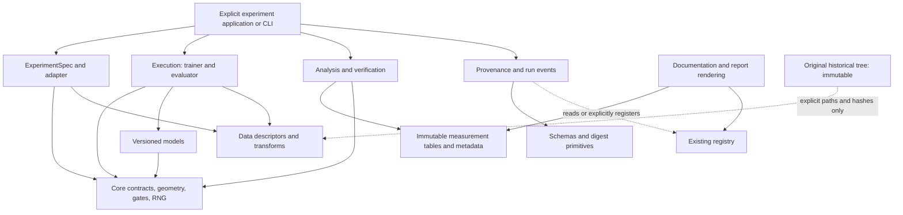
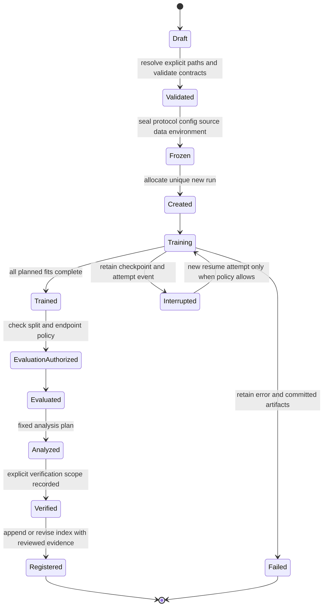

# Phase 3 proposed research architecture

Verified 2026-11-22 against local workspace E:/CoNN; repository remote nu-ink/frank_h_torralva-conn, branch initial-repository, HEAD d06568ac87bf370eba627858a12997d88cf30208.

Evidence labels: **V** = verified source/file fact; **S** = static-analysis inference, with limits; **P** = architectural proposal; **U** = unresolved. No project module was imported, no checkpoint loaded, and no training, evaluation, research test, package installation or runtime framework creation was performed. Byte identity and AST similarity are not behavioral-equivalence claims.

Reports: [inventory](PHASE3_SOURCE_INVENTORY.md) | [dependencies](PHASE3_DEPENDENCY_MAP.md) | [compatibility](PHASE3_BEHAVIORAL_COMPATIBILITY.md) | [proposal](PHASE3_PROPOSED_ARCHITECTURE.md) | [risks](PHASE3_RISK_ASSESSMENT.md). Navigation foundation: [registry guide](../../registry/README.md).

## Architectural decision

**P:** Evolve future experiments through explicit, versioned contracts over small reusable components. Keep all historical code, configurations, run paths and artifacts intact. The existing registry remains the navigation/provenance foundation; it is not an execution engine or an automatically updated source of scientific authority. This report defines interfaces and boundaries only. No package, adapter, launcher, environment or runtime framework is created.

**S:** A coherent framework is feasible because math, data generation, model construction, training, analysis and provenance already exist. The main work is removing coupling and documenting behavior, not inventing a universal trainer. The compatibility report explains why sharing one new loop or gate implementation across every historical study would be unsafe.

## Seven conceptual layers: existing state and work required

| Layer | Existing evidence | Assessment | Future responsibility |
| --- | --- | --- | --- |
| Core mathematics and models | [gaussian_gate](../../conn_experiment_01/src/conn_exp/gates.py#L20); [CoNNMLP](../../conn_experiment_01/src/conn_exp/models.py#L41); [ContextFactor](../../CoNN_Associative_Relationships/src/conn_assoc/phase3_context.py#L25) | Implemented, with divergent domains, heads and precision policies | Pure geometry/gates/schedules plus explicit model specifications; no paths, dataset loading or run creation |
| Data ingestion/preprocessing | [generate_dataset](../../conn_experiment_01/src/conn_exp/data.py#L151); [prepare](../../conn_experiment_01/src/conn_exp/har_data.py#L70); [load_prepared](../../CoNN_Associative_Relationships/src/conn_assoc/data.py#L105) | Implemented but mixed with fixed historical paths and write-heavy audit/preparation | Read-only dataset descriptors, versioned transformations, split/scaler lineage and guarded test access |
| Experiment definitions/configuration | [load_config](../../conn_experiment_01/src/conn_exp/config.py#L288); [Config](../../experiments/experiment_04/src/conn_exp04/core.py#L40) | Multiple study-specific schemas; protocol constraints partly embedded in code | Immutable validated ExperimentSpec with explicit treatment/control, selection, RNG and endpoint policies |
| Training/evaluation | [train_condition](../../conn_experiment_01/src/conn_exp/train.py#L174); [train_job](../../CoNN_Associative_Relationships/src/conn_assoc/phase23_core.py#L203); [evaluate_run](../../experiments/experiment_04/src/conn_exp04/runner.py#L194) | Implemented, fragmented; losses, batching, resume and embargo differ | Adapters over explicit model/data/sampling/endpoint contracts; test evaluation separated from selection |
| Statistics/verification | [paired_summary](../../conn_experiment_01/src/conn_exp/evaluation.py#L68); [bootstrap](../../CoNN_Associative_Relationships/phase3b_context_diagnostics/src/reporting.py#L8); [paired](../../experiments/experiment_04/src/conn_exp04/analysis.py#L13) | Implemented but estimands, nonfinite handling, multiplicity and side effects differ | Pure metric/contrast operations with declared inference units; separate check-only and artifact-writing operations |
| Tracking/provenance | [registry/experiments.yaml](../../registry/experiments.yaml); [registry/runs.csv](../../registry/runs.csv); [seal_sources](../../CoNN_Associative_Relationships/phase3b_context_diagnostics/src/training.py#L21) | Navigation and many seals/manifests exist; no common transactional schema or per-fit source lineage | Versioned run records, artifact digests, dependency closure and immutable event/attempt lineage |
| Research documentation | [README.md](../../README.md); [docs/research_validation/README.md](../../docs/research_validation/README.md) | Extensive dated material; current/proposed/historical status can diverge | Current navigation plus dated protocols, decisions and result interpretations with explicit supersession |

## Suggested future module boundaries

The following tree is a **proposal**, not a filesystem migration or a claim that these modules exist. Names should be checked for packaging conflicts before implementation.

```text
src/conn/
  core/
    geometry.py       # coordinates, axes, distances
    gates.py          # named domain/gradient/energy policies
    schedules.py      # pure update-index -> gate-state functions
    rng.py            # versioned streams and seed composition
    contracts.py      # tensor/layout/model identity contracts
  models/
    gated_mlp.py      # binary/multiclass heads from explicit ModelSpec
    context.py        # separately versioned context-factor variants
  data/
    descriptors.py   # immutable dataset/split/scaler identities
    synthetic.py     # versioned DGP adapters
    har.py           # archive/prepared readers with explicit locations
    transforms.py    # versioned fits/transforms, no hidden refits
    access.py        # development/audit/test access capabilities
  experiments/
    spec.py          # validated scientific design and endpoint schema
    adapters/        # future studies; opt-in historical readers only
  execution/
    sampling.py      # frozen named batch algorithms
    trainer.py       # orchestration contracts, not one assumed-equivalent loop
    evaluator.py     # explicit split/endpoint/access policy
    checkpoints.py   # schema-specific readers and new-format writers
    runtime.py       # explicit device/determinism/thread policy
  analysis/
    metrics.py       # class universe, weighting, missing-class policy
    contrasts.py     # estimator/inference-unit contracts
    inference.py     # versioned intervals/tests/resampling/multiplicity
    verification.py  # pure checks separate from executing/writing commands
  provenance/
    identities.py    # separate file/config/tensor digest namespaces
    manifest.py      # source and artifact dependency graph
    events.py        # immutable attempts/failures/completions
    registry_io.py   # schema validation and explicit registration
registry/            # existing navigation; original files remain in place
docs/architecture/   # these assessment reports only in this phase
```

Historical conn_exp, conn_assoc, nested Phase 3B, Experiment 04, organized copies, all old runs and source snapshots remain at their original locations. A future distribution version does not retroactively version historical runs. Separate explicit historical-profile readers may refer to those locations; no default import path should silently redirect old source to the new package.

## Import direction and composition

**P:** Arrows below mean caller/consumer depends on the target. The application layer composes all services. Core cannot depend on orchestration, data storage, statistics, the registry or documentation. Core model interfaces may use Torch, but report/rendering dependencies should not be mandatory for importing a gate or data descriptor.



The dashed historical arrow denotes a source of explicitly referenced assets, not a Python import from new data code into a historical trainer. Legacy execution, if approved separately, must have its own captured environment and dependency closure. CLI orchestration records effects; low-level code returns values without creating run directories or mutating global Torch settings on import.

## Suggested public interfaces

These signatures are design sketches, **not implemented code** and not an approved compatibility layer. Types denote contracts rather than existing Python classes.

```python
# Pure numerical behavior: all policy defaults must be explicit/versioned.
make_geometry(layout: LayoutSpec, *, dtype, device) -> Geometry
make_gate(distance, bandwidth: Bandwidth, *, domain_policy, gradient_policy) -> GateState
schedule_at(spec: ScheduleSpec, update_index: int) -> ScheduleState
seed_for(plan: SeedPlan, stream: str, *, fold=None) -> SeedDescriptor
build_model(spec: ModelSpec, initial_state: InitialState) -> ModelAdapter

# No hidden fitting, selection, download, or official-test access.
open_dataset(ref: DatasetRef, split: SplitRef, *, access: AccessPolicy) -> DatasetView
fit_transform(spec: TransformSpec, fit_view: DatasetView) -> TransformArtifact
make_batches(plan: SamplingPlan, dataset: DatasetView) -> BatchPlan

# Scientific execution is explicit and always targets a new authorized run.
create_run(spec: ExperimentSpec, provenance: SourceClosure) -> RunHandle
train_fit(fit: FitSpec, data: DatasetView, model, batches: BatchPlan,
          *, outputs: ArtifactSink, runtime: RuntimePolicy) -> FitResult
evaluate_endpoint(endpoint: EndpointSpec, checkpoint: CheckpointRef,
                  data: DatasetView, *, access: AccessPolicy) -> MeasurementTable

# Analysis cannot train, select extra endpoints, or silently drop rows.
compute_metric(predictions: PredictionTable, spec: MetricSpec) -> MetricTable
estimate_contrast(measurements: MeasurementTable, plan: AnalysisPlan) -> ContrastResult
check_integrity(manifest: Manifest, *, checkpoint_loading=False) -> CheckReport
write_check_report(report: CheckReport, destination: NewArtifactPath) -> ArtifactRef
register_run(record: RunRecord, *, expected_registry_revision) -> RegistrationResult
```

### Contract requirements

- **Geometry/GateState:** shape/axis order, coordinate meaning, tau/d50 units, floor/error policy, output dtype/device, detach behavior, control permutation identity and exact-dense flag. Do not overload a finite bandwidth value to mean exact ones.
- **ModelSpec/InitialState:** binary or multiclass head, hidden sizes, initialization algorithm and draw order, context variant/storage/forward dtype, parameter grouping and complete state-key schema.
- **DatasetRef/SplitRef:** original relative location, source hash, DGP or vendor version, row/subject IDs, train/validation/test role, layout and preprocessing hashes, scaler fit population and access policy. Shape equality is insufficient.
- **SeedPlan/BatchPlan:** RNG implementation/version, stream derivation and effective seeds, epoch/cycle behavior, saved index-plan hash and code/mask plan. The historical algorithms stay named and distinct.
- **ExperimentSpec:** treatment/control identity, equal-budget/selection rules, configuration schema and digest, endpoints, evaluation permissions, interruption/resume semantics and analysis plan. Reading the registry is not authorization to execute a study.
- **EndpointSpec:** completed optimizer updates, zero-based gate/update index, weight checkpoint, gate mode, input mask/context code, split access and allowed evaluation count. Selection policy is separate from reporting endpoint choice.
- **MetricSpec/AnalysisPlan:** class universe, absent-class/zero-division behavior, pooling/subject weights, nonfinite policy, pairing keys, independent sampling unit, interval/test/resampling seed, multiplicity family and practical threshold. Record descriptive versus confirmatory interpretation.
- **ArtifactSink/RunHandle:** exclusive new identifiers, explicit output roots, atomic writes, checkpoint schema, immutable completion/event records, checked dependencies and parent-attempt lineage. A check report is a value until an explicit writer persists it.

## Experiment execution lifecycle

**P:** Adopt this lifecycle for future studies after approval. It does not change historical state labels or reinterpret existing failed runs. The registry keeps its study/attempt distinction; per-fit detail belongs in an associated manifest rather than changing what the existing CSV counts.



A deliberately unevaluated pilot may stop at Trained with a terminal policy record; no timeout or absence of evaluation promotes it to failure. A failed attempt remains failed even when a later attempt completes the parent study. Analysis/report repair creates a child artifact/attempt with its own source identity, leaving the original training seal and failure evidence intact. A new scientific definition creates a new protocol/study version, not a resume.

## Versioning and provenance strategy

**P:** Use four separate version axes: (1) package/API version, (2) scientific behavior/profile version, (3) protocol/configuration/analysis schema version, and (4) artifact/checkpoint/digest format version. A compatible Python signature does not imply the same scientific behavior. An invalid-input rule, seed mapping, class aggregation, cast, schedule boundary, baseline path or sample-order change receives a new behavior version even if the API still accepts the same arguments.

For new runs, freeze a source dependency closure before execution: tracked revision when available, dirty-state or content hashes, exact project module identities including transitive reused modules, lock/environment records, hardware/runtime policy, original and derived config digests, protocol bytes, raw/derived dataset/split/scaler/layout hashes, seed and batch/mask plans, plus the analysis specification. Record the source identity per fit **and per resume attempt**, not just one final delivery snapshot. Record analysis source separately from training source. No historical source-to-fit mapping should be invented to fill a new schema.

Maintain separate digest namespaces: file-byte SHA-256, canonical structured-config identity with named serialization rules, tensor/array identity including shape/dtype/layout, and source closure identity. A changed serializer cannot invalidate or overwrite an old seal; a new record references the old hash as its parent. Immutable artifacts retain original paths; portability is achieved by an explicit location resolver over identities and recorded mappings, not by editing original manifests.

The existing [registry/runs.csv](../../registry/runs.csv) and [registry/experiments.yaml](../../registry/experiments.yaml) remain human-reviewable navigation. A future additive schema may reference richer manifests and per-fit lineage. Such schema changes need explicit approval; these files were not edited. Completion, evidence verification and independent reproduction remain distinct fields. Git HEAD now exists, but does not authenticate the source revision of runs captured before Git.

## Historical compatibility and environment policy

**P:** Preserve historical entry points in their original environments. A new implementation may expose opt-in readers for each historical checkpoint schema and explicit adapters for scientific behavior profiles. It must not replace import targets using global sys.path edits or monkeypatching to make an old run appear portable. Validate dependency closure, tensor schema and data identities before any authorized replay. A conversion produces new output with original parent hashes and a stated comparison scope.

The framework should record an exact supported environment per profile instead of promising bitwise identity across Python/Torch/NumPy/backend versions. Core import should not initialize CUDA or change global flags. Runtime selection, deterministic settings, thread limits, precision and benchmark measurement boundaries should be explicit. Dependencies needed only for analysis/rendering should be isolated from math/data consumers.

## Approval gates, validation and rollback

| Gate | Proposed work | Acceptance evidence | Preservation and rollback |
| --- | --- | --- | --- |
| 1 | Agree on contracts and behavior IDs | Review all C01-C14 compatibility findings and unresolved scientific choices | Documentation only; originals remain untouched |
| 2 | Implement small pure components in new locations, if authorized | Domain/error, dtype/device, gradient, schedule-boundary and seed/order fixtures against named versions | Keep original imports and entry points; revert only new files |
| 3 | Add one future experiment adapter, if authorized | New-run output isolation, complete source/data closure, fixed endpoints and reproducible fixture results | Original runs/configs remain the reference; new outputs stay separately identified |
| 4 | Add checkpoint and legacy readers, if authorized | Schema validation, original hashes unchanged, permitted roundtrip/replay comparisons recorded | Never rewrite an original checkpoint or manifest |
| 5 | Evaluate performance/portability, if separately authorized | Same hardware/runtime/batch/diagnostic scope; warm-up/synchronization and scientific comparisons | Retain both implementations; adopt only on supported evidence |

No gate has been executed by writing this proposal. Import/evaluation/optimizer-based fixtures require authorization consistent with the assessment restrictions. Rollback for any future additive development should mean returning callers to the original version, not attempting to reverse edits inside historical evidence.

## Open decisions

**U:** Maintained public API and ownership; required replay target (artifact inspection, statistical recomputation, numerical or bitwise training replay); exact per-fit historical stage lineage; resolution of the Phase 3B scientific definitions; supported environment matrix; and handling of already-used test data in future confirmatory protocols. The smallest next step is approval of the contract/versioning design, not a broad refactor.
