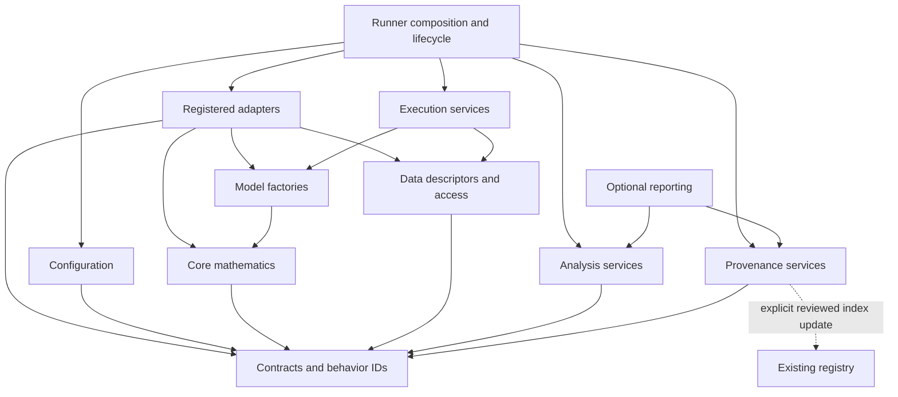

# Repository and package architecture

Status: **Proposed**. Design-freeze candidate **DF-2026-11-22-v1**. Prepared 2026-11-22 against branch initial-repository, HEAD 7a89cd51b1dcfb3526fd9212b0b395cd91317be7. No ADR is accepted and no runtime design is implemented by this documentation.

Labels: **V** verified current file/source fact; **S** static inference; **P** proposed requirement; **U** unresolved evidence or approval. Requirements below are normative only if explicitly approved. Historical provenance is never filled by inference.

Design documents: [architecture decisions](ARCHITECTURE_DECISIONS.md) | [interface contracts](INTERFACE_CONTRACTS.md) | [behavioral version matrix](BEHAVIORAL_VERSION_MATRIX.md) | [reproducibility contract](REPRODUCIBILITY_CONTRACT.md) | [repository architecture](REPOSITORY_ARCHITECTURE.md) | [github workflow](GITHUB_WORKFLOW.md) | [migration and validation plan](MIGRATION_AND_VALIDATION_PLAN.md).

## Preservation boundary and proposed layout

**V:** Current research lives in conn_experiment_01, CoNN_Associative_Relationships (including Phase 3B), experiments/experiment_04, original result trees and ORGANIZED_EXPERIMENTS. The current registry provides eight experiment identities and 32 run-related records. These locations remain unchanged. Immutable historical is a preservation responsibility, not a claim that every working copy was historically frozen at the same time.

**P:** The following is a future layout. Entries marked future are not created by this phase. Existing research trees are neither moved into an archive nor redirected to new imports.

```text
E:/CoNN/
  conn_experiment_01/                 existing research, preserved
  CoNN_Associative_Relationships/      existing research, preserved
  experiments/experiment_04/          existing research, preserved
  ORGANIZED_EXPERIMENTS/              existing evidence packets, preserved
  AUDIT_20261020/                     existing audit, preserved
  registry/                          existing index, reviewed changes only
    manifests/                       future additive manifest references
  docs/architecture/phase4/           this documentation package
    adr/                             eight Proposed ADRs
  pyproject.toml                     future distribution metadata only
  src/conn/                          future package, opt-in
    contracts/                       typed closed schemas, errors and IDs
    core/                            geometry, gates, schedules, RNG
    models/                          head/state/context behavior variants
    data/                            descriptors, readers, transforms, access
    configuration/                   strict config/profile validation
    execution/                       sampling, trainer/evaluator adapters
    analysis/                        metrics, inference, pure verification
    provenance/                      hashes, artifacts, events, registry IO
    adapters/                        registered scientific study definitions
    runner/                          composition root, lifecycle and CLI
    reporting/                       optional output renderers
  configs/future/                    future complete study/profile configs
  environments/future/               future pinned lock/build profiles
  runs/future/<experiment>/<run>/     future runs, never old destinations
    specification/
    provenance/
    attempts/<attempt>/fits/<fit>/
    artifacts/
    analysis/<analysis-version>/
  tests/future/                      future tests; not historical test edits
    static/
    contracts/
    numerical/
    lifecycle/
    checkpoint/
    fixtures/                        small licensed immutable fixtures only
```

No proposed source/config/test/run paths above are clickable links to nonexistent files. Actual current evidence is linked below. The root pyproject and new package are future additions, not changes to historical distribution metadata. Analysis/report subversions identify distinct source and parent artifacts; no regeneration overwrites an earlier result.

## Dependency direction and import rules

Arrows mean consumer depends on target. All services below are Proposed; the registry is already present.



| Package | Allowed project dependencies | Prohibited responsibilities |
| --- | --- | --- |
| contracts | standard library only | Loading research modules, allocating tensors/devices, writing artifacts |
| core | contracts; explicitly declared numerical libraries | Dataset discovery, run paths, registry writes, report rendering, global runtime mutation |
| models | contracts and core | Historical run lookup, preprocessing, test selection, report generation |
| data | contracts and explicit core layout contracts where needed | Model training, hidden fitting, automatic download, test-outcome-based transforms |
| configuration | contracts and a metadata-only behavior catalog | Importing arbitrary modules named in configuration; executing adapters during plan |
| execution | contracts, core/models/data interfaces | Sibling-path discovery, undeclared scientific defaults, automatic evaluation/selection |
| analysis | contracts and numerical/statistical kernels | Training, model test prediction, hidden pairing changes or automatic source repair |
| provenance | contracts and storage/hash/schema utilities | Calling trainers/evaluators; interpreting completion as scientific success |
| adapters | approved contracts/core/models/data/execution interfaces | Mutating import paths, monkeypatching ROOT, writing outside the RunContext |
| runner | explicit composition of approved services | Unreviewed dynamic imports, shell commands from configuration, Git actions |
| reporting | analysis/provenance read interfaces and optional renderers | Re-executing experiments as a side effect of rendering |

Implementations use package-qualified imports. Deny sys.path append/insert, importlib file-loader execution, __import__ from user strings, relative workspace sibling discovery and implicit imports of historical code in future runtime modules. Standard relative imports within the new package are allowed when statically resolvable. Importing a mathematical or schema module must not create output folders, initialize CUDA, select a run, modify Torch process settings or contact services. Runtime flags are applied explicitly at authorized execution entry.

Metadata-only component planning uses a fixed reviewed allowlist of behavior IDs and implementation hashes, not arbitrary installed entry points or globbed Python files. Approved implementations may load lazily through known package bindings after validation. Historical raw artifacts are opened by identity/descriptor, not by importing historical orchestrators. A legacy reader/adapter is a separate opt-in dependency with declared support limits.

## Boundary mappings from existing code

| Existing verified area | Future target | Required preservation condition |
| --- | --- | --- |
| [pairwise_abs_distance](../../../conn_experiment_01/src/conn_exp/geometry.py#L26) and [gaussian_gate](../../../conn_experiment_01/src/conn_exp/gates.py#L20) | core geometry/gates | C01/C02 domains, axes, floors and arithmetic remain named; do not infer equivalence |
| [GatedLinear.forward](../../../conn_experiment_01/src/conn_exp/models.py#L23) and [Model](../../../CoNN_Associative_Relationships/phase3b_context_diagnostics/src/models.py#L24) | models and explicit C03/C11/C12 variants | Gradient detach, head, initializer, parameter groups and precision/cast points remain explicit |
| [prepare](../../../conn_experiment_01/src/conn_exp/har_data.py#L70) and [load_prepared](../../../CoNN_Associative_Relationships/src/conn_assoc/data.py#L105) | data readers/transforms | Preserve original arrays/scalers and lineage; new preprocessing creates new derived versions |
| [train_job](../../../CoNN_Associative_Relationships/src/conn_assoc/phase23_core.py#L203) and [evaluate_run](../../../experiments/experiment_04/src/conn_exp04/runner.py#L194) | execution interfaces plus adapters | Preserve batching, endpoint timing, loss, finite checks, test policy and resume capability |
| [paired_summary](../../../conn_experiment_01/src/conn_exp/evaluation.py#L68) and [paired](../../../experiments/experiment_04/src/conn_exp04/analysis.py#L13) | analysis kernels/plans | Explicit estimand, finite/missing rule, sampling unit, inference RNG and multiplicity |
| [registry/README.md](../../../registry/README.md) and existing source/artifact manifests | provenance with reviewed index references | Keep old schemas/bytes; future per-fit/per-attempt closure is additive |

## Configuration and testing architecture

Future configuration is a closed schema with every scientific default resolved and behavior variant named. configs/future files are new protocol inputs. Historical YAML/JSON is read only by named legacy schema adapters; no migration rewrites it. New environment profiles have exact dependencies and build identities; original environments are not upgraded. Optional analysis/reporting groups prevent matplotlib/SciPy/browser renderers from becoming prerequisites for importing a pure geometry function.

Future tests are separated by effect level. Static tests parse/schema-check/hash/link/import-graph declarations without imports that execute research. Numerical tests may invoke tensor/autograd/metric kernels only under explicit future approval. Lifecycle/checkpoint fixtures exercise new isolated outputs and approved optimizer or restore scope; historical tests that write beneath active runs are not run as blanket regressions. No fixture should contain unlicensed data, secrets or an unreviewed executable pickle. Existing source samples can be identified by hash and read in place; small copied fixtures require attribution and a source identity, never claim to be the original experiment.

## Artifacts, data storage and portability

Current [.gitignore](../../../.gitignore) ignores checkpoints/arrays/archives while retaining CSV/JSON/log evidence, including one explicit oversized diagnostics CSV exclusion. Current [.gitattributes](../../../.gitattributes) assigns LF to most source/doc/config text, CRLF to Windows scripts and binary treatment to model/data formats. These files are preserved unchanged.

Future artifact locations are resolved from registered identity plus explicitly approved storage roots; identity and location are separate. Do not use symlink/path traversal to escape write roots or rely on current working directory. The only permitted writable research area for a future run is its new output root. Original files remain read-only inputs even if the account technically has write access. Remote publication, LFS adoption, retention service and artifact access permissions remain U06; no upload is implied by a registry reference.

## Release/package contract

One future distribution exposes the new conn package. Code version, C01-C14 behavior selection, protocol schema, checkpoint schema, environment lock and run/artifact identities are released separately but cross-referenced. Keep a small public facade for the ten interfaces; private implementation modules cannot be imported by experiments outside their declared adapter contracts. New adapters declare supported behavior/environment/checkpoint combinations and scientific limits. No declaration of production readiness or general associative memory follows from packaging.

## Approval boundary

This layout and dependency graph are design requirements pending ADR approval. No runtime framework, package directories, lockfile, test file, CI configuration, branch, CODEOWNERS file or repository setting is created in Phase 4. Use M0..M7 gates before additive implementation.
