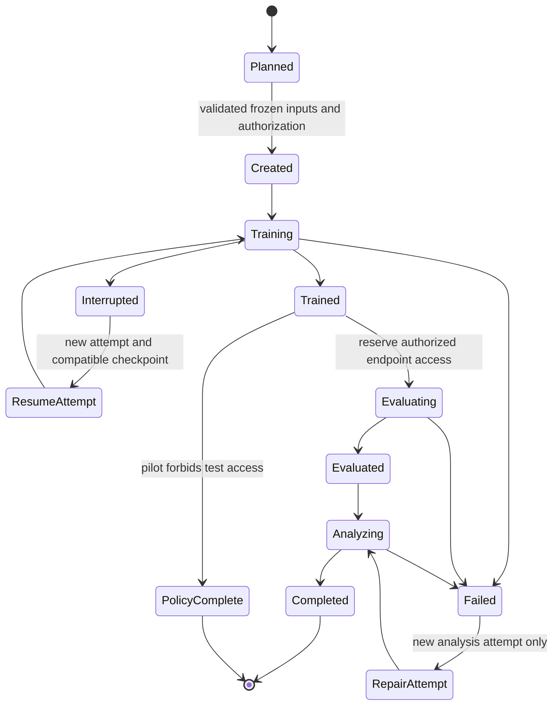

# Reproducibility contract

Status: **Proposed**. Design-freeze candidate **DF-2026-11-22-v1**. Prepared 2026-11-22 against branch initial-repository, HEAD 7a89cd51b1dcfb3526fd9212b0b395cd91317be7. No ADR is accepted and no runtime design is implemented by this documentation.

Labels: **V** verified current file/source fact; **S** static inference; **P** proposed requirement; **U** unresolved evidence or approval. Requirements below are normative only if explicitly approved. Historical provenance is never filled by inference.

Design documents: [architecture decisions](ARCHITECTURE_DECISIONS.md) | [interface contracts](INTERFACE_CONTRACTS.md) | [behavioral version matrix](BEHAVIORAL_VERSION_MATRIX.md) | [reproducibility contract](REPRODUCIBILITY_CONTRACT.md) | [repository architecture](REPOSITORY_ARCHITECTURE.md) | [github workflow](GITHUB_WORKFLOW.md) | [migration and validation plan](MIGRATION_AND_VALIDATION_PLAN.md).

## Scope and conformance

**P:** Schema **conn-run-1** describes future runs, fits, attempts, events and artifacts. It does not migrate or supplement historical manifests automatically. An old unknown fact remains unresolved in a separately attributed annotation. A run cannot claim conformance merely because it has a timestamp or Git revision. Conformance is stage-aware and distinct from completion, verification and independent scientific reproduction.

The minimum supported future claim is attributable artifact identity plus declared source/data/configuration/behavior/environment lineage. Numerical fixture or training replay claims additionally require their own saved validation scope and results. A local freeze record is not an external preregistration or proof that an author could not have changed files earlier.

## Required run manifest fields

All fields below are required for a newly conforming run, except explicitly conditional values. Unknown is not a default for a future required field. Explicit pending_realization and not_applicable_by_policy are allowed only where described and bound to a frozen plan.

| Field | Type/cardinality | Required meaning and rejection rule |
| --- | --- | --- |
| schema_id | literal conn-run-1 | Unsupported versions fail; no guessing from file names. |
| run_id, experiment_id, stage | nonempty strings; stage smoke/pilot/development/confirmatory | Stable experiment registry identity; unique new run ID allocated with timestamp+random suffix and exclusive collision check. No historical run reuse. |
| protocol | ProtocolRef | ID, original file SHA-256, frozen_status, frozen_at_utc, freeze evidence and approved scope. Execution requires frozen; timestamp is attributed, not independently authenticated. |
| source | SourceClosure | Full Git revision, clean/dirty flag, exact logical relative source file hashes, source closure digest, entry point/adapter ID, transitive project module bindings, resource files and dirty-content snapshot if permitted. Confirmatory runs require clean reviewed source. |
| behavior | exactly 14 BehaviorSelection records | One C01-C14 future ID each, mandatory variant parameters/digest, implementation/source binding and reference-suite version. No implicit variant choices. |
| datasets | one or more DatasetDescriptor references | Raw/parent artifacts, dataset/DGP version, representation/layout, feature/channel order, row IDs, subject IDs where relevant, schema/dtype/shape and byte hashes of realized arrays. |
| splits | descriptor for every used split | Membership/order digest, role, row/subject disjointness policy, split algorithm/seed and label universe. Reused subjects/CV overlap disclosed, not hidden by a new ID. |
| preprocessing | explicit transform sequence | Behavior IDs, code hashes, parameters, fit-population/split IDs, scaler/coordinate hashes, numerical cast order and parent data IDs. Identity/no transform is explicit. |
| configuration | original bytes ref plus normalized digest | conn-experiment-1 schema, all defaults resolved, derived values and conn-json-1 identity; no in-place reserialization of frozen historical files. |
| randomness | SeedPlan and realized plan refs | Base/effective stream seeds, RNG implementations and versions, composition/offset/draw order, fold/replicate identifiers, batch/permutation/mask/context-code artifacts and cursors. |
| environment | immutable ArtifactRef for environment | Python executable/version/build, OS/architecture, package versions and resolved build/wheel/lock hashes, dependency graph/optional groups, relevant numerical libraries and interpreter flags. Exclude credentials. |
| runtime | immutable RuntimePolicy artifact | Actual requested/used device, model/hardware IDs, backend/driver versions where relevant, thread counts, deterministic/TF32/MKLDNN flags, storage/compute/output dtype and cast points, fallback policy. |
| training | TrainingSpec + ModelSpec | Head/loss/dimensions, initial-state digest, optimizer options/groups, update/batch budgets, schedule and measurement timing, finite-check cadence, wall budget and resume policy. |
| evaluation | EvaluationPolicy | Protected splits, allowed endpoints, completed_updates/gate_step, checkpoint and gate/context mode, selection prohibition/rule, access grants and cumulative test-read/endpoint budget. |
| analysis | AnalysisPlan artifact | Metric schema, class universe, pooling/weights, pairing, inference unit, finite/missing policy, confidence/test method, RNG/tie/sidedness/multiplicity and practical threshold; descriptive/confirmatory interpretation. |
| checkpoint_schema | conn-checkpoint-1 plus capability | Model/state schema and endpoint_only/resumable distinction. Any historical reader uses a separately named schema/profile. |
| artifacts | manifest of every published output | Artifact ID, role, logical path, media/schema type, byte length, hash namespace/value, writer/source/attempt, completion state and parent dependencies. No unverifiable success if outputs are missing. |
| attempts and fits | immutable IDs and parent links | Operation, adapter, source closure and start/terminal event per attempt; per-fit source and resume checkpoint lineage. Parent study completion does not overwrite child failure. |
| execution_status | lifecycle projection | planned/created/training/trained/evaluating/evaluated/analyzing/completed/failed/interrupted as applicable; projection derived from immutable events. |
| verification_status | independent object | not_run/passed/failed/unresolved plus scope, verifier source/environment, checked refs, thresholds and report hash. Training completion does not imply verification. |
| scientific_interpretation | independent object | descriptive/confirmatory, success criteria outcome and limitations. Practical/statistical success are distinct from execution status. |
| independent_reproduction | evidence-qualified object | not_established by default; promotions require attributable executor, independence scope, exact inputs/procedure/environment and saved comparison evidence. |
| authorization_and_limits | attributed references | Approved operation, compute/output/access limits, data publication scope and approvals. A registry record or successful validation never grants execution permission. |

## Stage-aware sealing

1. Before output allocation, validate the complete study specification, source/profile/environment references, frozen protocol and authorization. A draft can be planned, never executed.
2. Before fitting, seal all training/validation bytes, realized sample/mask/batch plans and initial state. No selection or derivation may access protected test outcomes.
3. A synthetic test split scheduled for post-fit generation must already have a frozen generator/source/seed recipe commitment. Its realization digest may be pending_realization only until the evaluation operation generates and seals it **before model prediction**. The event records the recipe digest and realized bytes; seeds or generator cannot change based on observed outcomes.
4. A pilot whose frozen policy forbids test use may terminate at trained with a policy_complete event. Unmaterialized test bytes are not_applicable_by_policy, not invented hashes and not failed completion.
5. At each published artifact and terminal attempt, append exact available byte identities and dependencies. At completed evaluation/analysis, every actually consumed dataset/split must have a resolved identity. A missing required artifact or unresolved consumed source/data identity blocks verified conformance.
6. Seal analysis/reporting source independently of training source. A repaired report cannot retroactively alter the training seal or preregistration date.

## Digest namespaces and canonical encoding

**P:** A Digest is (namespace, algorithm=sha256, value=64 lowercase hexadecimal characters). These namespaces are distinct and never compared as if interchangeable:

| Namespace | Encoding |
| --- | --- |
| file-byte-1 | SHA-256 of actual file bytes; no newline, Unicode or format conversion. This is the preservation identity. |
| config-object-1 | conn-json-1: UTF-8, ensure_ascii=True, sorted string keys, compact separators comma/colon, allow_nan=False, no trailing newline. Reject duplicate keys before normalization; tuples normalize to arrays; preserve -0.0 versus 0.0. Interpreter/encoder version is captured. |
| array-content-1 | Prefix CoNN/array/1 followed by a NUL byte; 8-byte unsigned big-endian header length; conn-json-1 header with explicit dtype/byte order, shape and order=C; 8-byte payload length; contiguous raw bytes in that declared encoding. Unsupported dtype codecs fail rather than silently cast. |
| model-content-1 | Prefix CoNN/model/1 and NUL; canonical sorted mapping of parameter/buffer names to array-content-1 digests plus state-schema digest. Parameter eligibility/groups are included in the separate model schema. |
| source-closure-1 | Canonical mapping of logical source/resource paths to file-byte-1 identities plus explicit dependency bindings/entry point; exclude the closure_digest field itself. Absolute machine locations are separate resolver metadata. |

Configuration_digest is calculated over the resolved configuration object **excluding its own configuration_digest field**, not over the envelope containing it. Parameter digests cover only the selected parameter object. An ArtifactRef always carries file-byte-1 for its serialized artifact; structured identities may be recorded alongside it. Event predecessor hashes refer to the previous event file bytes, not a self-referential digest field. Historical digest rules remain unchanged even where they omit metadata that the future format requires.

## Event ledger and attempt representation

ProvenanceEvent uses the type in INTERFACE_CONTRACTS.md: schema_id, event_id, previous_event_digest, run_id, attempt_id and a closed payload. Payload requires sequence (strictly increasing per run), operation, event_kind, event_time_utc, fit_id where applicable, actor/tool identity, source/spec digests, status and input/output references. Per-run compare-and-swap against the predecessor and a single-writer lease prevent divergent append branches. Partial files never become successful events through inference. Materialized status summaries may be regenerated into new artifacts; immutable events stay unchanged.

| Case | Required record | Resume/repair rule |
| --- | --- | --- |
| Failed | Terminal failed attempt with exception class/message, attributable source/environment, last committed update/event and all complete/partial artifact refs | Failure stays failed. Retrying creates a new attempt linked to it; no silent deletion or success replacement. |
| Interrupted | Interrupted event with signal/cause, committed checkpoint, next cursor and scope of uncommitted work | Resume allowed only when complete_state_only was frozen and the checkpoint passes every compatibility check. |
| Resumed | New attempt_id, parent attempt/checkpoint/hash, exact source/profile/environment, restored RNG/plans/cursors and allowed replay window | No provenance inheritance by assumption. Changed scientific policy creates a new run/protocol; source changes need explicit compatibility evidence and approval. |
| Repaired analysis/report | New operation=repair attempt, parent artifacts, failure reference, repair source/diff identity, stated semantic scope and before/after result comparisons | Preserve originals and training seal. Changed statistical definitions require a new analysis/protocol identity, never label it serialization-only without evidence. |
| Unevaluated pilot | trained plus policy_complete terminal event identifying forbidden test access | Not failed and not evaluated. Verification may validate training artifacts without model test predictions. |
| Storage/ledger failure | Unregistered operation with preserved available partial bytes and explicit missing durable event | Never infer completed or passed; reconcile with attributable external logs in a new event when safe. |

The diagram shows operation progression; terminal attempt events remain immutable. The Failed-to-RepairAttempt edge creates a new child, not a mutation of the failed attempt. Training retry also creates a new attempt; scientific changes create a new run. Verification is a separate status dimension and is deliberately absent as an implied completion state.

## Checkpoint envelope: conn-checkpoint-1

Required envelope fields: checkpoint_id; run/fit/attempt IDs; capability; protocol/config/source-closure/behavior/environment/runtime/model-spec/state-schema digests; completed_updates and next_update_index; endpoint gate/context state; payload artifacts with individual byte hashes; dataset/split/scaler/layout identities; optimizer group/schema identity; RNG and sampling cursor schema; producing event/parent checkpoint. Model tensor payload uses an explicitly pinned tensor-only Torch serialization profile loadable with weights_only=True, with JSON metadata kept outside object pickles. RNG/optimizer metadata and tensors use reviewed tagged primitive/tensor encodings, not arbitrary Python module instances. Codec availability and exact restore must be validated at M5; no claim that historical files meet this codec is made.

An endpoint_only checkpoint may explicitly omit optimizer/RNG/iterator state and must refuse resume. A resumable checkpoint requires model and optimizer state, all used Python/NumPy/Torch/accelerator RNG states, full batch/mask/context plans or authenticated deterministic recipes, next-update/sample cursor and any scheduler/scaler/accumulation state actually used. Unused state is explicitly not_applicable, not accidentally absent. Check keys/shapes/dtypes/head/eligibility and semantic versions before deserialization/restore. A schema-specific historical reader is opt-in and never upgrades capability by guesswork.

## Read-only verification, restoration and disclosure

Default integrity verification checks metadata, paths and bytes only. Forward passes, metrics from predictions, checkpoint deserialization and replay are separate requested scopes with explicit destinations/authorization. A CheckReport is a value until an explicit writer publishes it. Report whether data/outputs are complete, missing, changed, unavailable or unexecuted; never silently drop failed seeds or omitted fits. Record both window-level and subject/seed scope where relevant.

The current [registry/runs.csv](../../../registry/runs.csv) remains the preserved 32-record navigation index, not this new ledger. Future manifests are additive and registered only through reviewed updates. [registry/README.md](../../../registry/README.md) already distinguishes completion, evaluation and reproduction. This contract keeps that distinction and does not replace existing files.

## Conformance gates

T-P01 checks required schemas, digest namespaces, closure, membership, access policy and valid event transitions without model execution. T-P02 injects missing/partial/failed/resumed/repaired records, concurrency and immutable-terminal cases. T-C14 covers checkpoint identity and, only when separately authorized, restoration/replay. Unknown historical fields must remain unknown in every fixture. Independent reproduction requires separate evidence beyond these checks.
